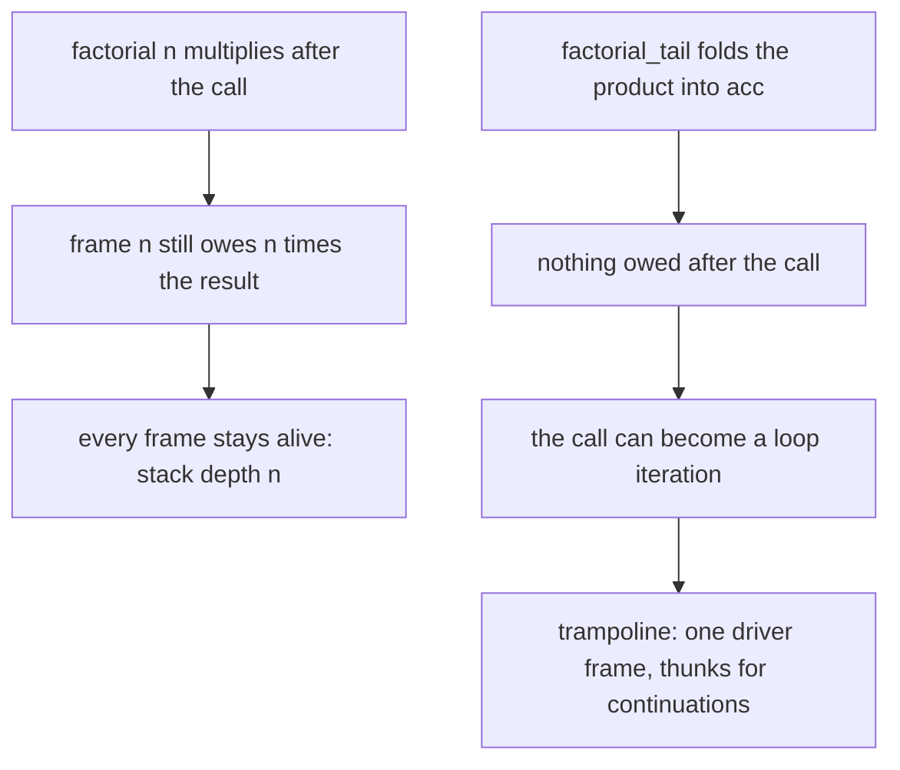
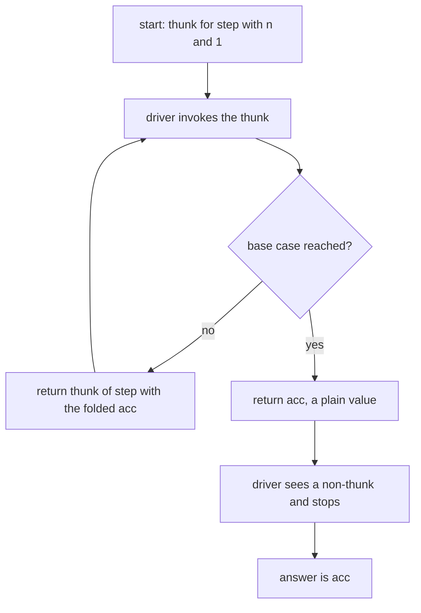
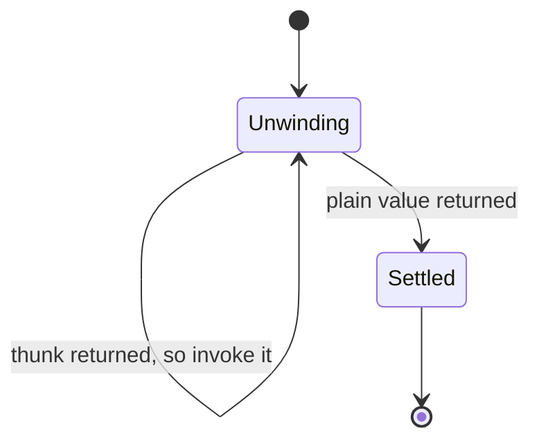
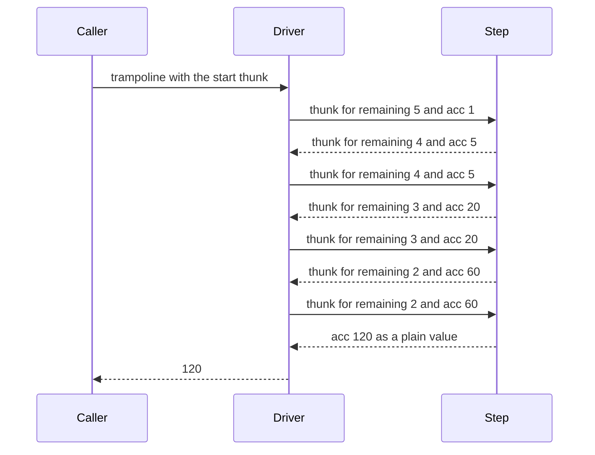

# 129 — Implement tail recursion (if language supports).

> **Tier:** Beginner · **CTCI chapter:** Ch 8 — Recursion and Dynamic Programming
> **Task spec:** [129-implement-tail-recursion-if-language-supports.md](../../../tasks/beginner/129-implement-tail-recursion-if-language-supports.md)
> **Solutions:** [Python](../../../solutions/python/beginner/129-implement-tail-recursion-if-language-supports/solution.py) ·
> [Java](../../../solutions/java/beginner/129-implement-tail-recursion-if-language-supports/Solution.java) ·
> [JavaScript](../../../solutions/javascript/beginner/129-implement-tail-recursion-if-language-supports/solution.js) ·
> [C#](../../../solutions/csharp/beginner/129-implement-tail-recursion-if-language-supports/Solution.cs)

## 1. Problem restatement

**Input:** a non-negative integer `n`, plus an accumulator that starts at `1`.

**Output:** `n!`, the product `1 · 2 · ... · n`. Every solution file uses the base case `n <= 1`,
so `0!` and `1!` both come back as the accumulator, `1`.

The parenthetical in the title — "if language supports" — is the whole point of the task:
**none of Python, Java, JavaScript or C# guarantees tail-call optimisation.** A factorial written
in tail-recursive *shape* still consumes one stack frame per call, and still dies on deep input.
Each solution file therefore ships three things:

1. a tail-recursive shape (`factorial_tail`) with an accumulator parameter,
2. an iterative reference (`factorial_iterative`), used to cross-check the deep answers,
3. a **trampoline** (`trampoline` plus `factorial_trampolined`) that keeps the recursive shape but
   replaces the call stack with an explicit driver loop.

| Call | Result | Where the claim comes from |
| --- | --- | --- |
| `factorial_tail(5, 1)` | `120` | asserted in all four files |
| `factorial_tail(20, 1)` | `2432902008176640000` | asserted in all four; 20! is the last factorial that fits a signed 64-bit integer |
| `factorial_trampolined(20000)` | `20000!`, equal to the iterative product | Python and JavaScript, which have unbounded integers |
| `factorial_trampolined(5000)` | `5000!`, equal to the iterative product | Java and C#, whose `long` overflows, so those two run the deep route on big integers |
| `factorial_tail(20000)` | raises | Python's default recursion limit is 1000 frames |
| `factorialTail(100000)` | raises | JavaScript throws `RangeError`: V8 has no TCO |

The task spec is a one-liner, so those assertions *are* the contract: the answer must be exact
(no floating point), the deep route must agree with the iterative reference, and the plain
tail-recursive route is *expected* to fail on deep input rather than to be quietly lucky.

## 2. Intuition

The textbook recursion multiplies **after** the call returns:

```text
function factorial(n)
    if n <= 1 then
        return 1
    end
    return n * factorial(n - 1)
end
```

The frame for `n` cannot be discarded while `factorial(n - 1)` runs, because it still owes the
caller a multiplication. `n` frames stay alive, each holding unfinished work. Rewriting with an
accumulator moves that work *before* the call:

```text
function factorial_tail(n, acc)
    if n <= 1 then
        return acc
    end
    return factorial_tail(n - 1, n * acc)
end
```

Now the recursive call is the **last** thing the function does, so in principle the frame could be
reused instead of stacked. That property is called being in *tail position* — and whether it saves
memory is entirely the runtime's business. A runtime with tail-call optimisation turns the call
into a jump; a runtime without one builds `n` frames anyway. That is exactly the situation for all
four languages here.

The insight that rescues the task without TCO: **if nothing is left to do after the call, then
"call myself" is just "continue with new arguments".** Continuing needs a loop, not a stack. Two
ways to exploit that:

* throw the recursion away and write the loop by hand (`factorial_iterative`);
* keep the recursive *shape*, but have each step return a **thunk** — a zero-argument closure that
  performs the continuation — and let one small driver loop unwind the thunks. That is the
  trampoline, and it is what makes `factorial_trampolined(20000)` finish in a language whose
  recursion limit is 1000 frames.



Same arithmetic, two memory shapes: the left branch keeps `n` frames alive at once, the right
branch keeps exactly one.

## 3. Algorithm

The trampoline route, step by step:

1. Write the recursive step so that its last action is either returning a finished value or
   returning a thunk describing the next call.
2. Wrap the initial call so the driver receives a thunk rather than a value.
3. Loop: while the driver holds a thunk, invoke it and keep whatever it returns.
4. When the step returns a plain value instead of a thunk, that value is the answer — the
   accumulator at the moment the base case fired.

```text
function factorial_tail(n, acc)
    if n <= 1 then
        return acc
    end
    return factorial_tail(n - 1, n * acc)
end

function factorial_iterative(n)
    acc ← 1
    for i ← 2 to n do
        acc ← acc * i
    end
    return acc
end

function step(remaining, acc)
    if remaining <= 1 then
        return acc
    end
    return thunk{ step(remaining - 1, acc * remaining) }
end

function trampoline(start)
    result ← start
    while result is a thunk do
        result ← result()
    end
    return result
end

function factorial_trampolined(n)
    return trampoline(thunk{ step(n, 1) })
end
```

`step` never calls itself: it *describes* the next call and returns. The driver is the only thing
that could recurse — and it does not, because `while` is a loop. The "is it a thunk?" test is what
terminates it: Python and JavaScript ask `callable(result)` / `typeof result === "function"`, Java
asks `result instanceof Thunk`, C# asks `result is Func<object>`. A finished big integer is simply
not a thunk.



Seen as a machine, the driver has exactly two states:



The trade is real: the loop is constant-depth, but each iteration allocates a fresh thunk, so the
trampolined route swaps stack frames for heap objects. What it buys is a depth bound that no
longer depends on the runtime's stack limit.

## 4. Worked example

Trace `factorial_tail(5, 1)`. The accumulator carries the partial product, so the table has no
"pending multiplication" column at all:

| Call | `n` | `acc` before | folded value `n * acc` | `acc` after |
| --- | --- | --- | --- | --- |
| 1 | 5 | 1 | 5 | 5 |
| 2 | 4 | 5 | 20 | 20 |
| 3 | 3 | 20 | 60 | 60 |
| 4 | 2 | 60 | 120 | 120 |
| 5 | 1 | 120 | base case fires | 120 |

Five calls, five frames — because the *shape* is tail-recursive but the runtime is not. Now the
same input through the trampoline: `step(5, 1)` returns a thunk, the driver invokes it and gets
`step(4, 5)`, four thunks are unwound in total, and the fifth call hits the base case and returns
`120` as a plain value.



Note the shape of that sequence: `Step` is entered five times yet never appears twice in a caller
chain — every arrow out of `Step` goes back to `Driver`. That is exactly what constant stack depth
looks like.

At `n = 20000` the difference stops being cosmetic. Python's plain route raises `RecursionError`,
because the call count exceeds the interpreter's default limit of 1000 frames, while
`factorial_trampolined(20000)` finishes and matches `factorial_iterative(20000)` exactly. The
JavaScript file makes the same point with `factorialTail(100000)`, which throws `RangeError`.

## 5. Complexity

Let `n` be the argument.

| Measure | Bound | Why it holds |
| --- | --- | --- |
| Time, every route | O(n) multiplications | each route multiplies once per integer from 2 to `n` |
| Space, `factorial_tail` | O(n) frames | no TCO in Python, Java, JavaScript or C#: one frame per call |
| Space, `factorial_iterative` | O(1) extra | one accumulator variable and no recursion |
| Space, `factorial_trampolined` | O(1) live frames | the driver is a loop; each iteration drops the previous thunk before invoking the next |
| Allocations, trampolined | one thunk per step, one alive at a time | `step` builds the continuation and returns it instead of calling it |
| Depth limit | 1000 frames in Python by default | the file asserts the `RecursionError` at `n = 20000` instead of guessing |
| Value range | 20! fits, 21! does not | 20! = 2432902008176640000, so the 64-bit routes assert exactly that input |

The comparison to make in an interview is **stack** space, not total space: only the trampolined
route has a stack depth independent of `n`. Its heap traffic is still linear, and the big-integer
routes pay progressively more per multiplication as the accumulator grows — the solution files do
not quantify that extra factor, and neither should the answer.

## 6. Pitfalls and edge cases

- **`n <= 1`, not `n == 0`.** The base case folds `0!` and `1!` alike onto the accumulator, so
  `factorial_tail(0, 1)` and `factorial_tail(1, 7)` both return `7`, not `1`. No file asserts
  `n = 0`, so read the contract off the base case before "fixing" it.
- **Tail position is syntactic.** `return n * factorial_tail(n - 1, 1)` is *not* tail recursive —
  the multiplication happens after the call returns. `return factorial_tail(n - 1, n * acc)` is.
- **Assuming TCO.** The JavaScript file states in its own comment that V8 has none, and asserts
  that `factorialTail(100000)` throws `RangeError`. Porting a "tail-recursive" function among these
  four runtimes and expecting constant stack is the exact mistake this task exists to prevent.
- **Assuming the trampoline is free.** It bounds stack, not memory: the deep route allocates one
  thunk per step, and Java and C# box every intermediate value in `Object` before `instanceof` /
  `is` can classify it.
- **Overflow.** `factorial_tail(20, 1)` is the largest case a 64-bit route can assert; past it the
  `long` route would wrap silently, which is why the deep routes use `BigInteger` and `BigInt`.
- **Mixing numeric types.** The JavaScript file notes that BigInt arithmetic cannot mix with
  `Number` literals, so the deep route converts `n` with `BigInt(n)` and starts from `1n`.
- **A base case that returns a thunk.** If the base case also returned a thunk, the driver would
  spin forever. Termination depends on a base case that returns a *value*.
- **Mutual recursion.** Two functions that tail-call each other need the same treatment: each
  returns a thunk naming the other, and one driver loop unwinds both.

## 7. Variants and follow-ups

- **Plain iterative rewrite.** When the recursion is a fold, the loop in
  [009-implement-iterative-factorial.md](../../../tasks/beginner/009-implement-iterative-factorial.md)
  is simpler and strictly better than any trampoline; compare it with the recursive form in
  [010-implement-recursive-factorial.md](../../../tasks/beginner/010-implement-recursive-factorial.md)
  and the doubly-recursive subtraction form in
  [012-compute-nth-fibonacci-using-recursion.md](../../../tasks/beginner/012-compute-nth-fibonacci-using-recursion.md).
- **Memoise instead of trampoline.** When the recursion is not in tail position but keeps
  recomputing subproblems, a cache is the right fix — see
  [013-compute-nth-fibonacci-with-memoization.md](../../../tasks/beginner/013-compute-nth-fibonacci-with-memoization.md)
  and the generic wrappers in
  [128-implement-basic-memoization-wrapper.md](../../../tasks/beginner/128-implement-basic-memoization-wrapper.md)
  and [159-implement-function-memoizer-decorator-or-equivalent.md](../../../tasks/beginner/159-implement-function-memoizer-decorator-or-equivalent.md).
- **Branching recursion cannot be trampolined the same way.** Subset and permutation generation
  ([131](../../../tasks/beginner/131-generate-all-subsets-recursive.md),
  [132](../../../tasks/beginner/132-generate-permutations-of-distinct-elements.md)) makes several
  recursive calls per node, so there is no single continuation to wrap; an explicit worklist
  replaces the trampoline there.
- **Convert recursion into an explicit stack.** Whenever a trampoline feels awkward, an
  interpreter loop over a stack of pending states is the general answer — the pattern the iterative
  segment tree in
  [183-implement-iterative-segment-tree.md](../../../tasks/beginner/183-implement-iterative-segment-tree.md)
  uses to avoid recursion entirely.
- The chapter walkthrough [Recursion and Dynamic Programming](../../ctci/08-recursion-and-dp.md)
  places tail shape, memoisation and iterative rewriting side by side as the three ways to tame a
  recursive definition.

## 8. Check yourself

1. Why does the accumulator make the recursive call a tail call?

<details><summary>Show answer</summary>

Because `n * acc` is computed **before** the call, the caller has no work left after the callee
returns — it passes the callee's value straight back. In the plain version the multiplication
happens after the call returns, which forces the frame to stay alive.

</details>

2. Do the four solution files get constant stack depth out of `factorial_tail`?

<details><summary>Show answer</summary>

No. None of the four runtimes guarantees tail-call optimisation, so `factorial_tail` uses O(n)
frames. Python's file asserts that `factorial_tail(20000)` raises `RecursionError` (its default
limit is 1000 frames) and JavaScript's asserts that `factorialTail(100000)` throws `RangeError`.
Constant depth comes from `factorial_trampolined`, which replaces the call stack with a loop.

</details>

3. What exactly does the driver loop test, and why is that test sufficient?

<details><summary>Show answer</summary>

It tests whether the returned value is callable: `callable(result)` in Python, `result instanceof
Thunk` in Java, `typeof result === "function"` in JavaScript, `result is Func<object>` in C#.
`step` returns a thunk while work remains and returns the accumulator once `remaining <= 1` fires,
so "not callable" is precisely "finished".

</details>

4. `factorial_tail(20, 1)` is asserted but `factorial_tail(21, 1)` is not. Why?

<details><summary>Show answer</summary>

20! = 2432902008176640000 is the largest factorial that fits a signed 64-bit integer, so the
`long` / `Number` route can assert it exactly; 21! would overflow. That is why the deep, stack-safe
route uses `BigInteger` in Java and C# and `BigInt` in JavaScript.

</details>

5. The trampoline keeps recursion depth constant. What does it *not* keep constant?

<details><summary>Show answer</summary>

Memory traffic. Every step allocates a fresh thunk, and Java and C# box each intermediate value as
`Object` before classifying it, so the run is still O(n) allocations (one alive at a time). It also
does not make the arithmetic cheaper: the multiplication count is the same O(n) as every other
route.

</details>
