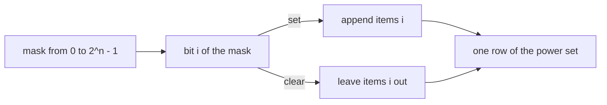
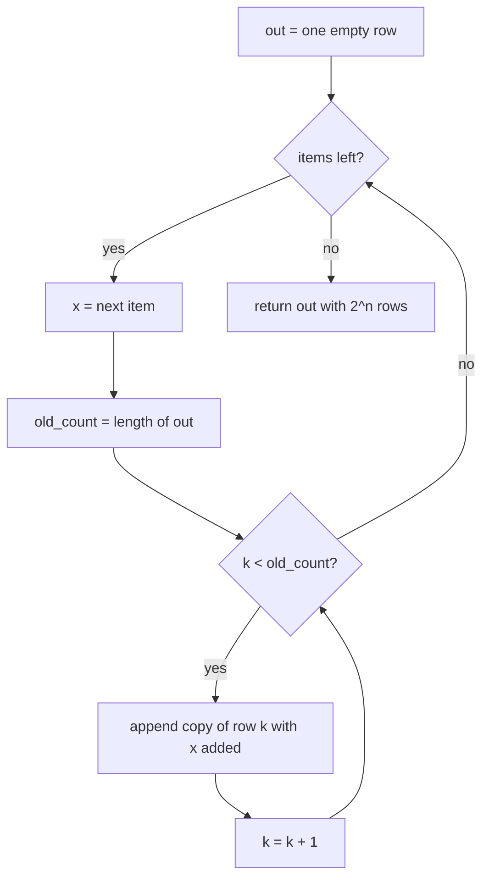
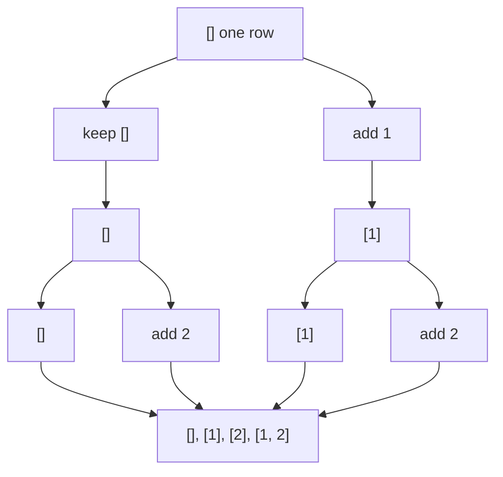

# 130 — Generate all subsets (power set) iterative.

> **Tier:** Beginner · **CTCI chapter:** Ch 8 — Recursion and Dynamic Programming
> **Task spec:** [130-generate-all-subsets-power-set-iterative.md](../../../tasks/beginner/130-generate-all-subsets-power-set-iterative.md)
> **Solutions:** [Python](../../../solutions/python/beginner/130-generate-all-subsets-power-set-iterative/solution.py) ·
> [Java](../../../solutions/java/beginner/130-generate-all-subsets-power-set-iterative/Solution.java) ·
> [JavaScript](../../../solutions/javascript/beginner/130-generate-all-subsets-power-set-iterative/solution.js) ·
> [C#](../../../solutions/csharp/beginner/130-generate-all-subsets-power-set-iterative/Solution.cs)

## 1. Problem restatement

**Input:** a list of `n` items. The Python cross-check also runs on strings (`["a", "b", "c"]`);
the Java, JavaScript and C# signatures take integer arrays. Input order is preserved and duplicate
values are *not* removed.

**Output:** a list of all `2^n` subsets of the input — the empty subset first-class, the full set
last — produced without recursion. The files ship **two** iterative routes:

* `subsets_bitmask` — enumerate the integers `0 .. 2^n - 1`; bit `i` of the mask means "take
  `items[i]`".
* `subsets_incremental` — start from `[[]]` and double the family once per item: keep the old rows,
  then append a copy of each with the new item added.

| Call | Result | Why |
| --- | --- | --- |
| `subsets_bitmask([1, 2, 3])` | `[[], [1], [2], [1, 2], [3], [1, 3], [2, 3], [1, 2, 3]]` | masks `0..7` read as binary `000, 001, 010, ...` |
| `subsets_bitmask([])` | `[[]]` | `2^0 = 1` subsets, and that one is the empty subset |
| `subsets_incremental([1, 2])` | `[[], [1], [2], [1, 2]]` | one pass per item: old half untouched, new half extended |
| `subsets_bitmask([1, 2, 3, 4])` | 16 rows | the `2^n` count |
| bitmask vs. incremental on `[1, 2, 3, 4]` and `["a", "b", "c"]` | identical families, size `2^n` | Python compares them as sets of sorted tuples |

The order is part of the contract, because Python and JavaScript assert the whole list with a deep
equality (or a literal comparison) rather than a set. Java and C# assert the shape instead: the
count is 8, row 0 is empty, row 1 is `[1]` and row 7 is `[1, 2, 3]` for input `[1, 2, 3]`. Both
statements of the contract agree, so a route that returns the right subsets in a different order
would pass Java and C# but fail Python and JavaScript.

## 2. Intuition

Each item is either inside a subset or outside it: one binary decision per item, so `2^n`
combinations and no way to produce fewer rows. The recursive way to enumerate that tree is task
131; this task asks for an iterative route, and there are two clean ones, each built on a
different numbering of the answer.

**Bitmask route — the integers *are* the subsets.** A subset is exactly a sequence of `n` yes/no
answers, and a sequence of `n` yes/no answers is exactly the `n` low bits of a number in
`0 .. 2^n - 1`. So enumerate the numbers and read off the bits: `mask & (1 << i)` is the membership
test for `items[i]`. Nothing has to be carried between rows, which means row `k` can be produced in
isolation — the property that makes this the route to reach for when only one subset is wanted.

**Doubling route — every item doubles the family.** The power set of `S` with a new element `x`
added splits into two disjoint halves:

* the subsets that exclude `x`, which are exactly the subsets of `S`;
* the subsets that include `x`, each of which is `S' ∪ {x}` for some `S'` in the power set of `S`.

Both halves are the same size, they are disjoint (they differ in whether `x` appears), and together
they cover everything. So the update is a pure append: keep the existing list, then append
`subset + [x]` for each existing subset. No deduplication step is needed, and the proof of that is
the disjointness above.



## 3. Algorithm

Bitmask route:

1. Let `n` be the number of items.
2. For every `mask` from `0` to `2^n - 1`:
   1. start an empty row;
   2. for every `i` from `0` to `n - 1`, if `mask & (1 << i)` is non-zero, append `items[i]`;
   3. append the row to the output.
3. Return the output.

Doubling route:

1. Start the output with a single empty row.
2. For every item `x`, in input order: record the current row count, then for each of those rows
   append a copy with `x` added.
3. Return the output once every item has been consumed.

```text
function subsets_bitmask(items)
    n ← length(items)
    out ← empty list
    for mask ← 0 to 2^n - 1 do
        row ← empty list
        for i ← 0 to n - 1 do
            if bit i of mask is set then
                append items[i] to row
            end
        end
        append row to out
    end
    return out
end

function subsets_incremental(items)
    out ← list containing one empty row
    for x in items do
        old_count ← length(out)
        for k ← 0 to old_count - 1 do
            extended ← copy of out[k] with x appended
            append extended to out
        end
    end
    return out
end
```

The `old_count` snapshot is not cosmetic: without it the inner loop walks into rows it just
created, doubling forever. Java and C# store `int size = out.size();` (or `outList.Count`) before
the inner loop for exactly this reason, and the JavaScript version sidesteps the issue by mapping
the *old* array into a new one and concatenating.



## 4. Worked example

Bitmask route on `items = [1, 2, 3]`, `n = 3`, so masks `0` through `7`. Bit `i` is read from the
right, so bit `0` selects `items[0] = 1`, bit `1` selects `2` and bit `2` selects `3`:

| Step | `mask` | bits `2 1 0` | membership tests | row appended |
| --- | --- | --- | --- | --- |
| 1 | 0 | `0 0 0` | none hit | `[]` |
| 2 | 1 | `0 0 1` | bit 0 | `[1]` |
| 3 | 2 | `0 1 0` | bit 1 | `[2]` |
| 4 | 3 | `0 1 1` | bits 0 and 1 | `[1, 2]` |
| 5 | 4 | `1 0 0` | bit 2 | `[3]` |
| 6 | 5 | `1 0 1` | bits 0 and 2 | `[1, 3]` |
| 7 | 6 | `1 1 0` | bits 1 and 2 | `[2, 3]` |
| 8 | 7 | `1 1 1` | all three | `[1, 2, 3]` |

Row `k` never consults row `k - 1`, which is why this route can answer "give me subset number `k`"
without building the other `2^n - 1` rows.

The doubling route on the same input grows a two-generation family per item:

| Pass | `x` | `old_count` | rows before | rows appended | rows after |
| --- | --- | --- | --- | --- | --- |
| 1 | 1 | 1 | `[]` | `[1]` | `[], [1]` |
| 2 | 2 | 2 | `[], [1]` | `[2], [1, 2]` | `[], [1], [2], [1, 2]` |
| 3 | 3 | 4 | `[], [1], [2], [1, 2]` | `[3], [1, 3], [2, 3], [1, 2, 3]` | all eight rows |



Both routes end at the same eight rows, but the *order* differs, and the difference is exactly
what the shared cross-check in the Python file tolerates: it compares the two families as sets of
sorted tuples, and separately checks that the count is `2 ** len(items)`. Deterministic order is
asserted per route, never across routes.

## 5. Complexity

Let `n` be the number of items; the answer has `2^n` rows.

| Measure | Bound | Why it holds |
| --- | --- | --- |
| Time, bitmask | Θ(n · 2^n) bit tests | `2^n` masks times `n` membership tests |
| Time, doubling | Θ(n · 2^n) list operations | pass `k` copies `2^(k-1)` rows of length up to `k`; the passes sum to `2^n - 1` copies |
| Output size | Θ(n · 2^(n-1)) element slots | each item appears in half of all subsets, so the total number of elements across the answer is `n · 2^(n-1)` |
| Row count | exactly `2^n` | one row per mask, and one doubling per item in the other route |
| Extra space, bitmask | O(n) per row | one row is built at a time; the answer itself is the only large structure |
| Extra space, doubling | Θ(n · 2^n) transient | the new half is materialised before being appended, so peak live storage stays proportional to the answer |
| Recursion depth, both | O(1) | the point of the task: the stack never grows with `n` |

The alternative is the recursive route in task 131, which has the same Θ(n · 2^n) time and the same
answer order as neither route here, but adds O(n) stack depth for the backtracking tree. That stack
is harmless at `n = 20` and fatal at `n = 10000` — and either way the `2^n` output, not the stack,
is what makes large `n` hopeless.

## 6. Pitfalls and edge cases

- **Empty input returns one row, not zero.** `subsets_bitmask([])` is `[[]]` in all four files: the
  empty set has exactly one subset, itself. Returning `[]` is the classic off-by-one here.
- **Duplicates in the input duplicate rows.** Neither route deduplicates, so `[1, 1]` yields
  `[], [1], [1], [1, 1]`. The uniqueness assertion (`len(a) == 2 ** len(items)`) is only made for
  inputs with distinct values.
- **Order is asserted.** Python and JavaScript compare the full list, so sorting rows or switching
  bit order breaks them. Bit `i` must mean `items[i]`, not the mirror bit.
- **`1 << n` is not safe for large `n`.** Java's `int` shift uses only the low five bits of the
  count, C#'s `int` shift behaves the same way, and JavaScript's bitwise operators are 32-bit
  signed, so `1 << 31` is negative. The files only test `n <= 4`; treat `n >= 30` as out of scope
  rather than as a bug to patch with a shift.
- **Growing the list you are iterating.** The doubling route must snapshot the row count before the
  inner loop; Java and C# do this explicitly and the JavaScript version maps over a snapshot of the
  array. Skipping the snapshot makes the loop consume its own output.
- **Aliasing rows.** A backtracking variant that keeps one buffer and mutates it must copy at the
  leaf — task 131 does `list(current)` / `new ArrayList<>(current)`. Without the copy every row in
  the answer is the same (finally empty) list. The bitmask and doubling routes build fresh rows and
  never hit this.
- **`null` input.** Every file takes an array or list and handles the empty case, but none of them
  handles a `null` container; there is no reported contract for it.
- **Memory, not time, is the real wall.** `n = 25` is already `2^25` rows; no implementation detail
  changes that, so an interviewer who raises `n` is asking about generating lazily, not about
  constant factors.

## 7. Variants and follow-ups

- **The recursive route.** [131-generate-all-subsets-recursive.md](../../../tasks/beginner/131-generate-all-subsets-recursive.md)
  walks the take/skip tree with backtracking; it produces the same family in skip-first order and
  is the version to quote when the interviewer asks for the tree, while this task's routes are the
  ones to quote when they ask for iteration.
- **Permutations instead of subsets.** [132-generate-permutations-of-distinct-elements.md](../../../tasks/beginner/132-generate-permutations-of-distinct-elements.md)
  swaps the "in or out" decision for "which unused item goes next", and
  [133-generate-permutations-with-duplicates-unique.md](../../../tasks/beginner/133-generate-permutations-with-duplicates-unique.md)
  adds the duplicate-skipping rule.
- **One subset at a time.** [134-next-lexicographical-permutation.md](../../../tasks/beginner/134-next-lexicographical-permutation.md)
  is the in-place cousin of the bitmask idea: a single mutable buffer and an O(n) step to the next
  combination, instead of `2^n` stored rows.
- **Bit tricks that recur.** Membership testing by mask shows up in
  [028-count-number-of-set-bits-in-an-integer.md](../../../tasks/beginner/028-count-number-of-set-bits-in-an-integer.md)
  and, as a single-bit probe, in
  [029-check-if-integer-is-power-of-two.md](../../../tasks/beginner/029-check-if-integer-is-power-of-two.md).
- The chapter walkthrough [Recursion and Dynamic Programming](../../ctci/08-recursion-and-dp.md)
  uses the power set as the smallest complete example of exhaustive enumeration.

## 8. Check yourself

1. Why does the doubling route never produce a duplicate row?

<details><summary>Show answer</summary>

Because the two halves differ in whether the new item `x` is present. The old half excludes `x` and
the new half includes it, so no row can appear in both; and by induction each half contains all
subsets of its kind. That disjointness is also the proof that the size doubles at every step,
which is why the count is `2^n`.

</details>

2. How many rows does `subsets_bitmask([])` return, and what is in them?

<details><summary>Show answer</summary>

One row, and it is the empty subset: `[[]]`. The loop runs once with `mask = 0`, found in all four
files' assertions. Returning no rows would mean the empty set had no subsets.

</details>

3. In the doubling route, why must the row count be snapshotted before the inner loop?

<details><summary>Show answer</summary>

Because the loop appends to the very list it is walking. With a live condition such as
`i < out.size()`, every appended row would be visited and extended again, and the list would grow
without bound. Java and C# store the size in a local variable first; JavaScript maps over a
snapshot instead.

</details>

4. Both routes are Θ(n · 2^n). Where does the output size Θ(n · 2^(n-1)) come from?

<details><summary>Show answer</summary>

Each of the `2^n` subsets has, on average, `n/2` elements: an item belongs to exactly half of the
subsets. Multiplying the row count by the average row length gives `2^n · n/2 = n · 2^(n-1)`
elements stored in the answer, which is why any implementation must be Θ(n · 2^n) in space too.

</details>

5. The bitmask route never looks at a previously produced row. What does that buy?

<details><summary>Show answer</summary>

It makes rows addressable: subset number `k` can be produced directly from `k`, with no shared
state, no ordering requirement and no memory for the other rows. That is the property the doubling
route deliberately gives up in exchange for a simpler inner loop.

</details>
