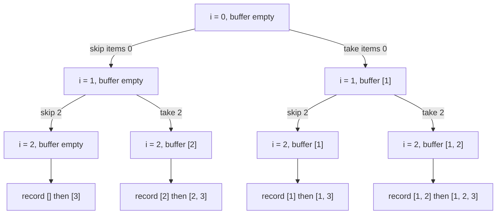
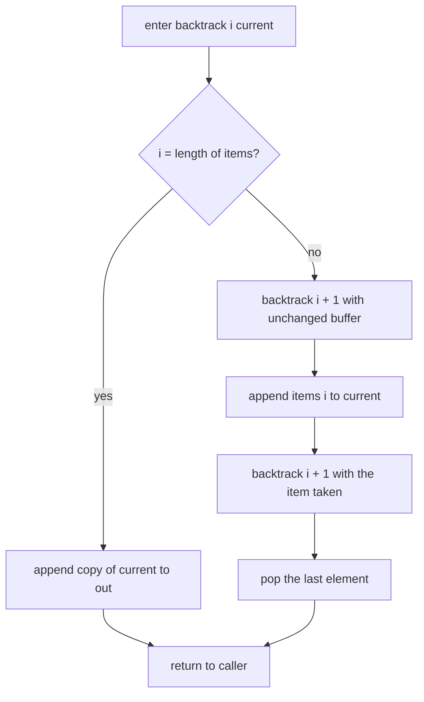
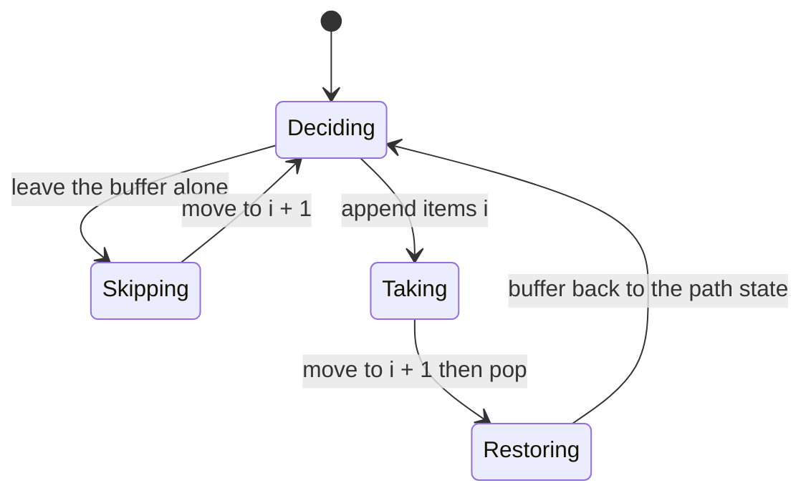
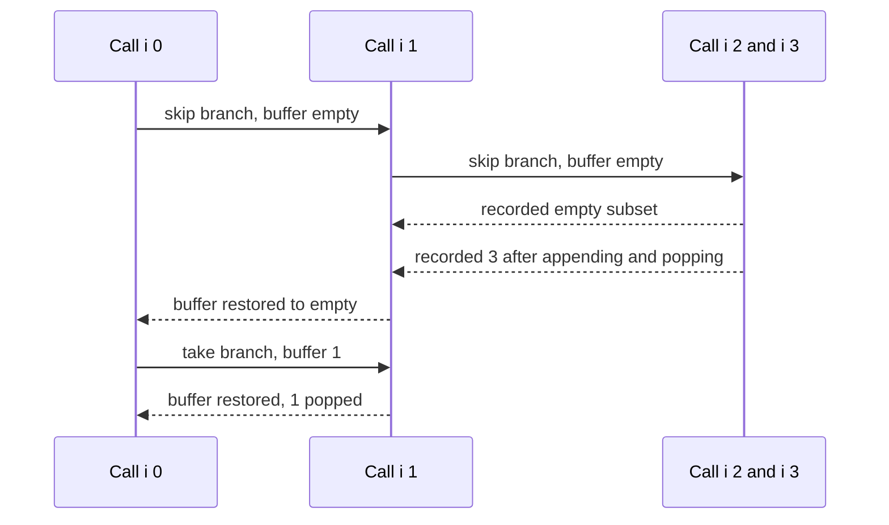

# 131 — Generate all subsets recursive.

> **Tier:** Beginner · **CTCI chapter:** Ch 8 — Recursion and Dynamic Programming
> **Task spec:** [131-generate-all-subsets-recursive.md](../../../tasks/beginner/131-generate-all-subsets-recursive.md)
> **Solutions:** [Python](../../../solutions/python/beginner/131-generate-all-subsets-recursive/solution.py) ·
> [Java](../../../solutions/java/beginner/131-generate-all-subsets-recursive/Solution.java) ·
> [JavaScript](../../../solutions/javascript/beginner/131-generate-all-subsets-recursive/solution.js) ·
> [C#](../../../solutions/csharp/beginner/131-generate-all-subsets-recursive/Solution.cs)

## 1. Problem restatement

**Input:** a list of `n` items, given as a Python list, a Java `int[]`, a JavaScript array or a C#
`int[]`. Order is preserved and duplicate values are not removed.

**Output:** all `2^n` subsets, generated by **backtracking** rather than by enumeration: at every
index the recursion branches into "skip this item" and "take this item", and a leaf is reached only
when the index runs past the end of the input.

| Call | Result | Why |
| --- | --- | --- |
| `subsets_recursive([1, 2, 3])` | `[[], [3], [2], [2, 3], [1], [1, 3], [1, 2], [1, 2, 3]]` | the skip branch is explored before every take branch, so the biggest subsets come last |
| `subsets_recursive([])` | `[[]]` | `i` is already past the end, so the very first call records the empty subset |
| `subsets_recursive([1, 2, 3, 4])` | 16 rows | `2^4` |
| recursive family of `[1, 2, 3]` vs. the task 130 families | equal as sets of sorted tuples | the Python file cross-checks against the iterative bitmask list |
| `result.size()` for `[1, 2, 3]` (Java) | 8, with the whole list equal to the literal order above | order is asserted, not just the count |

The ordering is the part that surprises people: skip-first means the *suffix-only* subsets appear
first. `[1, 2, 3]` therefore yields `[]`, then `[3]`, then `[2]`, then `[2, 3]`, and only afterwards
anything containing `1`. Java's assertion spells that order out as a string, so "same subsets,
different order" is a failure, not a pass.

## 2. Intuition

The naive mental model is a tree: at index `0` ask "is `items[0]` in?", at index `1` ask the same
about `items[1]`, and so on. `n` binary questions produce `2^n` leaves, and one leaf is one subset.
Walking that tree recursively is the obvious implementation, and the obvious implementation is also
the slow one if it copies the current subset into a new list at *every* node — that would rebuild
`2^(n+1) - 1` partial lists.

The key insight is that the tree path **is** the answer, so the path can be kept in one shared
buffer:

* before descending into the take branch, append `items[i]`;
* after that branch returns, pop it back off;
* copy the buffer only at the leaf — `2^n` copies of length at most `n`, instead of one copy per
  node.

That single buffer plus the pop is what makes the recursion *backtracking*: the invariant is "when
`backtrack(i, current)` is entered, `current` holds exactly the choices made on the path from the
root to this node". Entering and leaving a branch restores the invariant, which is what lets the
same buffer be reused by the sibling branch and by completely unrelated subtrees.

The order falls out of the code for free. The files call the *skip* branch first
(`backtrack(i + 1, current)`), then append and call the *take* branch, then pop. Reading that order
off the recursion gives the asserted output, and swapping the two calls would give the reverse
order — the take-first variant would start with the full set. Both are correct power sets; the
files pin down which one this repository produces.



## 3. Algorithm

1. Create an empty output list and a single, initially empty buffer.
2. Define `backtrack(i, current)`:
   1. if `i` equals the number of items, append a **copy** of `current` to the output and return;
   2. otherwise call `backtrack(i + 1, current)` — the skip branch, with the buffer unchanged;
   3. append `items[i]` to `current`;
   4. call `backtrack(i + 1, current)` — the take branch;
   5. pop the last element, restoring the buffer for the caller.
3. Call `backtrack(0, empty buffer)` and return the output.

```text
function subsets_recursive(items)
    out ← empty list
    backtrack(0, empty buffer)
    return out
end

procedure backtrack(i, current)
    if i = length(items) then
        append a copy of current to out
        return
    end
    backtrack(i + 1, current)
    append items[i] to current
    backtrack(i + 1, current)
    remove the last element of current
end
```

Steps 2.3 and 2.5 are a matched pair around the recursive call: the append makes the take branch
see the item, the pop makes the *caller's* sibling branch see the buffer it expects. Forgetting the
pop is a live bug — every subsequent subset would inherit a stale item — and the files avoid it by
keeping the two lines adjacent in all four languages.



The state that matters is a property of the *path*, not of the node:



## 4. Worked example

Trace `subsets_recursive([1, 2, 3])`. `n = 3`, so a leaf is any call with `i = 3`:

| Step | Call | `current` on entry | Action | Output appended so far |
| --- | --- | --- | --- | --- |
| 1 | `backtrack(0, [])` | `[]` | skip `1` | — |
| 2 | `backtrack(1, [])` | `[]` | skip `2` | — |
| 3 | `backtrack(2, [])` | `[]` | skip `3` | — |
| 4 | `backtrack(3, [])` | `[]` | leaf | `[]` |
| 5 | `backtrack(3, [3])` | `[3]` | leaf after the take branch of step 3 | `[], [3]` |
| 6 | `backtrack(2, [2])` | `[2]` | take branch of step 2 rebuilt the buffer | `[], [3], [2]` |
| 7 | `backtrack(3, [2, 3])` | `[2, 3]` | leaf | `[], [3], [2], [2, 3]` |
| 8 | `backtrack(1, [1])` | `[1]` | take branch of step 1 | `[], [3], [2], [2, 3], [1]` |
| 9 | `backtrack(2, [1])` → leaf at `[1, 3]` | `[1]` | as before, one level deeper | `..., [1], [1, 3]` |
| 10 | `backtrack(2, [1, 2])` → leaf at `[1, 2, 3]` | `[1, 2]` | last branch | eight rows |

Rows 8–10 are the mirror image of rows 1–7: the left subtree produced every subset avoiding `1`,
the right subtree produces every subset containing `1`, and the two halves are disjoint and
complete. That is the same argument the doubling route in
[130-generate-all-subsets-power-set-iterative.md](../../../tasks/beginner/130-generate-all-subsets-power-set-iterative.md)
uses to prove the `2^n` count.

The call tree for the first four rows, showing how the buffer is returned to the parent:



## 5. Complexity

Let `n` be the number of items.

| Measure | Bound | Why it holds |
| --- | --- | --- |
| Time | Θ(n · 2^n) | the tree has `2^n` leaves; each leaf copies a buffer of length at most `n`, and the internal nodes add O(1) work each |
| Node count | `2^(n+1) - 1` | `2^n` leaves plus `2^n - 1` internal nodes |
| Output size | Θ(n · 2^(n-1)) element slots | each item appears in half of the `2^n` subsets |
| Space, recursion | O(n) frames | the depth is exactly `n + 1`, since each call advances `i` by one |
| Space, extra | O(n) | the shared buffer holds at most one element per index on the current path |
| Space, copies at leaves | Θ(n · 2^n) over the run, one leaf at a time | this is the output itself, not an extra cost |

Compare with the iterative routes of task 130: same time bound, same output, but O(1) recursion and
no backtracking invariants to maintain. In exchange, this formulation generalises — replace
"take / skip" with "choose one of the remaining candidates" and the same skeleton generates
permutations ([132](../../../tasks/beginner/132-generate-permutations-of-distinct-elements.md)),
combinations and partitions. The cost of that generality is the recursion depth, which here is
`n + 1` rather than `2^n`, so the stack is never the problem; the output size always is.

## 6. Pitfalls and edge cases

- **Copy at the leaf, never store the buffer.** All four files append a copy
  (`list(current)`, `new ArrayList<>(current)`, `[...current]`, `new List<int>(current)`). Appending
  the buffer itself would leave every row pointing at the same finally-empty list.
- **Pop after the take branch.** The append and the pop must bracket the recursive call. Without the
  pop the buffer leaks an item into the sibling branch and every later subset is wrong.
- **Branch order is the output order.** The files skip first, which is why `[3]` precedes `[1]` in
  the asserted list. Reordering the two recursive calls gives a different but equally valid power
  set, and would fail the tests.
- **Empty input.** `backtrack` is called with `i = 0 = n`, so the first thing it does is record
  `[]`. The result is `[[]]`, one row, asserted in every file.
- **Single item.** `[7]` yields `[], [7]` in skip-first order, because the skip branch is recorded
  before the take branch.
- **Duplicates.** The algorithm branches on *indices*, so `[1, 1]` yields
  `[], [1], [1], [1, 1]` — four rows with a repeated value, since the two `1`s are different
  positions. Deduplication is not part of this task; it is what the duplicate-skipping rule in task
  133 does for permutations.
- **Depth is `n`, not `2^n`.** A recursion that is "exponential" in time can still be linear in
  depth; the branching factor here is 2 per level, so a 1000-element input would need 1001 frames
  and an impossible number of leaves. The stack is a red herring at this size.
- **Recursion limits are irrelevant at the sizes the files test.** `[1, 2, 3, 4]` needs five frames;
  the assertions check the count (`2^4 = 16`) rather than any depth behaviour.

## 7. Variants and follow-ups

- **The iterative counterpart.** [130-generate-all-subsets-power-set-iterative.md](../../../tasks/beginner/130-generate-all-subsets-power-set-iterative.md)
  reaches the same family with bitmask enumeration and doubling, and the Python files cross-check
  the two families for equality — the recursive order is skip-first, the bitmask order is numeric.
- **Permutations.** [132-generate-permutations-of-distinct-elements.md](../../../tasks/beginner/132-generate-permutations-of-distinct-elements.md)
  keeps the take/undo skeleton but replaces the index walk with a `used[]` array and a loop over
  candidates; [133-generate-permutations-with-duplicates-unique.md](../../../tasks/beginner/133-generate-permutations-with-duplicates-unique.md)
  adds a pruning rule so identical branches are visited once.
- **Backtracking with a validity test.** [170-simple-palindrome-partitioning-backtracking-list-partitions.md](../../../tasks/beginner/170-simple-palindrome-partitioning-backtracking-list-partitions.md)
  uses the same append / recurse / pop shape, but only descends when the chunk it just appended is a
  palindrome — pruning instead of exhausting every branch.
- **Enumerating in place.** [134-next-lexicographical-permutation.md](../../../tasks/beginner/134-next-lexicographical-permutation.md)
  turns "all orderings" into a single mutable buffer plus an O(n) step, which is how you avoid
  materialising `2^n` rows at all.
- **A constraint that prunes.** [085-three-sum-return-any-triplet.md](../../../tasks/beginner/085-three-sum-return-any-triplet.md)
  shows what backtracking looks like when the requirement is one witness rather than the whole
  enumeration.
- The chapter walkthrough [Recursion and Dynamic Programming](../../ctci/08-recursion-and-dp.md)
  presents take/skip backtracking as the base case for every enumeration problem in Ch 8.

## 8. Check yourself

1. What is the exact recursion depth for an input of `n` items, and why is it not exponential?

<details><summary>Show answer</summary>

`n + 1`. Every call advances the index by exactly one, so the deepest chain is
`backtrack(0) → ... → backtrack(n)`. The *branching* is what is exponential — each node makes two
recursive calls — but at any instant only one root-to-leaf path is on the stack.

</details>

2. Why must the leaf append a copy of the buffer instead of the buffer?

<details><summary>Show answer</summary>

Because there is exactly one buffer for the whole traversal. The pop at the end of every take branch
eventually empties it, so a stored reference would show the empty list in every row. Copying at the
leaf is what turns the path into an independent answer.

</details>

3. The output for `[1, 2, 3]` starts with `[]`, `[3]`, `[2]`, `[2, 3]`. What produces that order?

<details><summary>Show answer</summary>

Calling the skip branch before the take branch. Depth-first search follows skip first all the way
down, so the leftmost leaf is the empty subset and the next leaf reached is the one that took only
the last item. Swapping the two calls would produce the reverse order, starting with `[1, 2, 3]`.

</details>

4. How much extra memory does the recursion use, excluding the answer?

<details><summary>Show answer</summary>

O(n): `n + 1` stack frames and one shared buffer holding at most one element per index on the
current path. Nothing proportional to `2^n` is allocated except the output rows themselves.

</details>

5. Input `[1, 1]` — how many rows does the function return, and why does deduplication not happen?

<details><summary>Show answer</summary>

Four rows: `[], [1], [1], [1, 1]`. The recursion decides per *index*, and the two `1`s occupy
different indices, so the two leaves that each contain exactly one `1` are distinct paths and both
get recorded. Nothing in the task's solution files compares values, so duplicates in the output
mirror duplicates in the input.

</details>
