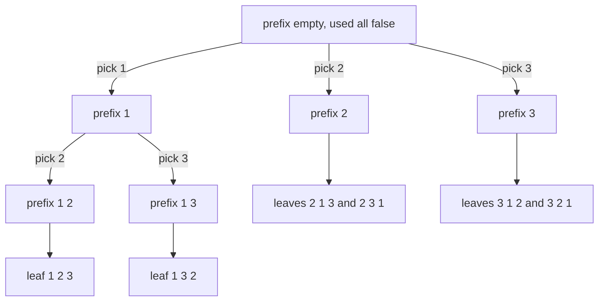
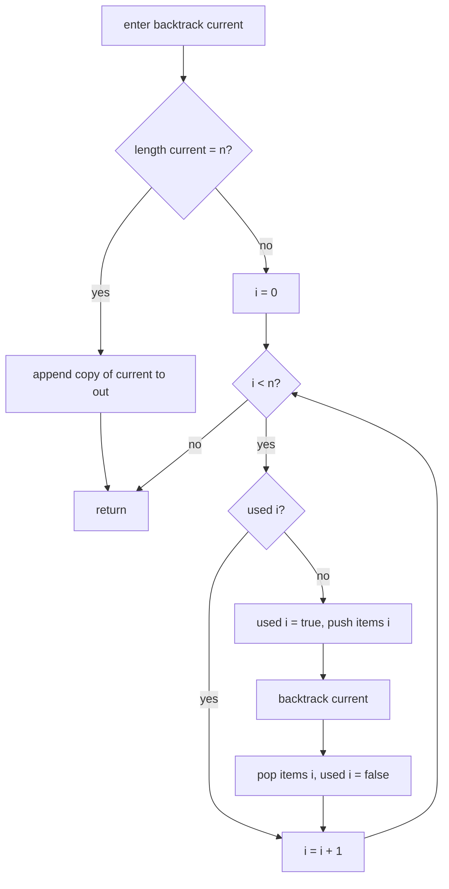
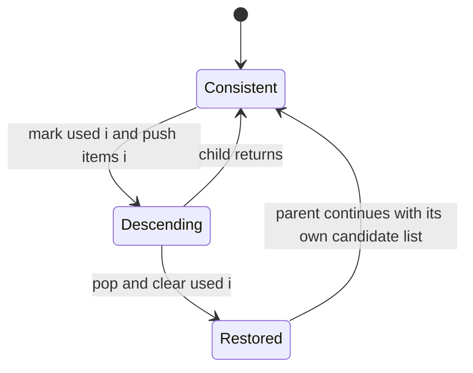
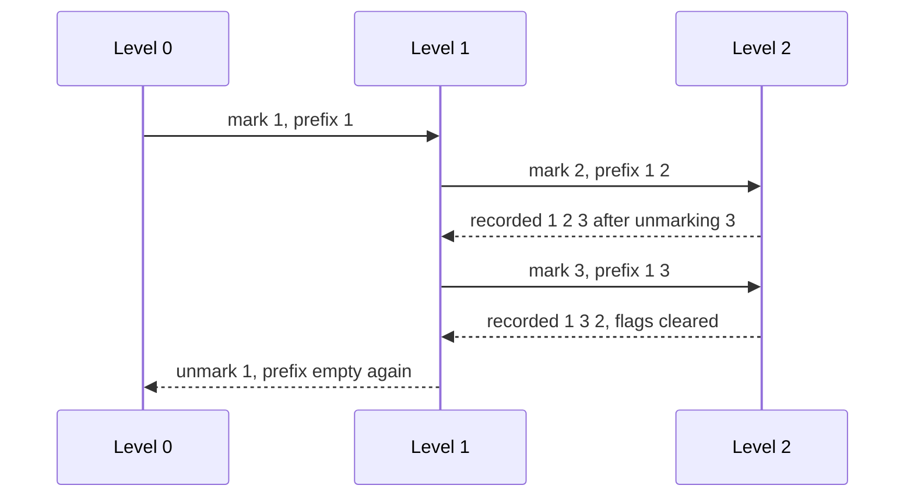

# 132 — Generate permutations of distinct elements.

> **Tier:** Beginner · **CTCI chapter:** Ch 8 — Recursion and Dynamic Programming
> **Task spec:** [132-generate-permutations-of-distinct-elements.md](../../../tasks/beginner/132-generate-permutations-of-distinct-elements.md)
> **Solutions:** [Python](../../../solutions/python/beginner/132-generate-permutations-of-distinct-elements/solution.py) ·
> [Java](../../../solutions/java/beginner/132-generate-permutations-of-distinct-elements/Solution.java) ·
> [JavaScript](../../../solutions/javascript/beginner/132-generate-permutations-of-distinct-elements/solution.js) ·
> [C#](../../../solutions/csharp/beginner/132-generate-permutations-of-distinct-elements/Solution.cs)

## 1. Problem restatement

**Input:** a list of `n` **distinct** items — Python list, Java `int[]`, JavaScript array, C#
`int[]`. The distinctness is the documented precondition of this task; the duplicate case is task
133.

**Output:** every ordering of the whole input, one row per ordering, `n!` rows in total. A row is
only recorded once its length equals `n`, so partial prefixes never appear in the answer.

| Call | Result | Why |
| --- | --- | --- |
| `permutations([1, 2, 3])` | `[[1, 2, 3], [1, 3, 2], [2, 1, 3], [2, 3, 1], [3, 1, 2], [3, 2, 1]]` | candidates are walked in input order, so the output is lexicographic |
| `permutations([])` | `[[]]` | the empty prefix is already a complete permutation of zero items |
| `permutations([7])` | `[[7]]` | one item, one ordering |
| `permutations([1, 2, 3, 4])` | 24 rows | `4! = 24`, asserted in all four files |
| `{tuple(p) for p in permutations([1, 2, 3, 4])}` | 24 distinct tuples | Python asserts that the rows are pairwise different |
| every row of `permutations([1, 2, 3, 4])` | sorted copy equals `[1, 2, 3, 4]` | Python asserts that each row is a reordering, not a sample |

The order matters as much as the membership: Java compares the whole list against that literal,
C# pins `perms[0]` to `1,2,3` and `perms[5]` to `3,2,1`, and JavaScript compares with a deep
equality. Iterating the candidates in index order is what makes the result lexicographic for a
sorted input.

## 2. Intuition

The naive idea is to take subsets — which the neighbouring tasks do — and then reject the rows that
are not complete orderings. That is wasteful for a specific reason: the number of *ordered
prefixes* of length `k` is `n · (n - 1) · ... · (n - k + 1)`, which is far bigger than `n!`, and
the rejected partial prefixes are exactly the `2^n` subsets this problem does not want.

The insight is to make the *decision* the thing that is being enumerated. At each level the
question is not "is this item in?" but "which of the remaining items comes next?" — and the state
needed to answer it is a single `used[]` array of `n` booleans:

* `used[i]` is true when `items[i]` already appears in the current prefix;
* the loop `for i in 0 .. n - 1` proposes each index as the next position;
* the recursion descends, and on the way back the flag is cleared and the buffer popped, restoring
  the state the parent expects.

That is the take/undo skeleton of
[131-generate-all-subsets-recursive.md](../../../tasks/beginner/131-generate-all-subsets-recursive.md)
with two changes that turn `2^n` leaves into `n!` leaves:

1. the branching factor *shrinks* as the depth grows — at depth `k` there are `n - k` unused
   candidates left, so the tree has `n · (n-1) · ... · 1 = n!` leaves;
2. every leaf is at depth exactly `n`, because the base case is "prefix length equals `n`" rather
   than "index ran past the end".

The consequence to internalise: the constraint that every item is used exactly once is encoded in
the `used[]` flags, not re-checked anywhere. A prefix of length `n` built from distinct indices is
automatically a permutation.



## 3. Algorithm

1. Set up `used` as `n` false flags, an empty prefix and an empty output.
2. Define `backtrack(current)`:
   1. if the prefix length equals `n`, append a copy of `current` to the output and return;
   2. otherwise loop `i` over `0 .. n - 1`:
      1. skip `i` when `used[i]` is true;
      2. mark `used[i]` true and append `items[i]` to the prefix;
      3. recurse;
      4. pop the prefix and mark `used[i]` false again.
3. Call `backtrack(empty prefix)` and return the output.

```text
function permutations(items)
    used ← array of length(items) filled with false
    out ← empty list
    backtrack(empty prefix)
    return out
end

procedure backtrack(current)
    if length(current) = length(items) then
        append a copy of current to out
        return
    end
    for i ← 0 to length(items) - 1 do
        if used[i] then
            continue
        end
        used[i] ← true
        append items[i] to current
        backtrack(current)
        remove the last element of current
        used[i] ← false
    end
end
```

The three lines around the recursive call are one atomic step: flip the flag, push the value,
descend, then undo both. Every implementation in the repository writes them in that order, and the
undo lines sit directly under the recurse line in each file so the pairing is visible.



The `used` array and the prefix are two views of the same fact, and keeping them in sync is the
whole invariant:



## 4. Worked example

Trace `permutations([1, 2, 3])`. The table shows the prefix and the flags at the moment a leaf is
recorded; the loop always proposes candidates in index order, so `1` is tried before `2` before `3`
at every level where it is still available.

| Step | Depth | Prefix on entry | Chosen index | Prefix at the leaf | Output after |
| --- | --- | --- | --- | --- | --- |
| 1 | 0 → 1 | `[]` | 0 (`1`) | — | — |
| 2 | 1 → 2 | `[1]` | 1 (`2`) | — | — |
| 3 | 2 → 3 | `[1, 2]` | 2 (`3`) | `[1, 2, 3]` | `[1, 2, 3]` |
| 4 | 1 → 2 | `[1]` | 2 (`3`) | `[1, 3, 2]` | `[1, 2, 3], [1, 3, 2]` |
| 5 | 0 → 1 | `[]` | 1 (`2`) | `[2, 1, 3]`, then `[2, 3, 1]` | four rows |
| 6 | 0 → 1 | `[]` | 2 (`3`) | `[3, 1, 2]`, then `[3, 2, 1]` | six rows |

Two facts to read off the table. First, the first two rows share the prefix `[1]` and differ only in
the last level — that is why the output is grouped lexicographically. Second, after the branch
starting with `1` is exhausted, the flags are all false again and the prefix is empty, which is what
allows the `2` branch to start clean.



At `n = 4` the same walk records 24 rows: four choices at the root, three at the next level, two
after that, one at the deepest level, and `4 · 3 · 2 · 1 = 24` is exactly the count the files
assert. The distinctness assertion in the Python file additionally confirms that no two of those 24
rows coincide — which they cannot, since each leaf corresponds to a unique sequence of index
choices.

## 5. Complexity

Let `n` be the number of items.

| Measure | Bound | Why it holds |
| --- | --- | --- |
| Time | Θ(n · n!) | `n!` leaves, each copying a prefix of length `n`; the internal nodes contribute one loop iteration per promising candidate |
| Leaves | exactly `n!` | the branching factor at depth `k` is `n - k`, and the base case fires only at depth `n` |
| Output size | Θ(n · n!) element slots | `n!` rows of length `n` |
| Space, extra | O(n) | the prefix holds at most `n` values, the `used` array has `n` flags, the prefix copy at a leaf is O(n) |
| Space, recursion | O(n) frames | the depth is exactly `n`, one level per chosen element |
| Naive alternative | Θ(n · 2^n) after filtering | enumerating subsets and rejecting the incomplete ones builds far more nodes than it keeps |

The naive comparison is worth stating plainly: `2^n` grows slower than `n!` only for tiny `n`, and
by `n = 10` the two are already far apart. More importantly, the subset route visits internal nodes
that the permutation route never creates, because "which comes next" prunes the tree by construction
instead of by a filter applied afterwards. Both are exponential; only one of them enumerates the
right thing.

## 6. Pitfalls and edge cases

- **Copy the prefix at the leaf.** All four files append a copy (`list(current)`,
  `new ArrayList<>(current)`, `[...current]`, `new List<int>(current)`). Storing the live buffer
  would make every row reference the same emptied list.
- **Unset the flag after the recursive call.** The undo pair (`pop` + `used[i] = false`) must run on
  the way out of every candidate, otherwise later branches see phantom used items and the row count
  collapses.
- **Empty input is one row, not zero.** `permutations([])` is `[[]]` — the empty prefix already has
  length `0 = n`, so the very first call records it. Java, JavaScript and C# assert the count `1`
  and Python asserts the literal `[[]]`.
- **Single item.** `permutations([7])` is `[[7]]`: one candidate, one leaf, and the loop inside the
  child never runs.
- **Input order controls output order.** Candidates are tried by index, so a sorted input yields
  lexicographic output. Feeding `[3, 2, 1]` produces the same six rows in a different order — the
  files only assert the sorted-input order, so a test on an unsorted input would be writing a new
  contract.
- **This task assumes distinct items.** The code has no duplicate rule, so `[1, 1, 2]` would emit
  six rows including repeats of `1, 1, 2`. Handling that is
  [133-generate-permutations-with-duplicates-unique.md](../../../tasks/beginner/133-generate-permutations-with-duplicates-unique.md),
  which sorts first and then skips a value whose identical predecessor is unused.
- **Factorial is the wall.** `n = 10` is 3.6 million rows and `n = 12` is nearly half a billion; no
  implementation choice moves that boundary, so a question about larger `n` is a question about
  generating lazily or about the next permutation in O(n) per step.
- **Recursion depth is `n`, not `n!`.** As in the subsets task, the stack is linear while the output
  is factorial; the files' largest case, `[1, 2, 3, 4]`, is four frames deep.

## 7. Variants and follow-ups

- **The duplicate-tolerant version.** [133-generate-permutations-with-duplicates-unique.md](../../../tasks/beginner/133-generate-permutations-with-duplicates-unique.md)
  sorts the input and skips a candidate when its equal predecessor has not been used at this level,
  which turns `n!` leaves into `n! / (product of the multiplicities' factorials)` unique rows.
- **One step at a time.** [134-next-lexicographical-permutation.md](../../../tasks/beginner/134-next-lexicographical-permutation.md)
  produces the next ordering in O(n) time in a single mutable array, so the whole family never has
  to be stored.
- **The subset sibling.** [131-generate-all-subsets-recursive.md](../../../tasks/beginner/131-generate-all-subsets-recursive.md)
  uses the same push / recurse / pop skeleton with a different decision; put the two side by side to
  see that only the branching rule changed.
- **Backtracking with pruning.** [170-simple-palindrome-partitioning-backtracking-list-partitions.md](../../../tasks/beginner/170-simple-palindrome-partitioning-backtracking-list-partitions.md)
  keeps the skeleton but refuses branches that cannot lead to a valid partition.
- **Choosing a fixed number of items.** [085-three-sum-return-any-triplet.md](../../../tasks/beginner/085-three-sum-return-any-triplet.md)
  shows the same "pick from what is left" logic when the answer is a witness rather than an
  enumeration.
- The chapter walkthrough [Recursion and Dynamic Programming](../../ctci/08-recursion-and-dp.md)
  uses permutation generation as the canonical backtracking example in Ch 8.

## 8. Check yourself

1. Why does the branching factor shrink with depth, and what does that imply for the leaf count?

<details><summary>Show answer</summary>

At depth `k` exactly `k` items are already used, so only `n - k` candidates survive the `used[]`
test. Multiplying the branching factors along a path gives `n · (n-1) · ... · 1 = n!` leaves — the
number of permutations, which is exactly the number of rows the files assert.

</details>

2. What is the difference between this algorithm and enumerating all subsets of size `n`?

<details><summary>Show answer</summary>

A subset of size `n` is only one of the `2^n` subsets — the full set — so the subset route would
have to enumerate `2^n` nodes and discard all but one. Enumerating *orderings* instead makes every
leaf a complete answer, so no work is thrown away. The `used[]` flags are what enforce "each item
exactly once" without a validity test.

</details>

3. `permutations([1, 2, 3])[1]` is `[1, 3, 2]`. Why is that the second row?

<details><summary>Show answer</summary>

After the first leaf `[1, 2, 3]`, the deepest level has no other candidate, so the recursion returns
to the level holding the prefix `[1]`, where candidate index `2` (`3`) is still unused. It is tried
next, and the only remaining item `2` follows, giving `[1, 3, 2]`.

</details>

4. What exactly must be undone when a candidate branch returns, and what breaks if it is not?

<details><summary>Show answer</summary>

Both the prefix and the flag: pop `items[i]` off the prefix and set `used[i]` back to false. If the
flag stays true, every other branch believes `items[i]` is already placed and stops offering it, so
most permutations are never generated — the row count would be far below `n!`.

</details>

5. `[1, 2, 3, 4]` gives 24 rows. Where does 24 come from, and does the extra `assert` in the Python
file change that count?

<details><summary>Show answer</summary>

`4! = 24`. The distinctness assertion (`len({tuple(p) for p in perms}) == 24`) and the reordering
assertion (`sorted(p) == [1, 2, 3, 4]`) do not affect the count; they confirm that all 24 rows are
different and that each is a rearrangement of the input rather than a sample.

</details>
