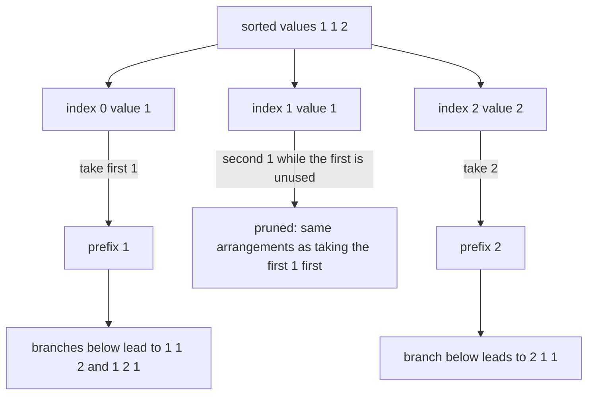
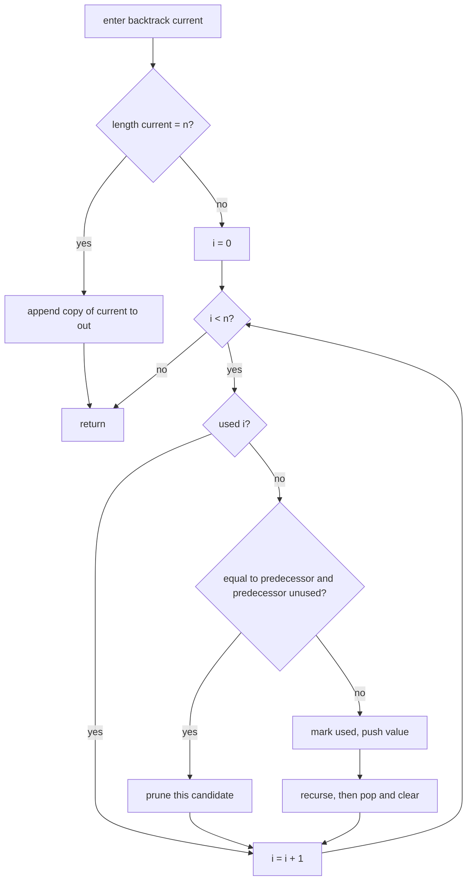
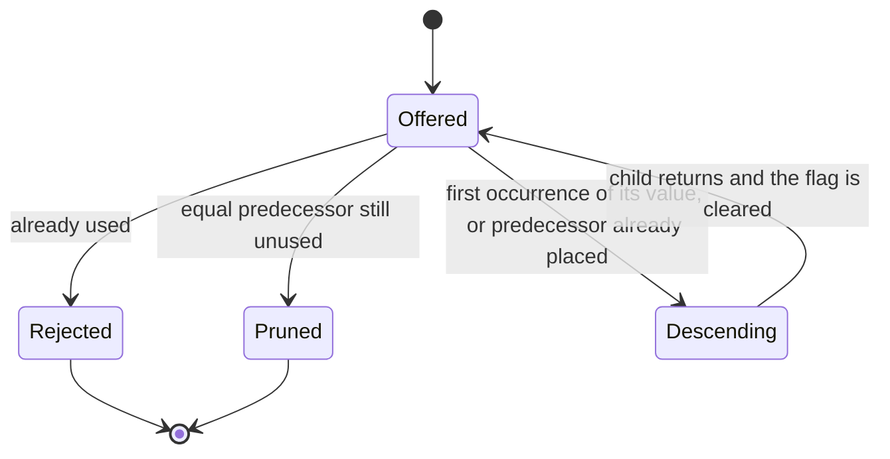
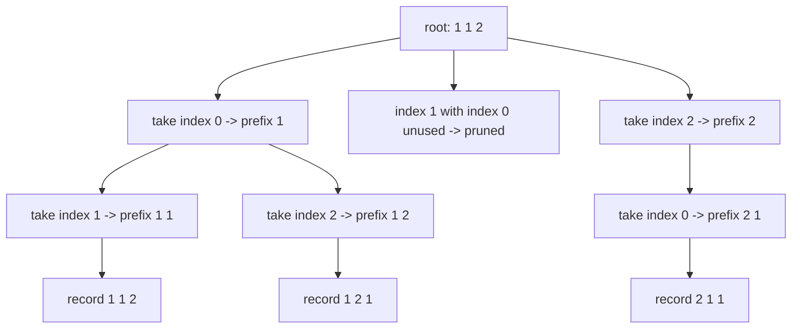

# 133 — Generate permutations with duplicates (unique).

> **Tier:** Beginner · **CTCI chapter:** Ch 8 — Recursion and Dynamic Programming
> **Task spec:** [133-generate-permutations-with-duplicates-unique.md](../../../tasks/beginner/133-generate-permutations-with-duplicates-unique.md)
> **Solutions:** [Python](../../../solutions/python/beginner/133-generate-permutations-with-duplicates-unique/solution.py) ·
> [Java](../../../solutions/java/beginner/133-generate-permutations-with-duplicates-unique/Solution.java) ·
> [JavaScript](../../../solutions/javascript/beginner/133-generate-permutations-with-duplicates-unique/solution.js) ·
> [C#](../../../solutions/csharp/beginner/133-generate-permutations-with-duplicates-unique/Solution.cs)

## 1. Problem restatement

**Input:** a list of `n` items that **may contain duplicates** — values can repeat any number of
times. The items are compared by value, not by position.

**Output:** every *distinct* ordering of the whole multiset, each exactly once. With multiplicities
`m₁, m₂, ...` the count is `n! / (m₁! · m₂! · ...)` rather than `n!`.

| Call | Result | Why |
| --- | --- | --- |
| `unique_permutations([1, 1, 2])` | `[[1, 1, 2], [1, 2, 1], [2, 1, 1]]` | `3! / 2! = 3` distinct arrangements |
| `unique_permutations([1, 1, 1])` | `[[1, 1, 1]]` | every arrangement is the same arrangement |
| `unique_permutations([1, 2, 3])` | 6 rows | no duplicates, so the distinct case is unchanged from task 132 |
| `unique_permutations([1, 2, 2, 3])` | 12 rows | `4! / 2! = 12`, asserted in Java, JavaScript and C# |
| `unique_permutations([])` | `[[]]` | one empty arrangement |
| unique output of `[1, 1, 2]`, `[1, 2, 2, 3]`, `[2, 2, 2, 2]` | equals the set of brute-force orderings | the Python file cross-checks against `itertools.permutations` used as a set |

The *set* claim is the strong one: Python builds the deduplicated reference from
`itertools.permutations(data)` and asserts equality with the algorithm's output, so a route that
merely generates fewer rows without covering all of them fails.

## 2. Intuition

The obvious approach is to run the task 132 algorithm and post-process: generate all `n!` rows,
put them in a hash set and return the set. It is correct and it is also wasteful twice over — the
`n!` intermediate rows can be far more numerous than the `n!/m!` answer, and every row has to be
hashed, which means walking `n` elements per row.

Two ideas fix it properly.

**Sort first.** Equal values must sit next to each other, because the pruning rule compares
`items[i]` with `items[i - 1]`. After sorting, the input has the shape
`v₁ repeated m₁ times, v₂ repeated m₂ times, ...`, and each identical block is contiguous. All four
files sort — Python rebinds with `sorted(items)`, Java uses `items.clone()` then `Arrays.sort`,
JavaScript spreads before `sort`, C# clones before `Array.Sort` — so the caller's array is left
untouched.

**Pick equal values left to right.** Among a block of equal values, decide once and for all that
they are consumed in index order: the second `1` may only be placed if the first `1` is already in
the prefix. That is the single test

```text
if i > 0 and items[i] = items[i - 1] and used[i - 1] is false then
    skip this candidate
end
```

Read it as a canonical-form rule rather than a filter: every distinct arrangement has exactly one
representative in which equal values appear in increasing index order, and the rule admits precisely
those representatives. A branch that would place the second `1` while the first is still unused is
a permutation of a *sibling* branch, not a new arrangement, so skipping it loses nothing and prunes
the whole duplicate subtree at once.



## 3. Algorithm

1. Sort a copy of the input ascending; keep the caller's array unchanged.
2. Set up `used` as `n` false flags, an empty prefix and an empty output.
3. Define `backtrack(current)`:
   1. if the prefix length equals `n`, append a copy to the output and return;
   2. loop `i` over `0 .. n - 1`:
      1. skip when `used[i]` is true;
      2. skip when `i > 0`, `items[i]` equals `items[i - 1]`, and `used[i - 1]` is false;
      3. mark `used[i]`, append `items[i]`, recurse, then pop and clear the flag.
4. Call `backtrack(empty prefix)` and return the output.

```text
function unique_permutations(items)
    sorted_items ← ascending sort of items
    used ← array of length(items) filled with false
    out ← empty list
    backtrack(empty prefix)
    return out
end

procedure backtrack(current)
    if length(current) = length(sorted_items) then
        append a copy of current to out
        return
    end
    for i ← 0 to length(sorted_items) - 1 do
        if used[i] then
            continue
        end
        if i > 0 and sorted_items[i] = sorted_items[i - 1] and used[i - 1] is false then
            continue
        end
        used[i] ← true
        append sorted_items[i] to current
        backtrack(current)
        remove the last element of current
        used[i] ← false
    end
end
```

The two `continue` statements are different in kind. The first enforces "each item once"; the second
enforces "equal values in index order". Removing the second turns this file back into the task 132
algorithm with duplicate rows; inverting the test (`used[i - 1]` is *true*) keeps the wrong
representative and produces both fewer and differently ordered rows.



A branch is therefore in one of three states, and only one of them descends:



## 4. Worked example

Trace `unique_permutations([1, 1, 2])`. After sorting the input is `items = [1, 1, 2]` at indices
`0, 1, 2`, and `used` is `[false, false, false]`.

| Step | Prefix on entry | Candidate | Test result | Action |
| --- | --- | --- | --- | --- |
| 1 | `[]` | index 0 (`1`) | not used, no predecessor | take |
| 2 | `[1]` | index 0 | `used[0]` true | skip |
| 3 | `[1]` | index 1 (`1`) | equal predecessor, but `used[0]` is true | take |
| 4 | `[1, 1]` | index 2 (`2`) | not used | take, leaf `[1, 1, 2]` recorded |
| 5 | `[1]` | index 2 (`2`) | not used | take |
| 6 | `[1, 2]` | index 1 (`1`) | equal predecessor, `used[0]` is true | take, leaf `[1, 2, 1]` recorded |
| 7 | `[]` | index 1 (`1`) | equal predecessor, `used[0]` is false | **pruned** |
| 8 | `[]` | index 2 (`2`) | not used | take |
| 9 | `[2]` | index 0 (`1`) | not used, no predecessor | take |
| 10 | `[2, 1]` | index 1 (`1`) | equal predecessor, `used[0]` is true | take, leaf `[2, 1, 1]` recorded |

Step 7 is the only prune, and it is worth a moment: had the second `1` been taken at that point, the
prefix would be `[1]` with `used = [false, true, false]`, and every arrangement reachable from there
would start with the same value as an arrangement already produced in steps 1–6. Three leaves
remain — exactly the asserted `3! / 2! = 3` rows.



The same walk on `[1, 2, 2, 3]` records 12 rows instead of the `4! = 24` that the unrestricted
algorithm would emit: the duplicated `2` prunes half of the tree, and the count matches
`4! / 2! = 12` exactly as the Java, JavaScript and C# assertions state.

## 5. Complexity

Let `n` be the number of items and `U` the number of distinct rows, `U = n! / (m₁! · m₂! · ...)`.

| Measure | Bound | Why it holds |
| --- | --- | --- |
| Time | Θ(n · U) | `U` leaves, each copying a prefix of length `n`; the pruned subtrees are never expanded, so the internal-node count stays proportional to the leaf count times `n` |
| Leaves | exactly `U` | one leaf per distinct arrangement, because each arrangement has exactly one index-ordered representative |
| Sorting | Θ(n log n) once | done before the recursion, so it is dominated by the exponential part |
| Output size | Θ(n · U) element slots | `U` rows of length `n` |
| Space, extra | O(n) | prefix, `used` flags and one prefix copy per leaf |
| Space, recursion | O(n) frames | the depth is exactly `n` |
| Naive alternative | Θ(n · n!) | generating every ordering and deduplicating with a hash set pays for all `n!` rows and hashes each of them |

The pruning is worth its complexity: at `[1, 1, 1]` the unrestricted route would generate six
identical rows and then remove five of them, whereas this route never builds them and returns a
single row. For an input of `k` equal values the saving is a factor `k!`, which is why the
sort-then-prune formulation is the standard answer rather than the filter.

## 6. Pitfalls and edge cases

- **Sort before you prune.** The rule compares `items[i]` with `items[i - 1]`, so equal values must
  be adjacent. Without the sort the test misses duplicates that are far apart and the output
  contains repeated rows — the JavaScript file sorts a *copy* (`[...items].sort(...)`) and Python
  rebinds with `sorted(items)`, so neither mutates the caller's array.
- **Direction of the test.** The condition is "equal to the predecessor **and the predecessor is
  not used**" → prune. The intuition is index order: an equal value may be taken as soon as all its
  earlier copies are already placed, and never before.
- **Do not confuse the two skips.** `used[i]` means "this exact index is placed"; the duplicate rule
  means "an earlier index with the same value is not placed yet". Both are needed.
- **Empty input.** The prefix has length `0 = n` on entry, so `[[]]` is recorded immediately.
- **All values equal.** `[1, 1, 1]` returns one row; the root takes index 0 and every other candidate
  at every level is either used or pruned.
- **Distinct input is unchanged.** `[1, 2, 3]` still yields six rows, because the duplicate test can
  never fire when no two adjacent values are equal.
- **Undo on the way out.** The `pop` plus `used[i] = false` pair must bracket the recursive call, as
  in task 132; the duplicate rule is checked *before* any state changes, so a pruned candidate leaves
  nothing to undo.
- **Order is asserted.** The rows come out in the order the sorted array is walked, which is why the
  Python assertion is the literal `[[1, 1, 2], [1, 2, 1], [2, 1, 1]]` and the Java and JavaScript
  files compare the same literal.
- **Worst case is still factorial.** Deduplication shrinks the answer but not its shape: an input
  with `n` distinct values still has `n!` rows, so the algorithm is exponential by necessity. What
  the rule buys is that the work tracks `U`, not `n!`.
- **Equality, not ordering, semantics.** Values are compared with value equality; the task says
  nothing about `null` entries or about types whose comparison is not a total order, and the files
  test integers only.

## 7. Variants and follow-ups

- **The distinct-only version.** [132-generate-permutations-of-distinct-elements.md](../../../tasks/beginner/132-generate-permutations-of-distinct-elements.md)
  is the same skeleton without the sort and the duplicate rule; comparing the two files shows that
  the pruning is the entire difference.
- **One step at a time.** [134-next-lexicographical-permutation.md](../../../tasks/beginner/134-next-lexicographical-permutation.md)
  walks permutations in O(n) per step in a single array, and it also tolerates duplicates — the
  comparison there uses `>=` so an equal pair does not count as an ascent.
- **The subset sibling.** [131-generate-all-subsets-recursive.md](../../../tasks/beginner/131-generate-all-subsets-recursive.md)
  enumerates a different family with the same push / recurse / pop discipline, and shows what a
  decision tree looks like when every branch is kept.
- **Pruning instead of filtering.** [170-simple-palindrome-partitioning-backtracking-list-partitions.md](../../../tasks/beginner/170-simple-palindrome-partitioning-backtracking-list-partitions.md)
  rejects branches early for the same reason this task does: the work saved is the whole subtree,
  not just the rejected leaf.
- **Deduplication by canonical order.** The "sort, then keep the first occurrence of each value" idea
  reappears in [085-three-sum-return-any-triplet.md](../../../tasks/beginner/085-three-sum-return-any-triplet.md),
  where skipping repeated values in a sorted array is what keeps triplets from repeating.
- The chapter walkthrough [Recursion and Dynamic Programming](../../ctci/08-recursion-and-dp.md)
  covers duplicate handling as the second refinement of the basic backtracking template.

## 8. Check yourself

1. Why must the input be sorted before the duplicate rule can work?

<details><summary>Show answer</summary>

Because the rule compares each candidate with `items[i - 1]`. Only after sorting is every copy of a
value adjacent to the previous copy, so "my predecessor holds the same value" reliably means "an
equal value exists earlier in the ordering". An unsorted input can have equal values separated by
other values, and the test silently stops firing.

</details>

2. What does the pruning rule actually express?

<details><summary>Show answer</summary>

A canonical form. Every distinct arrangement has exactly one representative in which each value's
copies appear in increasing index order, and the rule "an equal value may be taken only once the
predecessor copy is already placed" admits exactly those representatives. Every pruned branch is a
permutation of a branch that is still explored, so nothing is lost.

</details>

3. How many rows does `unique_permutations([1, 2, 2, 3])` return, and which assertion states it?

<details><summary>Show answer</summary>

12. Java, JavaScript and C# assert `4! / 2! = 12` directly, and the Python file additionally checks
that the result equals the set of `itertools.permutations` of the same data.

</details>

4. What changes if the last condition is dropped, leaving only `i > 0 and items[i] == items[i - 1]`?

<details><summary>Show answer</summary>

Too much is pruned: the second copy of a value could never be taken at all, so arrangements like
`[1, 1, 2]` and `[2, 1, 1]` could not be built and the count would fall far below `3`. The
`used[i - 1]` clause is what distinguishes "an earlier copy is already placed" from "an earlier copy
still exists".

</details>

5. The answer has fewer rows than `n!`. Why is the time bound about `U` rather than about `n!`?

<details><summary>Show answer</summary>

Because the pruned subtrees are never expanded — the test runs before marking and descending. The
search tree therefore has one leaf per distinct arrangement, so the work scales with `U` (times the
O(n) copy per leaf), not with the `n!` rows that a generate-then-filter approach would build and
discard.

</details>
