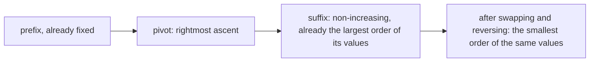
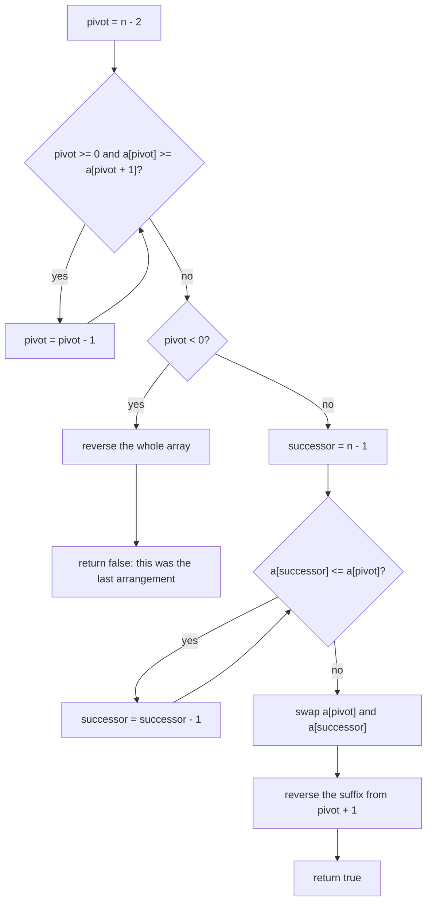
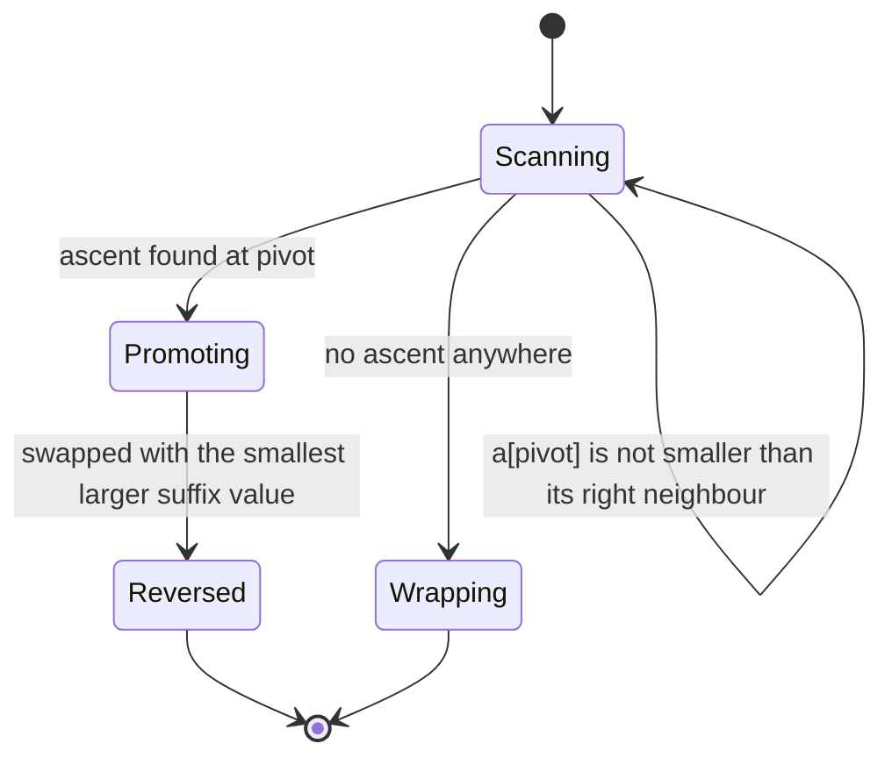
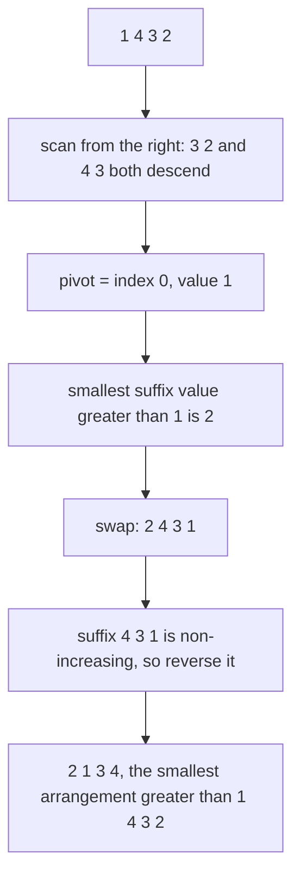

# 134 — Next lexicographical permutation.

> **Tier:** Beginner · **CTCI chapter:** Ch 8 — Recursion and Dynamic Programming
> **Task spec:** [134-next-lexicographical-permutation.md](../../../tasks/beginner/134-next-lexicographical-permutation.md)
> **Solutions:** [Python](../../../solutions/python/beginner/134-next-lexicographical-permutation/solution.py) ·
> [Java](../../../solutions/java/beginner/134-next-lexicographical-permutation/Solution.java) ·
> [JavaScript](../../../solutions/javascript/beginner/134-next-lexicographical-permutation/solution.js) ·
> [C#](../../../solutions/csharp/beginner/134-next-lexicographical-permutation/Solution.cs)

## 1. Problem restatement

**Input:** an array `a` of `n` integers, treated as a single arrangement.

**Output:** the array is rearranged **in place** into the next arrangement in lexicographic order,
and the function reports whether such an arrangement exists. At the last arrangement the function
returns "no" and rewrites the array into the first arrangement (fully ascending), so repeated calls
cycle through all `n!` orderings.

| Call | Return | Array afterwards | Why |
| --- | --- | --- | --- |
| `next_permutation([1, 2, 3])` | true | `[1, 3, 2]` | the last ascent is `2 < 3`, so `2` and `3` trade places |
| `next_permutation([1, 3, 2])` then | true | `[2, 1, 3]` | no ascent before the suffix `[3, 2]`, so the pivot is index 0 |
| `next_permutation([3, 2, 1])` | false | `[1, 2, 3]` | descending input is the last ordering; the wrap reverses it |
| `next_permutation([5])` | false | `[5]` | a single element is both first and last |
| 23 further calls on `[1, 2, 3, 4]` | true each time | `[4, 3, 2, 1]` | those calls visit the remaining arrangements; the 24th call returns false and wraps |
| the 24th call on the same array | false | `[1, 2, 3, 4]` | the loop counts 24 arrangements, asserted in all four files |

The array is mutated even when the answer is `false` — in fact *especially* then, since the wrap is
the whole point of the return value. All four files assert the array contents after the last
permutation, so a version that returns `false` and leaves `[3, 2, 1]` untouched fails.

## 2. Intuition

The brute-force answer is to generate all `n!` arrangements, sort them, and look the current one up.
That is Θ(n · n!) time and space for a query that only needs the *immediate* successor — so the
interesting question is what makes a successor immediate.

Look at the array from the right. The tail is the part that can be rearranged without touching
anything to its left. Two cases:

* **The tail is not already descending.** Take `[1, 2, 3]` with its tail `[2, 3]`: it still ascends,
  so a larger arrangement can be made by working inside the tail alone. The rightmost position where
  the array still goes up, `pivot = 1` here, is the last place we can change.
* **The tail is fully descending.** Take `[1, 3, 2]`: the suffix `[3, 2]` is non-increasing, which
  means it is already the *largest* arrangement of those values. Nothing larger can be built inside
  it, so the change has to reach further left; here `1 < 3`, making `pivot = 0`.

So the pivot is the **rightmost index with `a[pivot] < a[pivot + 1]`**. Everything to its right is
non-increasing, and that is what makes the rest of the algorithm easy:

* because the suffix is non-increasing, scanning it **from the right** visits values in
  non-decreasing order, so the first element greater than `a[pivot]` is the *smallest* element
  greater than `a[pivot]` — exactly the value to promote;
* after swapping, the suffix is still non-increasing, and a non-increasing sequence is its own
  largest arrangement. Reversing it produces the *smallest* arrangement of the same values, which is
  what makes the whole result the smallest arrangement greater than the input.

If no ascent exists at all (`pivot < 0`), the array is the last arrangement: reverse everything to
wrap to the first.



## 3. Algorithm

1. Scan from the right for the rightmost index `pivot` with `a[pivot] < a[pivot + 1]`; while
   `a[pivot] >= a[pivot + 1]`, step left.
2. If no such index exists, the array is the last permutation: reverse the whole array and report
   "no successor".
3. Otherwise scan from the right for the first index `successor` with `a[successor] > a[pivot]` —
   guaranteed to exist, because `a[pivot + 1] > a[pivot]`.
4. Swap `a[pivot]` and `a[successor]`.
5. Reverse the suffix from `pivot + 1` to the end, and report "successor exists".

```text
function next_permutation(a)
    n ← length(a)
    pivot ← n - 2
    while pivot >= 0 and a[pivot] >= a[pivot + 1] do
        pivot ← pivot - 1
    end
    if pivot < 0 then
        reverse the whole array
        return false
    end
    successor ← n - 1
    while a[successor] <= a[pivot] do
        successor ← successor - 1
    end
    swap a[pivot] and a[successor]
    reverse the slice from pivot + 1 to n - 1
    return true
end
```

Every comparison is non-strict exactly where it has to be: `a[pivot] >= a[pivot + 1]` means an equal
pair is *not* an ascent, and `a[successor] <= a[pivot]` means the promoted value must be strictly
larger, so equal values are never swapped past each other. That is what keeps the algorithm correct
on arrays with duplicates such as `[1, 1, 2]`.



The three phases and the wrap are the complete state space of one call:



## 4. Worked example

Take `a = [1, 4, 3, 2]`. The suffix `[4, 3, 2]` is non-increasing, so the rightmost ascent is at
index 0:

| Step | Array | `pivot` | `successor` | Why |
| --- | --- | --- | --- | --- |
| start | `[1, 4, 3, 2]` | 2 | — | `a[2] = 3 >= a[3] = 2`, step left |
| 1 | `[1, 4, 3, 2]` | 1 | — | `a[1] = 4 >= a[2] = 3`, step left |
| 2 | `[1, 4, 3, 2]` | 0 | — | `a[0] = 1 < a[1] = 4`, stop |
| 3 | `[1, 4, 3, 2]` | 0 | 3 | scan right to left: `2 > 1` immediately |
| 4 | `[2, 4, 3, 1]` | 0 | 3 | swap `1` and `2` |
| 5 | `[2, 1, 3, 4]` | 0 | 3 | reverse `[4, 3, 1]` into `[1, 3, 4]` |

The result `[2, 1, 3, 4]` is indeed the smallest arrangement greater than `1432`: everything
starting with `1` is used up, so the leading digit becomes the smallest available value greater than
`1`, namely `2`, and the remaining digits are sorted ascending.



Now the two extreme cases. For `[1, 2, 3]` the ascent is already at the end: `pivot = 1`,
`successor = 2`, the swap gives `[1, 3, 2]` and the suffix `[2]` reverses to itself. For `[3, 2, 1]`
no ascent exists, so the whole array reverses to `[1, 2, 3]` and the call reports `false`. Running
the function in a loop from `[1, 2, 3, 4]` returns `true` for 23 calls and lands back on
`[1, 2, 3, 4]` on the 24th, which is the `24` the files assert.

## 5. Complexity

Let `n` be the length of the array.

| Measure | Bound | Why it holds |
| --- | --- | --- |
| Time, worst case | O(n) | the pivot scan may cross the whole array, the successor scan at most the suffix, and the reversal touches the suffix once |
| Time, best case | Θ(1) | when the ascent sits at `n - 2`, both scans and the reversal examine a constant number of elements |
| Time, average | O(n) | the pivot scan stops on average after a couple of steps, the successor scan is bounded by the suffix length, and the reversal dominates |
| Space | O(1) extra | everything happens in the caller's array; only a few indices and one temporary value are used |
| Calls to enumerate everything | `n!` | each call advances exactly one arrangement, and the wrap is the `n!`-th |
| Naive alternative | Θ(n · n!) | generating all arrangements and sorting them costs factorial time and space for one successor query |

The contrast to state out loud: the enumeration tasks ([132](../../../tasks/beginner/132-generate-permutations-of-distinct-elements.md),
[133](../../../tasks/beginner/133-generate-permutations-with-duplicates-unique.md)) pay factorial
time to *store* every arrangement, while this algorithm pays O(n) to step from one to the next and
never stores anything. In-place stepping is also what makes duplicates free: the non-strict
comparisons handle equal values without any extra bookkeeping.

## 6. Pitfalls and edge cases

- **The wrap mutates.** At the last arrangement the array is reversed into ascending order *and*
  `false` is returned. Python, Java, JavaScript and C# all assert the post-wrap contents, because
  returning `false` while leaving `[3, 2, 1]` in place would break the "cycles through all `n!`"
  contract.
- **Single element.** `n = 1` makes `pivot = -1` immediately, so the array reverses to itself and
  the call reports `false`. `[5]` stays `[5]`.
- **Strict versus non-strict comparisons.** Using `>` instead of `>=` in the pivot scan treats an
  equal pair as an ascent and produces a strictly smaller "next" arrangement; using `<` instead of
  `<=` in the successor scan can swap equal values and skip arrangements. With duplicates such as
  `[1, 1, 2]`, the non-strict forms are what make `[1, 2, 1]` the next arrangement.
- **Forgetting the suffix reversal.** Swapping alone gives a valid but not *next* arrangement, for
  example `[2, 4, 3, 1]` instead of `[2, 1, 3, 4]`. The reversal is what turns the largest suffix
  into the smallest one.
- **Reversing the wrong slice.** The suffix starts at `pivot + 1`, not at `pivot`; including the
  freshly promoted value would undo the swap.
- **The successor scan needs no bounds check.** It is safe only because `pivot >= 0` was established
  first, which guarantees `a[pivot + 1] > a[pivot]` and therefore guarantees a hit.
- **Mutating the caller's data is the contract here.** Unlike the enumeration tasks, this function
  is in place by definition; a pure variant would have to copy first and return the copy. Every file
  documents the mutation, and the tests read the array after the call rather than the return value
  alone.
- **Unsorted input is fine.** The algorithm does not care whether the array starts ascending; the
  wrap only produces ascending order when no ascent exists, which is exactly the decreasing case.
- **Empty array.** `n = 0` gives `pivot = -2`, so the wrap branch reverses nothing and reports
  `false`; the files do not assert this case, but the code path is the single-element one.

## 7. Variants and follow-ups

- **Generating all of them instead of stepping.** [132-generate-permutations-of-distinct-elements.md](../../../tasks/beginner/132-generate-permutations-of-distinct-elements.md)
  and [133-generate-permutations-with-duplicates-unique.md](../../../tasks/beginner/133-generate-permutations-with-duplicates-unique.md)
  store every arrangement and therefore pay factorial space; this task is what you use when only the
  successor is needed.
- **Previous permutation.** Mirror every comparison: find the rightmost descent
  (`a[pivot] > a[pivot + 1]`), swap with the smallest suffix value *smaller* than the pivot, and
  reverse the suffix. The wrap at the first arrangement lands on the descending one.
- **The subset cousin.** [131-generate-all-subsets-recursive.md](../../../tasks/beginner/131-generate-all-subsets-recursive.md)
  enumerates a different family with the same "walk from the right, undo what you changed" instinct,
  and [130-generate-all-subsets-power-set-iterative.md](../../../tasks/beginner/130-generate-all-subsets-power-set-iterative.md)
  is its addressable, row-per-index counterpart.
- **Ordering a buffer by swapping neighbours.** [074-implement-simple-stable-partition.md](../../../tasks/beginner/074-implement-simple-stable-partition.md)
  and the merge-sort inversion count in
  [087-implement-merge-and-count-inversions-using-merge-sort.md](../../../tasks/beginner/087-implement-merge-and-count-inversions-using-merge-sort.md)
  both study how arrangements relate to each other under local operations.
- **Duplicate handling through ordering.** [085-three-sum-return-any-triplet.md](../../../tasks/beginner/085-three-sum-return-any-triplet.md)
  relies on the same property exploited here: a sorted array lets equal values be skipped in a
  predictable order.
- The chapter walkthrough [Recursion and Dynamic Programming](../../ctci/08-recursion-and-dp.md)
  contrasts storing a whole enumeration with stepping through it in constant additional space.

## 8. Check yourself

1. Why is the pivot defined as the rightmost index with `a[pivot] < a[pivot + 1]`?

<details><summary>Show answer</summary>

Because everything to the right of that index is non-increasing — already the largest arrangement of
its own values — so no larger arrangement can be built inside the suffix alone. The pivot is the
last position whose control over the suffix can still be exercised, and increasing it is the only
way to get a strictly larger arrangement with a minimally changed prefix.

</details>

2. Why does scanning the suffix from the right find the *smallest* value greater than the pivot?

<details><summary>Show answer</summary>

The suffix is non-increasing from left to right, so reading it from the right gives values in
non-decreasing order. The first element encountered that exceeds the pivot is therefore the smallest
element in the suffix that exceeds it — the least possible promotion, which keeps the result the
smallest arrangement greater than the input.

</details>

3. What does `next_permutation([3, 2, 1])` return, and what is in the array afterwards?

<details><summary>Show answer</summary>

`false`, and the array is `[1, 2, 3]`. No ascent exists, so the whole array is reversed. All four
files assert both parts, which is why a wrap that skipped the reversal would fail.

</details>

4. Why must the pivot comparison be `>=` and not `>`?

<details><summary>Show answer</summary>

Because an equal pair is not an ascent: `a[pivot] > a[pivot + 1]` would stop the scan at equal
values and treat them as an opportunity, producing an arrangement that is not the next one. The
non-strict form keeps scanning past equals, which is also what makes the algorithm work on inputs
with duplicates such as `[1, 1, 2]`.

</details>

5. Enumerating all permutations of `[1, 2, 3, 4]` takes 24 calls to this function. What is the
combined time, and how does it compare with the task 132 approach?

<details><summary>Show answer</summary>

24 calls at O(n) each is O(n · n!) time, but only O(1) extra space — the arrangements are consumed
one at a time and the caller decides whether to keep any of them. The task 132 backtracking
approach pays Θ(n · n!) time as well, and Θ(n · n!) space, because it stores every arrangement
before returning.

</details>
