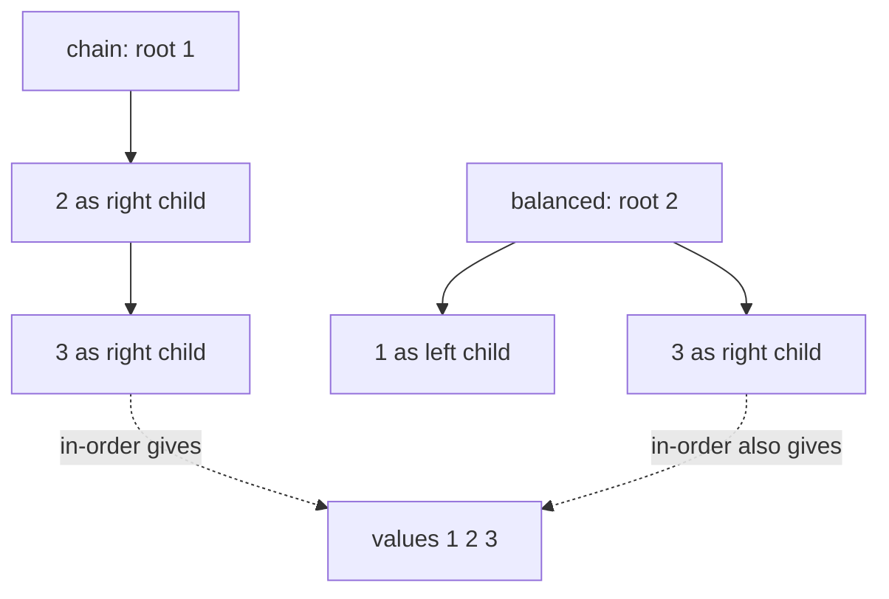
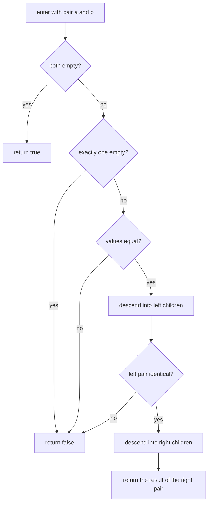
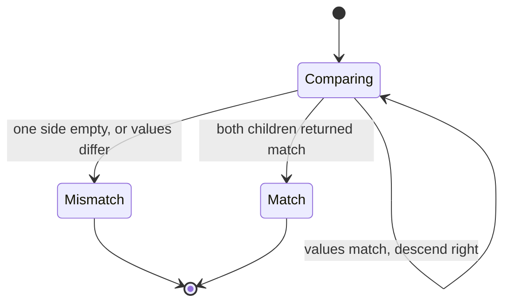
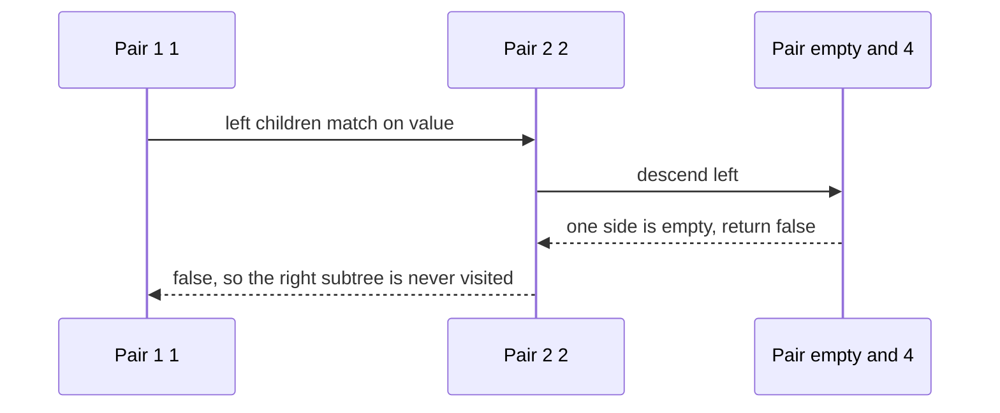

# 135 — Check if two binary trees are identical.

> **Tier:** Beginner · **CTCI chapter:** Ch 4 — Trees and Graphs
> **Task spec:** [135-check-if-two-binary-trees-are-identical.md](../../../tasks/beginner/135-check-if-two-binary-trees-are-identical.md)
> **Solutions:** [Python](../../../solutions/python/beginner/135-check-if-two-binary-trees-are-identical/solution.py) ·
> [Java](../../../solutions/java/beginner/135-check-if-two-binary-trees-are-identical/Solution.java) ·
> [JavaScript](../../../solutions/javascript/beginner/135-check-if-two-binary-trees-are-identical/solution.js) ·
> [C#](../../../solutions/csharp/beginner/135-check-if-two-binary-trees-are-identical/Solution.cs)

## 1. Problem restatement

**Input:** two binary tree roots, either of which may be `None` / `null`.

**Output:** `true` exactly when the two trees have the **same shape and the same values in the same
positions**. Shape matters: moving a value to the other side of its parent is a difference even when
every value still appears once.

The test data is built by a shared helper: each of the four solution files carries a `build_tree` /
`buildTree` function that consumes a **level-order** list, where `None` / `null` marks a missing
child but still occupies a slot. The values are attached in pairs — for each node dequeued, the next
value becomes its left child and the following value its right child. So `[1, 2, 3, None, 4]` builds

```text
        1
       / \
      2   3
       \ 
        4
```

and `[1, 2, 3, 4]` builds a tree with `4` as the **left** child of `2` instead.

| Call | Result | Why |
| --- | --- | --- |
| `are_identical(build([1, 2, 3, None, 4]), build([1, 2, 3, None, 4]))` | `true` | same values, same structure, node for node |
| `are_identical(build([1, 2, 3, None, 4]), build([1, 2, 3, 4]))` | `false` | `4` hangs on the right in the first tree and on the left in the second |
| `are_identical(build([1, 2]), build([1, 3]))` | `false` | same shape, different value at the left child |
| `are_identical(None, None)` | `true` | two empty trees are trivially identical |
| `are_identical(build([1]), None)` | `false` | one tree is empty, the other is not |
| `are_identical(build([7]), build([7]))` | `true` | a single matching node |

Python asserts all six rows, Java and JavaScript five of them (they replace the `[7]` pair with the
one-empty case), and C# four — the equal pair, the shape difference, the value difference and the
double-empty case. The critical row is the second one: a structural difference with an identical
multiset of values must be reported as *not* identical.

## 2. Intuition

The tempting shortcut is to compare traversals: run an in-order walk of both trees and compare the
resulting sequences. It fails, and it fails for a reason worth remembering, because the two trees
below have exactly the same in-order sequence `1, 2, 3` and completely different shapes:



The in-order sequence records *which* values are there, not *where* they are, so a single sequence
can never certify shape. Pre-order with explicit null markers does distinguish shapes, but it costs
a full traversal of both trees and an O(n) pair of lists to compare. The recursive formulation is
simpler *and* better: compare one pair of nodes at a time, stop at the first difference, and never
store anything.

The insight is that identity is a **structural congruence**, so it can be checked incrementally:

* two empty trees are identical;
* an empty tree and a non-empty tree are not;
* two nodes are identical when their values match **and** their left children are identical **and**
  their right children are identical.

That is a definition by simultaneous descent, and it needs no accumulator because the answer is a
single bit. The recursion mirrors the shape of the trees: one recursive call per matched pair of
children, and the early return on the first mismatch prunes everything below it.

## 3. Algorithm

1. If both nodes are empty, report identical.
2. If exactly one node is empty, report not identical.
3. If the two values differ, report not identical.
4. Otherwise recurse on the left children and, only if that succeeds, recurse on the right children;
   report identical exactly when both recursions report identical.

```text
function are_identical(a, b)
    if a is empty and b is empty then
        return true
    end
    if a is empty or b is empty then
        return false
    end
    if value(a) ≠ value(b) then
        return false
    end
    return are_identical(left(a), left(b)) and are_identical(right(a), right(b))
end
```

The order of the first two tests is what makes the recursion well defined: the empty/empty case must
be handled before any value is read, and the "exactly one empty" test must come before `value(a)`,
which would otherwise fail on an empty node. That is also why the recursion in every file reads as a
chain of guards rather than a single compound expression.



The recursion has two states that fail and one that succeeds, and every failing leaf is reached in
constant additional work:



## 4. Worked example

Compare `build([1, 2, 3, None, 4])` with `build([1, 2, 3, 4])`. The first tree puts `4` as the right
child of `2`, the second puts it as the left child, so the depth-first walk reaches the difference
at the fourth pair of nodes:

| Step | Pair examined | Values | Left pair | Right pair | Decision |
| --- | --- | --- | --- | --- | --- |
| 1 | roots | `1` vs `1` | continue | continue | values match |
| 2 | left children | `2` vs `2` | continue | continue | values match |
| 3 | `2`'s left children | empty vs `4` | — | — | exactly one side empty → not identical |

The answer is `false` after three comparisons — the walk never had to look at the right subtree of
the root at all, which is the pruning the early return buys.



Now the matching case, `are_identical(build([1, 2, 3, None, 4]), build([1, 2, 3, None, 4]))`. Every
pair lines up: roots `1`/`1`, then `2`/`2`, then the pair `empty`/`empty` for `2`'s left child, then
`4`/`4` for its right child, then `3`/`3` at the root's right. The tree has four nodes, so the walk
makes four matching value comparisons and five empty-pair comparisons (each leaf's two missing
children), and every one of them returns `true`.

The value-mismatch row behaves the same way as the shape row: `build([1, 2])` and `build([1, 3])`
agree on the roots, then compare `2` against `3`, and return `false` immediately — no descent into
grandchildren, because neither node has any.

## 5. Complexity

Let `n` and `m` be the node counts of the two trees, and `h` the height of the shorter one.

| Measure | Bound | Why it holds |
| --- | --- | --- |
| Time, worst case | O(min(n, m)) | the walk descends only while both sides exist, so it can visit at most the smaller tree's nodes |
| Time, best case | Θ(1) | a mismatch at the roots or a `null` / non-`null` mismatch is decided immediately |
| Space, worst case | O(h) | at most one recursive call per level is open at a time; `h = n` for a fully skewed tree |
| Space, best case | Θ(1) | the constant-work cases allocate no frames |
| Output | O(1) | a single boolean |
| Alternative (compare traversals) | Θ(n + m) time and space | both trees are fully traversed and both sequences are materialised before comparing |

The early return is what makes the average case much cheaper than the worst case in practice: any
difference located near the root collapses the remaining work. The traversal-comparison approach
cannot do that — it has no choice but to enumerate everything, because the comparison only happens
after both sequences exist.

## 6. Pitfalls and edge cases

- **Two empty trees are identical.** `are_identical(None, None)` is `true`, asserted in all four
  files. Treating "no nodes" as a failure is the most common off-by-one here.
- **Exactly one empty tree is not identical.** `are_identical(build([1]), None)` is `false`, asserted
  in Python, Java and JavaScript; the check must happen **after** the both-empty case and **before**
  reading any value.
- **Shape is part of the answer.** `[1, 2, 3, None, 4]` and `[1, 2, 3, 4]` hold the same values and
  are still different trees. Comparing sorted value lists, or in-order sequences, passes this pair
  by accident and fails on other pairs — the sequence-based check cannot see shape at all.
- **Value equality, not identity.** The comparison is `a.val == b.val`; two distinct node objects
  with equal values are identical trees. Nothing in the files compares node identity.
- **Short-circuiting order.** Both recursive calls are combined with `and` / `&&` in that order, so
  the right subtree is never walked when the left already failed. Swapping to an eager evaluation
  would change the cost, not the answer.
- **The level-order builder consumes slots for missing children.** A `None` in the input list means
  "this child does not exist" but the position is still spent, which is why `[1, 2, 3, None, 4]` and
  `[1, 2, 3, 4]` describe different trees with the same node count.
- **Recursion depth.** Depth equals the height of the tree, not the node count: a chain of `n`
  right-children makes `n` nested calls, which is where the O(h) bound becomes O(n).
- **Empty input list.** `build([])` is the same as `build([None])`: both return an empty tree, and
  comparing two of them is `true`.
- **Unequal sizes.** No size is computed anywhere; the walk discovers the difference when one side
  runs out of nodes before the other, which is exactly the "exactly one empty" case.

## 7. Variants and follow-ups

- **Mirror instead of identical.** [143-symmetric-tree-check-mirror.md](../../../tasks/beginner/143-symmetric-tree-check-mirror.md)
  keeps the pairwise descent but crosses the children — `a.left` against `b.right` and `a.right`
  against `b.left` — which turns "same tree" into "mirror image of itself".
- **Height difference instead of exact match.** [142-check-if-tree-is-balanced-height-difference-1.md](../../../tasks/beginner/142-check-if-tree-is-balanced-height-difference-1.md)
  also descends every node once, but returns a height instead of a boolean and uses a sentinel to
  signal failure upward.
- **Serialising the shape.** [148-serialize-and-deserialize-binary-tree-preorder.md](../../../tasks/beginner/148-serialize-and-deserialize-binary-tree-preorder.md)
  turns a tree into a marker-bearing pre-order sequence, which is the explicit alternative to this
  recursion: two trees are identical exactly when their serialisations match.
- **Building the trees being compared.** [144-convert-sorted-array-to-balanced-bst.md](../../../tasks/beginner/144-convert-sorted-array-to-balanced-bst.md)
  constructs a balanced tree from a sorted array, which makes an easy source of equal and unequal
  pairs for this check.
- **Counting and shaping.** [153-count-nodes-in-complete-binary-tree-faster-than-o-n.md](../../../tasks/beginner/153-count-nodes-in-complete-binary-tree-faster-than-o-n.md)
  exploits the structure of a complete tree instead of walking it, the opposite trade to the
  exhaustive walk here.
- The chapter walkthrough [Trees and Graphs](../../ctci/04-trees-and-graphs.md) introduces this
  pairwise descent as the template for every "compare two trees" question.

## 8. Check yourself

1. Why does comparing in-order sequences fail to prove identity?

<details><summary>Show answer</summary>

An in-order walk records values in visit order, and different shapes can produce the same order —
`1 → 2 → 3` as a right chain and a balanced root `2` with children `1` and `3` both yield
`1, 2, 3`. Since the sequence loses the structural information, equal sequences do not imply
identical trees. Pairwise descent never loses it.

</details>

2. What does `are_identical(None, None)` return, and why does the order of the guards matter?

<details><summary>Show answer</summary>

`true`. The both-empty case must be tested first, then "exactly one is empty", and only then the
values. If the value comparison came earlier it would dereference an empty node; if the
exactly-one-empty test came before the both-empty test, two empty trees would be reported as
different.

</details>

3. How many node comparisons does the `[1, 2, 3, None, 4]` versus `[1, 2, 3, 4]` case actually make?

<details><summary>Show answer</summary>

Three: the two roots, the two left children of the roots, and then `2`'s left child in the first
tree against `4` in the second, where one side is empty. The mismatch is detected there and the
right-hand subtrees are never examined.

</details>

4. What is the worst-case recursion depth, and what shape triggers it?

<details><summary>Show answer</summary>

O(h) where `h` is the height, which is O(n) for a fully skewed tree — `build([1, 2, None, 3, None,
4])` is such a chain. A balanced tree of `n` nodes keeps the depth at O(log n).

</details>

5. The two trees in row 2 of the table have four nodes each. Why is the comparison still able to
finish in three steps?

<details><summary>Show answer</summary>

Because the walk stops at the first structural difference instead of comparing node sets. It descends
in lockstep and discovers that one tree has a missing left child where the other has a node; nothing
below that point can change the answer, so the remaining nodes are never visited.

</details>
