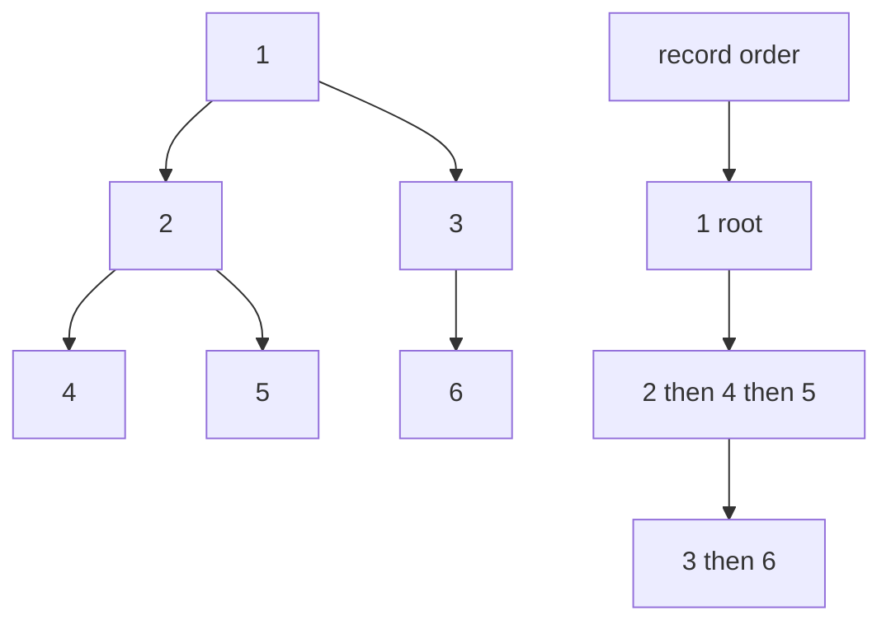
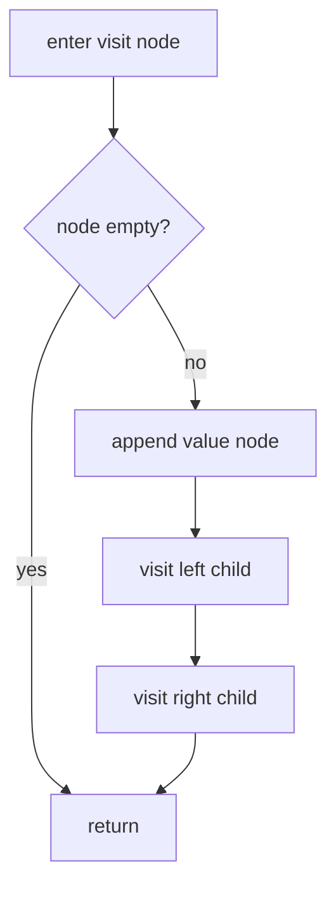
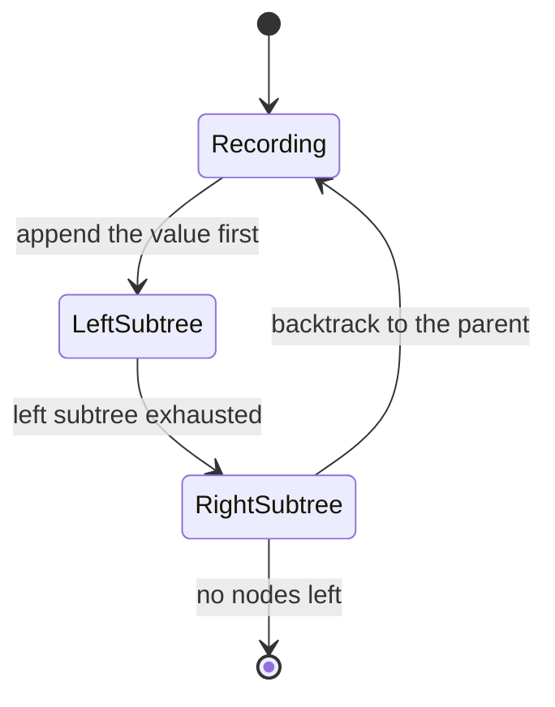
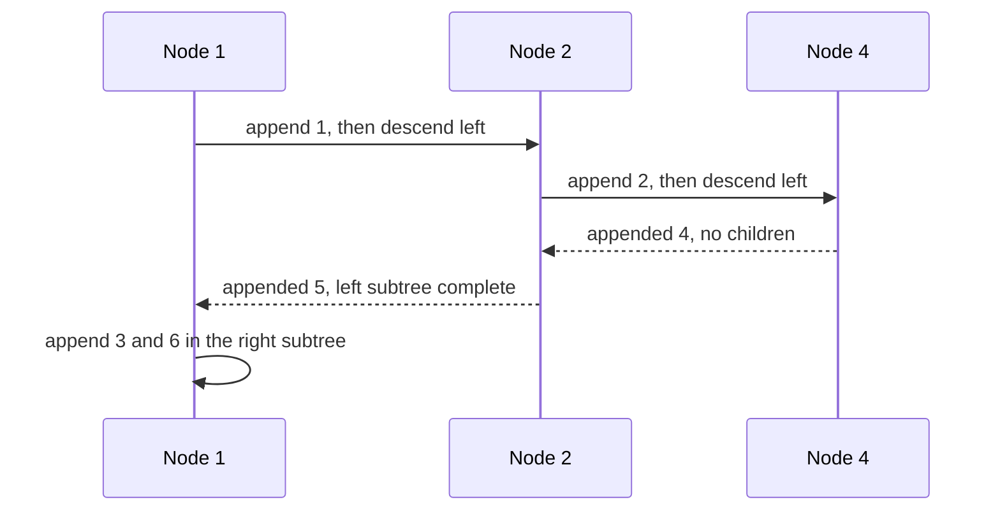

# 136 — Tree preorder traversal recursive.

> **Tier:** Beginner · **CTCI chapter:** Ch 4 — Trees and Graphs
> **Task spec:** [136-tree-preorder-traversal-recursive.md](../../../tasks/beginner/136-tree-preorder-traversal-recursive.md)
> **Solutions:** [Python](../../../solutions/python/beginner/136-tree-preorder-traversal-recursive/solution.py) ·
> [Java](../../../solutions/java/beginner/136-tree-preorder-traversal-recursive/Solution.java) ·
> [JavaScript](../../../solutions/javascript/beginner/136-tree-preorder-traversal-recursive/solution.js) ·
> [C#](../../../solutions/csharp/beginner/136-tree-preorder-traversal-recursive/Solution.cs)

## 1. Problem restatement

**Input:** the root of a binary tree, which may be `None` / `null`.

**Output:** the list of node values in **pre-order** — the node itself, then its whole left subtree,
then its whole right subtree. An empty tree yields an empty list.

The trees come from the shared level-order builder used by all tree tasks in this tier: the input
list is read in pairs, each dequeued node receiving the next value as its left child and the
following value as its right child, with `None` marking a missing child. The test tree is

| The test tree built from `[1, 2, 3, 4, 5, None, 6]` |
| --- |
| root `1`, left `2`, right `3`; then `2` gets `4` and `5`, and `3` gets no left child and `6` on the right |

| Call | Result | Why |
| --- | --- | --- |
| `preorder(build([1, 2, 3, 4, 5, None, 6]))` | `[1, 2, 4, 5, 3, 6]` | root first, then the left subtree `2, 4, 5`, then the right subtree `3, 6` |
| `preorder(None)` | `[]` | nothing to visit |
| `preorder(build([7]))` | `[7]` | a lone node is its own traversal |

The order is asserted exactly in Python and JavaScript (`==` and `deepStrictEqual` against the
literal), and as a joined string in Java and C#. So the list is not just a set of values — a
different traversal order is a failed test.

## 2. Intuition

A traversal is a *rule for when to record a node relative to its subtrees*, and the three classic
rules are three line orderings of the same walk. Pre-order says: record on **arrival**.

The naive implementation copies the answer around: build the left result, build the right result,
and concatenate the three pieces. It is correct and it is quietly quadratic, because each
concatenation copies the left subtree's values again at every ancestor — a left-skewed tree of `n`
nodes copies the same growing prefix `n` times. All four files avoid it by threading a single
mutable output list through the recursion:

* Python's `preorder(node, out=None)` creates the list on the first call and returns it at the end;
* JavaScript uses the same trick with a default parameter, `preorder(node, out = [])`;
* Java and C# split a public one-argument `preorder` / `Preorder` from a private overload that takes
  the output list and returns nothing.

The recursion itself is two lines, and the insight behind those lines is that *the shape of the
recursion is the traversal*. Reading the code top to bottom gives the visit order directly:

```text
record(node)      ← pre-order puts the record first
visit(left)       ← then the entire left subtree
visit(right)      ← then the entire right subtree
```

Every node is reached exactly once, and the accumulator preserves the order because the left
subtree finishes pushing before the right subtree starts.



## 3. Algorithm

1. Take the root and an output list (the wrapper creates an empty one).
2. If the node is empty, return the output unchanged.
3. Record the node's value.
4. Recurse into the left child with the same output list.
5. Recurse into the right child with the same output list, then return the output.

```text
function preorder(root)
    out ← empty list
    visit(root, out)
    return out
end

procedure visit(node, out)
    if node is empty then
        return
    end
    append value(node) to out
    visit(left(node), out)
    visit(right(node), out)
end
```

Only the position of the append distinguishes this from the in-order and post-order variants: moving
it between the two recursive calls gives the in-order walk, and moving it after both gives the
post-order walk. That single-line relationship is the point of the three sibling tasks.



The traversal can also be seen as a machine that visits each node once in a fixed order:



## 4. Worked example

Trace `preorder(build([1, 2, 3, 4, 5, None, 6]))`. The tree is root `1` with left child `2`
(children `4` and `5`) and right child `3` (no left child, right child `6`):

| Step | Call | Action | Output so far |
| --- | --- | --- | --- |
| 1 | `visit(1)` | record `1`, descend left | `[1]` |
| 2 | `visit(2)` | record `2`, descend left | `[1, 2]` |
| 3 | `visit(4)` | record `4`, both children empty | `[1, 2, 4]` |
| 4 | back in `visit(2)` | descend right | `[1, 2, 4]` |
| 5 | `visit(5)` | record `5` | `[1, 2, 4, 5]` |
| 6 | back in `visit(1)` | left subtree done, descend right | `[1, 2, 4, 5]` |
| 7 | `visit(3)` | record `3`, left child is empty | `[1, 2, 4, 5, 3]` |
| 8 | `visit(6)` | record `6` | `[1, 2, 4, 5, 3, 6]` |

Eight rows, six values: the two "back in" rows are returns, not visits, and each of the six nodes is
recorded exactly once.



The contrast with the sibling traversals on the same tree is worth memorising, because the trees are
identical and only the append position changes:

| Order | Sequence |
| --- | --- |
| pre-order (this task) | `1, 2, 4, 5, 3, 6` |
| in-order ([137](../../../tasks/beginner/137-tree-inorder-traversal-recursive.md)) | `4, 2, 5, 1, 3, 6` |
| post-order ([138](../../../tasks/beginner/138-tree-postorder-traversal-recursive.md)) | `4, 5, 2, 6, 3, 1` |

## 5. Complexity

Let `n` be the number of nodes and `h` the height of the tree.

| Measure | Bound | Why it holds |
| --- | --- | --- |
| Time | Θ(n) | one append and one visit per node; every node is reached exactly once |
| Space, output | Θ(n) | the result is one value per node |
| Space, recursion | O(h) | one frame per level of the current path; `h = n` for a skewed tree, `log n` when balanced |
| Space, extra accumulator | Θ(n) | the single output list, which *is* the answer — no per-node copies |
| Naive alternative | O(n · h) | concatenating `left + [node] + right` at every node re-copies the growing left result at each ancestor |

The quadratic alternative is not hypothetical: on a left-skewed tree every node's left result is a
copy of the entire remaining prefix, which is why the files thread the accumulator instead. The
trade-off is that the pure function becomes a helper procedure plus a wrapper.

## 6. Pitfalls and edge cases

- **Empty tree returns `[]`, not `[None]`.** The guard `if node is None: return` runs before any
  append, and all four files assert `preorder(null)` is empty.
- **Single node returns one value.** `build([7])` gives `[7]`; with no children, steps 4 and 5 of the
  algorithm are no-ops.
- **The accumulator must be shared, not recreated.** Each recursive call passes the *same* list. A
  version that creates a fresh list per call and merges results reintroduces the copying cost.
- **Do not append on the way back.** Moving the append after the recursive calls turns this into
  post-order and produces `4, 5, 2, 6, 3, 1`. The tests compare against the exact literal, so the
  mistake is caught immediately.
- **`None` markers still consume a slot.** The builder in `build_tree` nils out a child but the
  position is spent, which is why `[1, 2, 3, 4, 5, None, 6]` puts `6` under `3` rather than under a
  missing node.
- **Recursion depth follows the shape.** A right chain built from `[1, 2, None, 3, None, 4]` needs
  four frames, and a 1000-node chain would need a thousand. Nothing in the files iterates, so the
  stack is the only resource that scales with `h`.
- **Mutating the caller's list is not part of the contract.** Python's `out=None` default means a
  caller can pass a list to append into, but the shipped assertions only use the one-argument form
  and compare the returned list.
- **Node values are assumed comparable only by equality.** Nothing sorts or compares values, so
  duplicate values in the tree are fine — the traversal is positional.

## 7. Variants and follow-ups

- **The other two recursive orders.** [137-tree-inorder-traversal-recursive.md](../../../tasks/beginner/137-tree-inorder-traversal-recursive.md)
  moves the append between the recursive calls and yields sorted order on a BST;
  [138-tree-postorder-traversal-recursive.md](../../../tasks/beginner/138-tree-postorder-traversal-recursive.md)
  moves it after both and is the right choice when a node's answer depends on its children's.
- **Level by level instead of depth first.** [139-level-order-traversal-bfs-of-tree.md](../../../tasks/beginner/139-level-order-traversal-bfs-of-tree.md)
  uses a queue rather than the call stack and groups the output into levels.
- **Pre-order without recursion.** [148-serialize-and-deserialize-binary-tree-preorder.md](../../../tasks/beginner/148-serialize-and-deserialize-binary-tree-preorder.md)
  writes the pre-order sequence with explicit null markers, which is the traversal used to rebuild
  the tree, and [156-implement-iterator-for-a-binary-tree-inorder.md](../../../tasks/beginner/156-implement-iterator-for-a-binary-tree-inorder.md)
  is the same idea with a stack and a `next` call.
- **Traversals as a comparison tool.** [135-check-if-two-binary-trees-are-identical.md](../../../tasks/beginner/135-check-if-two-binary-trees-are-identical.md)
  explains why a single traversal sequence cannot certify shape, which is why that task recurses
  pairwise instead.
- **Ordering work bottom-up.** [140-max-depth-of-binary-tree.md](../../../tasks/beginner/140-max-depth-of-binary-tree.md)
  and [144-convert-sorted-array-to-balanced-bst.md](../../../tasks/beginner/144-convert-sorted-array-to-balanced-bst.md)
  both build their answers from the results of their children.
- The chapter walkthrough [Trees and Graphs](../../ctci/04-trees-and-graphs.md) frames the three
  depth-first orders as one walk with three possible append positions.

## 8. Check yourself

1. What exactly distinguishes pre-order from post-order in the code?

<details><summary>Show answer</summary>

The position of the append relative to the two recursive calls. Pre-order appends before both,
in-order appends between them, post-order appends after both. The tree walk and the number of
recursive calls are identical in all three.

</details>

2. Why do the files pass an output list into the recursion instead of returning concatenated lists?

<details><summary>Show answer</summary>

Because `left + [value] + right` copies the left result again at every ancestor. On a skewed tree
that is O(n) copying per node, i.e. O(n²) overall. With one shared list each value is appended
exactly once, so the traversal is Θ(n).

</details>

3. What does `preorder(None)` return, and where in the algorithm is that decided?

<details><summary>Show answer</summary>

`[]`. The empty check is the first statement of `visit`, so no value is ever appended for an empty
node — and the wrapper's freshly created empty list is returned unchanged.

</details>

4. For the test tree, how many times is each node's value appended, and in what order?

<details><summary>Show answer</summary>

Exactly once each, in the order `1, 2, 4, 5, 3, 6`: the root first, then the left subtree in the same
pre-order rule (`2` before its children `4` and `5`), then the right subtree (`3` before `6`).

</details>

5. What is the recursion depth for the test tree, and what would it be for a right-leaning chain of
`n` nodes?

<details><summary>Show answer</summary>

The test tree is three levels tall, so at most three frames are open at once. A right-leaning chain
of `n` nodes is `n` levels tall and therefore needs `n` frames — the O(h) space bound becomes O(n),
which is the practical limit of the recursive formulation.

</details>
