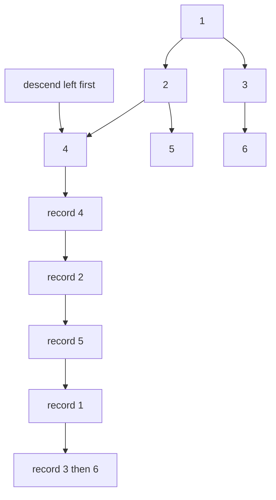
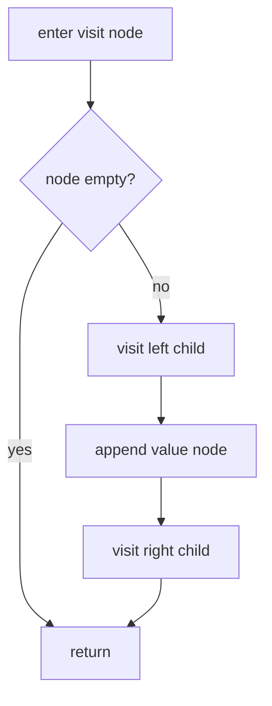
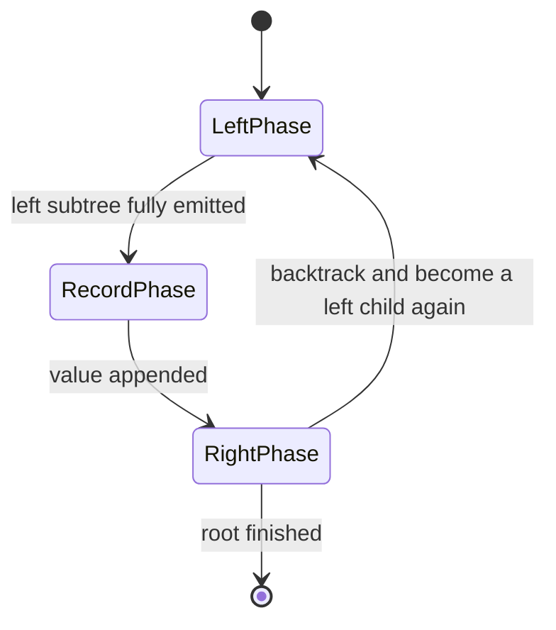
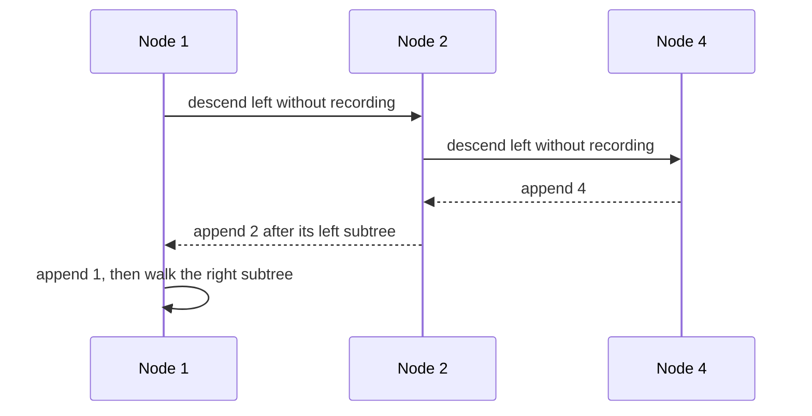

# 137 — Tree inorder traversal recursive.

> **Tier:** Beginner · **CTCI chapter:** Ch 4 — Trees and Graphs
> **Task spec:** [137-tree-inorder-traversal-recursive.md](../../../tasks/beginner/137-tree-inorder-traversal-recursive.md)
> **Solutions:** [Python](../../../solutions/python/beginner/137-tree-inorder-traversal-recursive/solution.py) ·
> [Java](../../../solutions/java/beginner/137-tree-inorder-traversal-recursive/Solution.java) ·
> [JavaScript](../../../solutions/javascript/beginner/137-tree-inorder-traversal-recursive/solution.js) ·
> [C#](../../../solutions/csharp/beginner/137-tree-inorder-traversal-recursive/Solution.cs)

## 1. Problem restatement

**Input:** the root of a binary tree, which may be `None` / `null`.

**Output:** the list of node values in **in-order** — the whole left subtree, then the node itself,
then the whole right subtree. An empty tree yields an empty list.

The test tree is the one used by every traversal task in this tier, built by the shared level-order
helper from `[1, 2, 3, 4, 5, None, 6]`: root `1`, left child `2` with children `4` and `5`, right
child `3` with a missing left child and `6` on the right. In-order visits it differently from
pre-order, because the root is no longer the first thing recorded.

| Call | Result | Why |
| --- | --- | --- |
| `inorder(build([1, 2, 3, 4, 5, None, 6]))` | `[4, 2, 5, 1, 3, 6]` | left subtree `4, 2, 5`, then the root `1`, then right subtree `3, 6` |
| `inorder(None)` | `[]` | nothing to visit |
| `inorder(build([7]))` | `[7]` | a lone node has no left subtree, so it is recorded immediately |

Python compares against the literal, JavaScript uses a deep equality, and Java and C# compare joined
strings — so the exact sequence `4, 2, 5, 1, 3, 6` is the contract.

## 2. Intuition

Pre-order records a node on arrival; in-order records it **between** its two subtrees, and that
apparently minor change gives the traversal its most important property: on a **binary search
tree** the output is sorted ascending. The reason is a direct consequence of the placement. Every
node of the left subtree holds a smaller value, every node of the right subtree a larger one, and
the node's own value is recorded after all smaller values and before all larger ones — which is
exactly the definition of sorted order. On a general binary tree the traversal is still perfectly
well defined, it just does not have that extra meaning.

For this test tree, `1` is recorded in the middle rather than first, and the walk from `1` is
therefore: descend to `4` (which has no left child, so it is recorded at once), return to `2` and
record it, descend to `5`, then come back up to `1`, then walk the right subtree `3 → 6`.

The implementation is the same accumulator-threaded recursion as the pre-order task — Python and
JavaScript use a default parameter, Java and C# split a public one-argument method from a private
overload — with the append moved between the two recursive calls. That single-line move is the whole
algorithm, and it is the reason the three depth-first tasks are worth reading together: the tree
walk never changes, only the moment of recording.



## 3. Algorithm

1. Take the root and an output list (the wrapper creates an empty one).
2. If the node is empty, return the output unchanged.
3. Recurse into the left child with the same output list.
4. Record the node's value.
5. Recurse into the right child with the same output list, then return the output.

```text
function inorder(root)
    out ← empty list
    visit(root, out)
    return out
end

procedure visit(node, out)
    if node is empty then
        return
    end
    visit(left(node), out)
    append value(node) to out
    visit(right(node), out)
end
```

The append is the only difference from the pre-order variant, and it is what makes the traversal
symmetric: everything about the left side is emitted, then the node, then everything about the
right side. That symmetry is why an in-order walk of a BST is a *proof* of sortedness rather than an
accident — and why the validation task
[145-validate-bst-property-inorder.md](../../../tasks/beginner/145-validate-bst-property-inorder.md)
can check the BST property by walking the tree this way and watching for a decrease.



The recursion always returns from the left subtree before appending, so the machine can be drawn as
three phases per node:



## 4. Worked example

Trace `inorder(build([1, 2, 3, 4, 5, None, 6]))`:

| Step | Call | Action | Output so far |
| --- | --- | --- | --- |
| 1 | `visit(1)` | descend left, nothing recorded yet | `[]` |
| 2 | `visit(2)` | descend left | `[]` |
| 3 | `visit(4)` | left child empty, so record `4` | `[4]` |
| 4 | back in `visit(2)` | record `2` | `[4, 2]` |
| 5 | `visit(5)` | left child empty, record `5` | `[4, 2, 5]` |
| 6 | back in `visit(1)` | record `1` | `[4, 2, 5, 1]` |
| 7 | `visit(3)` | left child is missing, so record `3` at once | `[4, 2, 5, 1, 3]` |
| 8 | `visit(6)` | record `6` | `[4, 2, 5, 1, 3, 6]` |

The first four rows are the whole point: the walk reaches the deepest left node `4` before anything
is recorded, and the root `1` is not emitted until both of `2`'s children are done. The order of
*visits* and the order of *records* are therefore different sequences, which is exactly what the
diagram of the recursion makes visible.



On a BST the same trace produces sorted output. Task 144 builds the balanced BST for `[1, 2, 3]` as
root `2` with children `1` and `3`, and asserts that the in-order walk of the result equals the
input array — sortedness follows from where the values sit, not from anything the traversal does.
The general tree in this task is not a BST, so its in-order sequence `4, 2, 5, 1, 3, 6` is simply
the positional order the recursion produces.

## 5. Complexity

Let `n` be the number of nodes and `h` the height.

| Measure | Bound | Why it holds |
| --- | --- | --- |
| Time | Θ(n) | each node is visited once and its value appended once; the number of edge traversals is `2(n - 1)` |
| Space, output | Θ(n) | one value per node |
| Space, recursion | O(h) | at most one frame per level of the current path; `log n` when balanced, `n` when skewed |
| Space, extra accumulator | Θ(n) | the shared output list, which is the answer itself |
| Naive alternative | O(n · h) | returning `inorder(left) + [value] + inorder(right)` re-copies the growing left result at every ancestor |

The output-size bound is tight and cannot be improved: the traversal is a permutation of the node
values, so every one of them must be written once. What the recursive formulation controls is the
*extra* space, which is the path length rather than the node count.

## 6. Pitfalls and edge cases

- **Empty tree returns `[]`.** The empty guard precedes any recording, and all four files assert
  `inorder(null)` is empty rather than `[null]`.
- **Single node returns one value.** With no left child, the record happens immediately; `build([7])`
  gives `[7]`.
- **The append position is the algorithm.** Moving it above the left recursion yields pre-order
  (`1, 2, 4, 5, 3, 6`), moving it below both yields post-order (`4, 5, 2, 6, 3, 1`) — three
  different asserted outputs from the same tree.
- **A general binary tree does not produce sorted output.** Sorted order is a property of in-order
  *on a BST*, not of the traversal. The test tree `[1, 2, 3, 4, 5, None, 6]` is not a BST in the
  required sense, and its in-order sequence is `4, 2, 5, 1, 3, 6`.
- **Missing children still consume a builder slot.** `[1, 2, 3, 4, 5, None, 6]` gives `3` a missing
  left child and `6` on the right; the `None` is not skipped over, so the position is spent.
- **One shared accumulator.** Every recursive call receives the same list; building a new list per
  call and merging would be correct but quadratic on skewed trees.
- **Recursion depth follows the height.** A left-leaning chain of `n` nodes makes `n` nested calls
  before the first value is recorded, which is both the deepest stack and the longest delay before
  output. The iterative `next`-style variant in
  [156-implement-iterator-for-a-binary-tree-inorder.md](../../../tasks/beginner/156-implement-iterator-for-a-binary-tree-inorder.md)
  exists precisely to avoid that.
- **Duplicate values are fine.** Nothing compares values to decide where to go, so repeated values
  are traversed in positional order without ambiguity.

## 7. Variants and follow-ups

- **The other two depth-first orders.** [136-tree-preorder-traversal-recursive.md](../../../tasks/beginner/136-tree-preorder-traversal-recursive.md)
  records on arrival and is the natural order for serialisation;
  [138-tree-postorder-traversal-recursive.md](../../../tasks/beginner/138-tree-postorder-traversal-recursive.md)
  records last and is the natural order for bottom-up aggregation.
- **In-order as a correctness oracle.** [145-validate-bst-property-inorder.md](../../../tasks/beginner/145-validate-bst-property-inorder.md)
  checks the BST property by walking this order and verifying that nothing decreases, which is the
  practical use of the sorted-output property.
- **In-order without recursion.** [156-implement-iterator-for-a-binary-tree-inorder.md](../../../tasks/beginner/156-implement-iterator-for-a-binary-tree-inorder.md)
  keeps a stack and yields one value per call, and
  [148-serialize-and-deserialize-binary-tree-preorder.md](../../../tasks/beginner/148-serialize-and-deserialize-binary-tree-preorder.md)
  shows the pre-order equivalent used for encoding.
- **Trees that are not searched.** [135-check-if-two-binary-trees-are-identical.md](../../../tasks/beginner/135-check-if-two-binary-trees-are-identical.md)
  explains why one traversal sequence cannot certify shape, which matters whenever a traversal is
  proposed as an equality test.
- **Ordering work by level.** [139-level-order-traversal-bfs-of-tree.md](../../../tasks/beginner/139-level-order-traversal-bfs-of-tree.md)
  replaces depth-first order with a queue, and
  [140-max-depth-of-binary-tree.md](../../../tasks/beginner/140-max-depth-of-binary-tree.md) builds
  its answer from child results.
- The chapter walkthrough [Trees and Graphs](../../ctci/04-trees-and-graphs.md) derives the
  three depth-first orders from one walk and uses in-order as the BST sortedness proof.

## 8. Check yourself

1. Why does in-order produce sorted output on a BST?

<details><summary>Show answer</summary>

Because every value in the left subtree is smaller than the node and every value in the right subtree
is larger, and in-order emits the left subtree first, then the node, then the right subtree. Each
value is therefore emitted after all smaller ones and before all larger ones — sorted by definition.

</details>

2. What would `inorder(build([1, 2, 3, 4, 5, None, 6]))` return if the append were placed before the
left recursion?

<details><summary>Show answer</summary>

`[1, 2, 4, 5, 3, 6]` — that is pre-order, the order asserted by task 136. The tree walk is unchanged;
only the moment of recording moved.

</details>

3. How many frames are open at the moment the first value is recorded?

<details><summary>Show answer</summary>

As many as there are nodes on the path to the leftmost node, inclusive. In the test tree that is
three: the calls for `1`, `2` and `4`. Nothing has been appended until `4` is reached, which is why
in-order delays output on a left-leaning tree.

</details>

4. Is the in-order sequence a safe way to test whether two trees are identical?

<details><summary>Show answer</summary>

No. Two differently shaped trees can share one in-order sequence — a right chain of `1, 2, 3` and a
balanced root `2` with children `1` and `3` both give `1, 2, 3`. Identity needs the pairwise descent
used by [135](../../../tasks/beginner/135-check-if-two-binary-trees-are-identical.md).

</details>

5. What is the space cost of the recursion, and what does it depend on?

<details><summary>Show answer</summary>

O(h) frames, one per level of the current root-to-node path. It depends on the *shape* of the tree,
not its size: a balanced tree of `n` nodes needs O(log n) frames, while a skewed chain needs O(n).
The output list is separate and always Θ(n).

</details>
