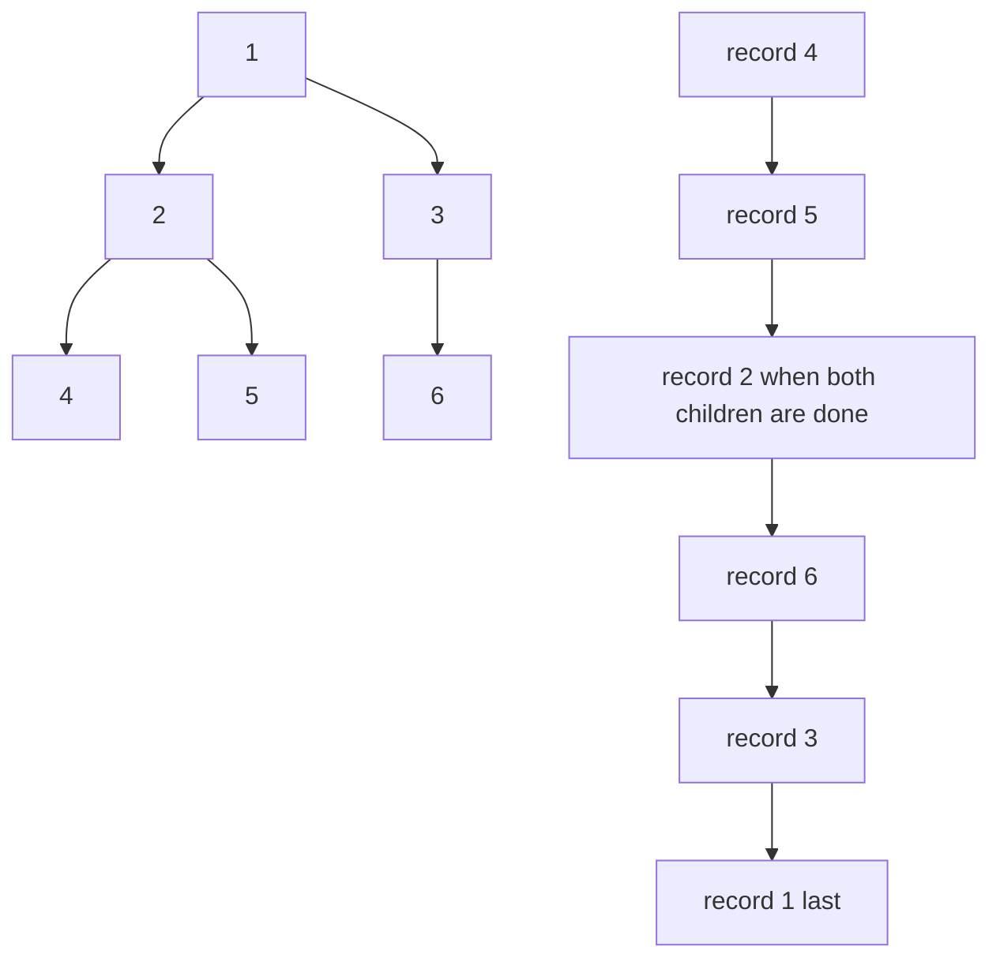
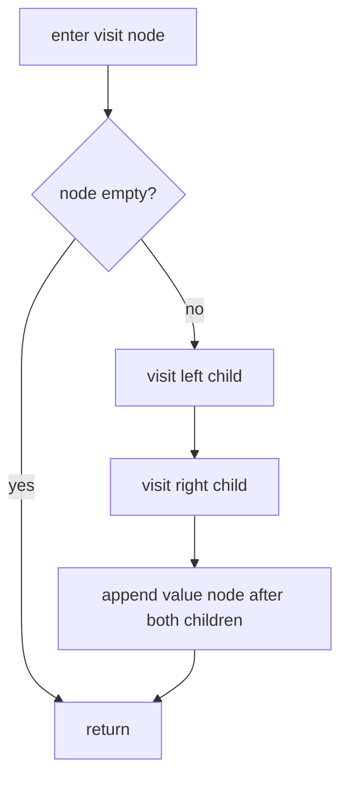
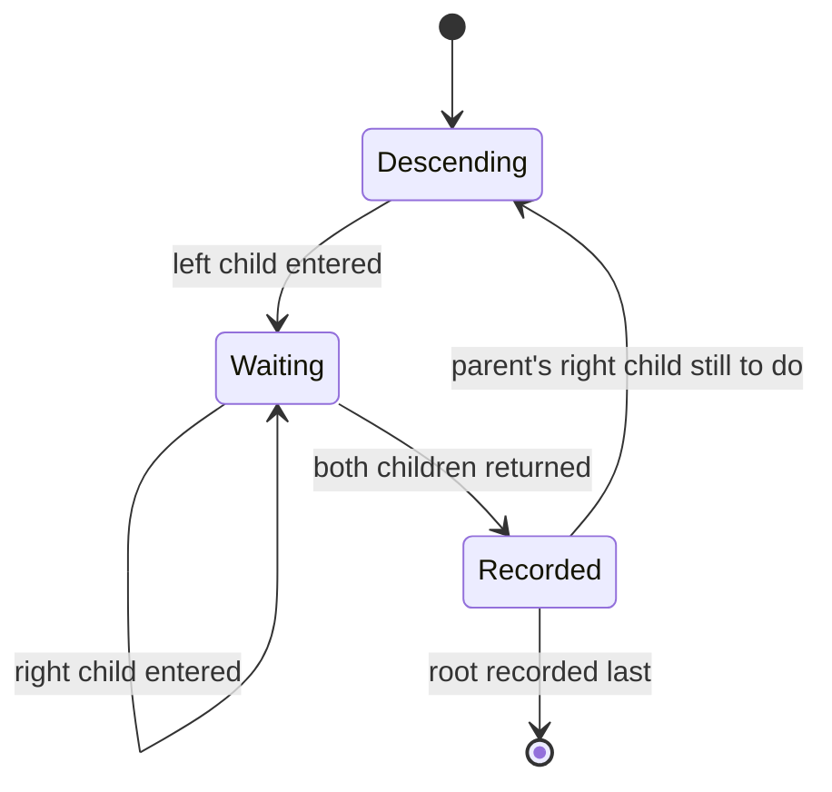
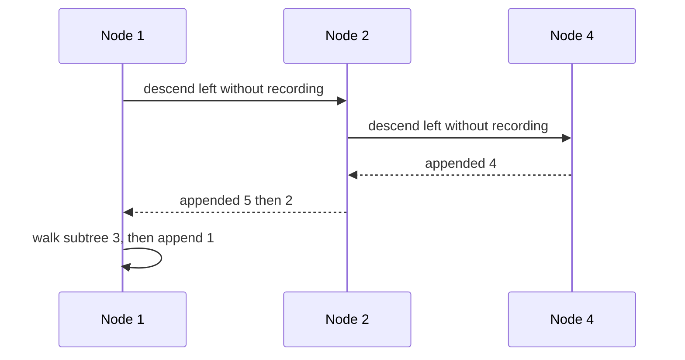

# 138 — Tree postorder traversal recursive.

> **Tier:** Beginner · **CTCI chapter:** Ch 4 — Trees and Graphs
> **Task spec:** [138-tree-postorder-traversal-recursive.md](../../../tasks/beginner/138-tree-postorder-traversal-recursive.md)
> **Solutions:** [Python](../../../solutions/python/beginner/138-tree-postorder-traversal-recursive/solution.py) ·
> [Java](../../../solutions/java/beginner/138-tree-postorder-traversal-recursive/Solution.java) ·
> [JavaScript](../../../solutions/javascript/beginner/138-tree-postorder-traversal-recursive/solution.js) ·
> [C#](../../../solutions/csharp/beginner/138-tree-postorder-traversal-recursive/Solution.cs)

## 1. Problem restatement

**Input:** the root of a binary tree, which may be `None` / `null`.

**Output:** the list of node values in **post-order** — the whole left subtree, then the whole right
subtree, then the node itself. An empty tree yields an empty list.

The test tree comes from the shared level-order builder with `[1, 2, 3, 4, 5, None, 6]`: root `1`,
left child `2` with children `4` and `5`, right child `3` whose left child is missing and whose
right child is `6`. Post-order is the mirror image of pre-order here, and it emits the root last.

| Call | Result | Why |
| --- | --- | --- |
| `postorder(build([1, 2, 3, 4, 5, None, 6]))` | `[4, 5, 2, 6, 3, 1]` | subtree `2` finishes as `4, 5, 2`, subtree `3` as `6, 3`, then the root `1` |
| `postorder(None)` | `[]` | nothing to visit |
| `postorder(build([7]))` | `[7]` | no children, so the single node is recorded at once |

Python and JavaScript assert the literal sequence, Java and C# compare joined strings — so
`4, 5, 2, 6, 3, 1` is the contract, and any other order fails even if the node set is right.

## 2. Intuition

Post-order records a node **after** both of its subtrees, and that placement is not cosmetic: it is
the order in which a node's own answer becomes computable. Whenever a value at a node depends on
values computed at its children — the height of a subtree, the sum of a subtree, the serialised form
of a subtree, whether a subtree is balanced — the children must be finished first, and post-order is
exactly the sequence that guarantees it.

For this test tree the walk goes: all the way down the left spine to `4`, record it; across to `5`,
record it; then back up to `2` and record it; then down the right side to `6`, record it, then `3`,
and finally the root `1`. Every value is recorded only when nothing below it is outstanding, so a
post-order sequence is a valid *bottom-up* computation order.

Two practical consequences come out of that:

* the last recorded value is always the root, so printing a post-order sequence backwards starts at
  the root — the same shape as a pre-order walk with the children swapped;
* the sequence is the natural trace of a recursive function that returns an aggregate, which is why
  so many of the tree tasks in this tier are post-order recursions even when they do not say so.

The implementation is the accumulator-threaded recursion used by the sibling tasks — Python and
JavaScript take an optional output parameter defaulting to a fresh list, Java and C# split a public
one-argument method from a private overload — with the append placed after both recursive calls.



## 3. Algorithm

1. Take the root and an output list (the wrapper creates an empty one).
2. If the node is empty, return the output unchanged.
3. Recurse into the left child with the same output list.
4. Recurse into the right child with the same output list.
5. Record the node's value, then return the output.

```text
function postorder(root)
    out ← empty list
    visit(root, out)
    return out
end

procedure visit(node, out)
    if node is empty then
        return
    end
    visit(left(node), out)
    visit(right(node), out)
    append value(node) to out
end
```

Compared with the other two orders, the recursion is identical and only the append moves: before both
calls (pre-order), between them (in-order), after both (post-order). That is why the three task files
have the same shape and different assertions. The single guard at the top keeps the accumulator free
of empty markers — leaves simply fall through both recursive calls and are recorded.



The machine view shows the two phases a node passes through: descending through it, and recording
it once its children have finished.



## 4. Worked example

Trace `postorder(build([1, 2, 3, 4, 5, None, 6]))`:

| Step | Call | Action | Output so far |
| --- | --- | --- | --- |
| 1 | `visit(1)` | descend left | `[]` |
| 2 | `visit(2)` | descend left | `[]` |
| 3 | `visit(4)` | no children, record `4` | `[4]` |
| 4 | `visit(5)` | reached after returning to `2` | `[4, 5]` |
| 5 | back in `visit(2)` | both children done, record `2` | `[4, 5, 2]` |
| 6 | `visit(3)` | left child missing, so descend right directly | `[4, 5, 2]` |
| 7 | `visit(6)` | record `6` | `[4, 5, 2, 6]` |
| 8 | back in `visit(3)` | record `3` | `[4, 5, 2, 6, 3]` |
| 9 | back in `visit(1)` | record the root last | `[4, 5, 2, 6, 3, 1]` |

The output is grouped by subtree: the first three values are exactly subtree `2`, the next two are
subtree `3`, and the final value is the root. That grouping is a general property — a post-order
sequence of a subtree appears as one contiguous block ending with that subtree's root — and it is
what makes post-order usable for rebuilding trees from a sequence.



The three depth-first orders side by side on the same tree, which is the cheapest way to remember
which is which:

| Order | Sequence | When the node is recorded |
| --- | --- | --- |
| pre-order ([136](../../../tasks/beginner/136-tree-preorder-traversal-recursive.md)) | `1, 2, 4, 5, 3, 6` | before its subtrees |
| in-order ([137](../../../tasks/beginner/137-tree-inorder-traversal-recursive.md)) | `4, 2, 5, 1, 3, 6` | between them |
| post-order (this task) | `4, 5, 2, 6, 3, 1` | after them |

## 5. Complexity

Let `n` be the number of nodes and `h` the height of the tree.

| Measure | Bound | Why it holds |
| --- | --- | --- |
| Time | Θ(n) | one visit and one append per node; each of the `n - 1` edges is traversed once down and once back |
| Space, output | Θ(n) | the sequence contains every node value exactly once |
| Space, recursion | O(h) | frames open along the current path only; O(log n) balanced, O(n) skewed |
| Space, extra accumulator | Θ(n) | the single shared output list — the answer itself, with no intermediate copies |
| Naive alternative | O(n · h) | building `postorder(left) + postorder(right) + [value]` re-copies both subtree results at every ancestor |

Note that the recursion's peak *depth* is unrelated to the output grouping: the entire left subtree
is recorded before the right subtree is entered, but only `h` frames are ever live. What grows with
`n` is the output, not the stack.

## 6. Pitfalls and edge cases

- **Empty tree returns `[]`.** The guard comes first, so no value is appended for an empty node; all
  four files assert that `postorder(null)` is empty.
- **Single node returns one value immediately.** With both children empty, the two recursive calls
  return at once and the node is recorded: `build([7])` gives `[7]`.
- **The root is always last.** If the root is not the final element of the output, the append is in
  the wrong place — the most common symptom of an accidental in-order or pre-order.
- **The append must come after *both* calls.** Placing it between them produces the in-order sequence
  `4, 2, 5, 1, 3, 6`, which the assertions reject.
- **Bottom-up does not mean iterative.** Nothing about post-order requires a loop; the recursion
  simply gives the children's results before the parent's. The related tasks that need a bottom-up
  *aggregate* — [140-max-depth-of-binary-tree.md](../../../tasks/beginner/140-max-depth-of-binary-tree.md),
  [142-check-if-tree-is-balanced-height-difference-1.md](../../../tasks/beginner/142-check-if-tree-is-balanced-height-difference-1.md) —
  return values from the recursion instead of appending to a list.
- **Accumulator sharing.** All recursive calls pass the same list; a fresh list per call reintroduces
  the quadratic copying that the accumulator was introduced to avoid.
- **Missing children consume a builder slot.** In `[1, 2, 3, 4, 5, None, 6]` the `None` gives `3` no
  left child while still spending the position, which is why `6` ends up as `3`'s right child.
- **Depth follows the shape, not the count.** The deepest stack for the test tree is three frames; a
  right chain built from `[1, 2, None, 3, None, 4]` would need four for a tree of four nodes.
- **Values are never compared.** Post-order is positional: duplicate values do not affect it, and no
  ordering assumption is made about them.

## 7. Variants and follow-ups

- **The other two depth-first orders.** [136-tree-preorder-traversal-recursive.md](../../../tasks/beginner/136-tree-preorder-traversal-recursive.md)
  records on arrival and [137-tree-inorder-traversal-recursive.md](../../../tasks/beginner/137-tree-inorder-traversal-recursive.md)
  records between the subtrees; the pre-order order is the natural one for serialisation.
- **Bottom-up aggregates.** [140-max-depth-of-binary-tree.md](../../../tasks/beginner/140-max-depth-of-binary-tree.md)
  computes `1 + max(left, right)` after both children return its answer, and
  [142-check-if-tree-is-balanced-height-difference-1.md](../../../tasks/beginner/142-check-if-tree-is-balanced-height-difference-1.md)
  returns a sentinel upwards when a subtree already violates the height rule — both are post-order
  recursions returning values instead of appending them.
- **Building trees from a sequence.** [144-convert-sorted-array-to-balanced-bst.md](../../../tasks/beginner/144-convert-sorted-array-to-balanced-bst.md)
  and [148-serialize-and-deserialize-binary-tree-preorder.md](../../../tasks/beginner/148-serialize-and-deserialize-binary-tree-preorder.md)
  show the mirror-image use of traversals: writing a sequence that is enough to reconstruct a tree.
- **Level by level.** [139-level-order-traversal-bfs-of-tree.md](../../../tasks/beginner/139-level-order-traversal-bfs-of-tree.md)
  abandons depth-first order entirely and groups the output by level, which is what a queue buys.
- **In-order as an oracle.** [145-validate-bst-property-inorder.md](../../../tasks/beginner/145-validate-bst-property-inorder.md)
  uses the in-order walk to prove sortedness, the one property post-order cannot provide.
- The chapter walkthrough [Trees and Graphs](../../ctci/04-trees-and-graphs.md) presents post-order
  as the order in which recursive tree computations return their values.

## 8. Check yourself

1. Why is the root the last value in a post-order sequence?

<details><summary>Show answer</summary>

Because a node is recorded only after both its subtrees have been fully emitted. The root owns every
other node as a descendant, so its append is the last one to happen — for any non-empty tree, and
regardless of shape.

</details>

2. What changes in the code if the append is moved between the two recursive calls?

<details><summary>Show answer</summary>

The traversal becomes in-order and the output changes to `4, 2, 5, 1, 3, 6`. The tree walk is
untouched; only the moment of recording changes, which is why the three depth-first tasks are one
algorithm with three assertions.

</details>

3. Why is post-order the natural order for bottom-up aggregation?

<details><summary>Show answer</summary>

Because a node's value is computed after both children have returned theirs — for example
`1 + max(depth(left), depth(right))`. Post-order is the traversal that guarantees that order, so any
recursion that consumes child results is implicitly a post-order walk.

</details>

4. For the test tree, what is the peak number of open frames, and how does it compare with `n`?

<details><summary>Show answer</summary>

Three frames (`1`, `2`, `4`), while `n = 6`. The peak is the height of the tree, not the number of
nodes: it is O(h), which is O(log n) for a balanced tree and O(n) for a chain.

</details>

5. Both subtree `2` and subtree `3` appear as contiguous blocks in the output. Is that a coincidence?

<details><summary>Show answer</summary>

No. Post-order emits a subtree's values as one block that ends with that subtree's root, because the
entire subtree is finished before the walk moves on. That property is what lets post-order sequences
reconstruct trees when combined with in-order sequences.

</details>
