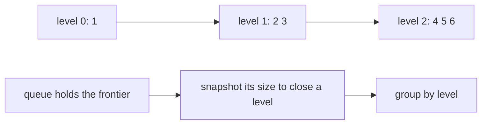
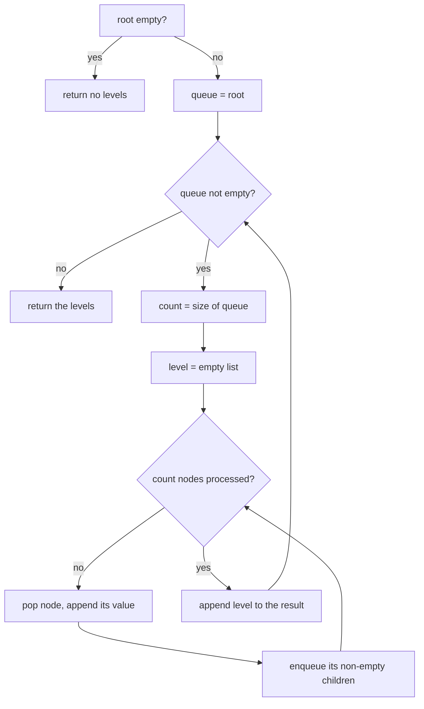
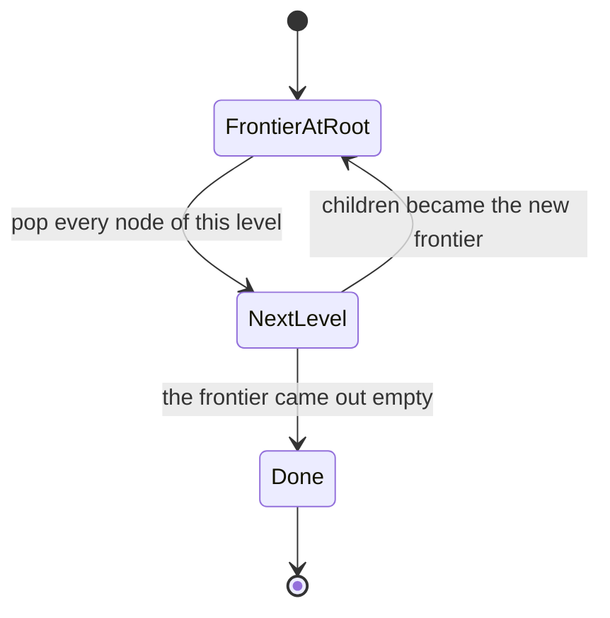
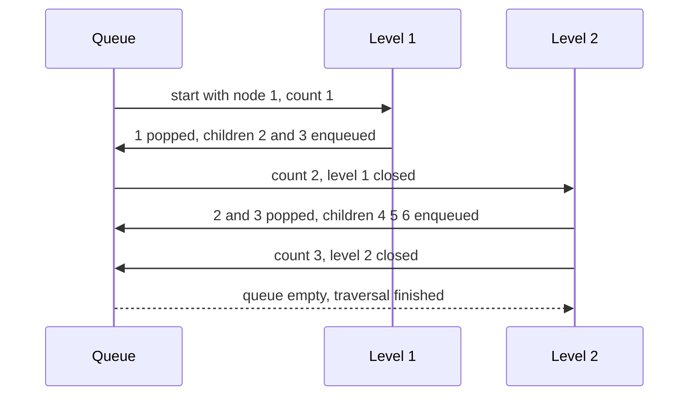

# 139 — Level order traversal (BFS) of tree.

> **Tier:** Beginner · **CTCI chapter:** Ch 4 — Trees and Graphs
> **Task spec:** [139-level-order-traversal-bfs-of-tree.md](../../../tasks/beginner/139-level-order-traversal-bfs-of-tree.md)
> **Solutions:** [Python](../../../solutions/python/beginner/139-level-order-traversal-bfs-of-tree/solution.py) ·
> [Java](../../../solutions/java/beginner/139-level-order-traversal-bfs-of-tree/Solution.java) ·
> [JavaScript](../../../solutions/javascript/beginner/139-level-order-traversal-bfs-of-tree/solution.js) ·
> [C#](../../../solutions/csharp/beginner/139-level-order-traversal-bfs-of-tree/Solution.cs)

## 1. Problem restatement

**Input:** the root of a binary tree, which may be `None` / `null`.

**Output:** the node values grouped **by level**, left to right within each level — a list of lists,
where element `d` holds the values of all nodes at depth `d`. An empty tree yields an empty list
(no levels at all, not one empty level).

The test tree is the shared one, built from `[1, 2, 3, 4, 5, None, 6]`: root `1`, left child `2`
with children `4` and `5`, right child `3` whose left child is missing and whose right child is `6`.

| Call | Result | Why |
| --- | --- | --- |
| `level_order(build([1, 2, 3, 4, 5, None, 6]))` | `[[1], [2, 3], [4, 5, 6]]` | one list per depth, three depths |
| `level_order(None)` | `[]` | no nodes means no levels |
| `level_order(build([7]))` | `[[7]]` | one node, one level |
| `level_order(build([1, 2, 3]))` | `[[1], [2, 3]]` | asserted in Python for the pure two-level case |
| `level_order(build([1, 2, 3, 4, 5, None, 6])).Count` (C#) | 3, with levels `1` and `4,5,6` | C# checks the count and the first and last level contents |

The grouping is what makes this task different from the depth-first traversals: the values
`1, 2, 3, 4, 5, 6` are the same set in every task, but the *structure* of the output — which values
belong to which level — is the contract here.

## 2. Intuition

Depth-first traversal uses the call stack, and the stack remembers exactly one path. That is why
pre-order, in-order and post-order can all be written as two recursive calls with an append in a
different place — and also why none of them can tell you where one level ends and the next begins
without extra bookkeeping.

Breadth-first traversal uses a **queue** instead, and a queue remembers a whole frontier. That is
the key insight, and it pays off twice:

* the frontier of a tree is exactly one level, so the queue's contents *are* a level;
* nodes enter the queue in depth order, so the traversal visits depth `0`, then `1`, then `2`, and
  never mixes them.

The one subtlety is the level boundary. A loop of the form `while queue is not empty` pops one node
at a time and pushes its children at the back, so the notion of "current level" has to be captured
explicitly. The files do it by taking a **snapshot of the queue length** at the start of each level:

```text
count ← number of nodes currently queued
repeat count times
    pop a node, record it, enqueue its children
end
```

Those children land behind the nodes that have not been popped yet, so they are all part of the
*next* level and cannot be consumed by this pass. The snapshot is a one-line trick that turns an
unstructured queue into a level-by-level walk.



## 3. Algorithm

1. If the root is empty, return an empty list of levels.
2. Put the root in a queue.
3. While the queue is not empty:
   1. record the queue's current size as the number of nodes in this level;
   2. start a new empty level list;
   3. repeat that many times: pop a node, append its value to the level list, and enqueue its
      non-empty children;
   4. append the level list to the result.
4. Return the result.

```text
function level_order(root)
    if root is empty then
        return empty list
    end
    levels ← empty list
    queue ← queue containing root
    while queue is not empty do
        count ← size of queue
        level ← empty list
        repeat count times
            node ← pop the front of queue
            append value(node) to level
            if left(node) is not empty then
                push left(node) to the back of queue
            end
            if right(node) is not empty then
                push right(node) to the back of queue
            end
        end
        append level to levels
    end
    return levels
end
```

Two details are load-bearing. The `count` is read **before** any popping, so the children enqueued
during the pass are not consumed by it. And empty children are never enqueued, which is why the
queue never contains placeholders and a missing child simply does not appear in any level.



The frontier moves down the tree one level per outer iteration, which is the state that the whole
algorithm maintains:



## 4. Worked example

Trace `level_order(build([1, 2, 3, 4, 5, None, 6]))`:

| Pass | Queue at pass start | `count` | Nodes popped | Level recorded | Queue after the pass |
| --- | --- | --- | --- | --- | --- |
| 1 | `[1]` | 1 | `1` | `[1]` | `[2, 3]` |
| 2 | `[2, 3]` | 2 | `2`, `3` | `[2, 3]` | `[4, 5, 6]` |
| 3 | `[4, 5, 6]` | 3 | `4`, `5`, `6` | `[4, 5, 6]` | `[]` |

The third pass is the interesting one: `4` and `5` are leaves, and `6` is a leaf as well, so nothing
is enqueued and the outer loop terminates with three levels recorded — the asserted
`[[1], [2, 3], [4, 5, 6]]`.

Note that node `3` contributes only `6`: its left child is the `None` in the level-order input, and
because empty children are never enqueued, the missing child leaves no trace in the output. Only the
*positions* in the original input list carried that information.



The contrast with the depth-first order on the same tree is worth keeping in view, because both
visit every node exactly once:

| Traversal | Output | Data structure |
| --- | --- | --- |
| pre-order ([136](../../../tasks/beginner/136-tree-preorder-traversal-recursive.md)) | `1, 2, 4, 5, 3, 6` | call stack |
| in-order ([137](../../../tasks/beginner/137-tree-inorder-traversal-recursive.md)) | `4, 2, 5, 1, 3, 6` | call stack |
| post-order ([138](../../../tasks/beginner/138-tree-postorder-traversal-recursive.md)) | `4, 5, 2, 6, 3, 1` | call stack |
| level order (this task) | `[1], [2, 3], [4, 5, 6]` | queue |

## 5. Complexity

Let `n` be the number of nodes, `h` the height and `w` the widest level.

| Measure | Bound | Why it holds |
| --- | --- | --- |
| Time | Θ(n) | every node is enqueued once, dequeued once and recorded once; each edge is followed once |
| Space, output | Θ(n) | every value appears exactly once, plus one list object per level |
| Space, queue | O(w) | the queue holds at most one level plus the children already enqueued, which is bounded by the widest level |
| Space, recursion | none | the algorithm is iterative; the call stack does not grow |
| Number of outer iterations | exactly `h` | one per level |
| Naive alternative | O(n · h) | recording the level of each node by re-walking from the root, or finding each level by a depth-limited search |

The queue bound O(w) is the interesting one: on a balanced tree `w` is about `n / 2` while the
depth-first traversals use O(log n) stack, and on a skewed chain `w = 1` while they use O(n) stack
instead. Neither formulation dominates; they trade width for depth, which is the standard
breadth-first versus depth-first trade in tree algorithms.

## 6. Pitfalls and edge cases

- **Empty tree yields no levels.** `level_order(null)` is `[]`, asserted in Python, JavaScript and
  C#. Returning `[[]]` — one empty level — is a different, wrong answer, and it is the mistake the
  early return exists to prevent.
- **Single node yields one level.** `build([7])` gives `[[7]]`, not `[7]`: the output is always a
  list of lists.
- **The size snapshot must be taken before popping.** Without it, children enqueued during the pass
  are consumed by the same pass, the levels collapse into one long list, and the grouping is lost.
- **Only non-empty children are enqueued.** The files test `if node.left` / `!= null` before
  enqueuing, so placeholders never reach the queue and no None value can leak into the output.
- **A `None` in the builder list is not a node.** In `[1, 2, 3, 4, 5, None, 6]` the `None` marks `3`'s
  absent left child; it consumes a position in the input but produces nothing in the traversal.
- **Queue discipline matters.** A stack would make this a depth-first walk with a completely
  different output; the FIFO order is what makes the frontier a level.
- **Level order is not a single sequence.** Any test that flattens the output and compares against
  `[1, 2, 3, 4, 5, 6]` loses the whole point — C# checks the count *and* the per-level contents.
- **Values are not compared.** Duplicate values in different levels are recorded in their own level
  and never merged, because grouping is positional.
- **Width can exceed the depth.** The queue holds up to a full level, so a tree that is wide and
  shallow uses more memory here than a depth-first walk would; conversely a deep chain costs the
  depth-first recursions O(n) frames while this task uses a queue of one.

## 7. Variants and follow-ups

- **The depth-first counterparts.** [136](../../../tasks/beginner/136-tree-preorder-traversal-recursive.md),
  [137](../../../tasks/beginner/137-tree-inorder-traversal-recursive.md) and
  [138](../../../tasks/beginner/138-tree-postorder-traversal-recursive.md) visit the same nodes in a
  different order using the call stack; comparing them with this task is the quickest way to see the
  queue-versus-stack trade.
- **Level counting as an answer.** [140-max-depth-of-binary-tree.md](../../../tasks/beginner/140-max-depth-of-binary-tree.md)
  can be solved by counting the outer iterations of this loop, and
  [141-min-depth-of-binary-tree.md](../../../tasks/beginner/141-min-depth-of-binary-tree.md) returns
  the first level that contains a leaf — both are this algorithm with a different exit condition.
- **The front of the queue as a sanity check.** [142-check-if-tree-is-balanced-height-difference-1.md](../../../tasks/beginner/142-check-if-tree-is-balanced-height-difference-1.md)
  and [143-symmetric-tree-check-mirror.md](../../../tasks/beginner/143-symmetric-tree-check-mirror.md)
  both descend recursively, but the pairwise queue of mirrored nodes in the symmetric check is the
  level-order idea applied to two trees at once.
- **Pre-order used for encoding.** [148-serialize-and-deserialize-binary-tree-preorder.md](../../../tasks/beginner/148-serialize-and-deserialize-binary-tree-preorder.md)
  writes a tree as a depth-first sequence; level order is the alternative encoding that makes the
  level boundaries explicit.
- **Grid breadth-first search.** The queue discipline reappears outside trees in
  [103-shortest-path-in-unweighted-grid-bfs.md](../../../tasks/beginner/103-shortest-path-in-unweighted-grid-bfs.md)
  and [102-flood-fill-algorithm-dfs-bfs.md](../../../tasks/beginner/102-flood-fill-algorithm-dfs-bfs.md).
- The chapter walkthrough [Trees and Graphs](../../ctci/04-trees-and-graphs.md) introduces
  breadth-first search as the queue-based counterpart of depth-first traversal.

## 8. Check yourself

1. What exactly does the size snapshot accomplish?

<details><summary>Show answer</summary>

It freezes how many nodes belong to the current level. Nodes popped during the pass enqueue their
children at the back of the queue, behind everything that has not been popped yet, so those children
are not consumed by the current pass and become the next level automatically.

</details>

2. Why does `level_order(null)` return `[]` and not `[[]]`?

<details><summary>Show answer</summary>

Because a tree with no nodes has no levels. Each level list is created only when the queue is
non-empty at the start of an outer iteration, so an empty tree never enters the loop. The three
files that assert this case fix `[]` as the contract.

</details>

3. What is `level_order(build([1, 2, 3, 4, 5, None, 6]))[2]`?

<details><summary>Show answer</summary>

`[4, 5, 6]` — depth 2 holds the children of the second level: `4` and `5` under node `2`, and `6`
under node `3`. Node `3`'s missing left child contributes nothing, which is why the level has three
values rather than four.

</details>

4. How does the memory use compare with a recursive depth-first traversal?

<details><summary>Show answer</summary>

This task uses O(w) for the queue, where `w` is the widest level, and no call stack at all. The
recursive traversals use O(h) stack frames and no queue. On a balanced tree the queue is the more
expensive of the two; on a skewed chain the recursion is — each formulation is bounded by a
different dimension of the tree.

</details>

5. Where does the queue's FIFO order actually matter?

<details><summary>Show answer</summary>

Everywhere: nodes are popped in the order they were enqueued, which is the order of increasing depth.
Replacing the queue with a stack would visit grandchildren before siblings, producing a depth-first
sequence — the level grouping would disappear entirely.

</details>
