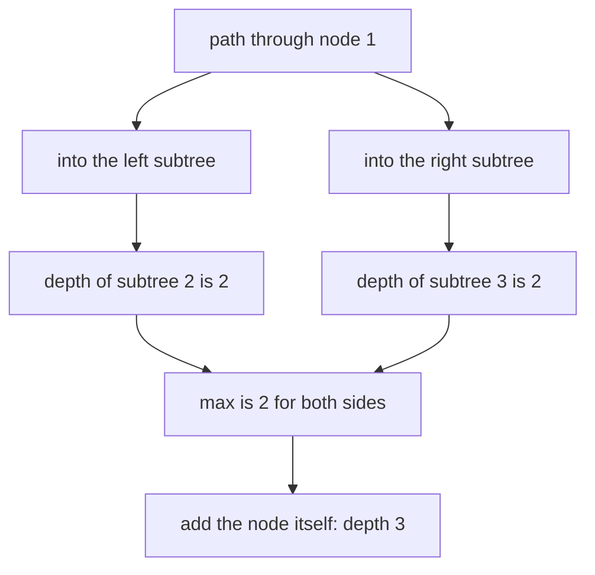
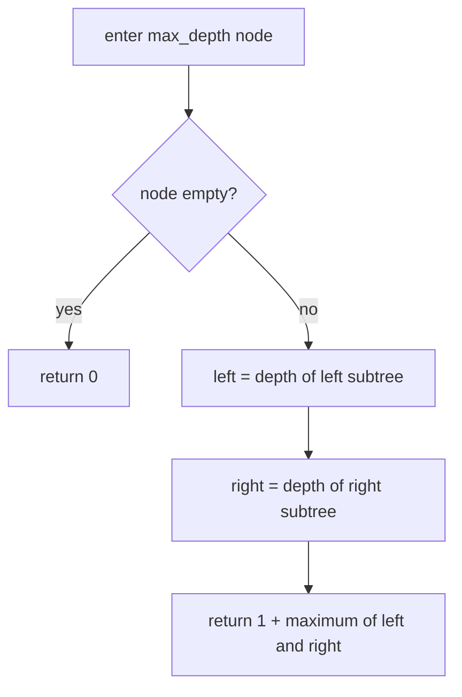
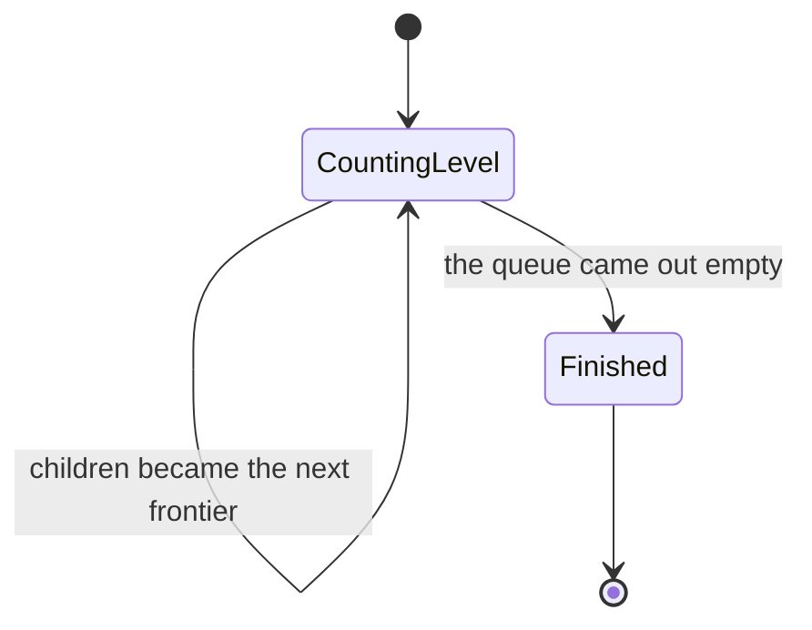
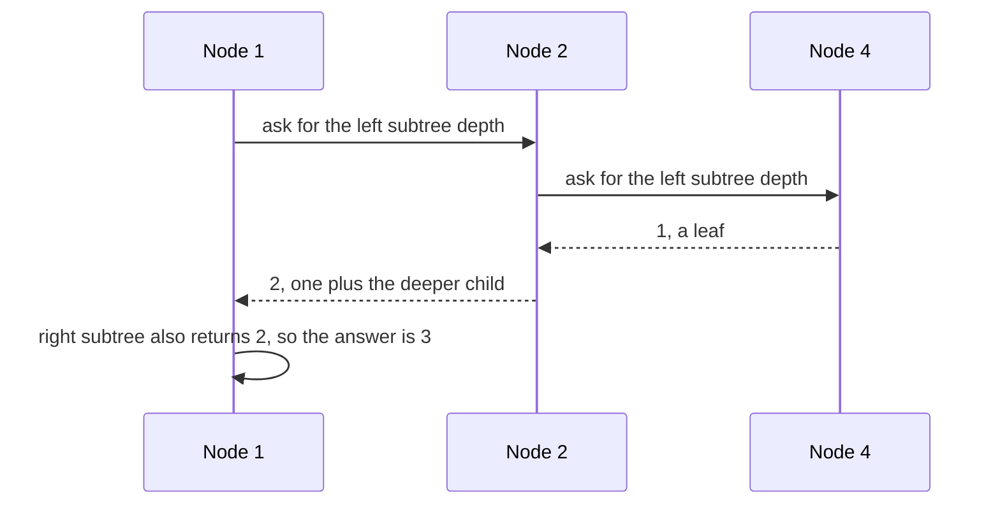

# 140 — Max depth of binary tree.

> **Tier:** Beginner · **CTCI chapter:** Ch 4 — Trees and Graphs
> **Task spec:** [140-max-depth-of-binary-tree.md](../../../tasks/beginner/140-max-depth-of-binary-tree.md)
> **Solutions:** [Python](../../../solutions/python/beginner/140-max-depth-of-binary-tree/solution.py) ·
> [Java](../../../solutions/java/beginner/140-max-depth-of-binary-tree/Solution.java) ·
> [JavaScript](../../../solutions/javascript/beginner/140-max-depth-of-binary-tree/solution.js) ·
> [C#](../../../solutions/csharp/beginner/140-max-depth-of-binary-tree/Solution.cs)

## 1. Problem restatement

**Input:** the root of a binary tree, which may be `None` / `null`.

**Output:** the number of nodes on the longest path from the root down to any leaf. The convention
is **node counting**, so an empty tree has depth `0` and a single node has depth `1`.

| Call | Result | Why |
| --- | --- | --- |
| `max_depth(build([1, 2, 3, 4, 5, None, 6]))` | `3` | the deepest path is `1 → 2 → 4` (or `1 → 2 → 5`, or `1 → 3 → 6`), three nodes |
| `max_depth(None)` | `0` | no nodes, no path |
| `max_depth(build([7]))` | `1` | a lone node is a path of length one |
| `max_depth(build([1, 2, None, 3, None, 4]))` | `4` | a right-leaning chain: depth equals the node count |
| `max_depth_iterative(...)` | the same values | the BFS variant is asserted to agree with the recursion on every test input |

Each file ships **two** implementations and asserts that they agree: the recursive
`max_depth` / `MaxDepth` and a BFS `max_depth_iterative` / `MaxDepthIterative` that counts levels.
Python cross-checks them over `[1, 2, 3, 4, 5, None, 6]`, `[1, None, 2]` and `[1, 2, 3]`; JavaScript
does the same for its inputs; C# asserts the skewed case for both.

The tree layout matters for reading the table: `[1, 2, None, 3, None, 4]` is a chain in which each
node's only child is on the right, so four nodes sit on one path.

## 2. Intuition

The definition of depth is recursive and that is not an accident — it is the shape of the tree
itself:

```text
depth(empty) = 0
depth(node)  = 1 + max(depth(left), depth(right))
```

A path through a node either goes into the left subtree or into the right one; the longest path picks
whichever side is deeper, and adds the node itself. The `1 +` is the node-counting convention:
an empty subtree contributes nothing, so the base case is `0`.

Two observations make the recursion obviously correct:

* the answer for a node depends only on its children's answers, so the recursion is a **post-order**
  computation — children first, then the combination ([138](../../../tasks/beginner/138-tree-postorder-traversal-recursive.md));
* the recursion visits each node once for the `max`, so nothing is recomputed, which is what makes
  this O(n) rather than the O(n²) that a "compute the height of the left subtree, then of the right
  subtree, then recurse into both" formulation would cost.

The alternative is to notice that "longest path" is also "the number of levels", which is exactly
what the level-order traversal of [139](../../../tasks/beginner/139-level-order-traversal-bfs-of-tree.md)
counts. `max_depth_iterative` is that traversal stripped down: a queue, a counter incremented once
per level, no level lists. Both routes appear in the files, and their agreement is asserted, so the
two definitions of depth — recursive maximum and number of levels — are checked against each other
rather than assumed equal.



## 3. Algorithm

Recursive route:

1. If the node is empty, return `0`.
2. Compute the depth of the left subtree recursively.
3. Compute the depth of the right subtree recursively.
4. Return `1 + max(left, right)`.

Iterative (BFS) route:

1. If the root is empty, return `0` and initialise a level counter to `0`.
2. Put the root in a queue.
3. While the queue is not empty: increment the counter, then pop exactly the nodes of the current
   level, enqueuing their non-empty children.
4. Return the counter.

```text
function max_depth(node)
    if node is empty then
        return 0
    end
    return 1 + maximum(max_depth(left(node)), max_depth(right(node)))
end

function max_depth_iterative(root)
    if root is empty then
        return 0
    end
    depth ← 0
    queue ← queue containing root
    while queue is not empty do
        depth ← depth + 1
        count ← size of queue
        repeat count times
            node ← pop the front of queue
            if left(node) is not empty then
                push left(node) to the back of queue
            end
            if right(node) is not empty then
                push right(node) to the back of queue
            end
        end
    end
    return depth
end
```

The recursive route is three lines and touches every node exactly once. The iterative route is the
level-order loop with the level *lists* replaced by a counter: each outer iteration proves that at
least one node exists at that depth. Neither route stores per-node state, which is why they are so
short.



The BFS variant is a machine that advances one frontier per iteration:



## 4. Worked example

Trace the recursion on `build([1, 2, 3, 4, 5, None, 6])`. The calls return bottom-up, so the table
lists them in the order their values become known:

| Step | Call | Children's depths | Returns |
| --- | --- | --- | --- |
| 1 | `max_depth(4)` | both empty → `0`, `0` | `1` |
| 2 | `max_depth(5)` | both empty → `0`, `0` | `1` |
| 3 | `max_depth(2)` | left `1`, right `1` | `2` |
| 4 | `max_depth(6)` | both empty → `0`, `0` | `1` |
| 5 | `max_depth(3)` | left empty → `0`, right `1` | `2` |
| 6 | `max_depth(1)` | left `2`, right `2` | `3` |

Two things are visible in that order. First, the leaves are resolved before their parents, which is
why this is a post-order computation in disguise. Second, the root's two subtrees have the same
depth here, so the `max` does not have to break a tie; on the chain `[1, 2, None, 3, None, 4]` every
node has only a right child, each `max` compares `0` against a real value, and the depth grows by
exactly one per level until it reaches `4`.



The BFS route on the same tree counts the same thing differently:

| Pass | Queue at pass start | Counter after the pass |
| --- | --- | --- |
| 1 | `[1]` | 1 |
| 2 | `[2, 3]` | 2 |
| 3 | `[4, 5, 6]` | 3 |

Both routes answer `3`, which is the cross-check the files assert for this tree, for `[1, None, 2]`
and for `[1, 2, 3]`.

## 5. Complexity

Let `n` be the number of nodes, `h` the height of the tree and `w` its widest level.

| Measure | Bound | Why it holds |
| --- | --- | --- |
| Time, recursion | Θ(n) | one call per node, one comparison per internal node |
| Time, BFS | Θ(n) | every node is enqueued once and dequeued once |
| Space, recursion | O(h) | frames along one root-to-leaf path; here `h` equals the answer, so a depth-`d` tree needs `d` frames |
| Space, BFS | O(w) | the queue holds up to one frontier, bounded by the widest level |
| Space, output | O(1) | a single integer |
| Naive alternative | O(n · h) | recomputing both subtree heights at every node while also recursing into them |

Neither route dominates. The recursion's footprint is the *answer* — a chain of `n` nodes needs `n`
frames — while the BFS footprint is the widest level, which is `n / 2` for a balanced tree but `1`
for a chain. That is the same dimension trade as in
[139](../../../tasks/beginner/139-level-order-traversal-bfs-of-tree.md), and it is why the files
carry both rather than declaring one the winner.

## 6. Pitfalls and edge cases

- **Empty tree has depth `0`, not `1`.** The base case returns `0`, and all four files assert
  `max_depth(null) == 0`. Treating empty as a leaf of depth one would make every tree one deeper.
- **Node counting, not edge counting.** `build([7])` is `1`, and a two-node tree is `2`. The two
  conventions differ by one on every non-empty tree, so an off-by-one here is invisible on the empty
  case and obvious on the single node.
- **A missing child is depth `0`, not depth `1`.** `max_depth(3)` in the test tree is `2` even though
  `3` has only one child: the missing side contributes `0`, which is why no special case is needed
  inside `max`.
- **`max`, not `min`, and not a sum.** Using the smaller subtree, or adding the two, both give wrong
  answers; the only correct combination is `1 + max`.
- **Recomputing heights is the classic accidental quadratic.** Calling a separate `height` helper on
  each child *and* recursing is what gives O(n²) on a chain; the shipped recursion computes and
  returns in the same pass.
- **A skewed tree is a stack risk.** The recursion depth equals the answer, so a 1000-node chain
  needs 1000 frames — the BFS variant in the same file avoids that entirely by using a queue instead.
- **BFS counting counts levels, not nodes.** The counter is incremented once per outer iteration, and
  the inner loop consumes exactly one level; incrementing per node would return `n`.
- **The two routes must agree.** That is asserted rather than argued, so an implementation that
  changes the depth convention in one route only is caught immediately.
- **Duplicate values are irrelevant.** Ordering and equality play no role; the answer depends purely
  on the shape.

## 7. Variants and follow-ups

- **The minimum instead of the maximum.** [141-min-depth-of-binary-tree.md](../../../tasks/beginner/141-min-depth-of-binary-tree.md)
  cannot simply swap `max` for `min`: a missing child is not a leaf, and the shortest path must end
  at a real leaf. That task carries the corrected recursion and a BFS route that stops at the first
  leaf.
- **Heights of both subtrees, at every node.** [142-check-if-tree-is-balanced-height-difference-1.md](../../../tasks/beginner/142-check-if-tree-is-balanced-height-difference-1.md)
  reuses this exact `1 + max(...)` computation, adds a comparison of the two child heights, and
  propagates a failure sentinel to keep the whole check O(n).
- **Level boundaries as a tool.** [139-level-order-traversal-bfs-of-tree.md](../../../tasks/beginner/139-level-order-traversal-bfs-of-tree.md)
  produces the level lists that this task's BFS route only counts.
- **Depth as a construction constraint.** [144-convert-sorted-array-to-balanced-bst.md](../../../tasks/beginner/144-convert-sorted-array-to-balanced-bst.md)
  builds a tree whose depth is minimal for its node count — the array of length 7 becomes a tree of
  depth 3 — and verifies the bound with the same height recursion.
- **Bottom-up aggregates in general.** [138-tree-postorder-traversal-recursive.md](../../../tasks/beginner/138-tree-postorder-traversal-recursive.md)
  is the traversal order this recursion follows, and
  [153-count-nodes-in-complete-binary-tree-faster-than-o-n.md](../../../tasks/beginner/153-count-nodes-in-complete-binary-tree-faster-than-o-n.md)
  shows what becomes possible once the tree's shape is known.
- The chapter walkthrough [Trees and Graphs](../../ctci/04-trees-and-graphs.md) builds tree height
  and balance out of this one recursion.

## 8. Check yourself

1. Why is the base case `0` rather than `1`?

<details><summary>Show answer</summary>

Because depth counts nodes on the path, and an empty subtree has no nodes on it. Returning `1` for an
empty node would make a leaf's missing children look like real levels and inflate every answer by
one.

</details>

2. What is the depth of `build([1, 2, None, 3, None, 4])`, and which bound does that illustrate?

<details><summary>Show answer</summary>

`4` — the tree is a right-leaning chain of four nodes. It illustrates that the recursion depth equals
the answer, so a chain of `n` nodes needs O(n) frames; the BFS route in the same file uses a queue of
size one instead.

</details>

3. How does the BFS route know when a level ends?

<details><summary>Show answer</summary>

By snapshotting the queue size at the start of each outer iteration and processing exactly that many
nodes. The counter is incremented once per outer iteration, so it equals the number of levels, which
equals the maximum depth under node counting.

</details>

4. Would using `min` inside the recursion give the right answer for this task?

<details><summary>Show answer</summary>

No. This task asks for the longest root-to-leaf path, so the combination is `1 + max(left, right)`.
The `min` variant is the subject of [141](../../../tasks/beginner/141-min-depth-of-binary-tree.md),
and even there it is not a straight swap of the operator, because a node with a single child is not a
leaf and must not let its missing side win the minimum.

</details>

5. What does the assertion that both routes agree actually protect against?

<details><summary>Show answer</summary>

Against a change to the depth convention in one implementation only. The recursion defines depth
top-down as `1 + max(...)` while the BFS route defines it as a level count; if someone switches one
of them to edge counting or changes the empty-tree value, the cross-check over multiple trees fails
immediately.

</details>
