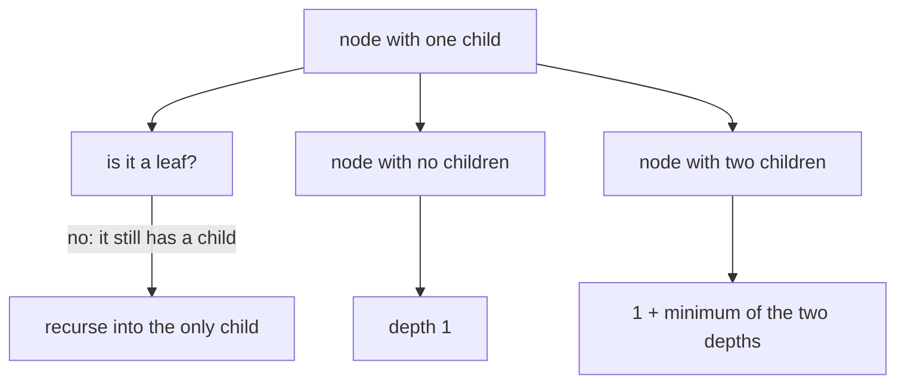
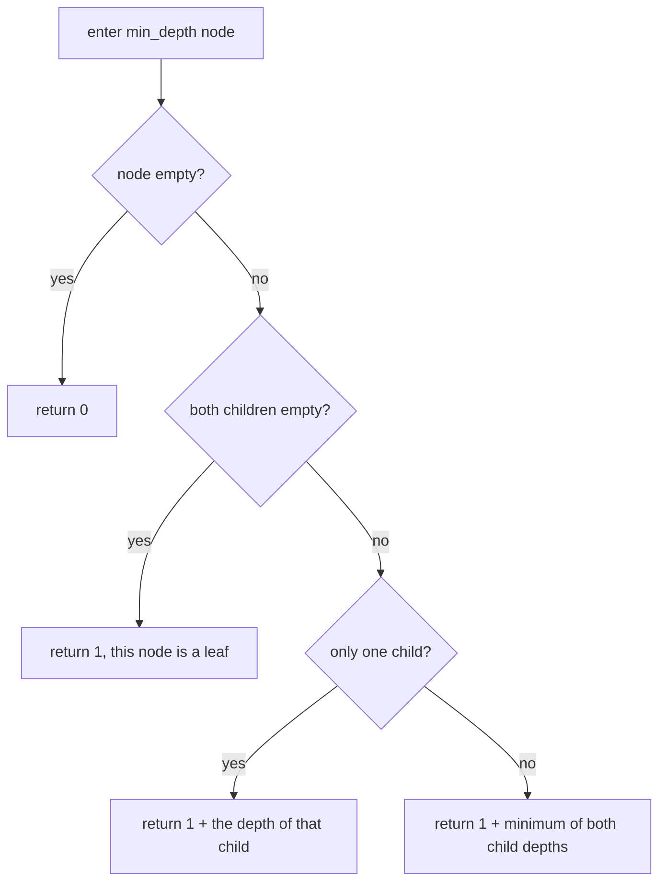
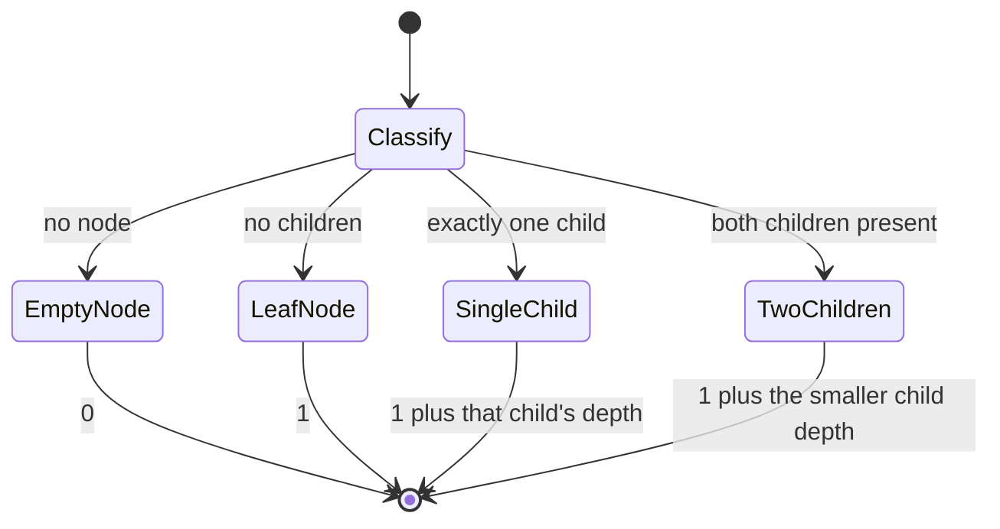
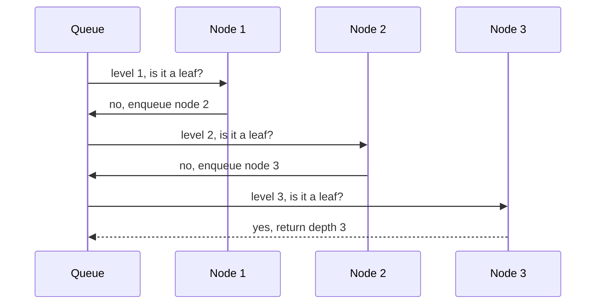

# 141 — Min depth of binary tree.

> **Tier:** Beginner · **CTCI chapter:** Ch 4 — Trees and Graphs
> **Task spec:** [141-min-depth-of-binary-tree.md](../../../tasks/beginner/141-min-depth-of-binary-tree.md)
> **Solutions:** [Python](../../../solutions/python/beginner/141-min-depth-of-binary-tree/solution.py) ·
> [Java](../../../solutions/java/beginner/141-min-depth-of-binary-tree/Solution.java) ·
> [JavaScript](../../../solutions/javascript/beginner/141-min-depth-of-binary-tree/solution.js) ·
> [C#](../../../solutions/csharp/beginner/141-min-depth-of-binary-tree/Solution.cs)

## 1. Problem restatement

**Input:** the root of a binary tree, which may be `None` / `null`.

**Output:** the number of nodes on the **shortest** path from the root to a **leaf** — a node with no
children at all. An empty tree is `0`, and a lone node is `1`.

The word "leaf" is the whole difficulty. A node with one child is *not* a leaf, so a path that
follows a missing child and stops early is not a root-to-leaf path and must not be counted. All four
files ship two implementations of the same answer and assert that they agree: a BFS that returns at
the first level containing a leaf (`min_depth` / `MinDepth`) and a recursion that follows a single
child instead of treating the missing side as a zero-depth leaf (`min_depth_recursive` /
`MinDepthRecursive`).

| Call | Result | Why |
| --- | --- | --- |
| `min_depth(None)` | `0` | no nodes, no path; both routes assert it |
| `min_depth(build([7]))` | `1` | `7` is a leaf at depth 1 |
| `min_depth(build([1, 2, None, 3]))` | `3` | the trap: `2` has only a left child, so it is not a leaf and the true leaf is `3` at depth 3 |
| `min_depth(build([3, 9, 20, None, None, 15, 7]))` | `2` | `9` is a leaf at depth 2, the shallowest leaf anywhere |
| `min_depth(build([1, 2, None, 3, None, 4]))` | `4` | a right-leaning chain: every internal node has one child, so the only leaf is at the far end |
| both routes over the four shared inputs | equal values | Python and JavaScript assert the agreement rather than assuming it |

The trap row is the one to remember: the shallowest *missing child* is at depth 2 but the shallowest
*leaf* is at depth 3, and the answer must be `3`.

## 2. Intuition

Symmetry suggests that minimum depth is maximum depth with `max` replaced by `min`:

```text
wrong_min_depth(empty) = 0
wrong_min_depth(node)  = 1 + min(children depths)
```

That formula is wrong, and the trap tree shows exactly how. For `build([1, 2, None, 3])` it gives:

| Node | Children depths | Result of `1 + min` |
| --- | --- | --- |
| `3` | both empty → `0`, `0` | `1` |
| `2` | left `1`, right empty → `0` | `1` |
| `1` | left `1`, right empty → `0` | `1` |

The answer `1` claims a path of length one, which would mean the root itself is a leaf — but the root
has a child. The bug is that an empty child was treated as a leaf of depth `0`, when in fact it is
not a node at all. The missing side made the `min` pick the absence of a subtree over a real path.

Two correct formulations follow from that observation.

**Count leaves, not gaps (BFS).** Walk level by level with a queue and return the depth of the first
level that contains a leaf. Because levels are processed in order, the first leaf found is on the
shortest path, and the return happens immediately — no other subtree is inspected. That early exit is
the reason the BFS route can be much faster than the recursion on trees whose shallow leaf is near
the top.

**Always follow a real child (recursion).** A node is a leaf when both children are empty; if only one
child exists, the shortest path must go through it, so recurse into that child and add one. Only when
both children exist may `min` be applied.



## 3. Algorithm

BFS route:

1. If the root is empty, return `0`.
2. Put the root in a queue and set the depth counter to `0`.
3. While the queue is not empty: increment the counter, then process exactly the nodes of the current
   level; if a popped node has no children, return the counter immediately; otherwise enqueue its
   non-empty children.
4. If the loop ends without finding a leaf, return the counter.

Recursive route:

1. If the node is empty, return `0`.
2. If both children are empty, return `1` — this node is a leaf.
3. If only the left child exists, return `1 + depth of the left child`.
4. If only the right child exists, return `1 + depth of the right child`.
5. Otherwise return `1 + min(left depth, right depth)`.

```text
function min_depth(root)
    if root is empty then
        return 0
    end
    depth ← 0
    queue ← queue containing root
    while queue is not empty do
        depth ← depth + 1
        count ← size of queue
        repeat count times
            node ← pop the front of queue
            if left(node) is empty and right(node) is empty then
                return depth
            end
            if left(node) is not empty then
                push left(node) to the back of queue
            end
            if right(node) is not empty then
                push right(node) to the back of queue
            end
        end
    end
    return depth
end

function min_depth_recursive(node)
    if node is empty then
        return 0
    end
    if left(node) is empty and right(node) is empty then
        return 1
    end
    if left(node) is empty then
        return 1 + min_depth_recursive(right(node))
    end
    if right(node) is empty then
        return 1 + min_depth_recursive(left(node))
    end
    return 1 + minimum(min_depth_recursive(left(node)), min_depth_recursive(right(node)))
end
```

The two single-child branches in the recursion are the fix for the trap. They are not an
optimisation: without them the recursion is simply wrong, because the `min` at the bottom would
compare a real path against a non-existent one.



Seen as a machine, every node is classified into exactly one of four cases, and only the last one
gets to use `minimum`:



## 4. Worked example

Trace the BFS route on the trap tree `build([1, 2, None, 3])`, which is `1` with left child `2`, and
`2` with left child `3`:

| Pass | Queue at pass start | `depth` | Popped | Leaf found? | Action |
| --- | --- | --- | --- | --- | --- |
| 1 | `[1]` | 1 | `1` | no, it has a left child | enqueue `2` |
| 2 | `[2]` | 2 | `2` | no, it has a left child | enqueue `3` |
| 3 | `[3]` | 3 | `3` | yes, no children | return `3` |

The recursion reaches the same conclusion in a different order:

| Node | Case | Result |
| --- | --- | --- |
| `3` | leaf | `1` |
| `2` | single child on the left | `1 + 1 = 2` |
| `1` | single child on the left | `1 + 2 = 3` |

Note that the naive `1 + min(...)` formulation returned `1` for this same tree, as the table in
section 2 shows — a difference of two on a tree of four nodes, which is why the files assert this
input explicitly in all four languages.



On a tree with a shallow leaf the BFS route stops much earlier. For
`build([3, 9, 20, None, None, 15, 7])` — root `3`, leaf `9` on the left, and `20` with children `15`
and `7` on the right — the first level holds the root (not a leaf), and the second level holds `9`,
which is a leaf, so the answer `2` is returned before the subtree under `20` is ever touched. The
recursion computes it as `1 + min(1, 2) = 2`, where the two children do both exist and `min` is
legitimately applicable.

## 5. Complexity

Let `n` be the number of nodes, `h` the height, `w` the widest level, and `d` the answer.

| Measure | Bound | Why it holds |
| --- | --- | --- |
| Time, BFS, worst case | Θ(n) | the first leaf may be at the deepest level, so every node is processed |
| Time, BFS, best case | Θ(1) | a tree whose root is a leaf returns on the first pop |
| Time, recursion, worst case | Θ(n) | each node is visited once; the prune only skips the subtrees below a single-child node |
| Space, recursion | O(h) | frames along the current path |
| Space, BFS | O(w) | the queue holds one frontier, plus the children already enqueued |
| Output | O(1) | one integer |
| Naive `1 + min` formulation | O(n) but wrong | it terminates quickly and answers the wrong question |

The interesting comparison is between the two correct routes. The BFS route stops as soon as the
shallowest leaf is found, which can be a large saving on bushy trees whose leaves start high; the
recursion must still descend the single-child spines, and on a chain both routes touch all `n` nodes.
Against `max_depth` ([140](../../../tasks/beginner/140-max-depth-of-binary-tree.md)) neither route is
weaker: whatever the shape, one of "the answer is near the root" and "the answer is at the bottom" is
true, and the two formulations are optimal in the opposite cases.

## 6. Pitfalls and edge cases

- **A missing child is not a leaf.** This is the entire point of the task. `build([1, 2, None, 3])`
  has its only leaf at depth `3`, and both files' assertions say so.
- **Empty tree is `0`, single node is `1`.** Both routes assert these two rows; a version that
  returns `1` for an empty tree breaks the "no nodes, no path" reading.
- **A node with one child is not a leaf either.** `2` in the trap tree has a child, so it cannot
  terminate a path. A node is a leaf only when *both* children are empty.
- **The two single-child branches must come before `min`.** They are correctness, not tuning: with
  them removed, the trap tree returns `1` instead of `3`.
- **The BFS early return must test the popped node.** Testing on enqueue would also work for leaves,
  but the files test when a node is dequeued, and a node enqueued as a child is examined at the level
  it belongs to.
- **The BFS level snapshot is still required.** Without it the "current level" merges with the next
  and the returned depth is meaningless — the same snapshot used in
  [139](../../../tasks/beginner/139-level-order-traversal-bfs-of-tree.md).
- **Do not return from the recursion at the first leaf-looking node.** A node whose only child exists
  looks like a candidate for termination, and stopping there is exactly the trap.
- **Both routes must agree.** Python and JavaScript assert the equality over four different trees,
  which is how a divergence in one formulation is caught.
- **Chain trees make the answer large.** `build([1, 2, None, 3, None, 4])` gives `4`, and a chain of
  `n` nodes needs `n` frames in the recursive route — the BFS route keeps a queue of size one there.
- **Values are irrelevant.** Depth is purely structural; duplicate values change nothing.

## 7. Variants and follow-ups

- **Maximum instead of minimum.** [140-max-depth-of-binary-tree.md](../../../tasks/beginner/140-max-depth-of-binary-tree.md)
  uses `1 + max(left, right)` and needs no single-child special case, because the missing side
  contributes `0` and can never win a maximum — the asymmetry that makes this task harder than it
  looks.
- **Levels as an explicit structure.** [139-level-order-traversal-bfs-of-tree.md](../../../tasks/beginner/139-level-order-traversal-bfs-of-tree.md)
  is the same queue discipline returning the level lists, which is what makes the early-return
  formulation here obvious once you have seen it.
- **Height differences at every node.** [142-check-if-tree-is-balanced-height-difference-1.md](../../../tasks/beginner/142-check-if-tree-is-balanced-height-difference-1.md)
  needs the subtree heights from both sides at every node, so it cannot return early the way the BFS
  route here does.
- **Depth as a construction target.** [144-convert-sorted-array-to-balanced-bst.md](../../../tasks/beginner/144-convert-sorted-array-to-balanced-bst.md)
  builds a tree of minimal height for `n` values, which is the structural property this task measures
  from the outside.
- **Mirror and identity checks.** [135](../../../tasks/beginner/135-check-if-two-binary-trees-are-identical.md)
  and [143](../../../tasks/beginner/143-symmetric-tree-check-mirror.md) show the same leaf-versus-gap
  trap in a different guise: an empty child is a place where one tree can run out, not a node to be
  counted.
- The chapter walkthrough [Trees and Graphs](../../ctci/04-trees-and-graphs.md) pairs minimum and
  maximum depth as the two queries that differ by one operator and one subtlety.

## 8. Check yourself

1. Why is `1 + min(left, right)` wrong for the minimum depth?

<details><summary>Show answer</summary>

Because a missing child is not a leaf; it contributes `0` to the `min` and makes the missing subtree
look like a path of length zero. On `build([1, 2, None, 3])` a real subtree of depth `2` is compared
against an absent one, so the formula returns `1` instead of `3`.

</details>

2. How does the recursive route repair the formula?

<details><summary>Show answer</summary>

By handling three cases before the general one: both children empty is a leaf (return `1`), only the
left child exists (return `1 +` the left depth), only the right child exists (return `1 +` the right
depth). `min` is applied only when both children exist and both paths are real.

</details>

3. Why can the BFS route return earlier than the recursion?

<details><summary>Show answer</summary>

Because it visits nodes in increasing depth order, so the first leaf it dequeues is necessarily on
the shortest root-to-leaf path. There is nothing to compare afterwards, and the subtrees that have
not been enqueued yet are never explored.

</details>

4. What is `min_depth(build([1, 2, None, 3, None, 4]))`, and what shape produces it?

<details><summary>Show answer</summary>

`4`. The tree is a right-leaning chain, so every internal node has exactly one child and is therefore
not a leaf. The only leaf is the final node at depth 4, which is why both routes have to descend the
whole spine.

</details>

5. Both routes are O(n) in the worst case. What does each one use for memory?

<details><summary>Show answer</summary>

The BFS route uses O(w) for the queue, bounded by the widest level. The recursion uses O(h) frames
along the current path, which is O(n) for a chain and O(log n) for a balanced tree. Neither is
uniformly better; as with maximum depth, the two routes trade width for depth.

</details>
