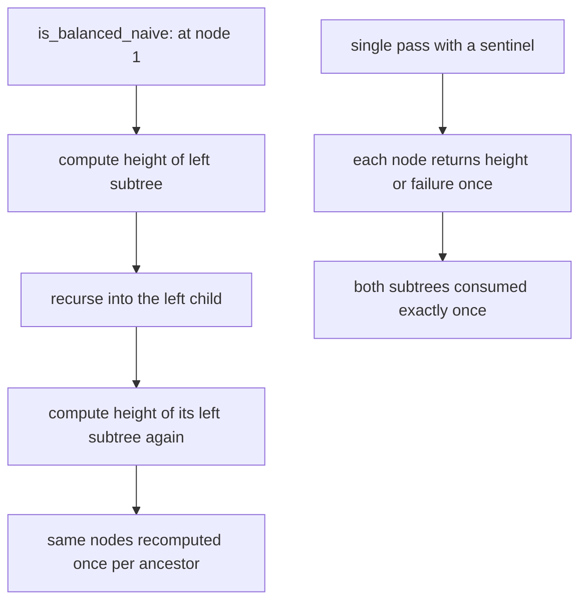
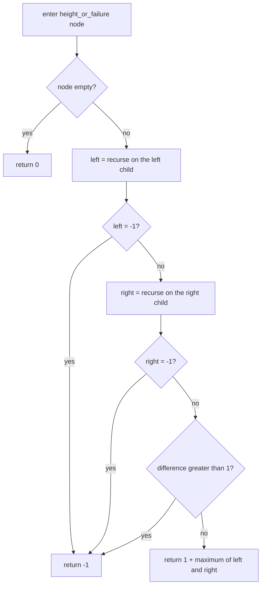
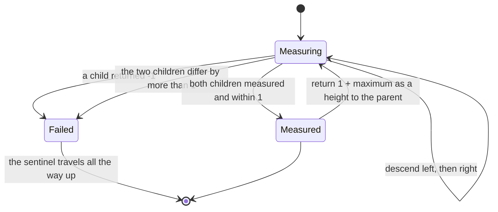
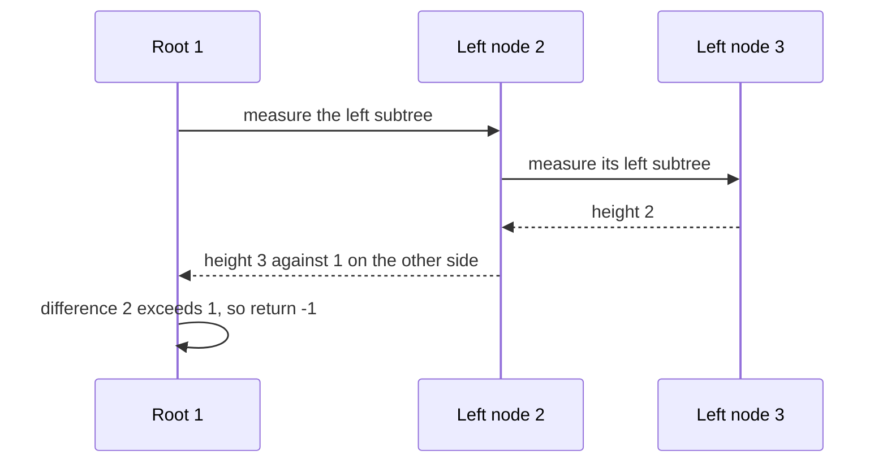

# 142 — Check if tree is balanced (height difference <=1).

> **Tier:** Beginner · **CTCI chapter:** Ch 4 — Trees and Graphs
> **Task spec:** [142-check-if-tree-is-balanced-height-difference-1.md](../../../tasks/beginner/142-check-if-tree-is-balanced-height-difference-1.md)
> **Solutions:** [Python](../../../solutions/python/beginner/142-check-if-tree-is-balanced-height-difference-1/solution.py) ·
> [Java](../../../solutions/java/beginner/142-check-if-tree-is-balanced-height-difference-1/Solution.java) ·
> [JavaScript](../../../solutions/javascript/beginner/142-check-if-tree-is-balanced-height-difference-1/solution.js) ·
> [C#](../../../solutions/csharp/beginner/142-check-if-tree-is-balanced-height-difference-1/Solution.cs)

## 1. Problem restatement

**Input:** the root of a binary tree, which may be `None` / `null`.

**Output:** `true` when the height difference between the two subtrees of **every** node is at most
1, and `false` as soon as one node violates that rule. Height is measured in nodes on the longest
downward path, with an empty tree at height `0` and a leaf at height `1`.

| Call | Result | Why |
| --- | --- | --- |
| `is_balanced(None)` | `true` | an empty tree has nothing to violate the rule |
| `is_balanced(build([1]))` | `true` | a leaf's two sides are `0` and `0` |
| `is_balanced(build([1, 2]))` | `true` | difference `1 - 0`, exactly at the limit |
| `is_balanced(build([3, 9, 20, None, None, 15, 7]))` | `true` | heights `2` and `2` at the root |
| `is_balanced(build([1, 2, 3, 4, 5]))` | `true` | every node's sides differ by at most one |
| `is_balanced(build([1, 2, 2, 3, 3, None, None, 4, 4]))` | `false` | the left subtree is height `3` against height `1` on the right |
| `is_balanced(build([1, 2, None, 3, None, 4]))` | `false` | a left chain: heights `3` against `0` at the root |
| `is_balanced(build([1, None, 2, None, 3]))` | `false` | the same chain leaning right |
| `height(build([1, 2, 3, 4, 5, None, 6]))` | `3` | the shared helper, asserted on its own |

Each file ships two predicates — `is_balanced` / `IsBalanced` and an instructive
`is_balanced_naive` / `IsBalancedNaive` — and every file asserts that the two agree on the trees it
tests. The naive one is kept deliberately: it is the version most people write first, and comparing
it with the fast one is the lesson of this task.

## 2. Intuition

The direct reading of the definition is: at every node, compute the height of the left subtree,
compute the height of the right subtree, compare them, then recurse into both children. That is
exactly what `is_balanced_naive` does, and it is correct — but it computes each subtree's height over
and over:

* the root asks for the height of the whole left subtree;
* the left child then asks for the height of *its* left subtree, which is a subproblem of what the
  root already computed;
* and so on down the tree.

Each node's height is recomputed once for every ancestor, which turns the check into O(n²) on a
skewed tree and O(n log n) on a balanced one. The fix is to make one pass do both jobs: compute the
height *and* the verdict at the same time, bottom-up.

The mechanism is a single sentinel. Height is a non-negative node count, so `-1` is not a legal
height and can be reserved to mean "somewhere inside this subtree the rule is already broken":

* an empty subtree returns `0`;
* a violated child returns `-1`, which is passed straight up the recursion — nothing above it needs
  the actual height any more, because the answer is already `false`;
* otherwise the node returns `1 + max(left, right)` as usual.

The whole check then collapses to `is_balanced(root) = (height_or_failure(root) != -1)`. The recursion
is a post-order computation ([138](../../../tasks/beginner/138-tree-postorder-traversal-recursive.md))
because the verdict at a node needs both children's results first, and the sentinel is what lets a
single pass return two different kinds of information.



## 3. Algorithm

1. Define `height_or_failure(node)`:
   1. if the node is empty, return `0`;
   2. compute the left result; if it is `-1`, return `-1` at once;
   3. compute the right result; if it is `-1`, return `-1` at once;
   4. if `abs(left - right) > 1`, return `-1` — this node already violates the rule;
   5. otherwise return `1 + max(left, right)`.
2. Report `height_or_failure(root) != -1`.

```text
function is_balanced(root)
    return height_or_failure(root) ≠ -1
end

function height_or_failure(node)
    if node is empty then
        return 0
    end
    left ← height_or_failure(left(node))
    if left = -1 then
        return -1
    end
    right ← height_or_failure(right(node))
    if right = -1 then
        return -1
    end
    if absolute(left - right) > 1 then
        return -1
    end
    return 1 + maximum(left, right)
end

function height(node)
    if node is empty then
        return 0
    end
    return 1 + maximum(height(left(node)), height(right(node)))
end

function is_balanced_naive(node)
    if node is empty then
        return true
    end
    if absolute(height(left(node)) - height(right(node))) > 1 then
        return false
    end
    return is_balanced_naive(left(node)) and is_balanced_naive(right(node))
end
```

The two `-1` checks placed immediately after each recursive call are what keep the pass linear: once
a violation is found, the sentinel travels up without any further height computation. Without those
short-circuits the pass would still be correct, but it would keep descending into subtrees whose
verdict no longer matters.



The recursion therefore produces either a height or a permanent failure, and once failure appears it
can never be undone:



## 4. Worked example

Trace `height_or_failure` on `build([1, 2, 2, 3, 3, None, None, 4, 4])`, the unbalanced sample. The
tree is root `1` with two children of value `2`; the left `2` has children `3` and `3`, the right `2`
is a leaf; and the left `3` gets children `4` and `4` from the builder while the other `3` has none.

| Step | Node | Children results | Difference | Returns |
| --- | --- | --- | --- | --- |
| 1 | each `4` | `0`, `0` | `0` | `1` |
| 2 | left `3` | `1`, `1` | `0` | `2` |
| 3 | right `3` | `0`, `0` | `0` | `1` |
| 4 | left `2` | `2`, `1` | `1` | `3` |
| 5 | right `2` | `0`, `0` | `0` | `1` |
| 6 | root `1` | `3`, `1` | `2` | **`-1`** |

At step 6 the rule is violated by exactly one, so the root returns the sentinel and `is_balanced`
reports `false`. Every node below was measured once, and no height was computed twice.



Now the same walk on a balanced sample, `build([1, 2, 3, 4, 5])`: root `1` with left `2` (children
`4` and `5`) and right `3`.

| Step | Node | Children results | Difference | Returns |
| --- | --- | --- | --- | --- |
| 1 | `4`, `5`, `3` | `0`, `0` | `0` | `1` each |
| 2 | `2` | `1`, `1` | `0` | `2` |
| 3 | root `1` | `2`, `1` | `1` | `3`, no sentinel |

The result is `true`, and the returned `3` is the tree's height — a free by-product of the check.
Because heights are non-negative, `-1` can never be confused with a real measurement; that is the
property the sentinel exploits.

## 5. Complexity

Let `n` be the number of nodes and `h` the height of the tree.

| Measure | Bound | Why it holds |
| --- | --- | --- |
| Time, fast route | Θ(n) | each node is visited once and returns one number |
| Space, fast route | O(h) | frames along the current path |
| Output | O(1) | one boolean |
| Time, naive route | O(n²) worst case | `height` is recomputed for every node against every ancestor; a skewed tree gives Θ(n²) |
| Time, naive route on a balanced tree | O(n log n) | each of the `log n` levels recomputes the heights below it |
| Space, naive route | O(h) | its recursion is also depth-bounded, so the extra cost is time, not memory |
| Both routes | identical answers | asserted over every test input in all four files |

The two implementations exist side by side precisely for this table: they answer the same question,
they are both short, and only one of them is O(n). The sentinel idiom is what makes the improvement
possible without a second helper that returns a pair.

## 6. Pitfalls and edge cases

- **Heights are non-negative, so `-1` is safe.** If the height convention were edge counting with
  empty at `-1`, the sentinel would collide with a legitimate value; the node-counting convention
  used by every file leaves `-1` free.
- **Empty tree is balanced.** `is_balanced(null)` is `true` in all four files, as is the naive
  version's answer.
- **A single node is balanced.** Its two sides are `0` and `0`, so the difference is `0`.
- **A node with one child is balanced.** `build([1, 2])` has heights `1` and `0`, a difference of
  exactly `1`, which is allowed — the rule is "at most 1", not "equal".
- **Two children is not enough to be balanced.** `build([1, 2, 2, 3, 3, None, None, 4, 4])` looks
  symmetric near the root and is unbalanced two levels down; the check must look at every node, not
  just the root.
- **The short-circuits are part of the design.** Returning the sentinel immediately after a failed
  child avoids descending into subtrees whose verdict cannot change the answer.
- **Do not merge the `height` helper into the naive version.** Calling `height` on both children *and*
  recursing is exactly the O(n²) pattern; the fast route must return the height it measured instead
  of measuring it again elsewhere.
- **The comparison is `> 1`, strict.** `abs(left - right) > 1` fails only on `2` or more; `>= 1`
  would reject every tree with an uneven number of nodes.
- **Results are asserted to agree.** Every file compares the fast and naive predicates across its
  inputs, so a divergence introduced in one of them is caught even when both look plausible.
- **Recursion depth follows the shape.** The check walks the taller side of each node, so a chain of
  `n` nodes needs `n` frames — the same O(h) bound as every other recursion in this tier.

## 7. Variants and follow-ups

- **Heights alone.** [140-max-depth-of-binary-tree.md](../../../tasks/beginner/140-max-depth-of-binary-tree.md)
  is the `1 + max(left, right)` half of this task without the comparison, and
  [141-min-depth-of-binary-tree.md](../../../tasks/beginner/141-min-depth-of-binary-tree.md) is the
  minimum, which needs its own leaf rule.
- **Constructing a balanced tree.** [144-convert-sorted-array-to-balanced-bst.md](../../../tasks/beginner/144-convert-sorted-array-to-balanced-bst.md)
  builds a tree that satisfies exactly this rule by construction and then verifies it with the same
  height recursion, which is the constructive counterpart of this predicate.
- **Bottom-up aggregation in general.** [138-tree-postorder-traversal-recursive.md](../../../tasks/beginner/138-tree-postorder-traversal-recursive.md)
  is the traversal order this recursion follows, and
  [135-check-if-two-binary-trees-are-identical.md](../../../tasks/beginner/135-check-if-two-binary-trees-are-identical.md)
  shows the same "decide at the children, propagate upward" structure for equality.
- **Mirror symmetry.** [143-symmetric-tree-check-mirror.md](../../../tasks/beginner/143-symmetric-tree-check-mirror.md)
  also descends every node once, but compares crossed children instead of measuring them.
- **Exploiting shape instead of walking it.** [153-count-nodes-in-complete-binary-tree-faster-than-o-n.md](../../../tasks/beginner/153-count-nodes-in-complete-binary-tree-faster-than-o-n.md)
  is what becomes possible when a tree is known to be balanced, and
  [145-validate-bst-property-inorder.md](../../../tasks/beginner/145-validate-bst-property-inorder.md)
  is the analogous check for ordering rather than height.
- The chapter walkthrough [Trees and Graphs](../../ctci/04-trees-and-graphs.md) presents the
  sentinel-carrying recursion as the standard way to combine two answers in one pass.

## 8. Check yourself

1. Why does the naive version cost more than one pass?

<details><summary>Show answer</summary>

Because it calls a `height` helper on each child and *then* recurses into those same children. Every
node's height is therefore recomputed at each ancestor: Θ(n²) on a skewed tree and O(n log n) on a
balanced one, even though the total amount of distinct information is only n heights.

</details>

2. What does the value `-1` mean, and why is it a safe sentinel?

<details><summary>Show answer</summary>

It means "a violation already exists somewhere in this subtree". It is safe because heights are node
counts and therefore never negative, so no legitimate return value collides with it. Empty subtrees
return `0` and leaves return `1`, both strictly above the sentinel.

</details>

3. Is `build([1, 2])` balanced?

<details><summary>Show answer</summary>

Yes. The root's children have heights `1` (a leaf) and `0` (empty), a difference of exactly `1`,
which the rule allows. All four files assert this row, and it is the boundary case that distinguishes
`> 1` from `>= 1`.

</details>

4. When is the check able to stop early, and what does it save?

<details><summary>Show answer</summary>

As soon as a child returns `-1`, the parent returns `-1` immediately without examining the other
child or descending further. This does not change the asymptotic bound — the sentinel still travels
up one frame per level — but it avoids descending into subtrees whose verdict can no longer change
the answer.

</details>

5. How do you verify that a "balanced check" is correct without re-deriving it?

<details><summary>Show answer</summary>

By comparing it against the transparent definition: measure both child heights at every node and
recurse. That is exactly what `is_balanced_naive` does, and every solution file asserts that the fast
and naive predicates agree on all its inputs — an oracle-based test rather than a hand-written
expected value.

</details>
