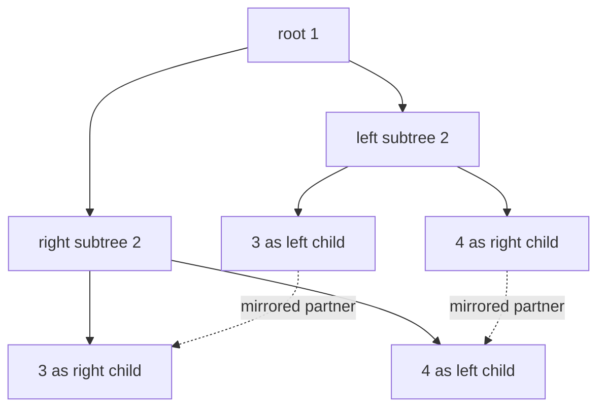
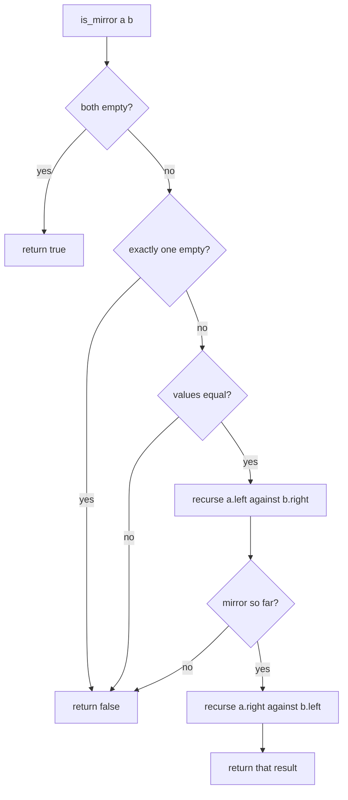
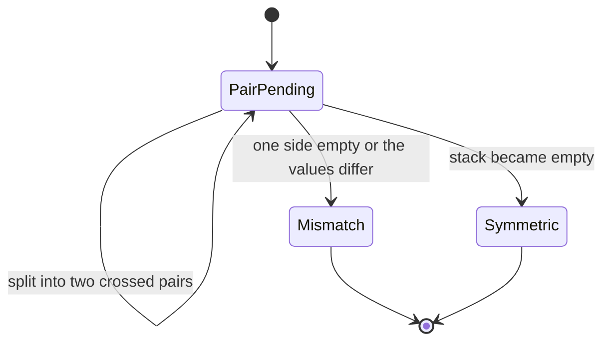
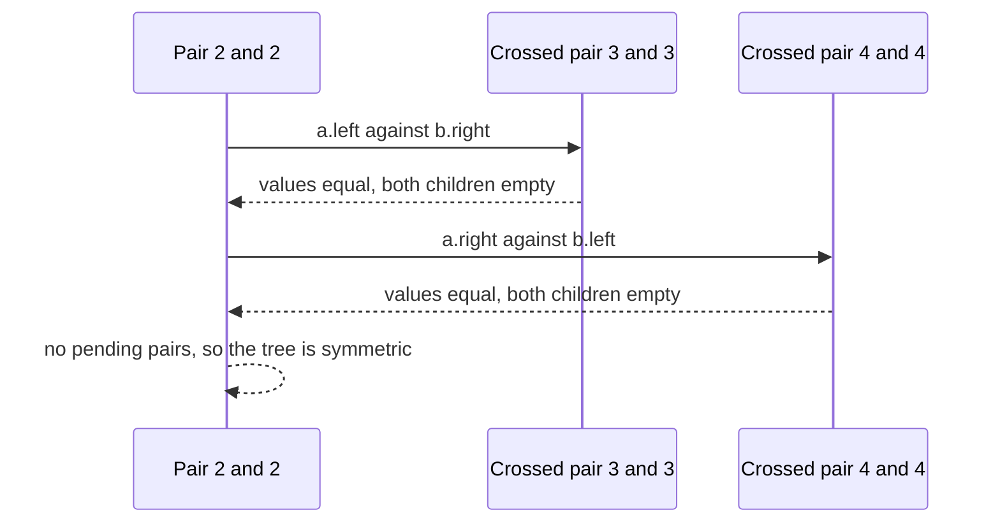

# 143 — Symmetric tree check (mirror).

> **Tier:** Beginner · **CTCI chapter:** Ch 4 — Trees and Graphs
> **Task spec:** [143-symmetric-tree-check-mirror.md](../../../tasks/beginner/143-symmetric-tree-check-mirror.md)
> **Solutions:** [Python](../../../solutions/python/beginner/143-symmetric-tree-check-mirror/solution.py) ·
> [Java](../../../solutions/java/beginner/143-symmetric-tree-check-mirror/Solution.java) ·
> [JavaScript](../../../solutions/javascript/beginner/143-symmetric-tree-check-mirror/solution.js) ·
> [C#](../../../solutions/csharp/beginner/143-symmetric-tree-check-mirror/Solution.cs)

## 1. Problem restatement

**Input:** the root of a binary tree, which may be `None` / `null`.

**Output:** `true` when the tree is its own mirror image — equivalently, when its left subtree and
its right subtree are mirrors of each other. A tree is the mirror of another when the same values
appear at mirrored positions, so the *left* child of one corresponds to the *right* child of the
other.

Two helpers are shared across the files: `is_mirror` / `IsMirror(a, b)` compares two subtrees for
mirror equality, and the Python file additionally builds an explicit mirror image and uses a
structural-equality check as an independent oracle.

| Call | Result | Why |
| --- | --- | --- |
| `is_symmetric(None)` and `is_symmetric(build([]))` | `true` | an empty tree is trivially its own mirror |
| `is_symmetric(build([1]))` | `true` | no children to mismatch |
| `is_symmetric(build([1, 2, 2]))` | `true` | the two children match and are themselves mirrored |
| `is_symmetric(build([1, 2, 2, 3, 4, 4, 3]))` | `true` | the classic picture: `3, 4` on the left mirror `4, 3` on the right |
| `is_symmetric(build([1, 2, 2, None, 3, None, 3]))` | `false` | both `3`s are right children, so mirrored positions do not match |
| `is_symmetric(build([1, 2, 2, None, 3, 3, None]))` | `true` | here the `3`s *are* at mirrored positions |
| `is_symmetric(build([1, 2, 3]))` | `false` | the values `2` and `3` sit at mirrored positions and differ |
| `is_symmetric(build([1, 2, 2, 3, None, None, 3]))` | `true` | both inner sides are empty, both outer sides hold `3` |

All four files assert the positive and negative rows, and Python cross-checks its recursive and
iterative implementations against the oracle `identical(tree, mirror(tree))` on every input.

## 2. Intuition

The definition says "equal to its own mirror image", so the direct implementation builds the mirror
and compares: `mirror(root)` produces a new tree with the children of every node swapped, and then a
structural equality test compares it with the original. That is correct, and it is exactly what the
Python oracle does — but it costs an extra full tree plus two traversals.

The insight that removes both is to **cross the children while descending** instead of rearranging
them first. Two subtrees `a` and `b` are mirrors when

* both are empty, or
* their values match, **and** `a`'s left child mirrors `b`'s right child, **and** `a`'s right child
  mirrors `b`'s left child.

The mirroring is folded into the recursion, so nothing is ever copied: one simultaneous descent
walks both halves of the tree and stops at the first mismatch.

That also disposes of the most common wrong answer, which is to test the two children for *equality*
(`identical(root.left, root.right)`). Mirror equality is strictly weaker than identity: in
`build([1, 2, 2, 3, 4, 4, 3])` the left subtree holds `3, 4` and the right subtree holds `4, 3` — not
identical at all — yet the tree is symmetric. The equality test would reject a symmetric tree, so the
crossed pairing is not a detail but the definition.



## 3. Algorithm

Recursive route:

1. If the root is empty, report symmetric.
2. Otherwise report `is_mirror(root.left, root.right)`, where `is_mirror(a, b)` is defined as:
   1. both empty → mirrors;
   2. exactly one empty → not mirrors;
   3. values differ → not mirrors;
   4. otherwise recurse on `a.left` against `b.right` **and** `a.right` against `b.left`.

Iterative route:

1. If the root is empty, report symmetric.
2. Push the pair `(root.left, root.right)` onto a stack.
3. While the stack is not empty: pop `(a, b)`; if both are empty continue; if exactly one is empty or
   the values differ, report not symmetric; otherwise push `(a.left, b.right)` and
   `(a.right, b.left)`.
4. Report symmetric when the stack empties.

```text
function is_symmetric(root)
    if root is empty then
        return true
    end
    return is_mirror(left(root), right(root))
end

function is_mirror(a, b)
    if a is empty and b is empty then
        return true
    end
    if a is empty or b is empty then
        return false
    end
    if value(a) ≠ value(b) then
        return false
    end
    return is_mirror(left(a), right(b)) and is_mirror(right(a), left(b))
end

function is_symmetric_iterative(root)
    if root is empty then
        return true
    end
    stack ← stack containing the pair of root's children
    while stack is not empty do
        pair (a, b) ← pop from stack
        if a is empty and b is empty then
            continue
        end
        if a is empty or b is empty or value(a) ≠ value(b) then
            return false
        end
        push (left(a), right(b)) to stack
        push (right(a), left(b)) to stack
    end
    return true
end
```

The two pushes are the crossing made explicit: the algorithm never swaps pointers in the tree, it
just pairs them differently. The recursion is the same statement in recursive form.



The iterative route shows the same structure as a worklist machine, where each pending pair is an
obligation to compare two positions that must mirror each other:



## 4. Worked example

Trace `is_symmetric(build([1, 2, 2, 3, 4, 4, 3]))`. The tree is root `1`, with left subtree
`2(3, 4)` and right subtree `2(4, 3)`. The recursive route pairs positions as follows:

| Step | Pair compared | Values | Next pairs | Verdict so far |
| --- | --- | --- | --- | --- |
| 1 | roots of the subtrees | `2` vs `2` | `3` vs `3` (crossed) and `4` vs `4` (crossed) | matches |
| 2 | `a.left` (`3`) vs `b.right` (`3`) | `3` vs `3` | both children empty | matches |
| 3 | `a.right` (`4`) vs `b.left` (`4`) | `4` vs `4` | both children empty | matches |
| 4 | no pairs left | — | — | symmetric |

Three comparisons for seven nodes — the walk never visits a node that has no mirrored partner to
check against, and every comparison is between nodes at mirrored positions.



Now the near-miss, `build([1, 2, 2, None, 3, None, 3])`. The builder attaches `3` as the **right**
child of both `2`s, so the first crossed comparison pairs the left subtree's right child (`3`) with
the right subtree's *left* child — which is absent:

| Step | Pair compared | Outcome |
| --- | --- | --- |
| 1 | `2` vs `2` | values match, descend crossed |
| 2 | `3` vs absent position | exactly one side is empty → not symmetric |

The same input with the `3`s at mirrored positions, `[1, 2, 2, None, 3, 3, None]`, passes step 2
because there the absent side pairs with the absent side — which is why the two inputs differ by one
number in the builder list and by an entire verdict.

## 5. Complexity

Let `n` be the number of nodes, `h` the height and `w` the widest level.

| Measure | Bound | Why it holds |
| --- | --- | --- |
| Time, recursive | Θ(n) | every node is compared against at most one mirrored partner, and each mismatch returns immediately |
| Time, iterative | Θ(n) | each node is pushed into at most one pair and popped once |
| Space, recursive | O(h) | frames along the current path, one per level of the pair being compared |
| Space, iterative | O(w) pairs worst case | pending pairs live on the stack; a wide tree can queue one pair per node of a level |
| Space, output | O(1) | a single boolean |
| Alternative (`mirror` plus `identical`) | Θ(n) time, Θ(n) extra space | building the mirror allocates a second tree, then two walks compare it |

The oracle approach in the Python file is a good example of a *testing* shortcut that is a poor
production choice: for assertions the extra tree is harmless, while inside an algorithm it would
double the memory for no benefit.

## 6. Pitfalls and edge cases

- **Mirror equality is not equality.** `build([1, 2, 2, 3, 4, 4, 3])` is symmetric even though its
  two subtrees are not identical. Testing `identical(root.left, root.right)` rejects it.
- **Mirrored positions, not the same side.** `[1, 2, 2, None, 3, None, 3]` is not symmetric because
  both `3`s hang on the right; `[1, 2, 2, None, 3, 3, None]` is, because the `3`s occupy mirrored
  slots. The builder list differs by one value and the verdict differs completely.
- **Empty root is symmetric.** `is_symmetric(null)` is `true`; the guard exists so that the two
  children of an empty root are never dereferenced.
- **Single node is symmetric.** With no children, the pair is `empty` against `empty` and matches.
- **Both guards are required, in order.** "Both empty" must be tested before "exactly one empty",
  and both before reading any value; the same ordering as in
  [135](../../../tasks/beginner/135-check-if-two-binary-trees-are-identical.md).
- **Cross both ways.** The recursive step must compare `a.left` with `b.right` **and** `a.right`
  with `b.left`. Comparing `a.left` with `b.left` is the equality test wearing a mirror's name, and
  it fails on the classic symmetric tree.
- **The iterative version pushes pairs, not nodes.** A stack of single nodes would lose the mirrored
  partnership; the pair is the unit of work, and empty twins are skipped rather than pushed.
- **Order of the two recursive calls does not matter for correctness.** Both are combined with `and`,
  so only the cost changes: a mismatch found by the first call skips the second.
- **Values are compared, not nodes.** Two distinct node objects holding equal values are mirror
  partners; nothing in the files compares object identity.
- **The oracle is not the algorithm.** `mirror` plus `identical` is a testing device that produces
  the same answer; it is not what the shipped predicate runs.

## 7. Variants and follow-ups

- **Identity instead of mirroring.** [135-check-if-two-binary-trees-are-identical.md](../../../tasks/beginner/135-check-if-two-binary-trees-are-identical.md)
  uses the same pairwise descent with straight (uncrossed) children, and comparing the two files
  isolates exactly one line of difference.
- **Heights instead of values.** [142-check-if-tree-is-balanced-height-difference-1.md](../../../tasks/beginner/142-check-if-tree-is-balanced-height-difference-1.md)
  also descends every node once, but returns a measured height rather than a comparison verdict.
- **Walking mirrored structures.** [146-lowest-common-ancestor-in-bst-iterative.md](../../../tasks/beginner/146-lowest-common-ancestor-in-bst-iterative.md)
  and [147-lowest-common-ancestor-in-binary-tree-general.md](../../../tasks/beginner/147-lowest-common-ancestor-in-binary-tree-general.md)
  use value comparisons to steer a descent rather than positional pairing.
- **Serialising the shape.** [148-serialize-and-deserialize-binary-tree-preorder.md](../../../tasks/beginner/148-serialize-and-deserialize-binary-tree-preorder.md)
  is the alternative when a tree must be compared through a representation instead of in place.
- **Building one half of a symmetric tree.** [144-convert-sorted-array-to-balanced-bst.md](../../../tasks/beginner/144-convert-sorted-array-to-balanced-bst.md)
  shows how a tree gets its shape from a recursive midpoint rule, which is the constructive mirror of
  this predicate.
- The chapter walkthrough [Trees and Graphs](../../ctci/04-trees-and-graphs.md) presents the mirror
  check as the standard example of a recursion that consumes two nodes per step.

## 8. Check yourself

1. Why is `is_mirror(a.left, b.left) and is_mirror(a.right, b.right)` wrong?

<details><summary>Show answer</summary>

That compares the two subtrees for *identity*, not for mirroredness. A symmetric tree can have
subtrees that differ — `build([1, 2, 2, 3, 4, 4, 3])` has left subtree `2(3, 4)` and right subtree
`2(4, 3)` — so the identity pairing rejects symmetric trees. The children must be crossed.

</details>

2. What does `build([1, 2, 2, None, 3, None, 3])` build, and why is it not symmetric?

<details><summary>Show answer</summary>

Root `1` with two `2`s; the first `None`/`3` pair makes `3` the right child of the left `2`, and the
second `None`/`3` pair makes `3` the right child of the right `2`. Mirroring requires the left `2`'s
right child to pair with the right `2`'s *left* child, which is absent — so the check fails.

</details>

3. What is the answer for an empty tree, and what happens without the explicit guard?

<details><summary>Show answer</summary>

`true`. Without the guard, the recursion would attempt to read `root.left` and `root.right` of an
empty node and fail before it could return; the guard also encodes that "no nodes" trivially mirrors
itself.

</details>

4. How does the iterative version differ from the recursive one?

<details><summary>Show answer</summary>

Not in the comparisons it makes — only in where the pending work lives. The recursion keeps pending
crossed pairs on the call stack, one frame per level; the iterative version keeps them in an explicit
stack, pushing `(a.left, b.right)` and `(a.right, b.left)` and skipping pairs where both sides are
empty. Python asserts that both produce the same answer on every input.

</details>

5. How much extra memory does the "build the mirror and compare" approach need?

<details><summary>Show answer</summary>

Θ(n) for the mirrored copy, plus the stack for two traversals. It is only viable for testing — which
is exactly how the Python file uses it: as an independent oracle for the recursive and iterative
predicates, not as the shipped implementation.

</details>
