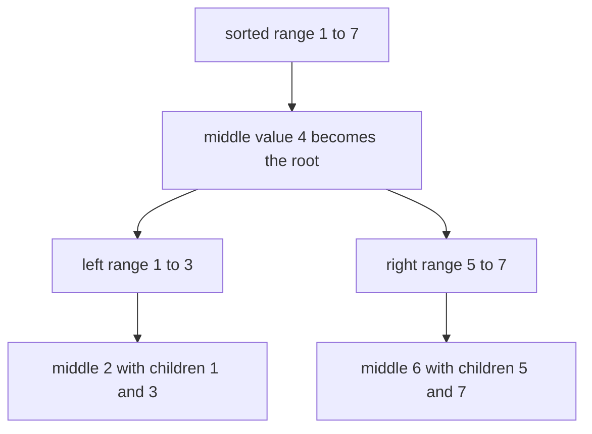
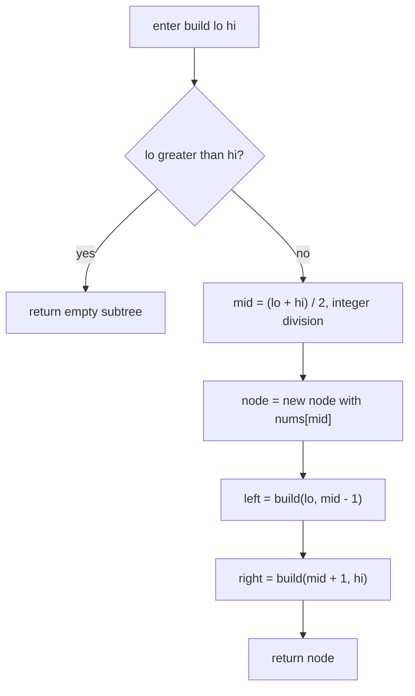
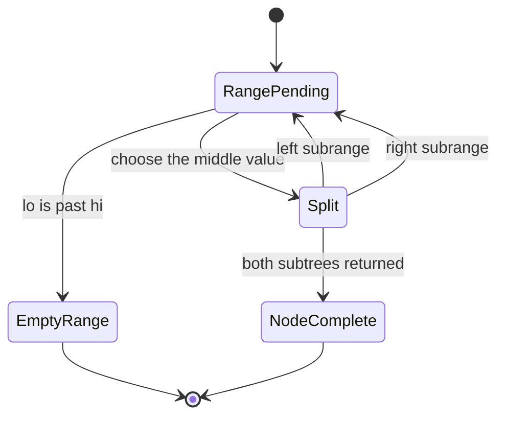
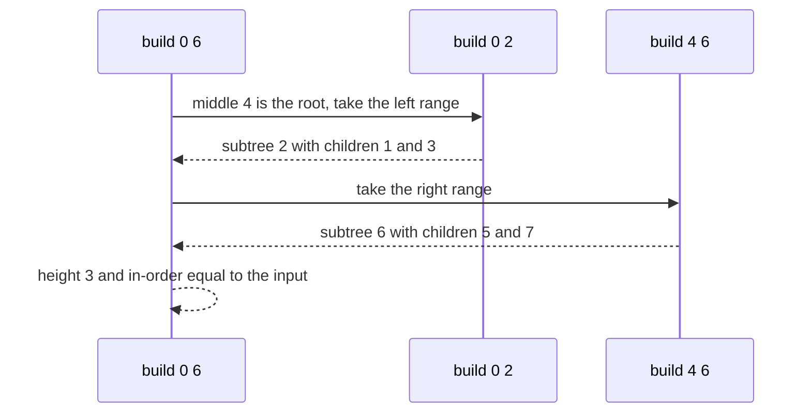

# 144 — Convert sorted array to balanced BST.

> **Tier:** Beginner · **CTCI chapter:** Ch 4 — Trees and Graphs
> **Task spec:** [144-convert-sorted-array-to-balanced-bst.md](../../../tasks/beginner/144-convert-sorted-array-to-balanced-bst.md)
> **Solutions:** [Python](../../../solutions/python/beginner/144-convert-sorted-array-to-balanced-bst/solution.py) ·
> [Java](../../../solutions/java/beginner/144-convert-sorted-array-to-balanced-bst/Solution.java) ·
> [JavaScript](../../../solutions/javascript/beginner/144-convert-sorted-array-to-balanced-bst/solution.js) ·
> [C#](../../../solutions/csharp/beginner/144-convert-sorted-array-to-balanced-bst/Solution.cs)

## 1. Problem restatement

**Input:** an array of values sorted ascending. It may be empty, may contain duplicates
(`[1, 1, 1]`), may be negative (`[-10, -3, 0, 5, 9]`) and may hold large values (`[0, 1000000]`).

**Output:** the root of a **height-balanced** binary search tree holding exactly those values — the
same multiset, in-order sorted, and every node's two subtree heights differing by at most 1.

| Call | Result | Why |
| --- | --- | --- |
| `sorted_array_to_bst([])` | empty | no values, no tree |
| `sorted_array_to_bst([5])` | a lone node with value `5` | the only value becomes the root |
| `sorted_array_to_bst([1, 2, 3])` | root `2` with children `1` and `3` | the middle value becomes the root |
| `height(sorted_array_to_bst([1, 2, 3, 4, 5, 6, 7]))` | `3` | seven values, minimal height |
| `height(sorted_array_to_bst([-10, -3, 0, 5, 9]))` | `3` | five values, asserted with negative input |
| `height(sorted_array_to_bst([1, 2, 3, 4, 5, 6]))` | `3` | six values, asserted in Python, JavaScript and C# |
| in-order walk of the result | equals the input array | asserted for every test input in all four files |
| `is_height_balanced(result)` | `true` | the balance rule is verified directly, not assumed |
| `result.val` | `nums[(n - 1) / 2]` | the left-biased middle is the root, asserted by index |

The last row is the subtle one: for an even number of values there are two possible middles, and the
files pin down which one is chosen.

## 2. Intuition

Building a balanced BST by inserting the values one at a time does not work: inserting a sorted array
into a plain BST produces a chain — each new value is larger than everything already present, so it
becomes the rightmost node — and a chain of height `n` is the opposite of balanced. Repairing it
afterwards costs rotations and rebalancing.

The midpoint rule sidesteps all of that. If the values are sorted, then any value can be the root
without breaking the search property, as long as everything to its left goes left and everything to
its right goes right. From that freedom, pick the choice that balances the *sizes* of the two sides:

* take the middle element of the range as the root;
* the values below it form the left subtree, the values above it the right subtree;
* both halves have sizes differing by at most one, in the odd case exactly equal.

Since the halves are themselves sorted and smaller, applying the same rule recursively builds the
whole tree — and because size balance is maintained at every node, height balance follows: a range of
`n` values becomes a tree whose height is the number of times `n` can be halved, `ceil(log2(n + 1))`.
For 7 values that is `3`, and so is 5, 6 and 4 — which is why every height assertion in the files
reads `3`.

Two consequences fall out of the construction for free:

* an in-order walk of the result reproduces the input — the values were placed in sorted order by
  construction, which is exactly the BST property;
* the height is *minimal* for that many nodes, because no binary tree of `n` nodes can be shallower
  than `ceil(log2(n + 1))`.



## 3. Algorithm

1. Work on a half-open range of indices `[lo, hi]` of the input array.
2. If the range is empty (`lo > hi`), return an empty subtree.
3. Compute `mid = (lo + hi) / 2` using integer division — the left-biased middle.
4. Create a node holding `nums[mid]`.
5. Build the left subtree from `[lo, mid - 1]` and the right subtree from `[mid + 1, hi]`.
6. Return the node.

```text
function sorted_array_to_bst(nums)
    return build(0, length(nums) - 1)
end

function build(lo, hi)
    if lo > hi then
        return empty
    end
    mid ← (lo + hi) / 2
    node ← new node with value nums[mid]
    left(node) ← build(lo, mid - 1)
    right(node) ← build(mid + 1, hi)
    return node
end
```

The recursion is a textbook divide and conquer over an index range, and the two helper functions used
for verification are equally simple: `inorder` walks the result and must return the input unchanged,
and `height` / `is_height_balanced` measure the constructed tree to confirm the promise.



Each recursive call consumes one value and splits the remaining range into two disjoint parts, so the
state of the computation is the range itself:



## 4. Worked example

Trace `sorted_array_to_bst([1, 2, 3, 4, 5, 6, 7])`. The ranges are listed in the order the recursion
creates them:

| Call | `lo` | `hi` | `mid` | Value placed | Subranges |
| --- | --- | --- | --- | --- | --- |
| 1 | 0 | 6 | 3 | `4` (root) | `[1, 2, 3]` and `[5, 6, 7]` |
| 2 | 0 | 2 | 1 | `2` | `[1]` and `[3]` |
| 3 | 0 | 0 | 0 | `1` | empty and empty |
| 4 | 2 | 2 | 2 | `3` | empty and empty |
| 5 | 4 | 6 | 5 | `6` | `[5]` and `[7]` |
| 6 | 4 | 4 | 4 | `5` | empty and empty |
| 7 | 6 | 6 | 6 | `7` | empty and empty |

The resulting tree is

```text
        4
       / \
      2   6
     / \ / \
    1  3 5  7
```

Its in-order walk is `1, 2, 3, 4, 5, 6, 7`, which is the input, and its height is `3`, the number the
files assert.



For an even number of values the choice of middle matters to the assertions. On `[1, 2, 3, 4, 5, 6]`
the range is `[0, 5]`, integer division gives `mid = 2`, so the root holds `nums[2] = 3` and the left
side gets two values against the right side's three. Choosing `mid = (lo + hi + 1) / 2` instead would
produce an equally balanced tree with the root `nums[3] = 4`, and it would fail the assertion
`tree.val == nums[(n - 1) / 2]` — balance does not uniquely determine the tree, so the repository
fixes the tie-break explicitly.

For `[-10, -3, 0, 5, 9]` the same rule gives the root `0` (index 2); its left child is `-10` with `-3`
hanging to its right, and its right child is `5` with `9` to its right. The height is `3` and the
in-order walk is the input again, both asserted in Java, JavaScript and C#.

## 5. Complexity

Let `n` be the number of values.

| Measure | Bound | Why it holds |
| --- | --- | --- |
| Time | Θ(n) | each value is read once and becomes exactly one node; the empty-range checks are O(1) each |
| Number of nodes created | exactly `n` | every range element produces one node, and no rebalancing or re-insertion happens |
| Recursion depth | O(log n) | each call splits the range in half, so the depth is `ceil(log2(n + 1))` |
| Space, output | Θ(n) | the tree itself |
| Extra space | O(log n) | the recursion frames; no auxiliary array or map is used |
| Height of the result | `ceil(log2(n + 1))` | minimal for `n` nodes; `3` for every asserted size from 4 to 7 |
| Naive alternative | Θ(n²) time | inserting a sorted array into an unbalanced BST builds a chain of height `n` |

The naive comparison is the reason the midpoint rule exists. Inserting `n` sorted values one by one
costs `1 + 2 + ... + n` comparisons and produces a chain, and the height is `n` rather than
`log n` — the tree is useless for search even though it holds the right values.

## 6. Pitfalls and edge cases

- **Empty input returns an empty subtree.** `lo > hi` on the first call, so `sorted_array_to_bst([])`
  is null / `None`. Every file asserts it, and it is the recursion's base case.
- **The base case is `lo > hi`, not `lo == hi`.** The one-element range `[k, k]` must still create a
  leaf; testing equality instead of "past the end" would drop the last leaf of every branch.
- **`mid` uses integer division.** In Python `//`, in Java/C# integer `/`, in JavaScript
  `Math.floor((lo + hi) / 2)`; a fractional index would be a type error or an index error.
- **The tie-break for even lengths is part of the contract.** `(lo + hi) / 2` is left-biased; the
  files assert `result.val == nums[(n - 1) / 2]`, which is exactly that choice.
- **Sortedness is an input guarantee, not a property to enforce.** The function never compares two
  values; feeding it an unsorted array produces a tree that is balanced but not a BST. Nothing in the
  files guards against that input.
- **Duplicates are allowed.** `[1, 1, 1]` is a valid input — the assertion `inorder(tree) == nums`
  holds, and the BST property is interpreted as "non-decreasing in-order", which a run of equal
  values satisfies.
- **The root need not be the median value of the whole array.** For an even length there are two
  candidate middles; either gives a height-balanced tree, and only one matches the assertions.
- **Verification is part of the solution design.** Each file walks the result in-order and measures
  its height rather than trusting the construction, which is how the two structural promises are
  checked. The Python `inorder` helper concatenates lists, which is fine at test sizes but would copy
  subtrees repeatedly on a large tree.
- **Nothing is mutated.** The input array is only read; the output is new nodes throughout.
- **Height and depth conventions differ by one.** `height(empty) = 0` and `height(leaf) = 1` here, as
  in the rest of this tier ([140](../../../tasks/beginner/140-max-depth-of-binary-tree.md)); mixing in
  an edge-counting convention elsewhere in the same program is the classic off-by-one.

## 7. Variants and follow-ups

- **Measuring the promise.** [140-max-depth-of-binary-tree.md](../../../tasks/beginner/140-max-depth-of-binary-tree.md)
  and [142-check-if-tree-is-balanced-height-difference-1.md](../../../tasks/beginner/142-check-if-tree-is-balanced-height-difference-1.md)
  are the two checks this task runs on its own output; the constructive and the verification sides of
  the same property.
- **Validating the ordering.** [145-validate-bst-property-inorder.md](../../../tasks/beginner/145-validate-bst-property-inorder.md)
  checks the property this construction guarantees by building the tree from an ascending array and
  then confirming that the in-order walk never decreases.
- **The midpoint idea outside trees.** [075-binary-search-iterative-on-sorted-array.md](../../../tasks/beginner/075-binary-search-iterative-on-sorted-array.md)
  and [076-binary-search-recursive.md](../../../tasks/beginner/076-binary-search-recursive.md) use the
  same halving of a sorted range, and [182-implement-segment-tree-for-range-sum-build-query-update.md](../../../tasks/beginner/182-implement-segment-tree-for-range-sum-build-query-update.md)
  builds a balanced binary structure over an array with the identical recursive midpoint split.
- **Searching the result.** [146-lowest-common-ancestor-in-bst-iterative.md](../../../tasks/beginner/146-lowest-common-ancestor-in-bst-iterative.md)
  exploits the ordering this tree was built to have, walking left or right by value comparison.
- **Round-tripping a tree.** [148-serialize-and-deserialize-binary-tree-preorder.md](../../../tasks/beginner/148-serialize-and-deserialize-binary-tree-preorder.md)
  writes and rebuilds trees, which is the counterpart of turning an array into one.
- The chapter walkthrough [Trees and Graphs](../../ctci/04-trees-and-graphs.md) derives the balanced
  construction as the minimal-height answer to "build a tree from sorted data".

## 8. Check yourself

1. Why does taking the middle element guarantee a balanced tree?

<details><summary>Show answer</summary>

Because the middle splits the range into two parts whose sizes differ by at most one — equal for an
odd count, off by one for an even count. Since the left and right subtrees are built from those parts
by the same rule, every node's two subtree heights differ by at most one, which is exactly the
balance rule. The height ends up minimal at `ceil(log2(n + 1))`.

</details>

2. What is the base case, and why is it `lo > hi` rather than `lo == hi`?

<details><summary>Show answer</summary>

`lo > hi` means the range is empty, so there is no value to place and the call returns an empty
subtree. A one-element range `[k, k]` must still produce a leaf, so terminating at equality would
lose the last node of each branch.

</details>

3. For `[1, 2, 3, 4, 5, 6]`, which value is the root, and how do the files pin that down?

<details><summary>Show answer</summary>

`3`, because `mid = (0 + 5) / 2 = 2` with integer division (left-biased). The assertion
`tree.val == nums[(n - 1) / 2]` states exactly that: `(6 - 1) / 2 = 2`, so the root is `nums[2]`. The
right-biased middle would give an equally balanced tree and fail this test.

</details>

4. How is the BST property verified, and why is a height check not enough?

<details><summary>Show answer</summary>

By an in-order walk: `inorder(tree) == nums` proves that the values appear in ascending order within
the tree, which is the BST property. A height check only proves balance — a balanced tree containing
the right values in the wrong positions would still pass it.

</details>

5. What goes wrong if the values are inserted one by one into a plain BST instead?

<details><summary>Show answer</summary>

Every new value is larger than all previous ones, so each insertion walks to the rightmost node and
becomes its right child. The result is a chain of height `n`, not a balanced tree: `n` insertions cost
`1 + 2 + ... + n`, i.e. Θ(n²) time, and search in the result degenerates to a linear scan.

</details>
