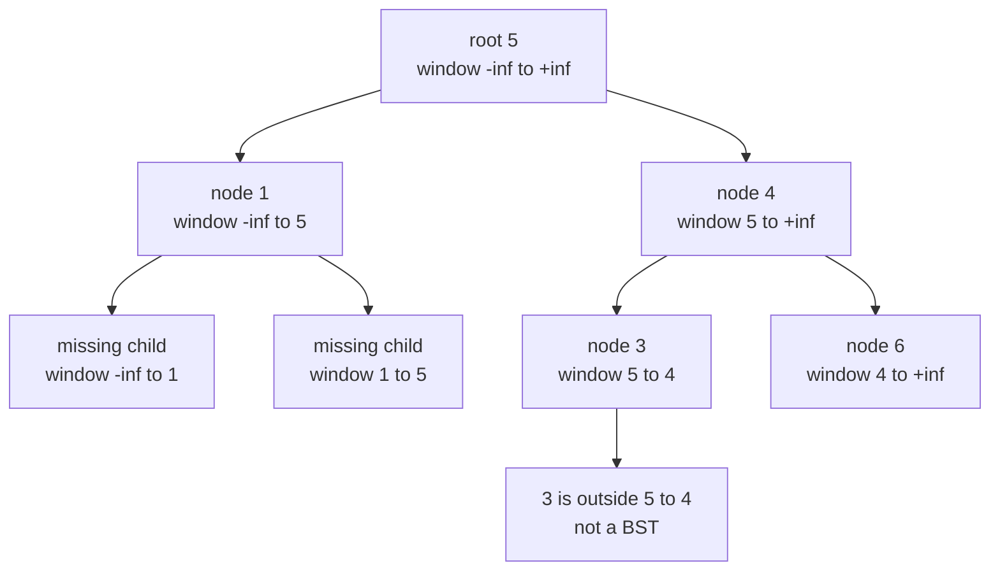
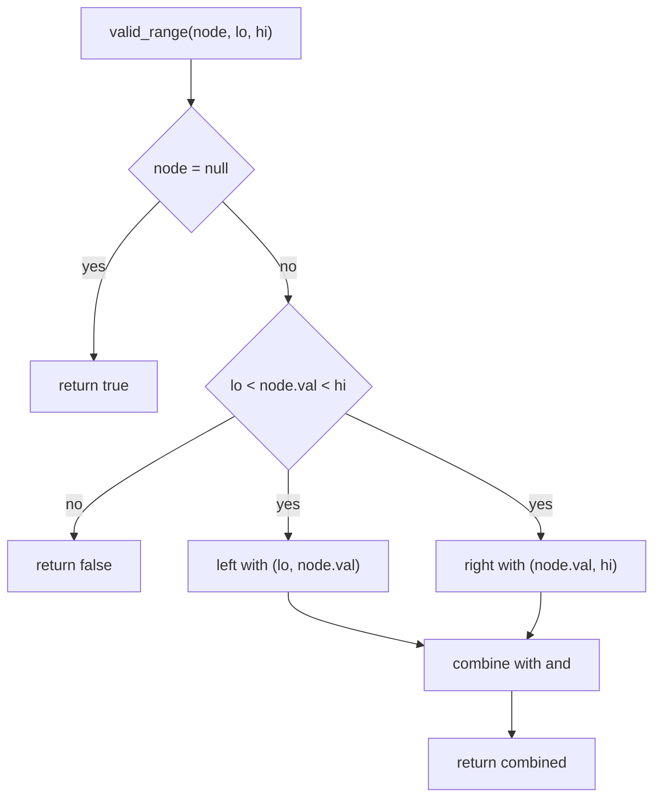
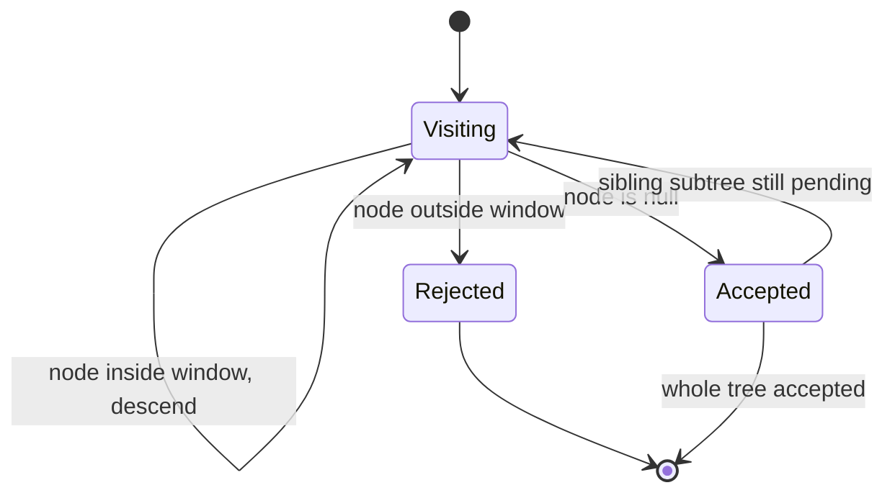

# 145 — Validate BST property (inorder).

> **Tier:** Beginner · **CTCI chapter:** Ch 4 — Trees and Graphs
> **Task spec:** [145-validate-bst-property-inorder.md](../../../tasks/beginner/145-validate-bst-property-inorder.md)
> **Solutions:** [Python](../../../solutions/python/beginner/145-validate-bst-property-inorder/solution.py) ·
> [Java](../../../solutions/java/beginner/145-validate-bst-property-inorder/Solution.java) ·
> [JavaScript](../../../solutions/javascript/beginner/145-validate-bst-property-inorder/solution.js) ·
> [C#](../../../solutions/csharp/beginner/145-validate-bst-property-inorder/Solution.cs)

## 1. Problem restatement

**Input:** the root of a binary tree of integers; the tree may be empty. Every solution file
also ships a helper that builds such a tree from a **level-order** list, where a missing child is
written as a sentinel (`None`, `null`, `int?[] { null }`).

**Output:** `true` when the tree satisfies the binary-search-tree ordering, and `false`
otherwise. The ordering is strict and global: for every node, *all* keys in its left subtree are
smaller than the node and *all* keys in its right subtree are larger.

The task spec is a single line, so the exact contract is pinned down by the assertions the four
solution files carry:

| Level-order input | Result | Why |
| --- | --- | --- |
| `null` / `None` | `true` | an empty tree has no node to violate anything |
| `[2, 1, 3]` | `true` | a balanced three-node BST |
| `[7]` | `true` | a single node has no children to contradict |
| `[3, 2, null, 1]` | `true` | a left-leaning chain `3 → 2 → 1` |
| `[5, 1, 4, null, null, 3, 6]` | `false` | `4` is a legal right child of `5`, but `3 < 5` sits below it |
| `[10, 5, 15, null, null, 6, 20]` | `false` | `6 < 10` while living in the right subtree of `10` |
| `[5, 4, 6, null, null, 3, 7]` | `false` | `3` is in the right subtree of `5` |
| `[1, 1]` | `false` | equal keys break the *strict* ordering |
| `[2147483647, -2147483648, null]` | `true` | the 32-bit extremes are ordinary values, not infinity |

The last row is the reason the range bounds cannot be `int`-sized: a real node value must never be
mistaken for a sentinel bound. Python uses `float("-inf")` / `float("inf")`, Java and C# use
`long.MIN_VALUE` / `long.MAX_VALUE`, and JavaScript uses
`Number.MIN_SAFE_INTEGER` / `Number.MAX_SAFE_INTEGER`.

## 2. Intuition

The naive idea is to walk the tree and check each node against its two children:

```text
previous = none
procedure is_valid_naive(node)
    if node = null: return true
    if node.left != null and node.left.val >= node.val: return false
    if node.right != null and node.right.val <= node.val: return false
    return is_valid_naive(node.left) and is_valid_naive(node.right)
end
```

This is local, and locality is exactly the bug. A node only sees its parent, never its
grandparent, so `[5, 1, 4, null, null, 3, 6]` slips through: `4` really is greater than `5`, and
`3` really is smaller than `4`, yet `3` sits in the right subtree of `5` and destroys the
ordering. The subtree of `4` needed a *lower bound of 5*, and the local check never propagated it.

The key insight is that the constraint a BST places on a node is not "compared to my parent" but
"inside an open interval inherited from every ancestor":

- the root may hold any value, i.e. it lives in the window `(-∞, +∞)`;
- the left child of a node with value `v` inherits the same lower bound but gets `v` as its new
  upper bound, so its window is `(lo, v)`;
- the right child keeps `lo`'s complement and gets `v` as its lower bound, so its window is
  `(v, hi)`.

That turns the validator into a single top-down pass carrying a pair `(lo, hi)` in the recursion
arguments — the window narrows as you descend, and any node outside its window is a violation.



Node `3` receives the window `(5, 4)`, which is empty — no integer can be strictly greater than
`5` and strictly smaller than `4` at the same time. An empty window is a definitive proof of
failure, and it is a *structural* property: it does not depend on which value happens to be
there.

The second, equivalent insight comes from the definition of a BST rather than from its
invariant: **an inorder traversal of a BST is strictly increasing**. Read the same tree in order
and you get `5, 1, 4, 3, 6`... no — the values are visited as `1, 5, 3, 4, 6`, and `5 > 3` is the
moment the walk fails. Both routes answer the same question; the four solutions ship both.

## 3. Algorithm

Route A — range recursion (`is_valid_bst` / `isValidBst` / `IsValidBst`):

1. Call `valid_range(root, -infinity, +infinity)`.
2. If the node is empty, return `true`.
3. If the node value is not strictly inside `(lo, hi)`, return `false`.
4. Recurse into the left child with the window `(lo, node.val)`.
5. Recurse into the right child with the window `(node.val, hi)`.
6. Return the conjunction of steps 4 and 5 — a failed subtree short-circuits the rest.

```text
procedure valid_range(node, lo, hi)
    if node = null then
        return true
    if not (lo < node.val < hi) then
        return false
    return valid_range(node.left, lo, node.val)
       and valid_range(node.right, node.val, hi)
end

procedure is_valid_bst(root)
    return valid_range(root, -infinity, +infinity)
end
```

Route B — iterative inorder (`is_valid_bst_inorder` and its counterparts):

1. Keep a `previous` value initialised to `-infinity` and an explicit stack.
2. Descend to the leftmost node, pushing every node on the way.
3. Pop a node; if its value is not strictly greater than `previous`, return `false`.
4. Record its value as the new `previous`, then continue the walk with its right child.
5. When both the stack and the cursor are exhausted, return `true`.

```text
procedure is_valid_bst_inorder(root)
    previous = -infinity
    stack = empty
    node = root
    while stack is not empty or node != null do
        while node != null do
            push stack, node
            node = node.left
        end
        node = pop stack
        if node.val <= previous then
            return false
        previous = node.val
        node = node.right
    end
    return true
end
```

Route B never recurses, which matters for a degenerate chain of `n` nodes: the recursive route
would nest `n` calls deep, the iterative one keeps an explicit stack of the same size but on the
heap. Both are single passes, and the four files assert that the two routes agree on every sample
tree, including the trap.



## 4. Worked example

Trace `is_valid_bst(build_tree([5, 1, 4, null, null, 3, 6]))`. The level-order builder makes `5`
the root, gives it children `1` and `4`, and then gives `4` the children `3` and `6`.

| Step | Node | Window `(lo, hi)` | Inside? | Action |
| --- | --- | --- | --- | --- |
| 1 | `5` | `(-∞, +∞)` | yes | descend left with `(-∞, 5)`, right with `(5, +∞)` |
| 2 | `1` | `(-∞, 5)` | yes | both children are sentinels, returns `true` |
| 3 | `4` | `(5, +∞)` | yes | descend left with `(5, 4)`, right with `(4, +∞)` |
| 4 | `3` | `(5, 4)` | **no** | `3 < 5`, so the window is empty — returns `false` |
| 5 | `4` | — | — | `and` short-circuits, propagation stops |
| 6 | `5` | — | — | the whole call returns `false` |

The inorder route reaches the same verdict from the other direction: the walk emits
`1, 5, 3, 4, 6` and stops at `3`, because `3 <= 5 = previous`.



The companion assertion `[3, 2, null, 1]` shows the same windows accepting a legitimate chain:
`3` in `(-∞, +∞)`, `2` in `(-∞, 3)`, `1` in `(-∞, 2)` — every value is strictly inside its
window, so the answer is `true` and the level-order builder's sparse tail
(`[3, 2, null, 1]` lists `1` as the left child of `2`) is exercised correctly.

## 5. Complexity

Let `n` be the number of nodes and `h` the height of the tree.

| Measure | Bound | Why it holds |
| --- | --- | --- |
| Time, route A, best | O(1) | a violation at the root returns immediately |
| Time, route A, worst | O(n) | every node is visited exactly once, with constant work per node |
| Space, route A | O(h) | the recursion stack holds one frame per level |
| Time, route B | O(n) | the inorder walk pushes and pops each node once |
| Space, route B | O(h) | the explicit stack holds at most one root-to-leaf path |
| Time, naive parent/child check | O(n) but **incorrect** | the trap `[5, 1, 4, null, null, 3, 6]` is accepted |
| Space, "collect inorder into a list" | O(n) | a correctly sorted buffer is not needed to compare neighbours |
| Call depth on a skewed chain | `n` | `h = n` when every node has a single child |

The two routes have identical asymptotics; the second is only preferable when recursion depth is
a concern or when the traversal is already written iteratively. Compared with the naive local
check, the range route pays nothing in time and buys correctness by carrying two numbers per
frame — an `O(1)`-per-node difference that the assertion suite treats as a hard requirement
rather than a nicety.

## 6. Pitfalls and edge cases

- **Empty tree.** `is_valid_bst(None)` is `true` in all four solutions; the recursion's first
  branch returns before touching any value.
- **Single node.** `[7]` is `true`, and only the sentinel children are examined afterwards.
- **Sentinels must be wider than the value type.** The assertions include
  `[2147483647, -2147483648, null]`; with `int`-sized infinity the left child would compare
  `-2147483648 <= -2147483648` and be rejected wrongly. Java and C# widen to `long`, Python uses
  floats, JavaScript uses `MIN_SAFE_INTEGER` / `MAX_SAFE_INTEGER`.
- **Duplicates are invalid.** `[1, 1]` fails because the comparison is strict (`lo < val < hi`, or
  `val <= previous` in the inorder route). A "BST" that allows duplicates needs an explicit
  convention about which side they go to.
- **Local checks are not enough.** `[5, 1, 4, null, null, 3, 6]` and `[10, 5, 15, null, null, 6, 20]`
  are both in the assertion list purely to catch the "compare with the children only"
  implementation.
- **Deep violations, not just adjacent ones.** In `[10, 5, 15, null, null, 6, 20]` the offending
  `6` is three edges below the root; the window test finds it without extra work.
- **Sparse level order.** The builder consumes two slots per dequeued node, so the input lists
  must spell out `null` for missing children (as in `[3, 2, null, 1]`) or the shape silently
  shifts.
- **Both routes must agree.** The Python, Java, JavaScript and C# files all cross-check
  `is_valid_bst` against the inorder variant on every sample, including the trap.
- **Equality of the two routes is not assumed, it is asserted.** A mismatch (for example an
  off-by-one in the `previous` initialisation) fails the test suite rather than being tolerated.

## 7. Variants and follow-ups

- **Find the split point instead of validating.** [146-lowest-common-ancestor-in-bst-iterative.md](../../../tasks/beginner/146-lowest-common-ancestor-in-bst-iterative.md)
  uses the same ordering to walk down towards the first node where two keys part ways.
- **Build a valid BST instead of checking one.** [144-convert-sorted-array-to-balanced-bst.md](../../../tasks/beginner/144-convert-sorted-array-to-balanced-bst.md)
  picks the middle of a sorted range as the root, which keeps every node inside its window by
  construction.
- **The inorder walk on its own.** [137-tree-inorder-traversal-recursive.md](../../../tasks/beginner/137-tree-inorder-traversal-recursive.md)
  emits the same sequence without the strictly-increasing check.
- **Structural questions about a tree.** [142-check-if-tree-is-balanced-height-difference-1.md](../../../tasks/beginner/142-check-if-tree-is-balanced-height-difference-1.md)
  and [135-check-if-two-binary-trees-are-identical.md](../../../tasks/beginner/135-check-if-two-binary-trees-are-identical.md)
  reuse the same top-down recursion shape but compare heights and shapes instead of intervals.
- The chapter walkthrough in [Trees and Graphs](../../ctci/04-trees-and-graphs.md) puts this task
  next to the other traversal-shaped tree checks.

## 8. Check yourself

1. Why does `[5, 1, 4, null, null, 3, 6]` fail even though each node is correctly placed relative
   to its own parent?

<details><summary>Show answer</summary>

Because the BST constraint is transitive. `3` is a left child of `4`, so it is smaller than `4`,
but it lives in the right subtree of `5`, so it must also be greater than `5` — and it is not.
The window `(5, 4)` on `3` is empty, which is the structural way of saying "no value could be
valid here".

</details>

2. What exactly must the sentinel bounds be, and why can they not be `int`-sized?

<details><summary>Show answer</summary>

They must be strictly smaller and strictly larger than every possible node value. The suite
asserts `[2147483647, -2147483648, null]` is a valid BST; with `INT_MIN` / `INT_MAX` the left
child would be rejected by `-2147483648 <= -2147483648`. So Java and C# use `long` bounds, Python
uses `float("-inf")` / `float("inf")`, and JavaScript uses the safe-integer limits.

</details>

3. Route A recurses and route B keeps an explicit stack. When does that difference matter?

<details><summary>Show answer</summary>

Only on deep trees. Both visit each node once and hold `O(h)` state; on a skewed chain of `n`
nodes `h = n`, so route A nests `n` frames of the host language's call stack while route B keeps
its stack on the heap. The asymptotics are the same, the failure mode is not.

</details>

4. What does the inorder route compare, and what is `previous` initialised to?

<details><summary>Show answer</summary>

It compares each visited value with the value visited immediately before it — `previous` — and
requires `node.val > previous`. `previous` starts at negative infinity (or the type's minimum),
so the leftmost node always passes. The first descent goes as far left as possible before any
comparison happens.

</details>

5. Is `[1, 1]` a BST?

<details><summary>Show answer</summary>

No. The four solutions define the ordering strictly, so a duplicate must fail; `[1, 1]` is in the
assertion list precisely for that. A BST that permits duplicates has to fix a convention (say,
"equal keys go right") and then relax one of the two comparisons accordingly.

</details>
