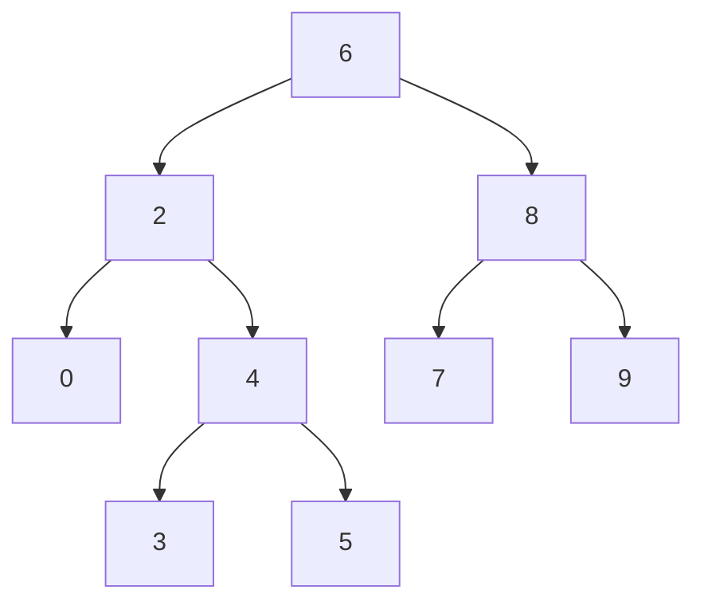
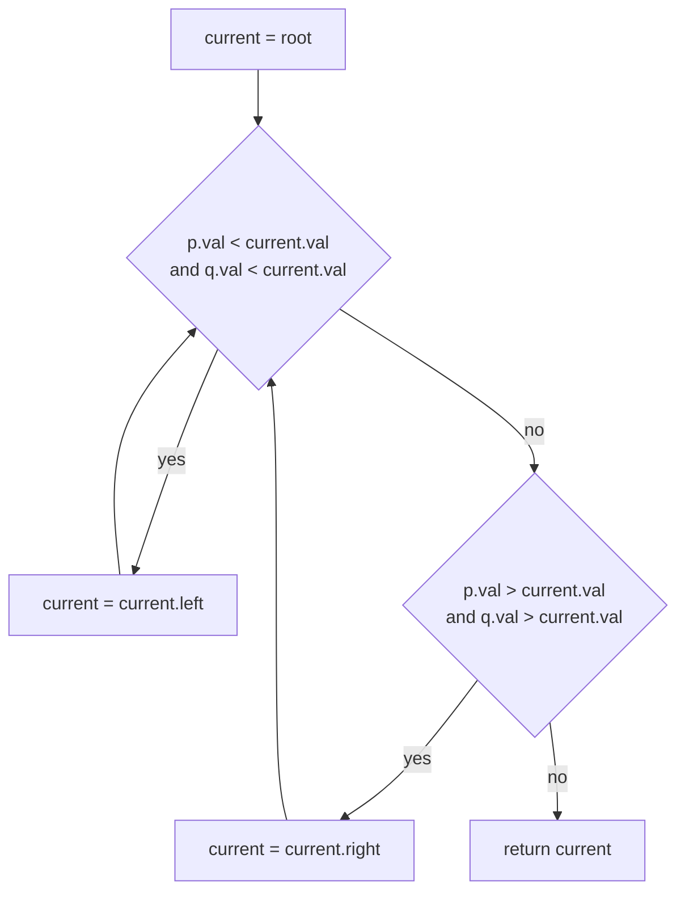
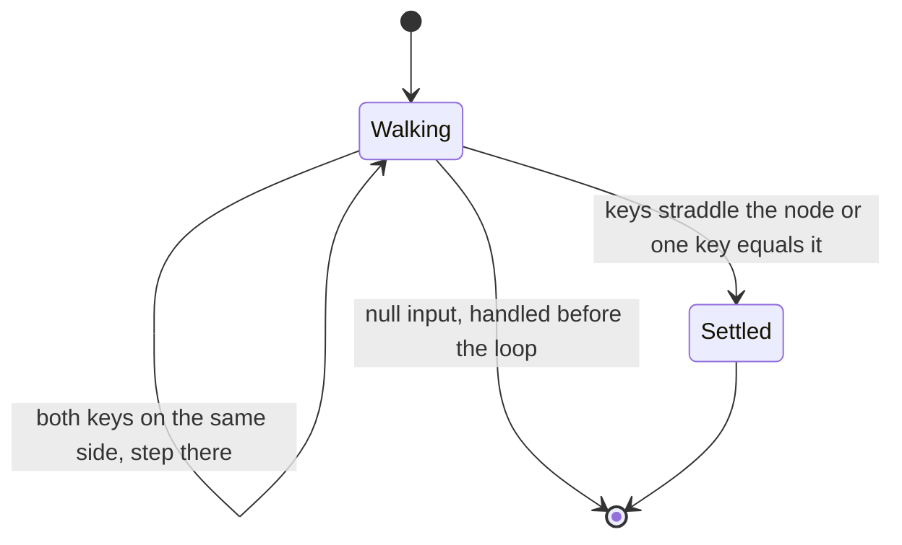
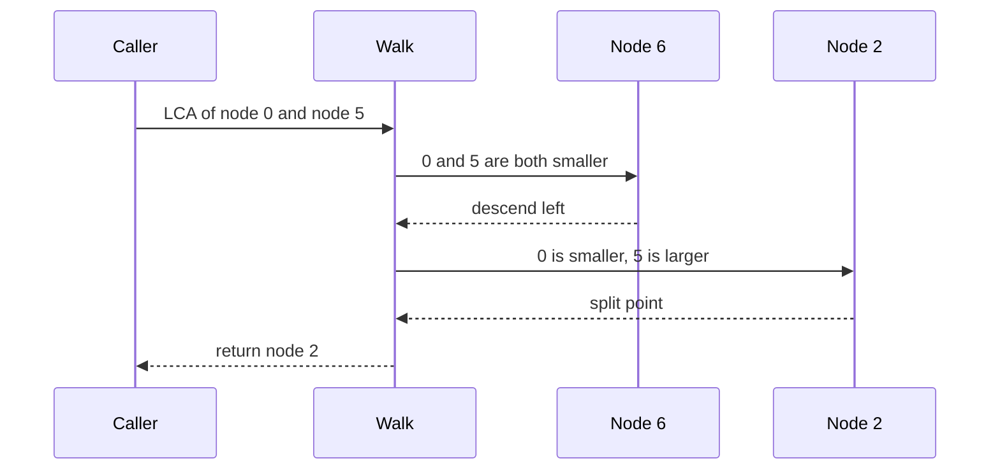

# 146 — Lowest common ancestor in BST (iterative).

> **Tier:** Beginner · **CTCI chapter:** Ch 4 — Trees and Graphs
> **Task spec:** [146-lowest-common-ancestor-in-bst-iterative.md](../../../tasks/beginner/146-lowest-common-ancestor-in-bst-iterative.md)
> **Solutions:** [Python](../../../solutions/python/beginner/146-lowest-common-ancestor-in-bst-iterative/solution.py) ·
> [Java](../../../solutions/java/beginner/146-lowest-common-ancestor-in-bst-iterative/Solution.java) ·
> [JavaScript](../../../solutions/javascript/beginner/146-lowest-common-ancestor-in-bst-iterative/solution.js) ·
> [C#](../../../solutions/csharp/beginner/146-lowest-common-ancestor-in-bst-iterative/Solution.cs)

## 1. Problem restatement

**Input:** the root of a **binary search tree** of distinct integers, plus two node references
`p` and `q`. Each solution also ships a `find(root, value)` helper that locates a node by value
through the BST ordering, and a level-order `build_tree` helper for the tests.

**Output:** the **lowest** node that has both `p` and `q` in its subtree, meaning the deepest
node that is an ancestor of both. When `p` or `q` is missing from the tree, or either reference —
or the tree — is null, the answer is `None` / `null`.

The ordering makes the answer computable without any traversal bookkeeping: walk down from the
root and stop at the first node where the two keys stop lying on the same side.

| Question on the sample tree | Result | Why |
| --- | --- | --- |
| `LCA(2, 8)` | `6` | the two keys split immediately at the root |
| `LCA(2, 4)` | `2` | `2` is an ancestor of `4`, so the walk stops at `2` |
| `LCA(0, 5)` | `2` | both keys are left of `6`, but they split around `2` |
| `LCA(4, 5)` | `4` | one key *is* the current node, so it is the answer |
| `LCA(7, 9)` | `8` | both keys are right of `6`, then split around `8` |
| `LCA(0, 3)` | `2` | both keys are left of `6` and split around `2` |
| `LCA(2, 2)` | `2` | a node is its own ancestor |
| `LCA(0, 99)` | `None` | `99` is not in the tree, so `find` returns `None` |

The sample tree is `build_tree([6, 2, 8, 0, 4, 7, 9, None, None, 3, 5])`, i.e.



The second assertion tree is the sparser `build_tree([3, 1, 5, None, 2, 4])`: `3` has children `1`
and `5`, `1` has a right child `2`, and `5` has a left child `4`. It matters because the keys
`2` and `4` sit in *opposite* subtrees of `3` while `5` is an ancestor of `4`.

## 2. Intuition

The general-tree answer (task 147) needs a postorder search that reports upward, because nothing
about a plain binary tree tells you which way to go. In a BST the ordering does the deciding:
at any node `x`, the keys of the left subtree are all smaller than `x` and the keys of the right
subtree are all larger.

So there are exactly three cases at the current node:

- **both keys smaller** → both live in the left subtree, so the answer is deeper; step left;
- **both keys larger** → both live in the right subtree; step right;
- **otherwise** the keys are on different sides, or one of them *is* the current node → the
  current node is the first common ancestor reachable from the root on a single path, i.e. the
  lowest one.

Why is the third case final? Because in the first two cases the current node has both keys in a
single child subtree, so it cannot be the lowest common ancestor — a deeper node contains both.
The first node reached where that is no longer true has the two keys separated, and no descendant
can contain both.



The loop is a single root-to-node descent, so the number of steps is bounded by the height `h`,
not by the number of nodes `n`. Nothing is stored: no recursion frames, no parent pointers, no
visited set. That is the "iterative, `O(1)` space" promise in the task title, and it is the whole
reason this task exists next to task 147.

## 3. Algorithm

1. If `root`, `p` or `q` is null, return null — there is nothing to search.
2. Set `node = root`.
3. If `p.val < node.val` **and** `q.val < node.val`, move to `node.left` and repeat step 3.
4. Otherwise, if `p.val > node.val` **and** `q.val > node.val`, move to `node.right` and repeat.
5. Otherwise return `node`: the keys straddle it, or at least one key equals it.
6. If the walk runs off the end of the tree, return null.

```text
procedure lowest_common_ancestor(root, p, q)
    if root = null or p = null or q = null then
        return null
    node = root
    while node != null do
        if p.val < node.val and q.val < node.val then
            node = node.left
        else if p.val > node.val and q.val > node.val then
            node = node.right
        else
            return node
        end
    end
    return null
end
```

The helper that supplies `p` and `q` is itself a loop, and it exists mainly so that a *missing*
key is detected before the walk starts:

```text
function find(root, value)
    while root != null and root.val != value do
        if value < root.val then
            root = root.left
        else
            root = root.right
        end
    end
    return root
end
```

When `find` returns null for a key that is absent, the caller passes null into
`lowest_common_ancestor`, and step 1 turns it into null. That is how the assertion
`LCA(0, 99) is None` is satisfied: the walk itself never checks membership.



## 4. Worked example

Trace `LCA(0, 5)` on `[6, 2, 8, 0, 4, 7, 9, None, None, 3, 5]`; `p` is the node holding `0`
(a leaf below `2`) and `q` the node holding `5` (below `4`).

| Step | `node.val` | `p.val` | `q.val` | Comparison | Action |
| --- | --- | --- | --- | --- | --- |
| 1 | `6` | `0` | `5` | `0 < 6` and `5 < 6` | both left → move to `2` |
| 2 | `2` | `0` | `5` | `0 < 2` but `5 > 2` | split → return `2` |

Two steps for a tree of eleven nodes. The sibling trace `LCA(4, 5)` shows the equality branch:

| Step | `node.val` | `p.val` | `q.val` | Comparison | Action |
| --- | --- | --- | --- | --- | --- |
| 1 | `6` | `4` | `5` | both smaller | move to `2` |
| 2 | `2` | `4` | `5` | both larger | move to `4` |
| 3 | `4` | `4` | `5` | `4 > 4` is false, `4 < 4` is false | fall through to the `else` and return `4` |

The third row is the case that the strict comparisons of steps 3 and 4 handle for free: when a key
equals the current node, neither "both smaller" nor "both larger" can hold, so the `else` branch
fires and the node is returned. On the sparse tree `[3, 1, 5, None, 2, 4]` the walk for
`LCA(2, 4)` stops at the root: `2 < 3` but `4 > 3`, so the keys already straddle `3`, which is the
deepest node containing both.



## 5. Complexity

Let `h` be the height of the BST and `n` its node count.

| Measure | Bound | Why it holds |
| --- | --- | --- |
| Time, best | O(1) | the keys split at the root, so one comparison answers |
| Time, average | O(log n) | a balanced BST has `h = O(log n)` |
| Time, worst | O(h) = O(n) | a skewed BST is a chain; the walk can visit every level |
| Space | O(1) | one node reference plus the two parameters — no stack, no set |
| `find` helper | O(h) per key | it is the same descent, used to produce the two node references |
| Alternative (task 147 style) | O(n) time, O(h) space | a postorder search works on any binary tree but cannot exploit ordering |

The worst case is a genuine `O(n)`: for `build_tree([1, None, 2, None, 3])` the walk for the
deepest key performs one step per level. That is why the task is titled *iterative* — the
asymptotics are unchanged, but the memory profile stays flat regardless of the shape.

## 6. Pitfalls and edge cases

- **Missing keys.** `LCA(0, 99)` is `None` because `find(tree, 99)` returns `None` and the
  function's first guard rejects it. The walk itself cannot detect absence — it has no membership
  test — so callers must pass real node references.
- **A key that is an ancestor of the other.** `LCA(2, 4)` is `2`, not `4` and not `6`. The `else`
  branch returns the higher of the two, which is the lowest *common* ancestor.
- **A node with itself.** `LCA(2, 2)` is `2`; both comparisons fail immediately and the `else`
  branch returns the root of the subtree.
- **Null tree, null keys.** All three inputs are guarded, and the assertions cover
  `LCA(None, …)`, `LCA(…, None, …)` and `LCA(…, key, None)`.
- **Comparison direction.** Steps 3 and 4 must use `<` and `>`, not `<=`/`>=`. A non-strict test
  would keep walking when a key equals the node and would pass the split point.
- **Duplicate keys.** The walk assumes distinct keys, which every supplied test tree satisfies;
  with duplicates the "both smaller" test stops being a valid subtree discriminator.
- **Skewed trees.** `[1, None, 2, None, 3]` is a right chain, so each step moves one level; the
  loop still terminates because the cursor eventually becomes null.
- **Sparse level order.** `build_tree([3, 1, 5, None, 2, 4])` needs the explicit `None` to place
  `2` as the right child of `1`; without it the shape changes and the expected answers change too.

## 7. Variants and follow-ups

- **No ordering available.** [147-lowest-common-ancestor-in-binary-tree-general.md](../../../tasks/beginner/147-lowest-common-ancestor-in-binary-tree-general.md)
  solves the same problem on a general binary tree with a postorder search that reports upward.
- **Validate the ordering first.** [145-validate-bst-property-inorder.md](../../../tasks/beginner/145-validate-bst-property-inorder.md)
  is the task that establishes the invariant this walk relies on.
- **Build the tree the ordering describes.** [144-convert-sorted-array-to-balanced-bst.md](../../../tasks/beginner/144-convert-sorted-array-to-balanced-bst.md)
  produces a BST from a sorted array.
- **Where the two keys meet in a traversal sense.** [135-check-if-two-binary-trees-are-identical.md](../../../tasks/beginner/135-check-if-two-binary-trees-are-identical.md)
  and [142-check-if-tree-is-balanced-height-difference-1.md](../../../tasks/beginner/142-check-if-tree-is-balanced-height-difference-1.md)
  show the recursive shapes that a general-tree LCA borrows.
- The chapter walkthrough in [Trees and Graphs](../../ctci/04-trees-and-graphs.md) collects the
  tree-search tasks.

## 8. Check yourself

1. Why does the loop stop as soon as the "both smaller" and "both larger" tests both fail?

<details><summary>Show answer</summary>

Because then the keys are separated by the current node: one is in the left subtree and the other
in the right, or one of them equals the node. Either way the node is an ancestor of both, and no
descendant can be an ancestor of both — descending would abandon one of the keys. So the first
such node is the lowest common ancestor.

</details>

2. What does `LCA(4, 5)` on the sample tree return, and which branch produces it?

<details><summary>Show answer</summary>

`4`. The walk goes `6 → 2` (both keys smaller) and then `2 → 4` (both larger); at `4` the "both
smaller" test fails because `4 < 4` is false, and the "both larger" test fails because `4 > 4` is
false, so the `else` branch returns the node.

</details>

3. How is a missing key reported, given that the walk never checks membership?

<details><summary>Show answer</summary>

By the caller. `find(root, 99)` performs the same descent and returns `None` when it runs off the
tree, so `lowest_common_ancestor` sees a null argument and returns null from its first guard.
That is the assertion `LCA(0, 99) is None`.

</details>

4. What are the best and worst case running times, and what tree shapes realise them?

<details><summary>Show answer</summary>

Best is `O(1)`: the keys split at the root, as `LCA(2, 8)` does on the sample tree. Worst is
`O(h)`, which is `O(n)` for a skewed chain such as `[1, None, 2, None, 3]`, and `O(log n)` for a
balanced tree. Extra space is `O(1)` in every case.

</details>

5. Could you compute the same answer by finding the root-to-node paths and comparing prefixes?

<details><summary>Show answer</summary>

Yes, but it costs more: two paths of length `h` mean `O(h)` extra storage and a second pass to
trim the common prefix. The split-point walk needs neither, because the BST ordering tells it
which way to go without ever materialising a path.

</details>
