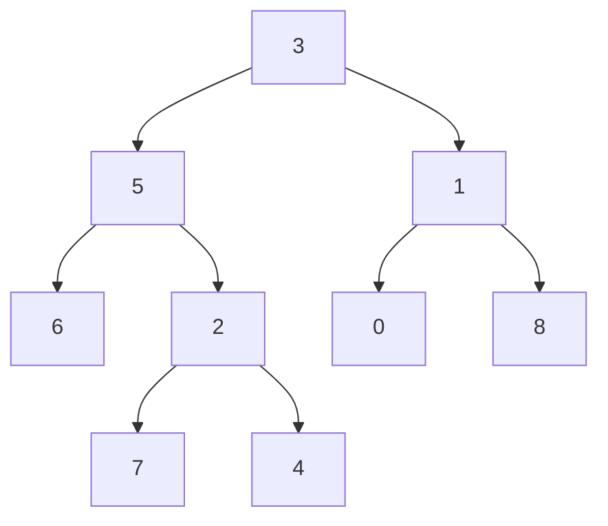
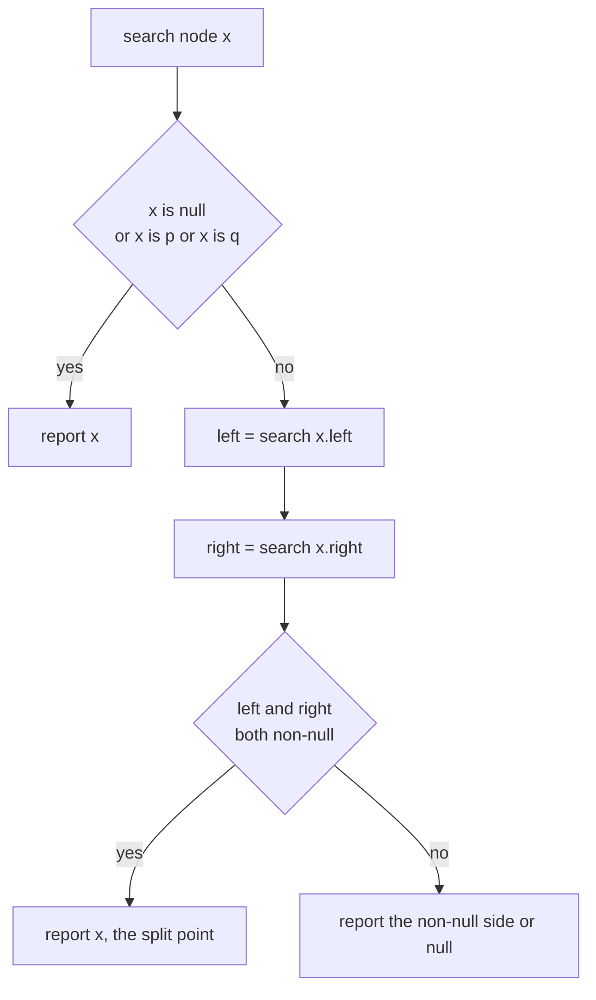
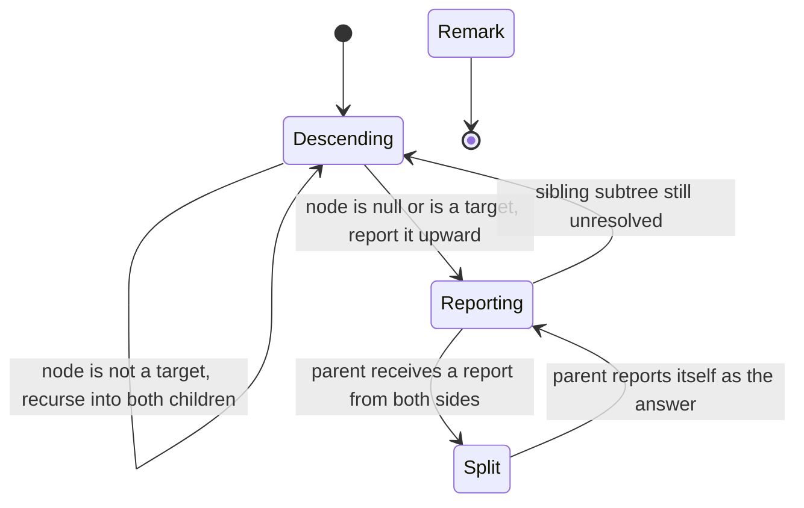
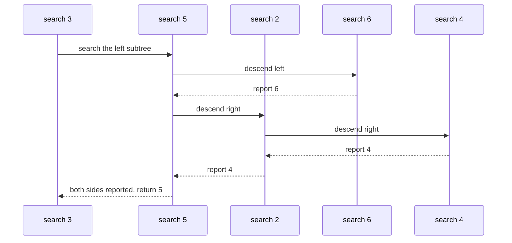

# 147 — Lowest common ancestor in binary tree (general).

> **Tier:** Beginner · **CTCI chapter:** Ch 4 — Trees and Graphs
> **Task spec:** [147-lowest-common-ancestor-in-binary-tree-general.md](../../../tasks/beginner/147-lowest-common-ancestor-in-binary-tree-general.md)
> **Solutions:** [Python](../../../solutions/python/beginner/147-lowest-common-ancestor-in-binary-tree-general/solution.py) ·
> [Java](../../../solutions/java/beginner/147-lowest-common-ancestor-in-binary-tree-general/Solution.java) ·
> [JavaScript](../../../solutions/javascript/beginner/147-lowest-common-ancestor-in-binary-tree-general/solution.js) ·
> [C#](../../../solutions/csharp/beginner/147-lowest-common-ancestor-in-binary-tree-general/Solution.cs)

## 1. Problem restatement

**Input:** the root of an ordinary binary tree (no ordering guarantee) plus two node references
`p` and `q`. Three helpers come with the solution files: a level-order `build_tree`, a general
`find(root, value)` depth-first search, and an identity test `contains(root, target)`.

**Output:** the lowest node whose subtree contains both `p` and `q`. If either node is not part of
the tree — or either reference, or the tree, is null — the answer is `None` / `null`.

The sample tree is `build_tree([3, 5, 1, 6, 2, 0, 8, None, None, 7, 4])`:



This tree is deliberately *not* a BST: `3` has a left child `5` and a right child `1`. The
assertions spell out the expected answers:

| Question | Result | Why |
| --- | --- | --- |
| `LCA(5, 1)` | `3` | the root's two subtrees hold one key each |
| `LCA(5, 4)` | `5` | `5` is an ancestor of `4` |
| `LCA(6, 7)` | `5` | both keys live in the left branch of the root |
| `LCA(6, 4)` | `5` | the split happens below `5`, not at the root |
| `LCA(7, 4)` | `2` | `7` and `4` are siblings under `2` |
| `LCA(0, 4)` | `3` | the keys sit in different subtrees of the root |
| `LCA(3, 5)` | `3` | `p` is the root itself |
| `LCA(7, 7)` | `7` | a node is its own ancestor |
| `LCA(0, 99)` | `None` | no node holds `99` |
| `LCA(3, stray 5)` | `None` | a fresh node with value `5` is not *in* the tree |
| `LCA(1, 3)` on `[1, None, 2, None, 3]` | `1` | a right chain still has a well-defined LCA |

The `stray` row is the interesting one: the same *value* in a detached object is not the same
*node*, so membership is decided by identity, not by value.

## 2. Intuition

With no ordering to exploit, there is no way to decide locally whether to go left or right —
both subtrees may hold a target. So the search has to be bottom-up: each subtree reports what it
saw, and the parent combines the two reports.

The naive first attempt is to search for the two parents' paths (`O(n)` each, plus storage) and
compare prefixes. It works, but it materialises two paths it never needs.

The key insight is to let the recursion do the reporting. A call on a subtree returns exactly one
of three things:

- `null` — this subtree contains neither key;
- a key node — this subtree contains exactly one of the keys (or *is* one of them), and the other
  key, if it is anywhere, must be outside this subtree;
- an internal node — the two keys were found in *different* children of this node, so this node is
  the lowest common ancestor of both.

The last case is the answer, and it is found on the way back up: the first node that receives a
non-null report from both children. Below it, exactly one child subtree holds both keys, so the
report travels upward unchanged until the split point.



One subtlety needs an extra step. The postorder search reports a node whenever it *reaches* `p` or
`q`, so if one key is simply absent, the search would happily return the other key and claim it as
the answer. The solutions therefore run a cheap identity pre-pass:

```text
procedure contains(root, target)
    if root = null then
        return false
    return root is target
        or contains(root.left, target)
        or contains(root.right, target)
end
```

`lowest_common_ancestor` calls `contains` for both keys first and returns `null` when either test
fails. That is what makes `LCA(0, 99) is None` and `LCA(3, stray 5) is None` true, even though the
postorder search alone would have returned something for the second row.

## 3. Algorithm

1. If `root`, `p` or `q` is null, return null.
2. Verify membership: if `contains(root, p)` or `contains(root, q)` is false, return null.
3. Run the postorder search from the root.
4. In the search, if the current node is null, or *is* `p`, or *is* `q`, report that node.
5. Otherwise search the left child and the right child.
6. If both reports are non-null, report the current node — this is the split point.
7. Otherwise report whichever side was non-null (or null when both were null).

```text
procedure lowest_common_ancestor(root, p, q)
    if root = null or p = null or q = null then
        return null
    if not contains(root, p) or not contains(root, q) then
        return null
    return search(root, p, q)
end

procedure search(node, p, q)
    if node = null or node is p or node is q then
        return node
    left = search(node.left, p, q)
    right = search(node.right, p, q)
    if left != null and right != null then
        return node
    if left != null then
        return left
    return right
end
```

Note step 4's ordering: the "is a target" test happens *before* the children are searched, so the
recursion never descends past a target. That is why `LCA(5, 4)` returns `5` — the call on `5`
returns immediately without ever looking at `4`.



The tooling around the core is worth naming because it shapes the tests: `find` is an ordinary
depth-first search that returns the first node with a matching value (there is no ordering to
guide it, unlike task 146), and `build_tree` assembles the sample shapes from level-order lists so
that "missing child" positions are explicit.

## 4. Worked example

Trace `LCA(6, 4)` on the sample tree. `contains` passes for both keys, so the walk runs:

| Call | Left report | Right report | Returned | Reason |
| --- | --- | --- | --- | --- |
| `search(6)` | — | — | `6` | node *is* `p`, so it reports immediately |
| `search(7)` | `null` | `null` | `null` | leaf that is neither key |
| `search(4)` | — | — | `4` | node *is* `q` |
| `search(2)` | `null` | `4` | `4` | only the right side reported |
| `search(5)` | `6` | `4` | `5` | both sides reported → split point |
| `search(1)` and below | `null` | `null` | `null` | neither key is in the right branch |
| `search(3)` | `5` | `null` | `5` | only the left side reported |

The verdict travels up as the single value `5`: row 5 detects the split, and rows 6-7 only carry
the result to the caller. The same trace for `LCA(7, 4)` stops one level lower — `search(2)` gets
`7` from the left and `4` from the right and returns itself, and that `2` is then carried up
through `5` and `3`.



On the degenerate right chain `[1, None, 2, None, 3]` the answer to `LCA(1, 3)` is `1`: the call
on the root hits the "node is a target" branch immediately and reports itself, and the ancestor
relation is already satisfied because `3` hangs below it.

## 5. Complexity

Let `n` be the number of nodes and `h` the height of the tree.

| Measure | Bound | Why it holds |
| --- | --- | --- |
| Time, best | O(n) | the search is a full postorder; even a shallow answer needs the membership pre-pass |
| Time, average | O(n) | every node is visited a constant number of times across the three passes |
| Time, worst | O(n) | `contains` runs twice (at most `n` nodes each) and `search` runs once |
| Space | O(h) | the recursion depth is the height; a skewed chain makes it `O(n)` |
| Alternative — parent pointers | O(h) time after O(n) pre-processing | store a parent per node once, then walk upward and match |
| Alternative — path materialisation | O(n) time, O(h) space | build both root-to-node paths and drop the common prefix |

The three linear passes are not an asymptotic concern (`3n` is still `O(n)`), and the recursion
depth is the same `O(h)` as any traversal. The price the general-tree version pays compared with
the BST version of task 146 is real, though: no early exit, no `O(1)` space, and no way to avoid
touching subtrees that obviously cannot contain a key.

## 6. Pitfalls and edge cases

- **A key that is not in the tree.** `LCA(0, 99)` is `None`. Without the `contains` pre-pass the
  postorder search would return `0` — a wrong answer, not an error — because it reports the first
  target it meets. This is the single most important correctness detail in the task.
- **Same value, different object.** The assertion `LCA(3, new TreeNode(5))` is `None`: identity is
  what decides membership, in Python (`is`), Java (`==`), JavaScript (`===`) and C# (`ReferenceEquals`).
  A value-based `contains` would wrongly answer `5`.
- **A target that is an ancestor of the other.** `LCA(5, 4)` is `5`; the search stops at `5`
  because the target test precedes the recursion.
- **A node paired with itself.** `LCA(7, 7)` is `7`, which falls out of the same early return.
- **The root is a target.** `LCA(3, 5)` is the root `3`; returning `null` here would be a bug.
- **Null inputs.** `LCA(None, …)`, `LCA(…, None, …)` and `LCA(…, key, None)` all return null
  before any traversal happens.
- **Recursion depth.** A chain of `n` nodes (`[1, None, 2, None, 3]` is a small one) nests `n`
  calls in all four languages; the shipped code accepts that, and the iterative alternative would
  need an explicit stack plus parent tracking.
- **Duplicate values are allowed.** A general binary tree may hold equal keys anywhere; `find`
  returns the first match in DFS order, which is why the tests build target references through
  `find` instead of comparing numbers.

## 7. Variants and follow-ups

- **Ordered keys.** [146-lowest-common-ancestor-in-bst-iterative.md](../../../tasks/beginner/146-lowest-common-ancestor-in-bst-iterative.md)
  solves the same problem in `O(h)` time and `O(1)` space on a BST by exploiting the ordering.
- **Validate the ordering.** [145-validate-bst-property-inorder.md](../../../tasks/beginner/145-validate-bst-property-inorder.md)
  is the check that tells you which of the two approaches applies to a given tree.
- **Traversal shapes.** [135-check-if-two-binary-trees-are-identical.md](../../../tasks/beginner/135-check-if-two-binary-trees-are-identical.md)
  and [143-symmetric-tree-check-mirror.md](../../../tasks/beginner/143-symmetric-tree-check-mirror.md)
  are built from the same "combine two child reports" recursion skeleton.
- **Root-to-leaf paths.** [152-all-root-to-leaf-paths-with-given-sum.md](../../../tasks/beginner/152-all-root-to-leaf-paths-with-given-sum.md)
  materialises paths rather than comparing them, which is the shape the path-based LCA variant
  would use.
- The chapter walkthrough in [Trees and Graphs](../../ctci/04-trees-and-graphs.md) covers the
  traversal vocabulary these tasks share.

## 8. Check yourself

1. Why does the postorder search alone give the wrong answer when a key is missing?

<details><summary>Show answer</summary>

Because it treats "found a target" as a stopping condition, so a search for `0` and `99` returns
`0` once it reaches `0` and reports it upward as if it were the split point. Only the identity
pre-pass can distinguish "one target and one stranger" from "both targets, one of them a
descendant".

</details>

2. What exactly does a subtree report when it holds both keys?

<details><summary>Show answer</summary>

It never reports both — it reports the split node, i.e. the lowest common ancestor inside that
subtree. Once a node receives non-null reports from both children, it returns itself; higher calls
then see a single non-null value and pass it along unchanged.

</details>

3. How does `LCA(5, 4)` avoid descending to `4`?

<details><summary>Show answer</summary>

The search tests the current node against `p` and `q` *before* recursing, so the call on `5`
returns `5` immediately. The recursion is only entered for nodes that are not targets, which also
guarantees the answer is never a descendant of a target.

</details>

4. What are the time and space bounds, and how many passes does the implementation make?

<details><summary>Show answer</summary>

`O(n)` time overall: `contains` is called twice (up to `n` nodes each) and the postorder search
visits each node once. Space is `O(h)` for the recursion, `O(n)` in the worst case of a chain.
Parent pointers would give `O(h)` query time after `O(n)` pre-processing.

</details>

5. Why must membership be decided by identity rather than by value?

<details><summary>Show answer</summary>

Because a binary tree may hold duplicate values, and because a caller can hand in a node object
that is not in the tree at all — `new TreeNode(5)` in the assertions. Two nodes with equal values
are different positions in the tree, and only the position determines the ancestor relation.

</details>
