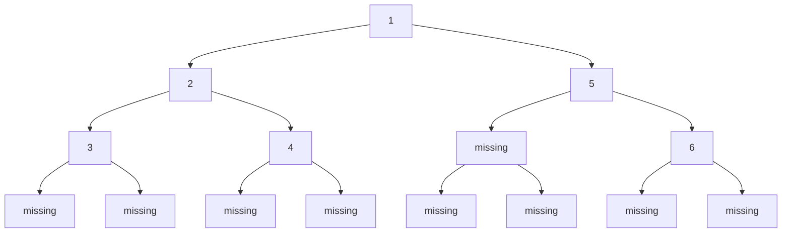
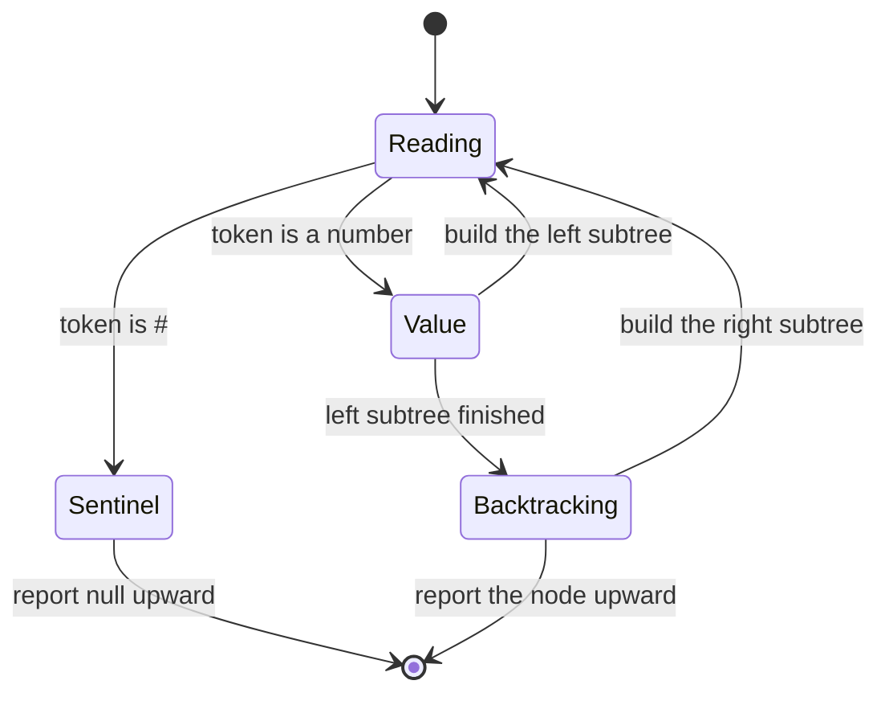
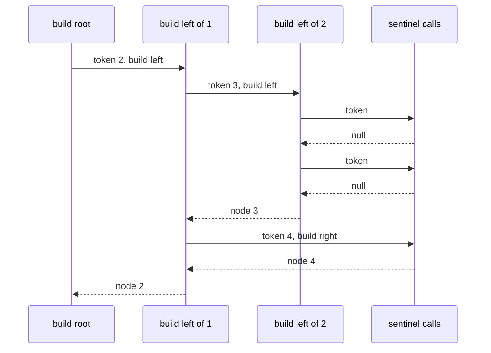

# 148 — Serialize and deserialize binary tree (preorder).

> **Tier:** Beginner · **CTCI chapter:** Ch 4 — Trees and Graphs
> **Task spec:** [148-serialize-and-deserialize-binary-tree-preorder.md](../../../tasks/beginner/148-serialize-and-deserialize-binary-tree-preorder.md)
> **Solutions:** [Python](../../../solutions/python/beginner/148-serialize-and-deserialize-binary-tree-preorder/solution.py) ·
> [Java](../../../solutions/java/beginner/148-serialize-and-deserialize-binary-tree-preorder/Solution.java) ·
> [JavaScript](../../../solutions/javascript/beginner/148-serialize-and-deserialize-binary-tree-preorder/solution.js) ·
> [C#](../../../solutions/csharp/beginner/148-serialize-and-deserialize-binary-tree-preorder/Solution.cs)

## 1. Problem restatement

**Input:** for `serialize`, the root of a binary tree of integers (possibly empty); for
`deserialize`, the string that `serialize` produced.

**Output:** a compact string that captures the tree **exactly** — same shape, same values — and a
fresh tree rebuilt from that string. The format is identical in all four languages: preorder
values separated by commas, with `#` marking every missing child.

```text
serialize(None)                          -> "#"
serialize(build_tree([7]))               -> "7,#,#"
serialize(build_tree([1, 2, None, 3]))   -> "1,2,3,#,#,#,#"
serialize(build_tree([1, 2, 5, 3, 4, None, 6]))
                                         -> "1,2,3,#,#,4,#,#,5,#,6,#,#"
deserialize("#")                         -> None
deserialize("")                          -> None
```

The assertions pin down the round trip:

| Property | Check |
| --- | --- |
| Token count | a tree with `n` nodes serializes to exactly `2n + 1` tokens |
| Preorder agreement | dropping the `#` tokens yields the plain preorder value list |
| Shape round trip | the rebuilt tree is identical to the original (`are_identical`) |
| String round trip | `serialize(deserialize(text))` is character-for-character `text` |
| Fresh structure | the rebuilt tree is a new object graph, never an alias of the input |

`serialize(build_tree([1, 2, 3]))` has `.split(",").length == 7`, which is the `2n + 1` rule with
`n = 3`: each node contributes one value token and one sentinel for its missing child, plus the
single sentinel of the empty tree.

## 2. Intuition

A preorder value list alone is ambiguous. `[1, 2, 3]` could be a right-leaning chain `1 → 2 → 3`, a
left-leaning chain, or a balanced tree — the same values in the same preorder order. The shape
information is simply not in the stream.

The key insight is that the *shape* is exactly what the sentinels record. If the walk emits a
token for every missing child as well, the stream becomes a complete description: reading it left
to right, a value means "make a node here", and `#` means "this child is absent". The reader then
consumes tokens in the same order the writer produced them and calls itself recursively, so it
never needs lookahead: the next token after a value is always the root of the left subtree.

The token budget makes that exact: a tree with `n` nodes has `n` values and `n + 1` sentinels
(every node has two child slots, and `2n` slots are filled by `n - 1` real edges and `n + 1`
absences), which is `2n + 1` tokens. Nothing is left to guess.



Preorder visiting that shape (`node`, then left subtree, then right subtree) emits
`1, 2, 3, #, #, 4, #, #, 5, #, 6, #, #`. Read the other way, the very first token `1` is the root,
the next three (`2, 3, #`) begin the left subtree, and rebuilding consumes exactly the tokens each
subtree needs — the boundaries fall out of the recursion rather than out of a delimiter.

Because `#` is the sentinel, a node value of literal `#` is not representable; the four solutions
accept that restriction, and no test tree contains such a value. Negative integers are fine
because the tokenizer splits on commas, not on the minus sign.

## 3. Algorithm

Serialization:

1. Start with an empty list of tokens.
2. Recurse on the node: if it is null, append `#` and return.
3. Otherwise append the node's value as text, then recurse into the left child, then the right.
4. Join the tokens with commas.

```text
procedure serialize(root)
    parts = empty list
    walk(root, parts)
    return join(parts, ",")
end

procedure walk(node, parts)
    if node = null then
        append parts, "#"
        return
    append parts, text(node.val)
    walk(node.left, parts)
    walk(node.right, parts)
end
```

Deserialization:

1. When the input string is empty, return null — there is no token at all.
2. Split the string on commas into a token array and set a cursor `pos` to `0`.
3. Recurse on the cursor: read the token at `pos`, advance `pos` by one.
4. If the token is `#`, return null.
5. Otherwise make a node from the token, then recurse for its left child and for its right child.
6. Return the node built by the outermost call.

```text
procedure deserialize(data)
    if data = "" then
        return null
    tokens = split(data, ",")
    pos = 0
    return build(tokens, pos)
end

procedure build(tokens, pos)
    token = tokens[pos]
    pos = pos + 1
    if token = "#" then
        return null
    node = new node(value of token)
    node.left = build(tokens, pos)
    node.right = build(tokens, pos)
    return node
end
```

The cursor must be *shared* across the recursive calls, which each language expresses in its own
way: Python wraps it in a one-element list, Java passes an `int[]` of length 1, C# uses `ref int
pos`, and JavaScript closes over a `let pos` variable. A cursor copied by value would make every
subtree restart at the beginning of the stream.



## 4. Worked example

Trace `deserialize("1,2,3,#,#,4,#,#,5,#,6,#,#")`, the serialization of
`build_tree([1, 2, 5, 3, 4, None, 6])`:

| Call | `pos` before | Token read | Action |
| --- | --- | --- | --- |
| `build()` root | 0 | `1` | make node `1`, then build its left child |
| `build()` left of `1` | 1 | `2` | make node `2`, then its left child |
| `build()` left of `2` | 2 | `3` | make node `3`, then its left child |
| `build()` left of `3` | 3 | `#` | return null — left of `3` is absent |
| `build()` right of `3` | 4 | `#` | return null — right of `3` is absent |
| `build()` right of `2` | 5 | `4` | make node `4`, both children are `#` at positions 6, 7 |
| `build()` right of `1` | 8 | `5` | make node `5`, then its left child |
| `build()` left of `5` | 9 | `#` | return null |
| `build()` right of `5` | 10 | `6` | make node `6`, children `#` at positions 11, 12 |

After the last call the cursor sits at `13`, exactly the token count, and the recursion has
rebuilt the original shape. The serialization direction on the same tree walks the nodes in the
order `1, 2, 3, 4, 5, 6` — the preorder value list — interleaving `#` after every child slot that
does not exist.



## 5. Complexity

Let `n` be the number of nodes, `h` the height, and `L = 2n + 1` the token count.

| Measure | Bound | Why it holds |
| --- | --- | --- |
| Time, serialize | O(n) | each node and each sentinel is appended once; one join at the end |
| Time, deserialize | O(L) | the cursor advances by one per token and never rewinds |
| Space, output string | O(n) | `2n + 1` tokens, each at least one character |
| Space, recursion | O(h) | the walk and the rebuild nest one frame per level |
| Space, token array | O(n) | the split array holds all `2n + 1` tokens |
| Naive alternative | ambiguous | a bare preorder list cannot distinguish shapes |

Building the output by repeated string concatenation would be `O(n²)` in the same way task 001
describes, which is why all four solutions collect tokens in a list (or `StringBuilder`-style
collection) and join once. The assertions also check that the rebuilt tree is a *fresh* object
graph, so the cost is genuinely paid rather than aliased.

## 6. Pitfalls and edge cases

- **Two spellings of "no tree".** `deserialize("#")` returns null (the sentinel rule) and
  `deserialize("")` returns null (the empty-string guard). Both are asserted.
- **A single node is not one token.** `serialize(build_tree([7]))` is `"7,#,#"` — the node plus
  both empty child slots. Emitting only `7` would make the shape ambiguous.
- **Sentinels are mandatory.** Emitting values alone cannot tell `[1, 2, null, 3]` from another
  arrangement of the same preorder values; that is why the format always emits `#`.
- **The token count is fixed.** Any correct stream of a `n`-node tree has exactly `2n + 1` tokens;
  the suite asserts `7` for the three-node tree `[1, 2, 3]`.
- **A shared cursor.** If `pos` were passed by value (or reset per subtree), the rebuild would
  re-read the first tokens and produce the wrong shape. Python's one-element list, Java's `int[]`,
  C#'s `ref` and JavaScript's closure all exist for this reason.
- **`#` cannot be a node value.** The sentinel is not escaped, so a tree containing the value `#`
  is out of scope for this format.
- **Delimiter choice.** Values are split on commas *before* parsing, so negative numbers and
  multi-digit numbers survive; a fixed-width or whitespace-only format would not be so forgiving.
- **Empty level-order input.** `build_tree([])` is null and serializes to `"#"`, which the round
  trip turns back into null — the identity is not preserved, but the *tree* is.
- **Fresh structure.** The rebuilt tree shares nothing with the original; the assertions check
  `rebuilt is not tree`, so a "deserialize" that returned its input would fail even if the shape
  matched.

## 7. Variants and follow-ups

- **Level-order instead of preorder.** The same format with a breadth-first walk is the usual
  alternative encoding; [139-level-order-traversal-bfs-of-tree.md](../../../tasks/beginner/139-level-order-traversal-bfs-of-tree.md)
  is the traversal it would build on.
- **The traversals that make the stream.** [136-tree-preorder-traversal-recursive.md](../../../tasks/beginner/136-tree-preorder-traversal-recursive.md)
  and [137-tree-inorder-traversal-recursive.md](../../../tasks/beginner/137-tree-inorder-traversal-recursive.md)
  are the walks that read the stream back.
- **Tree equality.** [135-check-if-two-binary-trees-are-identical.md](../../../tasks/beginner/135-check-if-two-binary-trees-are-identical.md)
  provides the `are_identical` shape-comparison the round trip is checked with.
- **The opposite direction.** [144-convert-sorted-array-to-balanced-bst.md](../../../tasks/beginner/144-convert-sorted-array-to-balanced-bst.md)
  builds a specific tree, which is what a deserializer does from a specific stream.
- The chapter walkthrough in [Trees and Graphs](../../ctci/04-trees-and-graphs.md) lists the
  traversal tasks in the order this encoding depends on.

## 8. Check yourself

1. Why does a tree with `n` nodes always produce exactly `2n + 1` tokens?

<details><summary>Show answer</summary>

One token per node value, plus one token for every empty child slot. A binary tree with `n` nodes
has `2n` child slots, of which `n - 1` are real edges to children and the remaining `n + 1` are
empty. So the stream is `n` values plus `n + 1` sentinels: `2n + 1`.

</details>

2. What breaks if `deserialize` copies the cursor per recursive call instead of sharing it?

<details><summary>Show answer</summary>

Every subtree would start reading at token `0`. The rebuilt root would be fine, but its left and
right subtrees would both be built from the beginning of the stream, producing a different shape
(or a non-terminating walk). The cursor has to be mutable and shared, which is why the solutions
use a one-element list, an `int[]`, a `ref` parameter or a closure variable.

</details>

3. Why is `serialize(null)` equal to `"#"` rather than the empty string?

<details><summary>Show answer</summary>

Because `#` is the sentinel for "no child", and the empty tree is nothing else than a missing
root. Using the empty string would create a second, redundant encoding; the solutions accept both
when decoding (the empty string is guarded separately) but only ever emit `"#"`.

</details>

4. Can `deserialize` be written without recursion?

<details><summary>Show answer</summary>

Yes — the token stream is a prefix description, so an explicit stack can rebuild it: push a
pending child slot, pop a token, and attach a new node to the slot when the token is a value.
Recursion is the shortest expression of that idea and keeps the `O(h)` auxiliary space; the
iterative form needs an explicit stack of the same size.

</details>

5. Which two properties does the test suite check that a shape-only comparison would miss?

<details><summary>Show answer</summary>

The string round trip (`serialize(deserialize(text)) == text`, which catches a format change such
as dropping a sentinel) and the fresh-structure check (`rebuilt is not tree`, which catches an
implementation that returns the original object). Both are asserted for every sample tree.

</details>
