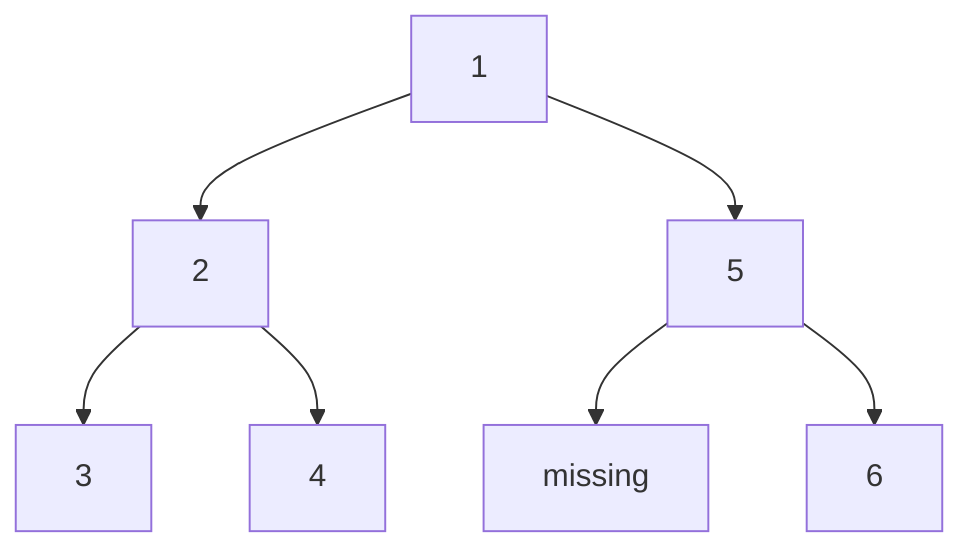
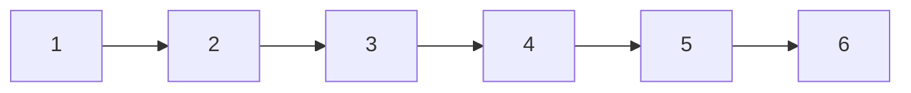
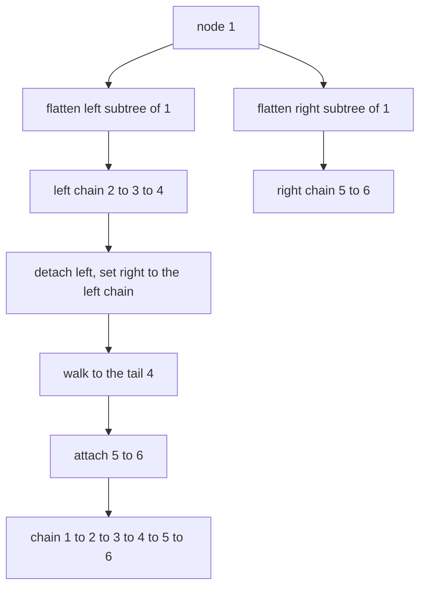
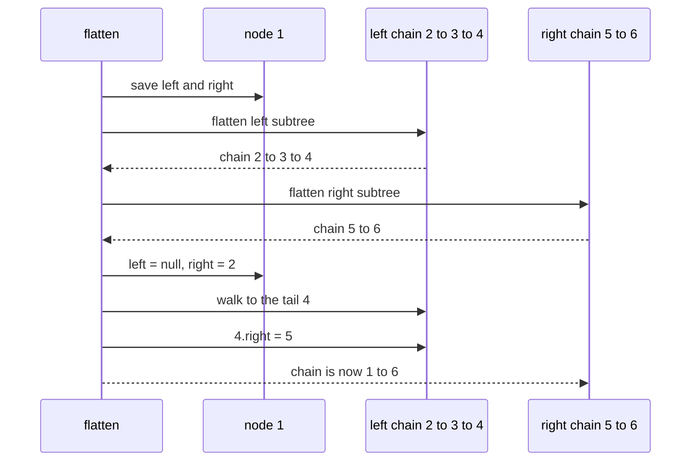

# 149 — Convert binary tree to linked list (flatten).

> **Tier:** Beginner · **CTCI chapter:** Ch 4 — Trees and Graphs
> **Task spec:** [149-convert-binary-tree-to-linked-list-flatten.md](../../../tasks/beginner/149-convert-binary-tree-to-linked-list-flatten.md)
> **Solutions:** [Python](../../../solutions/python/beginner/149-convert-binary-tree-to-linked-list-flatten/solution.py) ·
> [Java](../../../solutions/java/beginner/149-convert-binary-tree-to-linked-list-flatten/Solution.java) ·
> [JavaScript](../../../solutions/javascript/beginner/149-convert-binary-tree-to-linked-list-flatten/solution.js) ·
> [C#](../../../solutions/csharp/beginner/149-convert-binary-tree-to-linked-list-flatten/Solution.cs)

## 1. Problem restatement

**Input:** the root of a binary tree of integers (possibly empty).

**Output:** the *same* nodes, rewired **in place** so that the tree becomes a linked list in
preorder order. The `right` pointer is the `next` link, every `left` pointer is left empty, and the
root of the list is the root of the tree. The task follows LeetCode 114, and the solution files are
explicit that the rewrite is in place — no node is copied.

The sample is `build_tree([1, 2, 5, 3, 4, None, 6])`:



Its preorder order is `1, 2, 3, 4, 5, 6`, and after flattening the chain follows exactly that
order through `right` pointers:



The assertions in the four files:

| Case | Result |
| --- | --- |
| `flatten(null)` / `flatten_iterative(null)` | null, no work done |
| `build_tree([7])` | the chain `[7]` |
| `build_tree([1, 2, 5, 3, 4, null, 6])` | `[1, 2, 3, 4, 5, 6]` |
| `[1, 2, null, 3]`, `[1, null, 2]`, `[1, 2, null, 3, null, 4]`, `[1, 2, 3, 4, 5, null, 6]` | the chain equals the tree's preorder values |
| every case, both algorithms | `right_chain(result) == preorder_values(original)` |
| every case, both algorithms | `all_left_null(result)` — no left pointer survives |

The last two rows are the real contract: the chain must reproduce preorder, and the result must
not merely *look* like a list — the `left` pointers have to be cleared, because a leftover `left`
pointer keeps the old tree reachable and defeats the point of flattening.

## 2. Intuition

The naive idea is to visit the nodes in preorder and append each one to a growing list. That
copies `n` nodes and breaks the "in place" requirement: callers hold references to the original
nodes and expect them to be rewired, not replaced.

The first key insight is *where* the preorder order actually comes from. Preorder says: the node,
then everything in its left subtree, then everything in its right subtree. So if the left subtree
has already been flattened into a chain ending at some tail node, the whole job at the current
node is a splice:

1. flatten the left subtree;
2. flatten the right subtree;
3. detach the left, point `right` at the flattened left chain;
4. walk to the tail of that chain and attach the flattened right chain.

Every node is spliced exactly once, and no node is ever created or copied.

The second key insight is that the tail walk (step 4) is what costs: with the recursive version you
pay the height of each left chain, which can push the worst case towards `O(n²)`. The iterative
version avoids it by turning the observation around: preorder is exactly the order in which a
stack-based traversal visits the nodes, so instead of splicing subtrees you can *rebuild the links
in preorder as you go*, remembering only the previously visited node.



## 3. Algorithm

Recursive splice (`flatten` / `Flatten`):

1. If the node is null, return null.
2. Save `left` and `right` before anything is overwritten.
3. Recursively flatten `left` and `right`.
4. Set `node.left = null` and `node.right = left`.
5. Walk right from `node` until the tail of the flattened left part is reached.
6. Attach the flattened right part at that tail.
7. Return the node.

```text
procedure flatten(root)
    if root = null then
        return null
    left = root.left
    right = root.right
    flatten(left)
    flatten(right)
    root.left = null
    root.right = left
    node = root
    while node.right != null do
        node = node.right
    end
    node.right = right
    return root
end
```

Iterative relink (`flatten_iterative` / `FlattenIterative`):

1. If the root is null, return null; push the root on a stack and set `prev = null`.
2. Pop a node — the stack discipline makes this the next node in preorder.
3. If there is a previous node, set `prev.left = null` and `prev.right = node`.
4. Push `node.right` first, then `node.left`, so that the left subtree is popped first.
5. Remember the node as `prev` and repeat until the stack is empty.

```text
procedure flatten_iterative(root)
    if root = null then
        return null
    stack = empty
    push stack, root
    prev = null
    while stack is not empty do
        node = pop stack
        if prev != null then
            prev.left = null
            prev.right = node
        end
        if node.right != null then
            push stack, node.right
        end
        if node.left != null then
            push stack, node.left
        end
        prev = node
    end
    return root
end
```

The push order in step 4 is the whole trick: a stack pops in reverse order of pushing, so pushing
the right child *first* makes the left child — the next preorder node — come out first. Both
variants are in place; the difference is that the recursive one does a tail walk per splice while
the iterative one touches each node a constant number of times.

## 4. Worked example

Trace the iterative variant on `[1, 2, 5, 3, 4, None, 6]`. The tree is `1 → (2, 5)`,
`2 → (3, 4)`, `5 → (missing, 6)`.

| Step | Pop | Stack after pushes (top first) | `prev` | Link made |
| --- | --- | --- | --- | --- |
| 1 | `1` | `2, 5` | `1` | none (first node) |
| 2 | `2` | `3, 4, 5` | `2` | `1.right = 2`, `1.left = null` |
| 3 | `3` | `4, 5` | `3` | `2.right = 3`, `2.left = null` |
| 4 | `4` | `5` | `4` | `3.right = 4`, `3.left = null` |
| 5 | `5` | `6` | `5` | `4.right = 5`, `4.left = null` |
| 6 | `6` | empty | `6` | `5.right = 6`, `5.left = null` |

The pop order is `1, 2, 3, 4, 5, 6` — preorder — so the chain built in the "Link made" column is
exactly the target list. Note that node `5` is pushed during step 1 and only popped in step 5: the
stack remembers the deferred right subtree exactly as the original traversal would.

The recursive variant visits the same nodes in a different shape of work: it flattens `2`'s
subtree into `2 → 3 → 4` and `5`'s into `5 → 6`, then splices `5` after the tail of `2 → 3 → 4`.
Both orders produce `1 → 2 → 3 → 4 → 5 → 6`, and the suite checks both on every sample.



## 5. Complexity

Let `n` be the number of nodes and `h` the height.

| Measure | Bound | Why it holds |
| --- | --- | --- |
| Time, iterative | O(n) | each node is pushed and popped once, and relinked once |
| Time, recursive | O(n) average, O(n²) worst | the tail walk after each splice can traverse a left chain of length `O(n)` |
| Space, iterative | O(h) | the stack holds the pending right subtrees along one path; `O(n)` for a skew |
| Space, recursive | O(h) | the recursion depth plus the tail walk's single cursor |
| Space, both | O(1) extra nodes | every node is reused; no allocation beyond the stack |
| Alternative — copy into an array | O(n) time, O(n) space | simple, but it breaks the in-place contract |

The recursion-depth bound is the honest one for the recursive variant: on a left-leaning chain each
call flattens a child and then walks the whole flattened chain to find its tail, so the work per
level is proportional to the level length. The iterative variant's single preorder pass is what
removes that extra factor, at the cost of an explicit stack.

## 6. Pitfalls and edge cases

- **Empty tree.** `flatten(null)` returns null in every solution, and no pointer is touched.
- **Single node.** `[7]` flattens to `[7]`; the node is already a one-element list and its `left`
  is already empty, so the assertions still run `all_left_null` on it.
- **Left pointers must be cleared.** The suite asserts `all_left_null` on every result. Leaving a
  `left` pointer in place keeps the old tree shape reachable through a "list" node, which is the
  classic half-done flatten.
- **One-child nodes.** `[1, null, 2]` (right child only) and `[1, 2, null, 3]` (left-only chain)
  produce chains of length two and three; the preorder expectation handles them without special
  cases.
- **Push order in the iterative variant.** Pushing `left` before `right` would still visit every
  node but in the wrong order (a reversed variant), and the chain check against `preorder_values`
  would fail. Right first, then left.
- **Save both children before overwriting.** The recursive variant reads `root.left` and
  `root.right` into locals first; reading `root.right` after `root.right = left` would lose the
  original right subtree.
- **A deep chain.** With `n` nodes in a line, the recursive variant both recurses `n` levels and
  walks an `n`-long chain; the iterative variant's stack grows to `n` entries. Neither is wrong,
  but the resource profile differs sharply.
- **Nodes are shared, not copied.** Callers that kept references to inner nodes still see the same
  objects — the tests build a *fresh* tree for each algorithm (`build_tree` per flatten call) so
  the destructive rewrite cannot cross-contaminate the cases.

## 7. Variants and follow-ups

- **The traversal that defines the order.** [136-tree-preorder-traversal-recursive.md](../../../tasks/beginner/136-tree-preorder-traversal-recursive.md)
  emits the sequence the flattened chain must match.
- **The stream form of the same shape.** [148-serialize-and-deserialize-binary-tree-preorder.md](../../../tasks/beginner/148-serialize-and-deserialize-binary-tree-preorder.md)
  writes preorder into a string; this task writes it into `right` pointers.
- **Summing along paths.** [150-sum-of-root-to-leaf-numbers-in-tree.md](../../../tasks/beginner/150-sum-of-root-to-leaf-numbers-in-tree.md)
  walks the same `left`/`right` structure but accumulates instead of relinking.
- **Level-order view.** [139-level-order-traversal-bfs-of-tree.md](../../../tasks/beginner/139-level-order-traversal-bfs-of-tree.md)
  is the alternative visiting order, useful for the level-order encoding variant.
- The chapter walkthrough in [Trees and Graphs](../../ctci/04-trees-and-graphs.md) groups the
  traversal-shaped tasks with this one.

## 8. Check yourself

1. Why must the left pointers be explicitly cleared rather than simply ignored?

<details><summary>Show answer</summary>

Because a linked list is defined by having one outgoing link per node. If `left` still points at the
old subtree, the "list" node reaches two different places, the structure is still a tree, and any
consumer that walks it (except one that deliberately follows only `right`) sees stale structure.
That is why `all_left_null` is asserted on every result.

</details>

2. In the iterative variant, why is the right child pushed before the left child?

<details><summary>Show answer</summary>

A stack pops in the reverse of the push order. Pushing right first, then left, means the left child
is popped first — which is exactly preorder (visitor, left subtree, right subtree). Swapping the two
lines produces a different visiting order and the chain would no longer equal
`preorder_values(original)`.

</details>

3. What does the recursive variant do after flattening both children?

<details><summary>Show answer</summary>

It detaches the left subtree, makes it the `right` chain, walks to that chain's tail, and attaches
the flattened right subtree there. Because the samples save `left` and `right` into locals before
overwriting, the original subtrees are still reachable throughout.

</details>

4. Which variant is better, and when?

<details><summary>Show answer</summary>

The iterative one is `O(n)` in the worst case and only needs a stack; the recursive one can degrade
to `O(n²)` on left-leaning chains because of the tail walk after each splice. Both are `O(1)` in
allocations, and both are asserted to produce identical chains, so the choice is about worst-case
time rather than about correctness.

</details>

5. What is the chain for `build_tree([1, 2, null, 3])`?

<details><summary>Show answer</summary>

`[1, 2, 3]`. The tree is `1` with left child `2`, and `2` with left child `3`; its preorder values
are `1, 2, 3`, which is therefore the flattened chain, and all three left pointers become empty.

</details>
