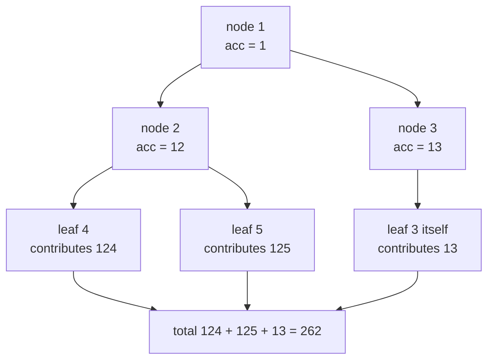
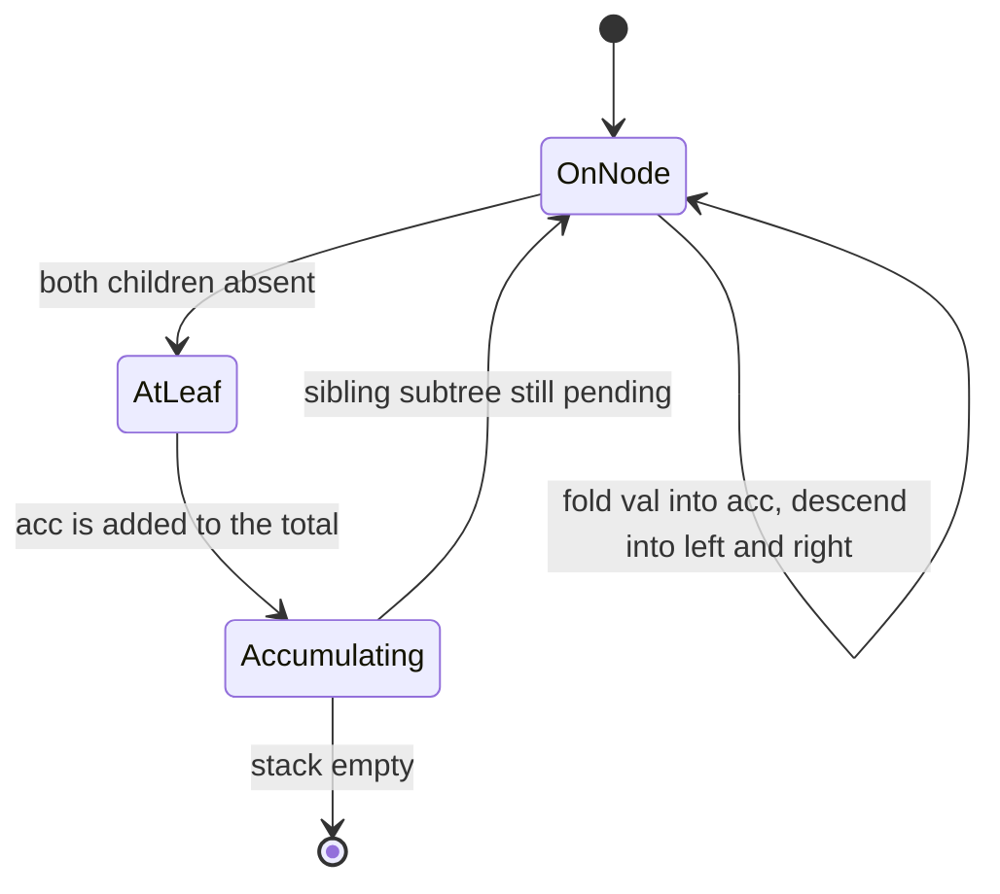
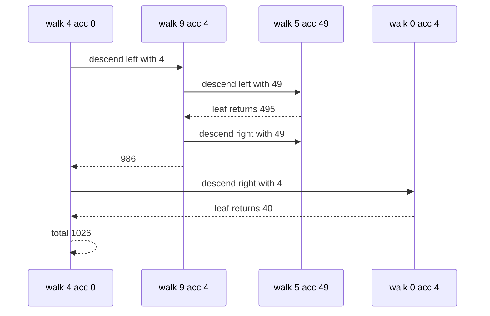

# 150 — Sum of root-to-leaf numbers in tree.

> **Tier:** Beginner · **CTCI chapter:** Ch 4 — Trees and Graphs
> **Task spec:** [150-sum-of-root-to-leaf-numbers-in-tree.md](../../../tasks/beginner/150-sum-of-root-to-leaf-numbers-in-tree.md)
> **Solutions:** [Python](../../../solutions/python/beginner/150-sum-of-root-to-leaf-numbers-in-tree/solution.py) ·
> [Java](../../../solutions/java/beginner/150-sum-of-root-to-leaf-numbers-in-tree/Solution.java) ·
> [JavaScript](../../../solutions/javascript/beginner/150-sum-of-root-to-leaf-numbers-in-tree/solution.js) ·
> [C#](../../../solutions/csharp/beginner/150-sum-of-root-to-leaf-numbers-in-tree/Solution.cs)

## 1. Problem restatement

**Input:** the root of a binary tree whose nodes hold single decimal digits, and the tree may be
empty.

**Output:** the sum over all root-to-leaf paths, where each path spells a decimal number: the path
`1 → 2 → 3` reads as `123`. "Leaf" means both children are missing, so a node with one child is
never a path end.

| Input | Result | Paths |
| --- | --- | --- |
| `null` | `0` | no paths exist |
| `[7]` | `7` | `7` |
| `[1, 2, 3]` | `25` | `12` and `13` |
| `[4, 9, 0, 5, 1]` | `1026` | `495`, `491` and `40` |
| `[1, 0, 0]` | `20` | `10` and `10` |
| `[1, 2, null, 3]` | `123` | one path only |
| `[1, 2, 3, 4, 5]` | `262` | `124`, `125` and `13` |
| `[1, 9, 9, null, 1]` | recursive equals iterative | cross-check case |

All four solutions ship two implementations — a recursive DFS and a stack-based one — and assert
that they agree on every case, including `[1, 9, 9, null, 1]`, which itself is only used for the
cross-check.

Two rows deserve attention. `[4, 9, 0, 5, 1]` builds `4 → (9, 0)`, `9 → (5, 1)`, and the three
leaves give `495 + 491 + 40 = 1026`; the `0` in the middle of `4 → 0` is a real digit, not a
terminator. `[1, 0, 0]` gives `10 + 10 = 20`, i.e. trailing zeros matter and the two paths are
distinct even though they spell the same number.

## 2. Intuition

The naive idea is to collect every root-to-leaf path as a list of digits, convert each list to a
number, and add the numbers up. It is correct, but it materialises every path at once: `O(h)`
storage per path and a conversion step per leaf, all for information that can be carried in a
single integer.

The key insight is that a path's value can be built incrementally, one digit at a time, from left
to right. If the prefix `1 → 2` is worth `12`, then appending `3` gives `12 · 10 + 3 = 123`. So the
recursion does not need the path at all — it needs the *running prefix*, which is one integer:

```text
acc = acc * 10 + node.val
```

and a leaf simply hands its `acc` upward. The addition happens at the leaves, and the prefix at
each node is the same value for both children, so the two child calls are independent.



Notice that `3` in `[1, 2, 3, 4, 5]` is a leaf: it has no children, so the path `1 → 3` is the
two-digit number `13`, not a prefix waiting to be extended. The tree shape decides where numbers
end, and the `acc * 10 + val` rule never has to special-case anything except the leaf test.

The iterative variant observes that the recursion's state is exactly the pair `(node, acc)`, so an
explicit stack of such pairs can replace the call stack — same arithmetic, no recursion.

## 3. Algorithm

Recursive DFS:

1. Start with `walk(root, 0)`.
2. If the node is null, return `0` — an absent child contributes nothing.
3. Fold the digit in: `acc = acc * 10 + node.val`.
4. If both children are absent, return `acc`: the path ends here.
5. Otherwise return `walk(left, acc) + walk(right, acc)`.

```text
function walk(node, acc)
    if node = null then
        return 0
    acc = acc * 10 + node.val
    if node.left = null and node.right = null then
        return acc
    return walk(node.left, acc) + walk(node.right, acc)
end

function sum_numbers(root)
    return walk(root, 0)
end
```

Iterative variant:

1. If the root is null, return `0`; otherwise push the pair `(root, root.val)` and set `total = 0`.
2. Pop a pair `(node, acc)`; if the node is a leaf, add `acc` to `total` and continue.
3. Otherwise push `(left, acc * 10 + left.val)` when the left child exists, and the analogous pair
   for the right child.
4. When the stack is empty, return `total`.

```text
function sum_numbers_iterative(root)
    if root = null then
        return 0
    total = 0
    stack = empty
    push stack, (root, root.val)
    while stack is not empty do
        (node, acc) = pop stack
        if node.left = null and node.right = null then
            total = total + acc
        else
            if node.left != null then
                push stack, (node.left, acc * 10 + node.left.val)
            end
            if node.right != null then
                push stack, (node.right, acc * 10 + node.right.val)
            end
        end
    end
    return total
end
```

The two variants differ in where the digit is folded in — the recursive one folds on entry to a
node, the iterative one folds when a child is pushed, which is why the root is pushed as
`(root, root.val)`. Java, JavaScript and C# hold the two parallel pieces of state in paired stacks
or a tuple stack; Python and JavaScript use tuples and arrays respectively.



## 4. Worked example

Trace `sum_numbers(build_tree([4, 9, 0, 5, 1]))` with the recursive variant. The tree is
`4 → (9, 0)` and `9 → (5, 1)`.

| Step | Call | `acc` on entry | `acc` after folding | Leaf? | Returns |
| --- | --- | --- | --- | --- | --- |
| 1 | `walk(4, 0)` | `0` | `4` | no | `walk(9, 4) + walk(0, 4)` |
| 2 | `walk(9, 4)` | `4` | `49` | no | `walk(5, 49) + walk(1, 49)` |
| 3 | `walk(5, 49)` | `49` | `495` | yes | `495` |
| 4 | `walk(1, 49)` | `49` | `491` | yes | `491` |
| 5 | `walk(9, 4)` | — | — | — | `986` |
| 6 | `walk(0, 4)` | `4` | `40` | yes | `40` |
| 7 | `walk(4, 0)` | — | — | — | `1026` |

Row 6 is the one that catches a sloppy implementation: `4 → 0` spells `40`, and folding `0` into
`4` gives `4 · 10 + 0 = 40` — the trailing zero is preserved because the multiplication happens
*before* the addition of the digit.



The iterative variant reaches the same total in a different order: it pops `(4, 4)`, pushes
`(9, 49)` and `(0, 4)`, then pops `(0, 4)` — a leaf, adding `40` — and finally deals with `9`'s
children. The stack order does not matter, because addition is commutative.

## 5. Complexity

Let `n` be the number of nodes, `h` the height, and `L` the number of leaves.

| Measure | Bound | Why it holds |
| --- | --- | --- |
| Time, recursive | O(n) | every node is visited once with constant arithmetic per visit |
| Time, iterative | O(n) | every node is pushed once, popped once, and folded once |
| Space, recursive | O(h) | the recursion depth; `O(n)` for a skewed chain |
| Space, iterative | O(h) | the stack holds at most one pending sibling per level |
| Output size | `L` numbers | each leaf contributes exactly one term |
| Alternative — materialise paths | O(n·h) work, O(h) extra | copying `h` digits per leaf costs more for no benefit |

The `O(h)` space claim is the reason `acc` is passed as a value rather than by mutating a shared
buffer: no path is ever stored, so the only growth is the stack or the call depth. The arithmetic
itself is `O(1)` per node in the sense that the digit count does not change the loop structure —
`acc * 10 + val` is a fixed pair of machine operations for machine-sized integers.

## 6. Pitfalls and edge cases

- **Empty tree.** `sum_numbers(null)` is `0` in both variants: there are no paths, so the sum of
  an empty set is the additive identity.
- **A single node is a one-digit number.** `[7]` gives `7`; the root is also a leaf, so the leaf
  branch fires immediately.
- **A node with one child is not a leaf.** `[1, 2, null, 3]` is the single path `1 → 2 → 3 = 123`;
  treating `1` or `2` as a path end would add `1` or `12` wrongly.
- **Trailing zeros.** `[1, 0, 0]` gives `10 + 10 = 20`, and `[4, 9, 0, 5, 1]` includes `40`. The
  multiplication must happen before the addition of the current digit.
- **Zeros in the middle of a path.** `[4, 9, 0, 5, 1]` has `0` as an internal node value; folding
  it into `4` gives `40`, which is then extended by that node's children if any existed.
- **Two different paths can spell the same number.** `[1, 0, 0]` produces `10` twice; the sum
  counts both, because the task sums paths, not distinct values.
- **Leading digit is not a zero-digit.** The accumulator starts at `0`, so the first fold is
  `0 · 10 + root.val = root.val` — correct by construction, and worth remembering when the root's
  value is `0` itself.
- **Deep chains and overflow.** The recursion depth equals the height, and the accumulator grows
  with the path length; the shipped tests stay far inside the integer range, but a very long chain
  of digits would exceed a 32-bit integer in Java, JavaScript and C#.
- **Both variants must agree.** The suite asserts `sum_numbers(tree) == sum_numbers_iterative(tree)`
  for every sample, so an off-by-one in either fold is caught.

## 7. Variants and follow-ups

- **Only ask whether a sum exists.** [151-path-sum-existence-in-tree.md](../../../tasks/beginner/151-path-sum-existence-in-tree.md)
  uses the same `target - val` bookkeeping but returns a boolean and can stop at the first hit.
- **Report the paths, not just their sum.** [152-all-root-to-leaf-paths-with-given-sum.md](../../../tasks/beginner/152-all-root-to-leaf-paths-with-given-sum.md)
  keeps a real path buffer because the caller wants the values back.
- **Digits to numbers in reverse.** [030-reverse-digits-of-an-integer.md](../../../tasks/beginner/030-reverse-digits-of-an-integer.md)
  performs the same `× 10 + digit` arithmetic without a tree.
- **Traverse the same structure.** [136-tree-preorder-traversal-recursive.md](../../../tasks/beginner/136-tree-preorder-traversal-recursive.md)
  visits nodes in the order this DFS follows; [139-level-order-traversal-bfs-of-tree.md](../../../tasks/beginner/139-level-order-traversal-bfs-of-tree.md)
  is the breadth-first alternative.
- The chapter walkthrough in [Trees and Graphs](../../ctci/04-trees-and-graphs.md) places this
  task with the other path-shaped tree problems.

## 8. Check yourself

1. Why is the accumulator updated as `acc * 10 + node.val` rather than `acc + node.val`?

<details><summary>Show answer</summary>

Because the path spells a decimal number: appending a digit shifts the existing digits one place
left, which is a multiplication by ten. `12` extended by `3` must become `123`, i.e.
`12 · 10 + 3`; a plain addition would give `15`.

</details>

2. What does `sum_numbers(build_tree([1, 2, null, 3]))` return, and why?

<details><summary>Show answer</summary>

`123`. The only root-to-leaf path is `1 → 2 → 3`; node `2` has a single child, so it is not a path
end even though node `1` has only one child as well. The leaf test requires *both* children to be
absent.

</details>

3. How does the iterative variant keep the accumulator without recursion?

<details><summary>Show answer</summary>

It pushes `(node, acc)` pairs and folds a child's digit when it pushes that child:
`(left, acc * 10 + left.val)`. The root is therefore pushed as `(root, root.val)`. Leaves add their
`acc` to the running total when they are popped.

</details>

4. Why does `[1, 0, 0]` sum to `20` rather than `10`?

<details><summary>Show answer</summary>

Because there are two distinct leaves, each one closing a path: `1 → 0` (left) and `1 → 0` (right),
and both spell `10`. The task sums over paths, so both terms count; equal values do not collapse.

</details>

5. Which node visits dominate the cost, and what is the auxiliary space?

<details><summary>Show answer</summary>

Every node is visited exactly once with constant work, so the time is `O(n)` for both variants. The
auxiliary space is `O(h)`: the call stack in the recursive version, the `(node, acc)` stack in the
iterative one, and `O(h) = O(n)` for a skewed chain.

</details>
