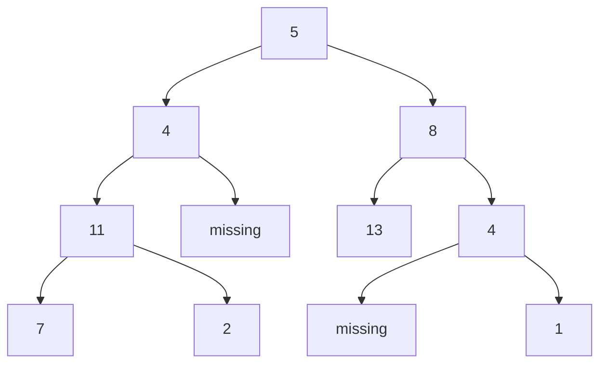
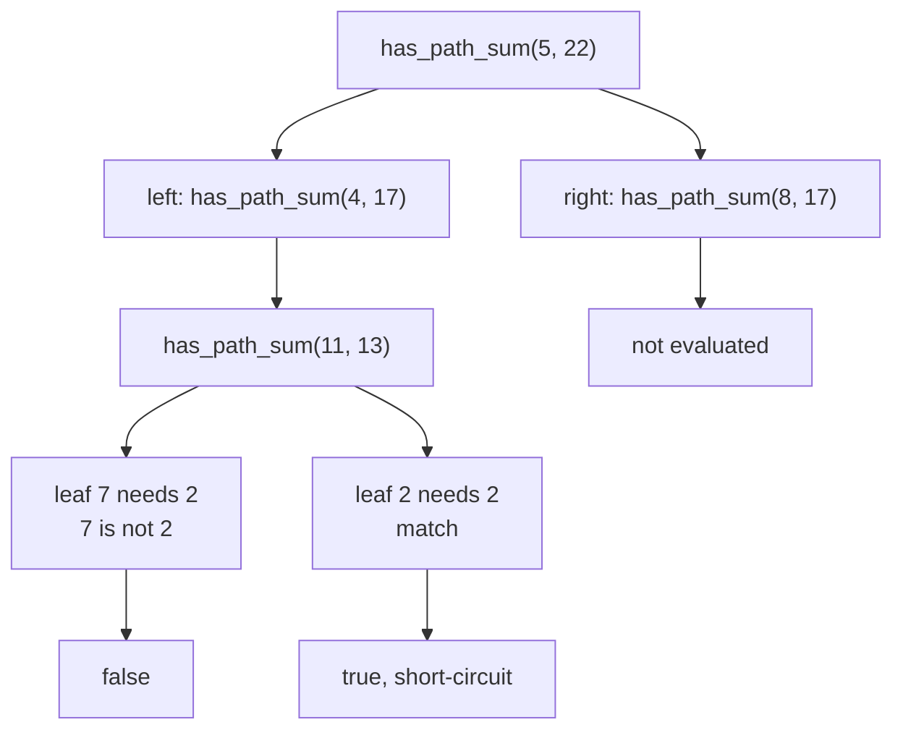
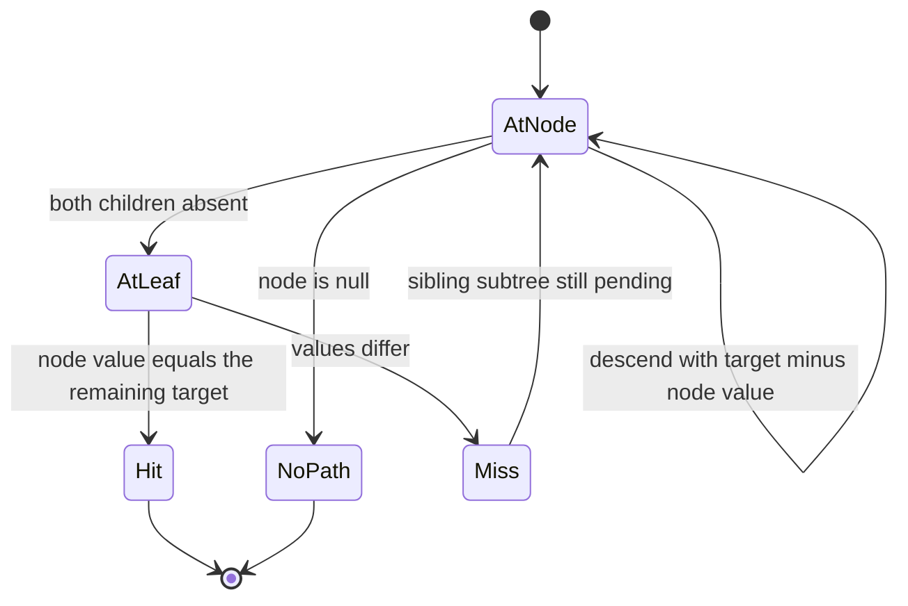
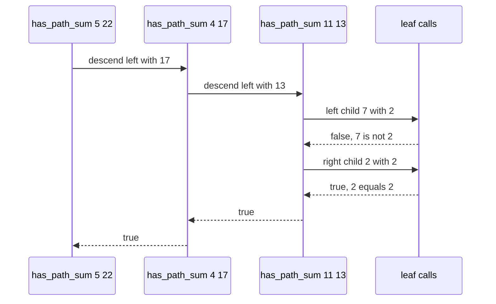

# 151 — Path sum existence in tree.

> **Tier:** Beginner · **CTCI chapter:** Ch 4 — Trees and Graphs
> **Task spec:** [151-path-sum-existence-in-tree.md](../../../tasks/beginner/151-path-sum-existence-in-tree.md)
> **Solutions:** [Python](../../../solutions/python/beginner/151-path-sum-existence-in-tree/solution.py) ·
> [Java](../../../solutions/java/beginner/151-path-sum-existence-in-tree/Solution.java) ·
> [JavaScript](../../../solutions/javascript/beginner/151-path-sum-existence-in-tree/solution.js) ·
> [C#](../../../solutions/csharp/beginner/151-path-sum-existence-in-tree/Solution.cs)

## 1. Problem restatement

**Input:** the root of a binary tree of integers (possibly empty) and an integer `target`.

**Output:** `true` exactly when some **root-to-leaf** path sums to `target`. A leaf is a node whose
`left` *and* `right` children are both missing, so a node with a single child never ends a path.
The empty tree has no paths at all and therefore answers `false` — even for `target = 0`.

| Input | `target` | Result | Why |
| --- | --- | --- | --- |
| sample tree | `22` | `true` | `5 + 4 + 11 + 2` |
| sample tree | `18` | `true` | `5 + 8 + 4 + 1` |
| sample tree | `27` | `true` | `5 + 4 + 11 + 7` (asserted by the Python file) |
| sample tree | `5` | `false` | `5` is the root and not a leaf |
| `null` | `0` | `false` | there is no path to end |
| `[1]` | `1` | `true` | the root is a leaf |
| `[1]` | `2` | `false` | the only path is worth `1` |
| `[1, 2]` | `1` | `false` | node `1` has a missing child, so it is not a path end |
| `[1, 2]` | `3` | `true` | the one path is `1 → 2` |
| `[-2, null, -3]` | `-5` | `true` | negative values are ordinary |
| `[0, 1, 1]` | `1` | `true` | `1` as a leaf |
| `[0, 1, 1]` | `0` | `false` | the root `0` is not a leaf |

The sample tree is `build_tree([5, 4, 8, 11, None, 13, 4, 7, 2, None, None, None, 1])`:



Its leaves are `7`, `2`, `13` and `1`, and the four root-to-leaf sums are `27`, `22`, `26` and `18`.
The Java, JavaScript and C# files assert the `22`, `18` and `5` rows; the Python file adds `27`.
All four assert the empty tree, the single node, the one-child cases and the negative case.

## 2. Intuition

The naive idea is to enumerate every root-to-leaf path, sum each one, and compare with the target.
That works, but it stores paths that are only ever needed as running totals, and it cannot stop
early: you would discover the answer only after all paths have been listed.

The key insight is the same arithmetic as task 150, read from the other end. If a path from the
current node down to a leaf must total `target`, then the path from the *child* down to that leaf
must total `target - node.val`. So the recursion can pass a shrinking budget down instead of an
accumulating value up:

- entering a node with budget `target`, the budget for its children is `target - node.val`;
- at a leaf, the question collapses to the single comparison `node.val == budget`.

No path is stored, because the budget is a single integer. And because the caller only wants a
yes/no answer, the `or` between the two child calls short-circuits: the first `true` stops the
whole search.



`5` itself is the third assertion in the suite precisely to catch the "any node can end a path"
misreading: the budget arrives at `5` as `5`, which a careless implementation would accept, but
`5` has children, so it is not a leaf and the search continues downwards.

## 3. Algorithm

1. If the node is null, return `false` — there is nothing here.
2. If both children are absent, return `node.val == target` — the leaf closes the path.
3. Otherwise return the `or` of the recursive calls on the left and right children, each with the
   reduced target `target - node.val`.

```text
function has_path_sum(root, target)
    if root = null then
        return false
    if root.left = null and root.right = null then
        return root.val = target
    return has_path_sum(root.left, target - root.val)
        or has_path_sum(root.right, target - root.val)
end
```

The whole algorithm is those three lines. Step 2 is the leaf test, step 3 is the descent, and the
substituted operand in step 3 is the only place where the target changes. There is no accumulator,
no path buffer, and no auxiliary structure — the recursion stack is the only state.



An iterative rewrite is possible by pushing `(node, remaining)` pairs on a stack and answering
`true` as soon as a leaf pair matches. It is not shipped here — the recursion is already the
shortest correct expression, and the stack version needs the same `O(h)` space anyway.

## 4. Worked example

Trace `has_path_sum(root, 22)` on the sample tree. The budget shrinks by the value of each node as
the search descends:

| Step | Call | Remaining on entry | Leaf? | Action |
| --- | --- | --- | --- | --- |
| 1 | `has_path_sum(5, 22)` | `22` | no | descend with `22 - 5 = 17` |
| 2 | `has_path_sum(4, 17)` | `17` | no | descend with `17 - 4 = 13` |
| 3 | `has_path_sum(11, 13)` | `13` | no | descend with `13 - 11 = 2` |
| 4 | `has_path_sum(7, 2)` | `2` | yes | `7 != 2` → `false` |
| 5 | `has_path_sum(2, 2)` | `2` | yes | `2 == 2` → `true` |
| 6 | back in step 3 | — | — | `false or true` → `true` |
| 7 | steps 1-2 | — | — | `true` propagates to the root |

Steps 6 and 7 are the short-circuit: once step 5 reports `true`, the right subtree of the root is
never examined, and neither is the rest of the left subtree.

Trace `has_path_sum(root, 18)` for the second match shows a deeper descent on the right side:
`5` leaves `13`, `8` leaves `5`, `13` is a leaf and `13 != 5` fails, then the sibling `4` is not a
leaf so it leaves `1`, and its leaf `1` matches.



## 5. Complexity

Let `n` be the number of nodes and `h` the height.

| Measure | Bound | Why it holds |
| --- | --- | --- |
| Time, best | O(1) | the root is a leaf and matches, or the tree is empty |
| Time, average | O(n) | in the worst case every node must be tested |
| Time, worst | O(n) | each node is visited once, with a constant number of comparisons |
| Space | O(h) | recursion depth; `O(h) = O(n)` for a skewed chain |
| Alternative — enumerate paths | O(n) time, O(h) per path | correct, but stores digits it never reads twice |
| Alternative — iterative stack | O(n) time, O(h) space | same bounds, more code |

The short-circuit is a real optimisation for *matching* inputs, not only an elegance: when the
first leaf examined already matches, the search stops and the untouched subtrees cost nothing. For
non-matching inputs the whole tree is traversed, which is why the worst case stays `O(n)`.

## 6. Pitfalls and edge cases

- **A node with one child is not a leaf.** `has_path_sum(build_tree([1, 2]), 1)` is `false` even
  though `1 == 1`: the path must end at a true leaf, and `1` still has a child. The one-child case
  is asserted in all four files.
- **Empty tree.** `has_path_sum(null, 0)` is `false`; the empty tree has no root-to-leaf path, so
  no sum can be `0` — a common bug is to answer `true` for a zero target.
- **The root is not a path just because it matches.** The sample tree with `target = 5` is the
  assertion for this; only the `left == null and right == null` test makes a node terminal.
- **Negative values.** `[-2, null, -3]` with target `-5` is `true`, so the budget may grow in
  magnitude as it shrinks; there is no monotonicity to exploit for pruning.
- **Zero values.** `[0, 1, 1]` answers `true` for `1` and `false` for `0`: the root's `0` is not a
  leaf, and each leaf `1` matches only the first target.
- **Short-circuit order.** The `or` evaluates the left child first, so the *order of examination*
  is left before right; the shipped assertions only require the boolean, which no ordering affects.
- **Budget arithmetic scope.** `target - root.val` is passed down, never mutated in place — the
  value at a node is shared by both child calls, so both branches see the same budget.

## 7. Variants and follow-ups

- **Collect the matching paths.** [152-all-root-to-leaf-paths-with-given-sum.md](../../../tasks/beginner/152-all-root-to-leaf-paths-with-given-sum.md)
  uses the same `remaining - val` budget but keeps a path buffer, because the caller wants the
  values rather than a boolean.
- **Sum the numbers the paths spell.** [150-sum-of-root-to-leaf-numbers-in-tree.md](../../../tasks/beginner/150-sum-of-root-to-leaf-numbers-in-tree.md)
  accumulates `acc * 10 + val` on the way down instead of subtracting.
- **Prefix sums on a linear structure.** [082-range-sum-query-naive-using-prefix-sums.md](../../../tasks/beginner/082-range-sum-query-naive-using-prefix-sums.md)
  is the array-shaped version of the same "carry the partial sum" idea.
- **Enumerate the paths themselves.** [130-generate-all-subsets-power-set-iterative.md](../../../tasks/beginner/130-generate-all-subsets-power-set-iterative.md)
  and the recursive variant show the enumeration style that the path-listing version of this task
  would use.
- The chapter walkthrough in [Trees and Graphs](../../ctci/04-trees-and-graphs.md) groups the
  path-sum family together.

## 8. Check yourself

1. Why is `has_path_sum(build_tree([1, 2]), 1)` false even though the root's value equals the
   target?

<details><summary>Show answer</summary>

Because a path must end at a leaf, and node `1` has a child. Its value matching the target is not
enough: the search only compares values at nodes where both children are absent. The single path
here is `1 → 2`, worth `3`.

</details>

2. Why does the empty tree answer false for every target, including zero?

<details><summary>Show answer</summary>

There is no root-to-leaf path at all, and the task asks whether *some* such path sums to the
target. `false` is the correct answer to an existential question over an empty set. Returning
`true` for `target = 0` (treating the empty sum as a path) is the classic mistake here.

</details>

3. What is passed down the recursion, and how does the leaf use it?

<details><summary>Show answer</summary>

The remaining budget: `target - node.val` for each child. At a leaf the remaining budget must equal
the leaf's own value, i.e. `node.val == target`, so the leaf performs one comparison and returns
its result up the call chain.

</details>

4. Where does the short-circuit happen, and what does it save?

<details><summary>Show answer</summary>

In the `or` between the two child calls. When the left branch returns `true`, the right branch is
never evaluated. On matching inputs this can prune large parts of the tree; on non-matching inputs
the whole tree is still visited, which is the `O(n)` worst case.

</details>

5. How would the answer change if a node with a single child were allowed to end a path?

<details><summary>Show answer</summary>

`has_path_sum(build_tree([1, 2]), 1)` would become `true`, and on the sample tree other prefixes
would start matching as well. The assertion list is written to lock the *leaf-only* definition
down, which is why `[1, 2]` with target `1` is included.

</details>
