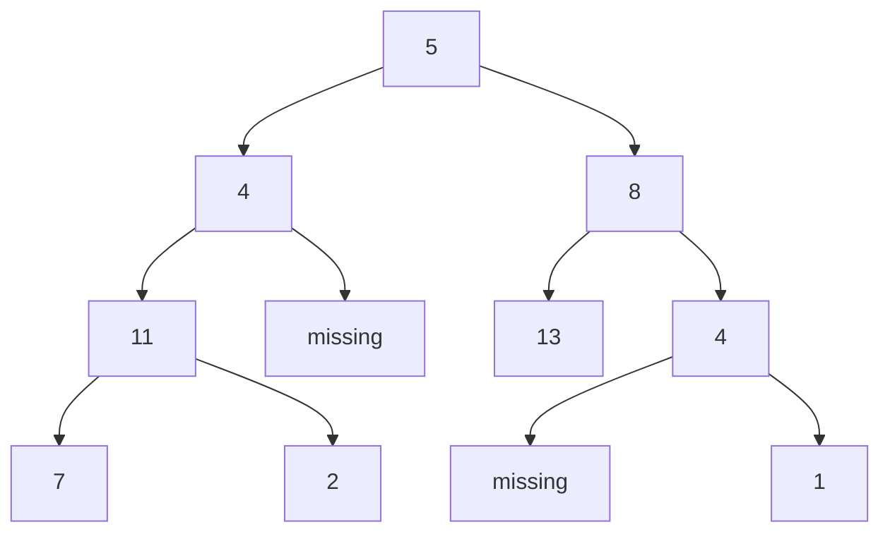
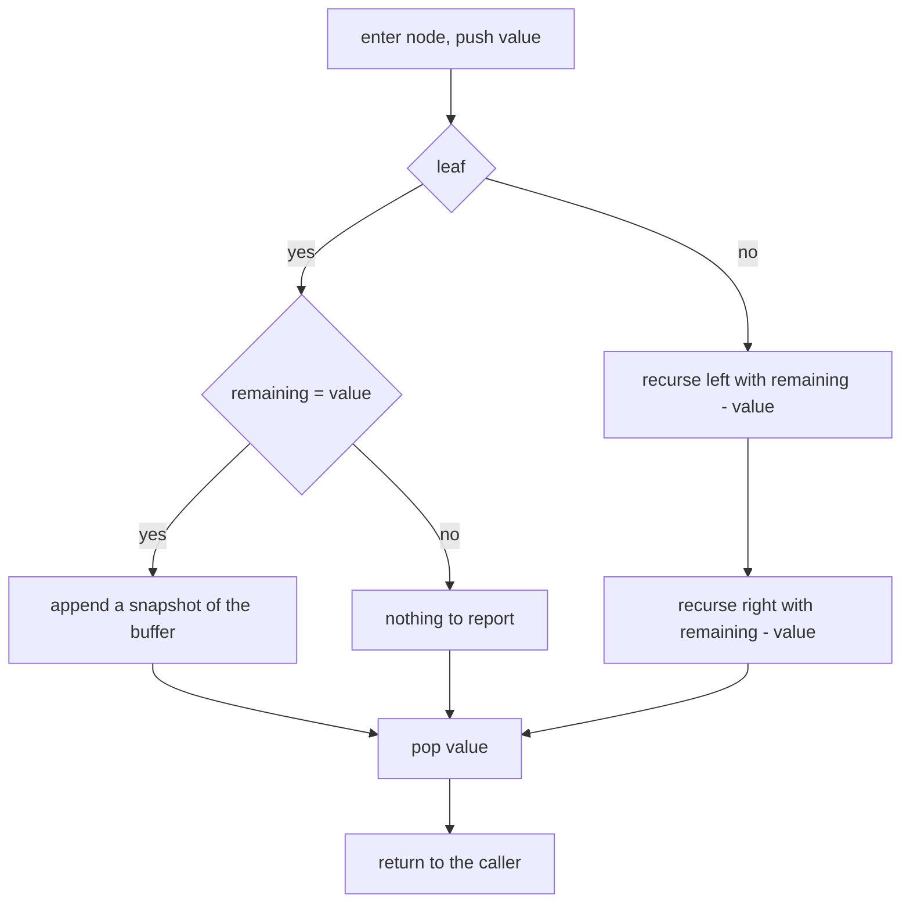
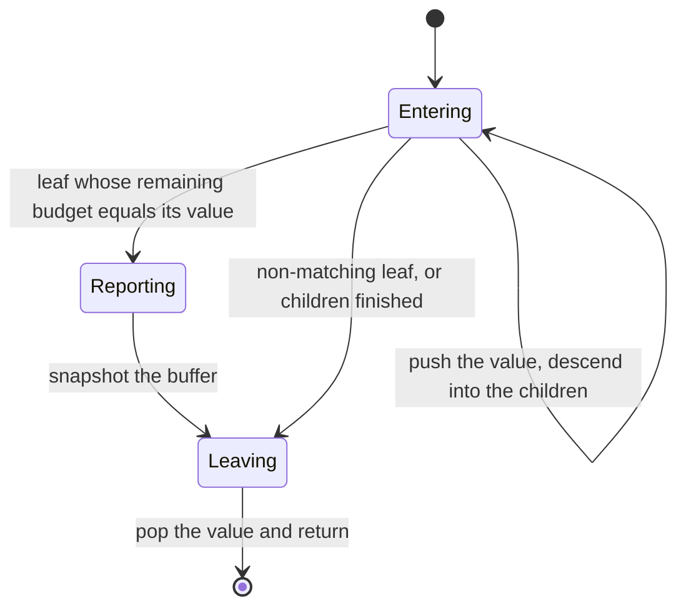
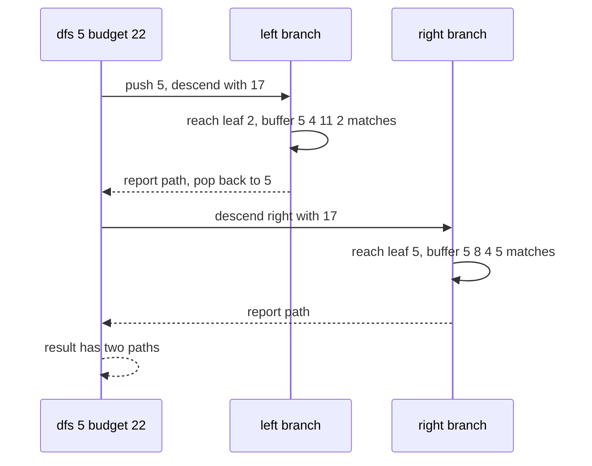

# 152 — All root-to-leaf paths with given sum.

> **Tier:** Beginner · **CTCI chapter:** Ch 8 — Recursion and Dynamic Programming
> **Task spec:** [152-all-root-to-leaf-paths-with-given-sum.md](../../../tasks/beginner/152-all-root-to-leaf-paths-with-given-sum.md)
> **Solutions:** [Python](../../../solutions/python/beginner/152-all-root-to-leaf-paths-with-given-sum/solution.py) ·
> [Java](../../../solutions/java/beginner/152-all-root-to-leaf-paths-with-given-sum/Solution.java) ·
> [JavaScript](../../../solutions/javascript/beginner/152-all-root-to-leaf-paths-with-given-sum/solution.js) ·
> [C#](../../../solutions/csharp/beginner/152-all-root-to-leaf-paths-with-given-sum/Solution.cs)

## 1. Problem restatement

**Input:** the root of a binary tree of integers (possibly empty) and an integer `target`.

**Output:** *every* root-to-leaf path whose values sum to `target`, each returned as a list of
values, with the left subtree's paths listed before the right subtree's. Paths are root-to-leaf,
so a node with a missing child never ends a path; the empty tree produces an empty result.

The sample is `build_tree([5, 4, 8, 11, None, 13, 4, 7, 2, None, None, 5, 1])`:



| Input | `target` | Result | Why |
| --- | --- | --- | --- |
| sample tree | `22` | `[[5, 4, 11, 2], [5, 8, 4, 5]]` | the left path is reported first |
| sample tree | `26` | `[[5, 8, 13]]` | a single match |
| sample tree | `27` | `[[5, 4, 11, 7]]` | the left-most path |
| sample tree | `100` | `[]` | no path matches |
| `null` | `0` | `[]` | nothing to report |
| `[7]` | `7` | `[[7]]` | the root is a leaf |
| `[7]` | `1` | `[]` | miss |
| `[1, 2]` | `1` | `[]` | node `1` has a missing child, so it is not an end |
| `[1, 2]` | `3` | `[[1, 2]]` | the only path |
| `[-1, -2, -3]` | `-3` | `[[-1, -2]]` | negative values are ordinary |
| `[1, 2, 2]` | `3` | `[[1, 2], [1, 2]]` | two paths that share a prefix and a value (Python assertion) |

The `[1, 2, 2]` row is the one that shows the result is a *multiset* of paths, not a set of value
sequences: the two matching paths happen to spell the same numbers, and both are reported. Note
also the different sample from task 151: here the right child of `8` is `4` with a child `5`, so
`5 → 8 → 4 → 5` also sums to `22`.

## 2. Intuition

The naive idea is to enumerate every root-to-leaf path into a list of paths, then filter by sum.
It works, and its result ordering is naturally left-before-right if the enumeration is a DFS — but
it materialises every path, including the ones that will never match, and it needs a full second
pass to filter.

The key insight is that the enumeration and the filter can happen in the *same* downward walk.
There are two pieces of state, and they are both cheap if handled carefully:

- a **budget** that shrinks as the walk descends, exactly like task 151: `remaining - node.val`;
- a **path buffer** that is not copied at every node, but shared by the whole DFS and mutated on
  entry and exit: push the current value, recurse, then pop it.

The push/pop pairing is what keeps the buffer correct. At any moment the buffer holds exactly the
values on the current root-to-node path; when the walk returns from a subtree, popping restores the
buffer to the state it had before entering. When a leaf is reached and the budget matches, the
buffer is the answer — but it must be **snapshotted**, because the same buffer object is about to
be mutated for the next branch.



The `path.pop()` is not optional bookkeeping — it is the invariant. Without it, values from
abandoned branches would leak into later paths and every reported path would be corrupted after
the first one.

The alternative to the shared buffer is to pass a fresh list per call (`path + [val]`), which is
simpler to read but allocates a new list at every node, i.e. `O(n·h)` copying in the worst case.
The shipped solutions take the shared-buffer route.

## 3. Algorithm

1. Prepare an empty result list and an empty path buffer.
2. Recurse from the root with the budget equal to `target`.
3. On entry, if the node is null, return without touching anything.
4. Push `node.val` onto the buffer.
5. If the node is a leaf, compare the budget with `node.val`; if they are equal, append a **copy**
   of the buffer to the result.
6. Otherwise recurse into the left child and then the right child, each with the budget
   `remaining - node.val`.
7. Pop the value off the buffer before returning, so the parent's buffer is restored.

```text
procedure path_sum_paths(root, target)
    result = empty list
    path = empty list
    dfs(root, target, path, result)
    return result
end

procedure dfs(node, remaining, path, result)
    if node = null then
        return
    append path, node.val
    if node.left = null and node.right = null then
        if remaining = node.val then
            append result, copy of path
        end
    else
        dfs(node.left, remaining - node.val, path, result)
        dfs(node.right, remaining - node.val, path, result)
    end
    pop path
end
```

The leaf branch is an `if`/`else` rather than two independent tests because a leaf must not be
descended into; a null child would return immediately anyway, but skipping the call makes the
intent explicit. Note that the recursion order — left before right — is what fixes the output
ordering that the assertions check.



## 4. Worked example

Trace `path_sum_paths(root, 22)` on the sample tree. The buffer is shown after the push, and the
budget is the value of `remaining` on entry.

| Step | Call | Remaining on entry | Buffer after push | Leaf? | Action |
| --- | --- | --- | --- | --- | --- |
| 1 | `dfs(5, 22)` | `22` | `[5]` | no | left with `17` |
| 2 | `dfs(4, 17)` | `17` | `[5, 4]` | no | left with `13` |
| 3 | `dfs(11, 13)` | `13` | `[5, 4, 11]` | no | left with `2` |
| 4 | `dfs(7, 2)` | `2` | `[5, 4, 11, 7]` | yes | `7 != 2`, nothing reported; pop |
| 5 | `dfs(2, 2)` | `2` | `[5, 4, 11, 2]` | yes | match → append `[5, 4, 11, 2]`; pop |
| 6 | back in step 3 | — | `[5, 4, 11]` | — | pop → `[5, 4]` |
| 7 | `dfs(8, 17)` | `17` | `[5, 8]` | no | left with `9` |
| 8 | `dfs(13, 9)` | `9` | `[5, 8, 13]` | yes | `13 != 9`, nothing reported; pop |
| 9 | `dfs(4, 9)` | `9` | `[5, 8, 4]` | no | right with `5` |
| 10 | `dfs(5, 5)` | `5` | `[5, 8, 4, 5]` | yes | match → append; pop |

Two paths are reported, in left-then-right order, and after the final pop the buffer is empty
again — which is why the result list has to hold copies rather than references.



## 5. Complexity

Let `n` be the number of nodes, `h` the height, and `P` the number of matching paths.

| Measure | Bound | Why it holds |
| --- | --- | --- |
| Time, best | O(n) | every node must be reached in the worst case; a shallower match does not prune the walk |
| Time, average | O(n) | one visit per node with constant work, plus a copy per match |
| Time, worst | O(n + Σ length) | each reported path is copied once, costing its own length |
| Space, recursion | O(h) | the DFS depth is the tree height |
| Space, buffer | O(h) | the shared path holds at most one value per level |
| Space, output | O(P · h) | the reported snapshots dominate; they are the answer, not overhead |
| Alternative — fresh list per call | O(n·h) copying | `path + [val]` allocates at every node instead of only at matches |

The `O(h)` buffer is the reason for the push/pop discipline: the walk holds *one* path, not one
path per node. The snapshots in the result are unavoidable — they are what the caller asked for —
and the leaf test keeps them proportional to the number of matches rather than to the number of
nodes.

## 6. Pitfalls and edge cases

- **Snapshot, do not alias.** `result.append(list(path))` in Python, `new ArrayList<>(path)` in
  Java, `path.slice()` in JavaScript, `new List<int>(path)` in C#. Storing the buffer itself would
  leave every reported path empty at the end, since the same object is popped back to nothing.
- **Pop on every exit path.** The `path.pop()` runs after both the leaf branch and the recursive
  branch; if it were only in the leaf branch, values from internal nodes would accumulate.
- **A node with one child is not a leaf.** `path_sum_paths(build_tree([1, 2]), 1)` is `[]`;
  the path `1 → 2` is the only one and it sums to `3`.
- **Empty tree.** `path_sum_paths(null, 0)` is `[]`; the null guard returns before the buffer is
  touched.
- **Empty result is the same as "no match".** There is no error case; the caller distinguishes
  "no paths" from "matches" by the length of the outer list.
- **Duplicates are reported twice.** `[1, 2, 2]` with target `3` yields `[[1, 2], [1, 2]]` (asserted
  in the Python file); a `set` of tuples would silently lose one.
- **Ordering is part of the contract.** The assertions compare full nested lists, so paths must come
  out left subtree first; a right-first recursion fails the tests even though the set of paths is
  the same.
- **Negative values are fine.** `[-1, -2, -3]` with target `-3` reports `[-1, -2]`; there is no
  monotonicity to exploit for pruning, and no assumption that the budget decreases.
- **Budget vs. accumulated sum.** This implementation subtracts as it descends; accumulating a sum
  upward and comparing at the leaf is equivalent, but the budget version keeps the comparison in
  one place.

## 7. Variants and follow-ups

- **Only ask whether a path exists.** [151-path-sum-existence-in-tree.md](../../../tasks/beginner/151-path-sum-existence-in-tree.md)
  keeps the budget but drops the buffer, so it can return at the first match.
- **Sum the numbers the paths spell.** [150-sum-of-root-to-leaf-numbers-in-tree.md](../../../tasks/beginner/150-sum-of-root-to-leaf-numbers-in-tree.md)
  folds digits instead of adding them.
- **Backtracking with an explicit path buffer.** [132-generate-permutations-of-distinct-elements.md](../../../tasks/beginner/132-generate-permutations-of-distinct-elements.md)
  and [133-generate-permutations-with-duplicates-unique.md](../../../tasks/beginner/133-generate-permutations-with-duplicates-unique.md)
  use the same push/recurse/pop skeleton, with deduplication instead of a sum predicate.
- **Path-critical partitions.** [170-simple-palindrome-partitioning-backtracking-list-partitions.md](../../../tasks/beginner/170-simple-palindrome-partitioning-backtracking-list-partitions.md)
  is the string version of "collect every valid decomposition".
- The chapter walkthrough in [Recursion and Dynamic Programming](../../ctci/08-recursion-and-dp.md)
  places this task with the other backtracking shapes.

## 8. Check yourself

1. Why must the matching buffer be copied before it is stored in the result?

<details><summary>Show answer</summary>

Because the DFS keeps mutating the same buffer: values are pushed on the way down and popped on the
way up. A stored reference would be emptied by the time the search finishes, and every reported
path would end up as the empty list.

</details>

2. What is the purpose of `path.pop()`, and what happens if it is omitted?

<details><summary>Show answer</summary>

It restores the buffer to the state of the parent node, which is the invariant that makes the
buffer equal to the current root-to-node path. Without it, values from finished branches would
stay in the buffer, so later paths would contain values from unrelated subtrees.

</details>

3. Why is `path_sum_paths(build_tree([1, 2]), 1)` empty?

<details><summary>Show answer</summary>

Node `1` has a child, so it is not a leaf and cannot end a path; the recursive branch only reports
at true leaves. The single path is `1 → 2`, worth `3`, so target `1` matches nothing.

</details>

4. The sample tree in this task differs from the one in task 151 by one value. What changes?

<details><summary>Show answer</summary>

The right child of `8` is `4` with a child `5` here (versus `4` with a child `1` in task 151), so
the path `5 → 8 → 4 → 5` also sums to `22`. That is why target `22` returns *two* paths, and why
the fast-path traversal order matters for the output.

</details>

5. What are the time and space bounds, and which part dominates?

<details><summary>Show answer</summary>

Time is `O(n)` for the traversal plus the cost of copying each reported path, so `O(n + Σ length)`.
Space is `O(h)` for the recursion and the single shared buffer, plus `O(P · h)` for the reported
snapshots, which are output rather than overhead.

</details>
