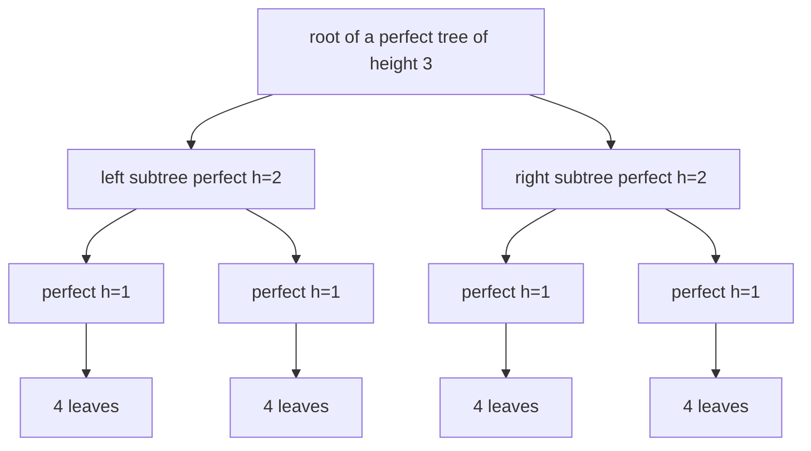
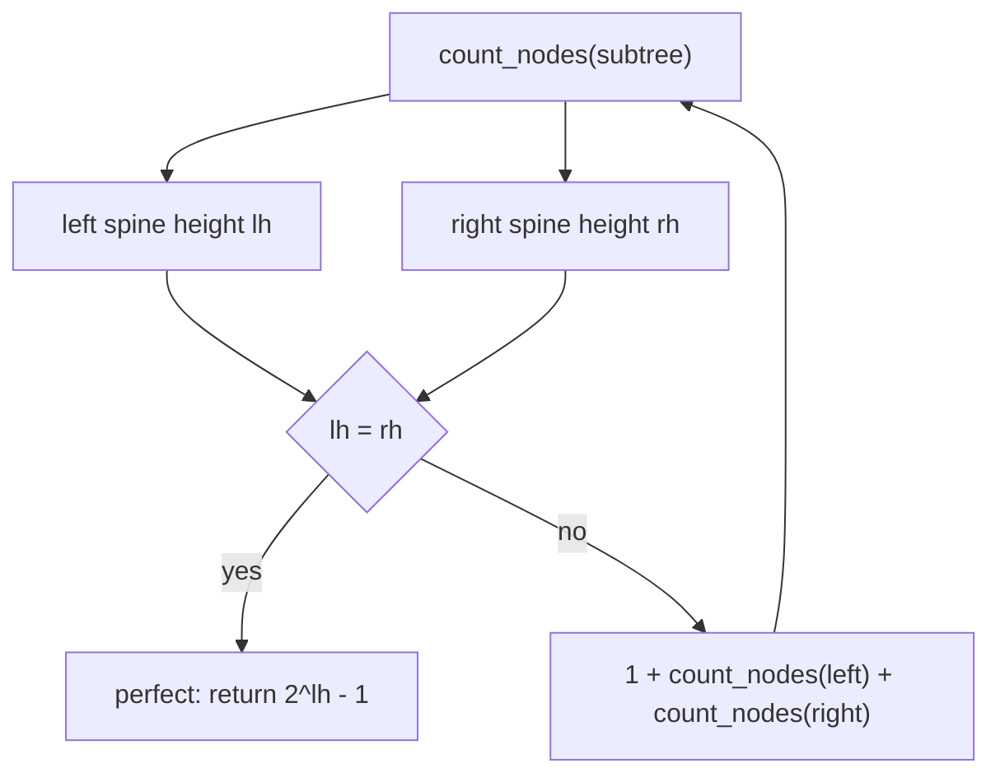
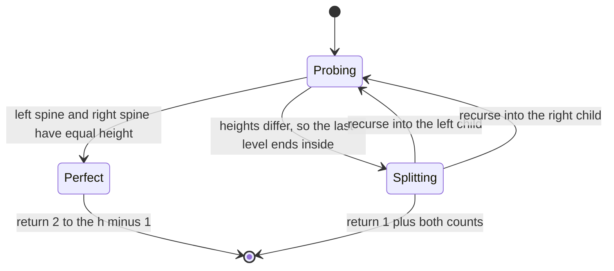
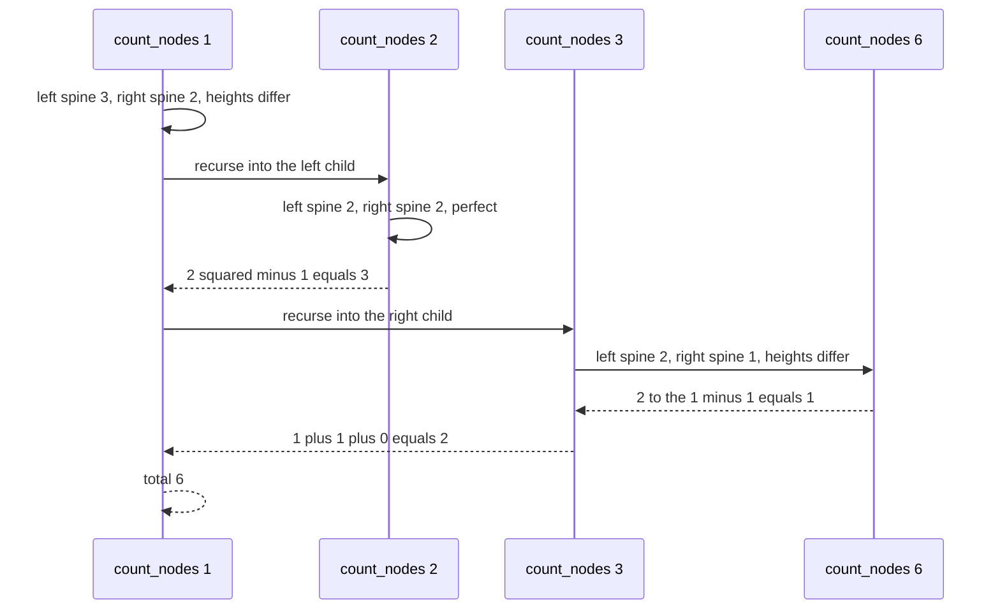

# 153 — Count nodes in complete binary tree faster than O(n).

> **Tier:** Beginner · **CTCI chapter:** Ch 4 — Trees and Graphs
> **Task spec:** [153-count-nodes-in-complete-binary-tree-faster-than-o-n.md](../../../tasks/beginner/153-count-nodes-in-complete-binary-tree-faster-than-o-n.md)
> **Solutions:** [Python](../../../solutions/python/beginner/153-count-nodes-in-complete-binary-tree-faster-than-o-n/solution.py) ·
> [Java](../../../solutions/java/beginner/153-count-nodes-in-complete-binary-tree-faster-than-o-n/Solution.java) ·
> [JavaScript](../../../solutions/javascript/beginner/153-count-nodes-in-complete-binary-tree-faster-than-o-n/solution.js) ·
> [C#](../../../solutions/csharp/beginner/153-count-nodes-in-complete-binary-tree-faster-than-o-n/Solution.cs)

## 1. Problem restatement

**Input:** the root of a **complete** binary tree. Completeness means every level is full except
possibly the last, and the last level is filled strictly left to right.

**Output:** the number of nodes, computed faster than the obvious `O(n)` walk. The solution files
use the left-spine/right-spine trick and document their complexity as `O(log² n)`; they also ship a
naive `O(n)` counter used only to cross-check the fast one.

The tests build their inputs from gapless level-order arrays — `build_tree(list(range(n)))` — which
produce exactly the complete tree of `n` nodes:

| Input | Result | Why |
| --- | --- | --- |
| `null` | `0` | no nodes |
| `[1]` | `1` | a single node |
| `range(0) … range(31)` | `n` | cross-checked against the naive count for each size |
| `range(63)`, `range(64)`, `range(65)`, `range(100)`, `range(1000)` | `n` | power-of-two boundaries and just past them |
| `[1, 2, 3, 4, 5, 6, 7]` | `7` | a perfect tree, answered directly by `2³ - 1` |
| `[1, 2, 3, 4, 5, 6, null]` | `6` | last level partially filled, left to right |

The sizes list in the Python file is `0, 1, 2, 3, 4, 5, 6, 7, 8, 10, 15, 16, 31` plus the larger
batch; the Java, JavaScript and C# files use the single list
`0, 1, 2, 3, 4, 5, 6, 7, 8, 10, 15, 16, 31, 63, 64, 65, 100, 1000`. Every size is checked twice:
`count_nodes(root) == n` and `count_nodes(root) == naive_count(root)`.



A perfect tree of height `h` has `2^h - 1` nodes — no traversal can beat a formula.

## 2. Intuition

The naive idea is a full traversal: `1 + count(left) + count(right)`. It is `O(n)` and it is
correct on any binary tree, but it throws away the one guarantee the input gives you.

The key insight is the gap between the two spines. For a **complete** tree, walk the left spine
(all `left` pointers) and the right spine (all `right` pointers) of a subtree and compare their
lengths:

- if the two heights are equal, the subtree reaches exactly the same depth on both sides, which
  for a complete tree means every level is full — the subtree is **perfect**, and it holds exactly
  `2^h - 1` nodes with no further descent needed;
- if the two heights differ, the last level ends somewhere inside this subtree, so the count must
  be `1 + count(left) + count(right)`.

The test is cheap because spine heights are measured iteratively, and it is decisive because
completeness forbids a "gap": a subtree cannot be full on the right and short on the left.



Why the total is `O(log² n)`: each spine probe walks at most `h = O(log n)` nodes, and the
recursion only descends when the subtree is *not* perfect. Along any root-to-leaf path at most one
node has non-equal spine heights per level — the last level can end in only one subtree — so there
are `O(log n)` recursive levels, each charging `O(log n)` for its probes. That is `O(log² n)`
against the naive `O(n)`, a real improvement that grows with the input.

## 3. Algorithm

1. If the node is null, return `0`.
2. Measure `lh` by walking `left` pointers from the node until null.
3. Measure `rh` by walking `right` pointers from the node until null.
4. If `lh == rh`, return `2^lh - 1` — the subtree is perfect and the formula is exact.
5. Otherwise return `1 + count_nodes(left) + count_nodes(right)`.

```text
function left_height(node)
    h = 0
    while node != null do
        h = h + 1
        node = node.left
    end
    return h
end

function right_height(node)
    h = 0
    while node != null do
        h = h + 1
        node = node.right
    end
    return h
end

function count_nodes(root)
    if root = null then
        return 0
    lh = left_height(root)
    rh = right_height(root)
    if lh = rh then
        return (1 shift left by lh) - 1
    return 1 + count_nodes(root.left) + count_nodes(root.right)
end
```

The shipped solutions pair this with the reference counter they test against:

```text
function naive_count(node)
    if node = null then
        return 0
    return 1 + naive_count(node.left) + naive_count(node.right)
end
```

`2^h - 1` is computed with a shift (`1 << lh` in Java and C#, `2 ** lh` in JavaScript and Python),
which keeps it exact for the sizes under test and avoids a floating-point power.



## 4. Worked example

Trace `count_nodes` on the partially filled tree `[1, 2, 3, 4, 5, 6, null]`, whose six nodes are
`1` at the root, `2` and `3` below it, and `4`, `5`, `6` as the left-to-right prefix of the last
level.

| Step | Subtree root | Left spine | Right spine | Equal? | Result |
| --- | --- | --- | --- | --- | --- |
| 1 | `1` | `1 → 2 → 4` = 3 | `1 → 3` = 2 | no | `1 + count(2) + count(3)` |
| 2 | `2` | `2 → 4` = 2 | `2 → 5` = 2 | yes | `2² - 1 = 3` |
| 3 | `3` | `3 → 6` = 2 | `3` = 1 | no | `1 + count(6) + count(null)` |
| 4 | `6` | `6` = 1 | `6` = 1 | yes | `2¹ - 1 = 1` |
| 5 | null | — | — | — | `0` |
| 6 | back in step 3 | — | — | — | `1 + 1 + 0 = 2` |
| 7 | back in step 1 | — | — | — | `1 + 3 + 2 = 6` |

Step 2 is the payoff: the left subtree `2 → (4, 5)` is perfect, so five nodes are accounted for
by one formula instead of a traversal — and steps 4-6 show that the one subtree containing the
last level is the only one that must be descended into.

A perfect tree needs no recursion at all. For `[1, 2, 3, 4, 5, 6, 7]` the root's left spine is
`1 → 2 → 4` and its right spine is `1 → 3 → 7`, both of length three, so the answer is
`2³ - 1 = 7` from a single pair of probes.



## 5. Complexity

Let `n` be the number of nodes and `h = O(log n)` the height of a complete tree.

| Measure | Bound | Why it holds |
| --- | --- | --- |
| Time, perfect subtree | O(h) | two spine probes and one shift; no descent |
| Time, best | O(log n) | a perfectly balanced input is answered by the root's probes alone |
| Time, average | O(log² n) | `O(log n)` recursive levels, each paying `O(log n)` for its probes |
| Time, worst | O(log² n) | the documented bound; the last level can force descent at every level |
| Space | O(log n) | the recursion depth is the height of a complete tree |
| Reference count | O(n) time, O(n) space | the naive walk used only for cross-checking |
| Alternative — BFS layer count | O(n) | visiting the last level still costs a full pass |

The `O(log² n)` figure comes from the solution file's own documentation: "Each height probe costs
`O(log n)` and there are `O(log n)` recursive levels, so the total cost is `O(log² n)`". The
space bound is only `O(log n)` because completeness caps the height — the same recursion on an
arbitrary tree would be `O(n)` deep in the worst case, which is exactly why this trick is only
valid for complete trees.

## 6. Pitfalls and edge cases

- **Completeness is a precondition.** The spine trick is *only* valid for complete trees: in a
  general tree the two spines can be equal while the middle of the last level is missing. The
  tests only feed gapless level-order arrays and the one partially-filled complete shape.
- **Empty tree.** `count_nodes(null)` is `0`, and the null guard precedes any probing.
- **Single node.** `[1]` has both spines of length one, so `2¹ - 1 = 1` — the formula handles the
  base case without an explicit special case.
- **A perfect tree is not special-cased anywhere else.** `[1, 2, 3, 4, 5, 6, 7]` is answered by the
  `lh == rh` branch, i.e. by the same code path as any other perfect subtree.
- **Partial last level.** `[1, 2, 3, 4, 5, 6, null]` is the case that forces recursion into the
  right child of the root while the left child is counted by formula; it is asserted explicitly.
- **Power-of-two boundaries.** `63`, `64` and `65` are all tested: `64` is the perfect tree of
  height 6 and both its neighbours require real recursion.
- **Large sizes.** `n = 1000` is asserted in the Java, JavaScript and C# files (and `1000` in the
  Python file too), which keeps the formula honest for trees far beyond hand-checkable size.
- **Shift vs. power.** `(1 << lh) - 1` is exact; a floating-point `2^h` would start rounding for
  large `h`. JavaScript uses `2 ** lh - 1` on the same small heights.
- **Fast count must equal naive count.** Every size is checked twice, so an early-exit bug that
  drops a subtree shows up immediately.

## 7. Variants and follow-ups

- **Height-based checks on general trees.** [142-check-if-tree-is-balanced-height-difference-1.md](../../../tasks/beginner/142-check-if-tree-is-balanced-height-difference-1.md)
  also compares spine-like heights, but on inputs where completeness is not available.
- **Depth instead of size.** [140-max-depth-of-binary-tree.md](../../../tasks/beginner/140-max-depth-of-binary-tree.md)
  and [141-min-depth-of-binary-tree.md](../../../tasks/beginner/141-min-depth-of-binary-tree.md)
  measure the spines this task uses as a perfect-subtree test.
- **Building the complete tree.** [144-convert-sorted-array-to-balanced-bst.md](../../../tasks/beginner/144-convert-sorted-array-to-balanced-bst.md)
  produces a balanced tree, the shape family this counting trick exploits.
- **The naive counter as a pattern.** [139-level-order-traversal-bfs-of-tree.md](../../../tasks/beginner/139-level-order-traversal-bfs-of-tree.md)
  is the breadth-first equivalent of the `O(n)` reference count.
- The chapter walkthrough in [Trees and Graphs](../../ctci/04-trees-and-graphs.md) groups the
  shape-aware tree tasks together.

## 8. Check yourself

1. Why does `lh == rh` imply a *perfect* subtree?

<details><summary>Show answer</summary>

In a complete tree the last level is filled left to right, so a height deficit can only appear on
the right-hand side of a subtree. If the leftmost and rightmost paths reach the same depth, no
deficit exists anywhere inside, so every level is full: the subtree is perfect and has `2^h - 1`
nodes.

</details>

2. Where does the `O(log n)` number of recursive levels come from?

<details><summary>Show answer</summary>

Only subtrees whose spines differ are descended into. The differing subtree is the one containing
the end of the last level, and there is at most one such chain of subtrees from the root downwards,
so the recursion follows a single root-to-leaf path of length `h = O(log n)`.

</details>

3. What is the cost of a single call that does descend, and what does that make the total?

<details><summary>Show answer</summary>

Two spine probes of `O(log n)` each, plus the two recursive calls. With `O(log n)` such calls along
the recursion path, the documented total is `O(log² n)` — compared with `O(n)` for the naive walk,
which the files also implement for cross-checking.

</details>

4. Why is the trick invalid for an arbitrary binary tree?

<details><summary>Show answer</summary>

Because equal spine heights do not force a full subtree without completeness. A general tree could
have both spines of length `h` while some middle position on the last level is missing, and the
`2^h - 1` formula would then overcount. The files only test gapless level-order inputs, which are
complete by construction.

</details>

5. What does `count_nodes(build_tree([1, 2, 3, 4, 5, 6, null]))` return, and which subtree is
handled by formula?

<details><summary>Show answer</summary>

`6`. The root's spines differ (3 versus 2), so it recurses; the left child `2` has both spines of
length 2 and is perfect, so it contributes `2² - 1 = 3` without further descent; the right child
`3` differs again and recurses into `6`, which is perfect with one node. Total `1 + 3 + 2 = 6`.

</details>
