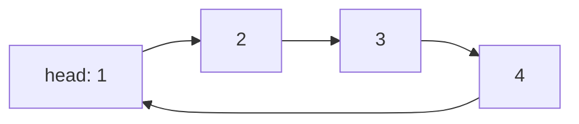
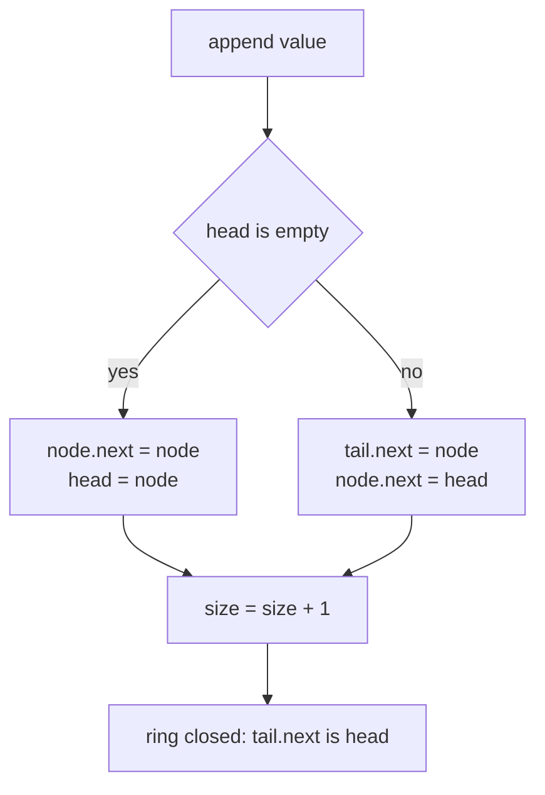
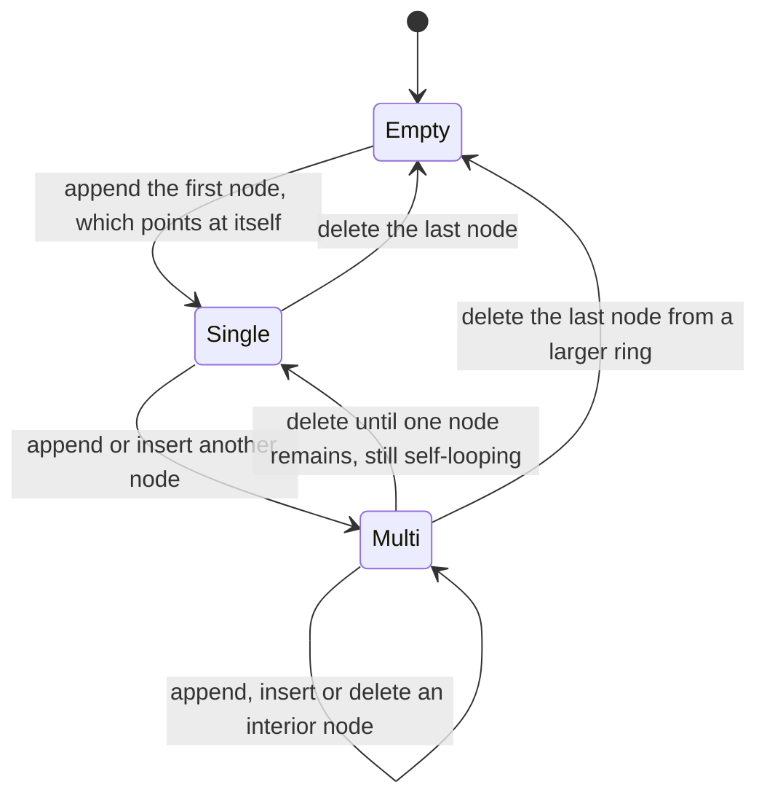
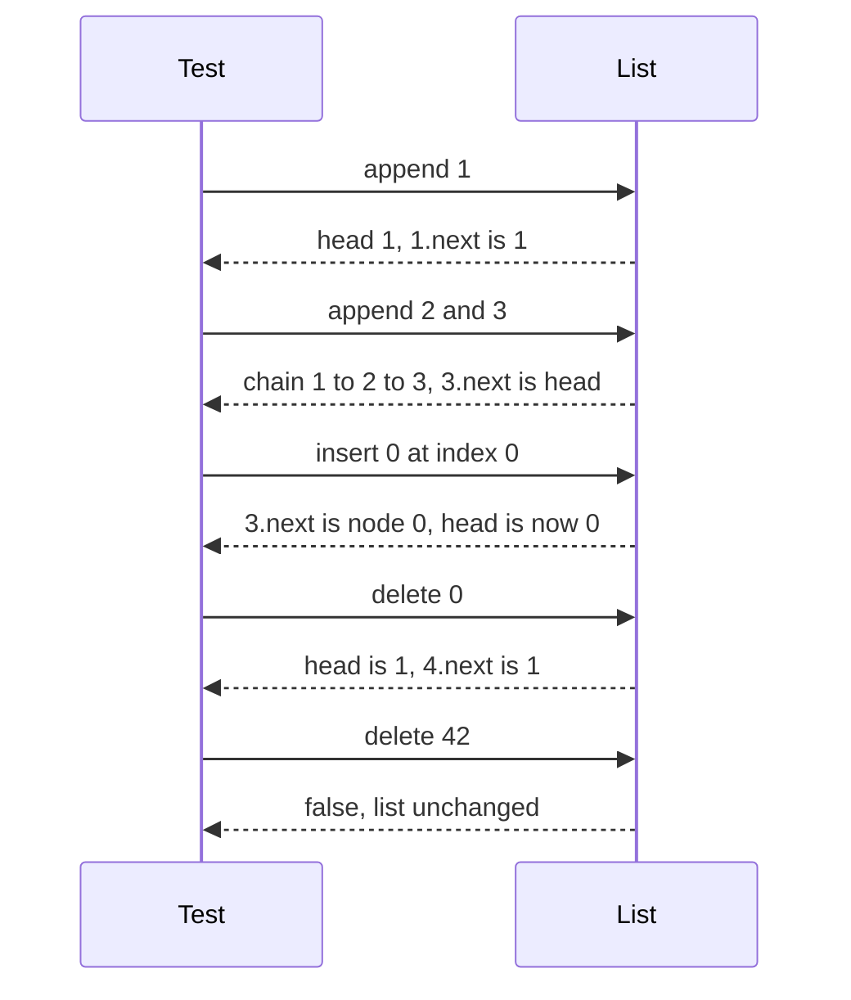

# 154 — Implement a basic circular linked list.

> **Tier:** Beginner · **CTCI chapter:** Ch 2 — Linked Lists
> **Task spec:** [154-implement-a-basic-circular-linked-list.md](../../../tasks/beginner/154-implement-a-basic-circular-linked-list.md)
> **Solutions:** [Python](../../../solutions/python/beginner/154-implement-a-basic-circular-linked-list/solution.py) ·
> [Java](../../../solutions/java/beginner/154-implement-a-basic-circular-linked-list/Solution.java) ·
> [JavaScript](../../../solutions/javascript/beginner/154-implement-a-basic-circular-linked-list/solution.js) ·
> [C#](../../../solutions/csharp/beginner/154-implement-a-basic-circular-linked-list/Solution.cs)

## 1. Problem restatement

**Input:** a sequence of operations against a singly linked list whose last node points back at
the first — `append(value)`, `insert(index, value)`, `delete(value)`, plus the read-only helpers
`tail()` and `to_list()` and the public fields `head` and `size`.

**Output:** a container that always keeps the ring closed, plus the values it holds. The exact
contract comes from the four solution files' assertion suites:

| Operation | Expected behaviour |
| --- | --- |
| `to_list()` on an empty list | `[]`, `head is None`, `size == 0` |
| `append(1)`, `append(2)`, `append(3)` | `[1, 2, 3]`, `size == 3` |
| `tail().next` | is the head — the ring is closed at the back |
| `insert(0, 0)` | `[0, 1, 2, 3]`, head becomes `0` |
| `insert(2, 99)` | `[0, 1, 99, 2, 3]` |
| `insert(size, 4)` | appends: `[0, 1, 99, 2, 3, 4]`, and the new tail wraps to the head |
| `insert(99, 0)` on a size-6 list | raises (Python/Java/C#: out-of-range error, JavaScript: `RangeError`) |
| `delete(99)` | `true`, list becomes `[0, 1, 2, 3, 4]` |
| `delete(0)` | `true`, head moves to `1`, ring still closed |
| `delete(4)` | `true`, `[1, 2, 3]` |
| `delete(42)` | `false`, list unchanged |
| draining to empty | `head is None`, `size == 0`, `tail() is None` |
| `delete` on an empty list | `false` |
| `append(7)` then `delete(7)` | `[7]` with `head.next is head`, then empty again |

The single-node state is the degenerate shape that matters: `head.next` points at `head` itself, so
the "walk until you come back to the head" idiom terminates immediately.



## 2. Intuition

In a linear singly linked list, three operations are awkward: appending at the tail costs `O(n)`
without a tail pointer, deleting the head requires a special case, and any traversal needs a
sentinel to stop. A circular list turns the tail's `next` into the head and gets a uniform rule
instead: **a walk of exactly `size` steps visits every node once and then stops**.

That single invariant is what `to_list()` is built on:

```text
node = head
repeat size times
    emit node.value
    node = node.next
```

There is no null check anywhere in the loop, because no node's `next` is ever null while the list
is non-empty — the ring never has an end.

The second thing the ring buys is a cheap notion of "the node before the head", which is exactly
what `tail()` computes and what three operations need:

- **append** becomes "attach after the tail and re-close the ring": `tail.next = node` and
  `node.next = head`. No head special case once the list exists.
- **insert at index 0** is the same splice, plus moving the `head` pointer forward to the new node.
- **delete the head** is `tail.next = head.next; head = head.next` — the ring stays closed and no
  other node changes.



The one place where circularity demands care is the *search* loop. Looking for a value, you cannot
stop at null — there is none — so the loop stops when `prev.next` is the head (one full lap, value
absent) or when `prev.next.value` matches. Both conditions must be checked before advancing:

```text
prev = head
while prev.next is not head and prev.next.value != value do
    prev = prev.next
end
```

Because the head itself is handled before this loop, the loop only ever searches the remaining
`size - 1` positions.

## 3. Algorithm

`append(value)`:

1. Create a node.
2. If the list is empty, point the node at itself and make it the head.
3. Otherwise let `tail` be the node whose `next` is the head; set `tail.next = node` and
   `node.next = head`.
4. Increment `size`.

`insert(index, value)`:

1. Reject `index < 0` or `index > size` with an out-of-range error.
2. If `index == size`, delegate to `append` — inserting at the end is appending.
3. If `index == 0`, create the node, point it at the head, and let the tail point at it; then move
   `head` to the new node.
4. Otherwise walk `index - 1` steps from the head to reach the predecessor, then splice the node in
   between `prev` and `prev.next`.
5. Increment `size`.

`delete(value)`:

1. If the list is empty, return `false`.
2. If the head holds the value: when `size == 1`, clear the head; otherwise re-point the tail at
   `head.next` and move the head forward. Decrement `size` and return `true`.
3. Otherwise walk from the head while `prev.next` is not the head and does not hold the value.
4. If the walk stopped because it came back to the head, return `false`.
5. Unlink `prev.next` from the ring, decrement `size`, and return `true`.

```text
procedure append(value)
    node = new node(value)
    if head = null then
        node.next = node
        head = node
    else
        tail = find_tail()
        tail.next = node
        node.next = head
    size = size + 1
end

procedure delete(value)
    if head = null then
        return false
    if head.value = value then
        if size = 1 then
            head = null
        else
            node = find_tail()
            head = head.next
            node.next = head
        end
        size = size - 1
        return true
    prev = head
    while prev.next is not head and prev.next.value != value do
        prev = prev.next
    end
    if prev.next is head then
        return false
    prev.next = prev.next.next
    size = size - 1
    return true
end

procedure find_tail()
    if head = null then
        return null
    node = head
    while node.next is not head do
        node = node.next
    end
    return node
end
```

Every mutation ends with the same invariant: `tail.next is head`. The assertion
`lst.tail().next is lst.head` is repeated after insertion at the tail and after deleting the
head, which are the two moments the invariant is easiest to break.



## 4. Worked example

Trace the sequence the tests perform, starting from an empty list.

| Step | Operation | `head.value` | `size` | `to_list()` | Ring check |
| --- | --- | --- | --- | --- | --- |
| 1 | start | none | 0 | `[]` | `head is None` |
| 2 | `append(1)` | `1` | 1 | `[1]` | `1.next is 1` |
| 3 | `append(2)` | `1` | 2 | `[1, 2]` | `2.next is 1` |
| 4 | `append(3)` | `1` | 3 | `[1, 2, 3]` | `tail.next is head` |
| 5 | `insert(0, 0)` | `0` | 4 | `[0, 1, 2, 3]` | tail `3` now points at `0` |
| 6 | `insert(2, 99)` | `0` | 5 | `[0, 1, 99, 2, 3]` | predecessor `1` relinked |
| 7 | `insert(5, 4)` | `0` | 6 | `[0, 1, 99, 2, 3, 4]` | new tail `4` wraps to `0` |
| 8 | `insert(99, 0)` | `0` | 6 | unchanged | throws out-of-range |
| 9 | `delete(99)` | `0` | 5 | `[0, 1, 2, 3, 4]` | interior unlink |
| 10 | `delete(0)` | `1` | 4 | `[1, 2, 3, 4]` | tail `4` re-pointed at `1` |
| 11 | `delete(4)` | `1` | 3 | `[1, 2, 3]` | tailless tail delete |
| 12 | `delete(42)` | `1` | 3 | `[1, 2, 3]` | returns `false` |
| 13 | `delete(1)`, `delete(2)`, `delete(3)` | none | 0 | `[]` | `head is None`, `tail() is None` |
| 14 | `append(7)`, `delete(7)` | none | 0 | `[]` | single node back to empty |

Steps 9 and 10 are the two delete paths — interior unlink and head removal — and step 13 ends with
the empty state the suite checks after the drain. Step 8 shows the guarding of `insert`: an index
beyond `size` is rejected rather than silently clamped.



## 5. Complexity

Let `n` be the number of nodes at the time of the call.

| Operation | Time | Space | Why |
| --- | --- | --- | --- |
| `append` | O(n) | O(1) | it finds the tail by walking the ring; `tail()` is the cost |
| `insert(index, value)` | O(index) | O(1) | one walk to the predecessor, or a tail walk when `index == size` |
| `delete(value)` | O(index of the match) | O(1) | a single walk that also detects absence in one lap |
| `tail()` | O(n) | O(1) | walks until `next` is the head |
| `to_list()` | O(n) | O(n) | exactly `size` steps, plus the output array |
| `size` | O(1) | O(1) | a counter, never recomputed by walking |

The design trades a linear `append` for a uniform invariant. Keeping a separate `tail` reference —
or pointing `head` at the *last* node instead of the first — would make appends `O(1)`, at the
cost of shifting the off-by-one arithmetic into `to_list()` and every index-based operation. The
solutions choose the simpler invariant and pay for it in the tail walk.

## 6. Pitfalls and edge cases

- **One full lap is the stop condition.** In a ring, "the value is absent" cannot be detected with
  a null check; the search must stop when it returns to the head. Both the `prev.next is not head`
  and the value test are needed in the same loop condition.
- **Deleting the head is a tail operation.** When `size > 1`, the tail's `next` must be re-pointed
  at the new head, or the ring is broken and `to_list()` overruns.
- **Deleting the last node must clear the head.** `[7]` after a delete becomes empty with
  `head is None`; leaving a self-looping single node behind makes `size` and `to_list()` disagree.
- **Single node self-loop.** `lst.head.next is head` for a one-element list; the tests assert this
  right after appending `7` and after appending `[1]`.
- **Empty list.** `delete` returns `false`, `tail()` returns `None`, `to_list()` returns `[]`, and
  `insert` is only valid at index `0` (which equals `size` and therefore appends).
- **Index validation.** `insert(99, 0)` raises; the allowed range is `0 … size` inclusive, and
  `index == size` is the append case.
- **Duplicate values.** `delete` removes only the *first* match; there is no bulk delete, and the
  tests never rely on removing all occurrences.
- **`insert` at the head with an empty list.** `index == size == 0` routes to `append`, so the
  head-insert branch only ever runs with at least one existing node — which is why it can call
  `tail()` safely.
- **`to_list()` depends on `size`.** The loop runs exactly `size` times, so a corrupted `size` shows
  up immediately as a wrong length rather than as an infinite loop.

## 7. Variants and follow-ups

- **The non-circular baseline.** [052-implement-simple-linkedlist-insert-at-head.md](../../../tasks/beginner/052-implement-simple-linkedlist-insert-at-head.md)
  and its siblings build the linear version, where appending needs a tail pointer and deletion
  needs null checks.
- **Ring traversal without a size counter.** [058-detect-cycle-in-linked-list-floyd.md](../../../tasks/beginner/058-detect-cycle-in-linked-list-floyd.md)
  uses the two-pointer walk that detects circularity without knowing the length in advance.
- **Elimination over a ring.** [155-josephus-problem-simulation.md](../../../tasks/beginner/155-josephus-problem-simulation.md)
  is the classic use of a circle of people, solved here with an array instead of pointers.
- **Iterating a tree in order.** [156-implement-iterator-for-a-binary-tree-inorder.md](../../../tasks/beginner/156-implement-iterator-for-a-binary-tree-inorder.md)
  applies the same "keep the state in a stack" discipline to a very different structure.
- The chapter walkthrough in [Linked Lists](../../ctci/02-linked-lists.md) covers pointer surgery.

## 8. Check yourself

1. Why is the stop condition of `to_list()` "exactly `size` steps" rather than "until `next` is
   null"?

<details><summary>Show answer</summary>

Because no node's `next` is ever null in a non-empty circular list — the last node points at the
head. A null check would loop forever. The `size` counter is the sentinel: it says how many nodes
one full lap contains, so the traversal terminates exactly once per node.

</details>

2. What has to happen when the head is deleted from a list with `size > 1`?

<details><summary>Show answer</summary>

The tail must be re-pointed at the *new* head: `tail.next = head.next` followed by
`head = head.next`. Without that, the ring still ends at the old head, which is no longer in the
list, and every traversal breaks.

</details>

3. What does `delete` return in each of its three outcomes?

<details><summary>Show answer</summary>

`true` after removing the head, `true` after unlinking an interior node, and `false` when the value
is not present (or the list is empty). The boolean is what tells the caller whether `size` changed,
and the suite asserts both branches.

</details>

4. What is the time cost of `append` in this implementation, and how could it be improved?

<details><summary>Show answer</summary>

`O(n)`, because `append` calls `tail()`, which walks the whole ring to find the node whose `next` is
the head. Storing a `tail` reference and updating it on every mutation would make appends `O(1)`;
an equally valid alternative is to let `head` point at the last node, so the first node is
`head.next`.

</details>

5. When is `insert(index, value)` valid, and what does `index == size` mean?

<details><summary>Show answer</summary>

The valid range is `0 ≤ index ≤ size`. Both endpoints are legal: `0` inserts at the head (relinking
the tail), and `size` appends — which is why that case simply delegates to `append`. Anything below
`0` or above `size` raises an out-of-range error, as `insert(99, 0)` does on the six-element list.

</details>
