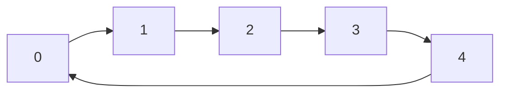
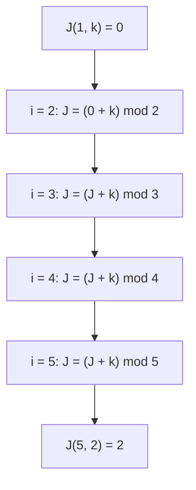
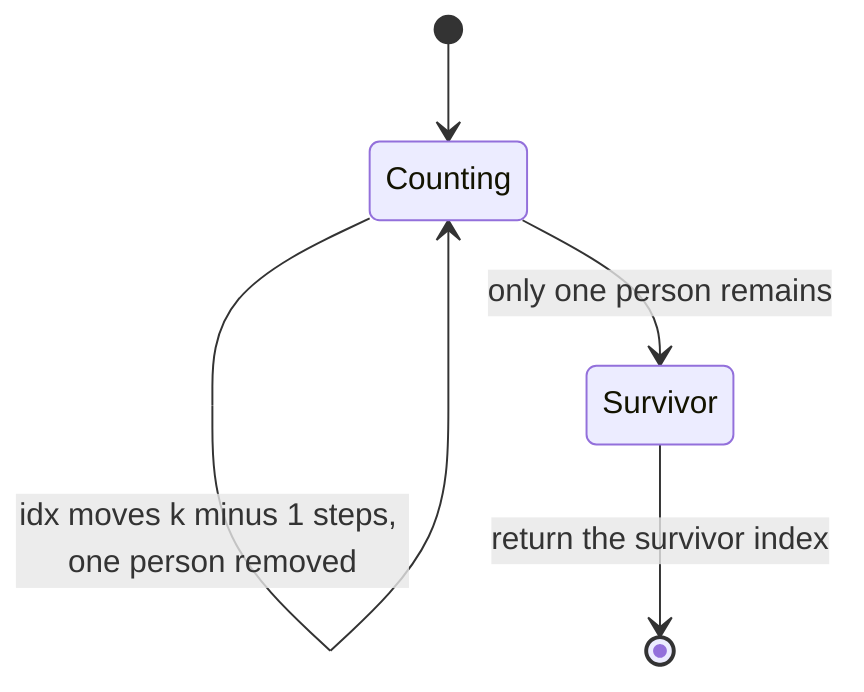
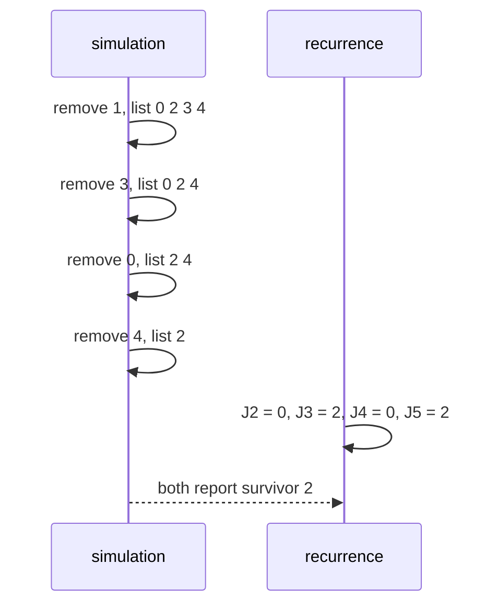

# 155 — Josephus problem simulation.

> **Tier:** Beginner · **CTCI chapter:** Ch 2 — Linked Lists
> **Task spec:** [155-josephus-problem-simulation.md](../../../tasks/beginner/155-josephus-problem-simulation.md)
> **Solutions:** [Python](../../../solutions/python/beginner/155-josephus-problem-simulation/solution.py) ·
> [Java](../../../solutions/java/beginner/155-josephus-problem-simulation/Solution.java) ·
> [JavaScript](../../../solutions/javascript/beginner/155-josephus-problem-simulation/solution.js) ·
> [C#](../../../solutions/csharp/beginner/155-josephus-problem-simulation/Solution.cs)

## 1. Problem restatement

**Input:** `n ≥ 1` people numbered `0 … n - 1`, standing in a circle, and a step size `k ≥ 1`.

**Output:** the number (0-based) of the single survivor. Counting starts at the current position,
every `k`-th person is eliminated, and counting continues from the position after the eliminated
one until only one person remains.

Each solution file contains **two** implementations and asserts that they agree:

| Function | Approach | Cost (as documented in the files) |
| --- | --- | --- |
| `josephus_simulate` / `josephusSimulate` | direct array simulation | O(n²) time, O(n) space |
| `josephus_recurrence` / `josephusRecurrence` | bottom-up recurrence | O(n) time, O(1) space |

Known checkpoints asserted in all four languages: `J(5, 2) = 2`, `J(7, 3) = 3`, `J(41, 3) = 30`.

| Case | Result | Why |
| --- | --- | --- |
| `J(5, 2)` | `2` | the checkpoint value |
| `J(7, 3)` | `3` | the checkpoint value |
| `J(41, 3)` | `30` | the traditional 41-person case |
| `J(1, 7)` | `0` | one person is always the survivor |
| `J(1, 999)` | `0` | the step size is irrelevant for `n = 1` |
| `J(10, 1)` | `9` | `k = 1` eliminates `0, 1, 2, …` in order, leaving the last index |
| `n = 0` or `k = 0` or negative | raises | the guards require `n, k ≥ 1` |

The cross-check runs both functions over `n ∈ {1, 2, 3, 5, 7, 10, 20, 41}` and
`k ∈ {1, 2, 3, 4, 7, 11}`, so every pair must agree exactly.



Five people in a ring; with `k = 2` the eliminations are `1`, `3`, `0`, `4`, leaving `2`.

## 2. Intuition

The straightforward reading is a simulation: keep the survivors in an array, move a cursor `k - 1`
steps forward (wrapping around), delete that person, and repeat until one remains. That is exactly
what `josephus_simulate` does, and it is the version a human would act out. Its cost is `O(n²)`
because each `pop` shifts the remaining elements — and with a real linked ring instead of an array
it would still be `O(n·k)` or worse, since the cursor walks `k` steps per elimination.

The fast version comes from changing the question. Instead of asking "who dies next?", ask:

> if I *relabel* the circle so that the survivor's position is known for `n - 1` people, where was
> that person among `n` people?

That is the recurrence `J(n, k) = (J(n - 1, k) + k) mod n`, with base case `J(1, k) = 0`. Each step
of the recurrence re-inserts one person *before* the first eliminated one at that level, which
shifts every remaining index forward by `k` positions modulo the new size.

The key insight is that this recurrence needs no circle at all — it is evaluated bottom-up as a
single loop:

```text
survivor = 0
for i from 2 to n
    survivor = (survivor + k) mod i
```

`O(n)` time, one integer of state, and it produces exactly the same answer as the simulation.



## 3. Algorithm

Simulation:

1. Reject `n < 1` or `k < 1`.
2. Build the list `people = [0, 1, …, n - 1]` and set `idx = 0`.
3. While more than one person remains: set `idx = (idx + k - 1) mod len(people)` and remove the
   person at `idx`.
4. Return the single remaining value.

```text
function josephus_simulate(n, k)
    if n < 1 or k < 1 then
        raise error "n and k must be >= 1"
    people = [0, 1, ..., n - 1]
    idx = 0
    while length(people) > 1 do
        idx = (idx + k - 1) mod length(people)
        remove people[idx]
    end
    return people[0]
end
```

Recurrence:

1. Reject `n < 1` or `k < 1`.
2. Start with `survivor = 0`, which is `J(1, k)`.
3. For `i` from `2` to `n`, set `survivor = (survivor + k) mod i`.
4. Return `survivor`.

```text
function josephus_recurrence(n, k)
    if n < 1 or k < 1 then
        raise error "n and k must be >= 1"
    survivor = 0
    for i = 2 to n do
        survivor = (survivor + k) mod i
    end
    return survivor
end
```

Note the off-by-one convention in step 3 of the simulation: because counting starts *at* the
current person, the first person eliminated when the cursor sits at `idx` is at
`(idx + k - 1) mod size`, not `(idx + k) mod size`. After the removal the same index now points at
the person who follows the eliminated one — which is exactly where counting resumes, so the cursor
needs no separate adjustment.

The two functions are also tested against each other rather than against a hand-written table,
which is what makes the pair useful: the simulation is the specification, the recurrence is the
optimisation.



## 4. Worked example

Trace `josephus_simulate(5, 2)` — people `[0, 1, 2, 3, 4]`, cursor at index `0`:

| Round | `idx` before | `(idx + k - 1) mod size` | Removed value | Remaining list |
| --- | --- | --- | --- | --- |
| 1 | `0` | `(0 + 1) mod 5 = 1` | `1` | `[0, 2, 3, 4]` |
| 2 | `1` | `(1 + 1) mod 4 = 2` | `3` | `[0, 2, 4]` |
| 3 | `2` | `(2 + 1) mod 3 = 0` | `0` | `[2, 4]` |
| 4 | `0` | `(0 + 1) mod 2 = 1` | `4` | `[2]` |

The survivor is `2`, matching the asserted checkpoint. Notice how the modulus shrinks with the
list: round 3 wraps (`3 mod 3 = 0`) because the cursor had reached the end of a three-element list.

The recurrence reaches the same answer without ever building the circle:

| `i` | `survivor` before | `(survivor + k) mod i` | `survivor` after |
| --- | --- | --- | --- |
| `1` | — | base case | `0` |
| `2` | `0` | `(0 + 2) mod 2` | `0` |
| `3` | `0` | `(0 + 2) mod 3` | `2` |
| `4` | `2` | `(2 + 2) mod 4` | `0` |
| `5` | `0` | `(0 + 2) mod 5` | `2` |

Four arithmetic steps against four eliminations — and the intermediate values (`0, 2, 0, 2`) are
not survivors of anything, they are just the relabelled index being carried forward.



## 5. Complexity

Let `n` be the number of people.

| Measure | Bound | Why it holds |
| --- | --- | --- |
| Time, simulation | O(n²) | `n - 1` removals, each shifting the remaining elements of the array |
| Space, simulation | O(n) | the array of `n` people |
| Time, recurrence | O(n) | one modular addition per `i` from `2` to `n` |
| Space, recurrence | O(1) | a single integer, no array and no recursion stack |
| Best case, both | O(n) | the recurrence always runs the loop; the simulation shrinks to `n = 1` |
| Iterator alternative | O(n·k) | walking `k` links per elimination instead of using a modulus |

The `O(n²)` for the simulation is inherent to array removal: after deleting a person in the middle,
every higher index shifts down by one. A linked ring would make the removal itself `O(1)` but would
replace it with a `k`-step pointer walk per round, giving `O(n·k)`. Only the recurrence removes
both factors, which is why the files ship it as the recommended answer and keep the simulation as
the executable specification.

## 6. Pitfalls and edge cases

- **Off-by-one in the counting start.** The person eliminated when the cursor sits at `idx` is at
  `(idx + k - 1) mod size`, because the person at `idx` counts as the first of the `k`. Using
  `(idx + k) mod size` silently shifts every elimination by one.
- **The cursor needs no adjustment after a removal.** After `remove(people[idx])`, the element that
  slid into position `idx` is the person who follows the eliminated one, which is exactly where
  counting resumes. Adding an extra decrement is the second classic bug here.
- **`n = 1`.** `J(1, k) = 0` for every `k`, asserted as `josephus_simulate(1, 7) == 0` and
  `josephus_recurrence(1, 999) == 0`. The simulation's `while` never runs; the recurrence's `for`
  never iterates.
- **`k = 1`.** People are eliminated in the order `0, 1, 2, …`, so the survivor is the last index,
  `n - 1`. Asserted as `josephus_simulate(10, 1) == 9`.
- **Wrapping.** `(idx + k - 1) mod size` wraps whenever `k` is large relative to the remaining
  count, as round 3 of the trace shows; the modulus must use the *current* size, not `n`.
- **Invalid inputs.** `n = 0`, `n = -1`, `k = 0` and `k = -1` all raise — Python `ValueError`, Java
  `IllegalArgumentException`, JavaScript `RangeError`, C# `ArgumentException`. The files assert both
  the `n` guard and the `k` guard.
- **`k` larger than `n`.** This is legal and simply wraps more than once; `J(3, 11)` is a valid call
  covered by the cross-check grid (`k = 11` is in the list of step sizes).
- **Both variants must agree.** The grid of `8 × 6` `(n, k)` pairs is the real test; the three
  named checkpoints alone would not catch a wrap-around bug that happens to be right for them.
- **Modulus with `i`, not `n`.** In the recurrence the divisor is the current size `i`, not the
  final `n`; using `n` throughout produces a plausible-looking but wrong survivor.

## 7. Variants and follow-ups

- **The circle as a data structure.** [154-implement-a-basic-circular-linked-list.md](../../../tasks/beginner/154-implement-a-basic-circular-linked-list.md)
  builds the ring this problem is naturally played on; a linked simulation would use `tail()` and
  a `k`-step walk per elimination.
- **Cycles without a size counter.** [058-detect-cycle-in-linked-list-floyd.md](../../../tasks/beginner/058-detect-cycle-in-linked-list-floyd.md)
  is the two-pointer technique that explores a ring you cannot count in advance.
- **Simulation as the specification.** [165-reservoir-sampling-for-k-items-from-stream.md](../../../tasks/beginner/165-reservoir-sampling-for-k-items-from-stream.md)
  is another task where a streaming simulation is the honest description of the algorithm.
- **Recurrence over a sequence.** [126-house-robber-problem-1d-dp.md](../../../tasks/beginner/126-house-robber-problem-1d-dp.md)
  and [127-decode-ways-num-decodings-dp.md](../../../tasks/beginner/127-decode-ways-num-decodings-dp.md)
  show the same "bottom-up recurrence with `O(1)` state" pattern on arrays.
- The chapter walkthrough in [Linked Lists](../../ctci/02-linked-lists.md) covers the pointers and
  rings this problem is usually drawn with.

## 8. Check yourself

1. Why is the eliminated index `(idx + k - 1) mod size` and not `(idx + k) mod size`?

<details><summary>Show answer</summary>

Because the person standing at `idx` is counted as the first of the `k`. Counting `k` people
starting at `idx` lands on `idx + k - 1`; with `k = 1` that is `idx` itself, which is correct —
the current person is eliminated.

</details>

2. What does the recurrence `J(n, k) = (J(n - 1, k) + k) mod n` actually compute?

<details><summary>Show answer</summary>

The survivor's index among `n` people, derived from the survivor's index among `n - 1` people.
It undoes a relabelling: after the first elimination the circle effectively starts at the next
person, so those `n - 1` positions must be shifted forward by `k` and wrapped modulo `n`.

</details>

3. Why does the simulation cost `O(n²)` while the recurrence costs `O(n)`?

<details><summary>Show answer</summary>

The simulation removes one element from an array `n - 1` times, and each removal shifts the
surviving suffix; that is `O(n)` per removal, so `O(n²)` overall, plus `O(n)` for the array. The
recurrence performs exactly one modular addition per size from `2` to `n`, keeping one integer.

</details>

4. What is `J(10, 1)`, and why?

<details><summary>Show answer</summary>

`9`. With a step of one, the eliminated person is always the current one, so the eliminations are
`0, 1, 2, …, 8` and the last index `9` survives. The assertion checks both implementations against
this value.

</details>

5. Both implementations must produce the same answer for every `(n, k)` in the test grid. Why is
   that cross-check more valuable than the three named checkpoints?

<details><summary>Show answer</summary>

Because the named checkpoints are just three points: a wrap-around or off-by-one bug can easily be
right at `(5, 2)`, `(7, 3)` and `(41, 3)` while still being wrong elsewhere. Comparing the two
independent algorithms over `8 × 6 = 48` pairs, including `k = 1`, `k = 4`, `k = 7` and `k = 11`
with `n` from `1` to `41`, tests the relations rather than the values.

</details>
