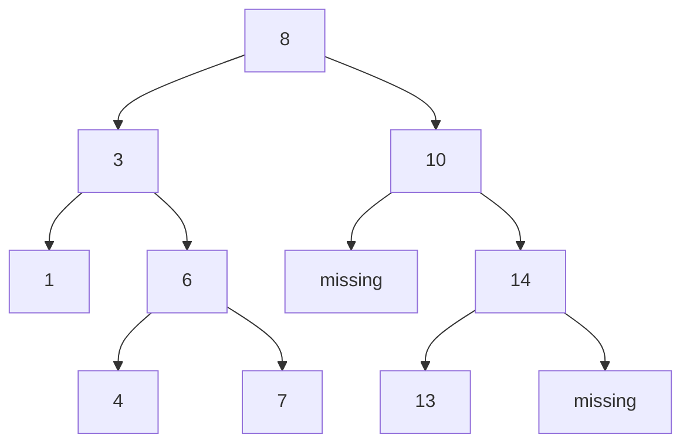
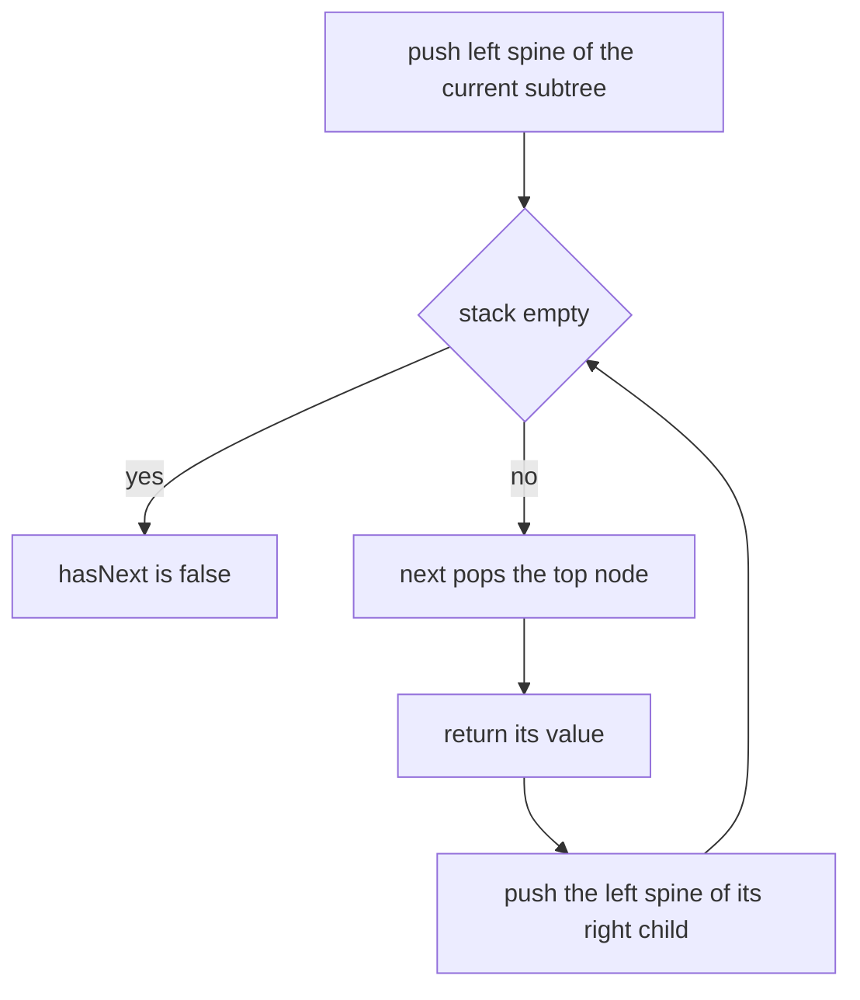
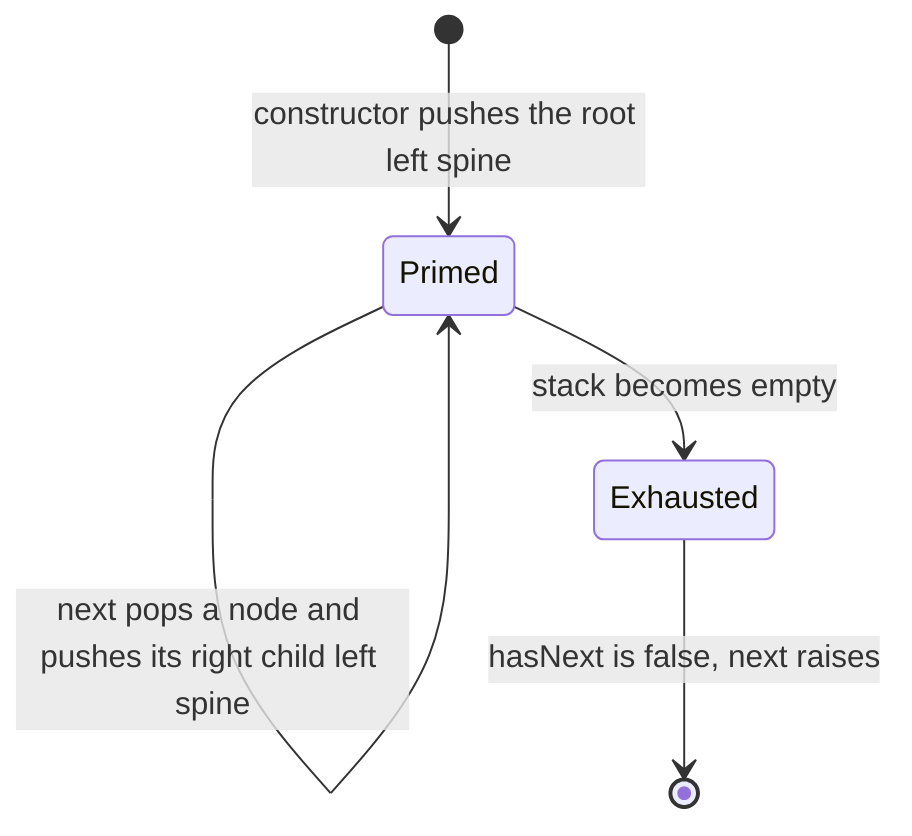
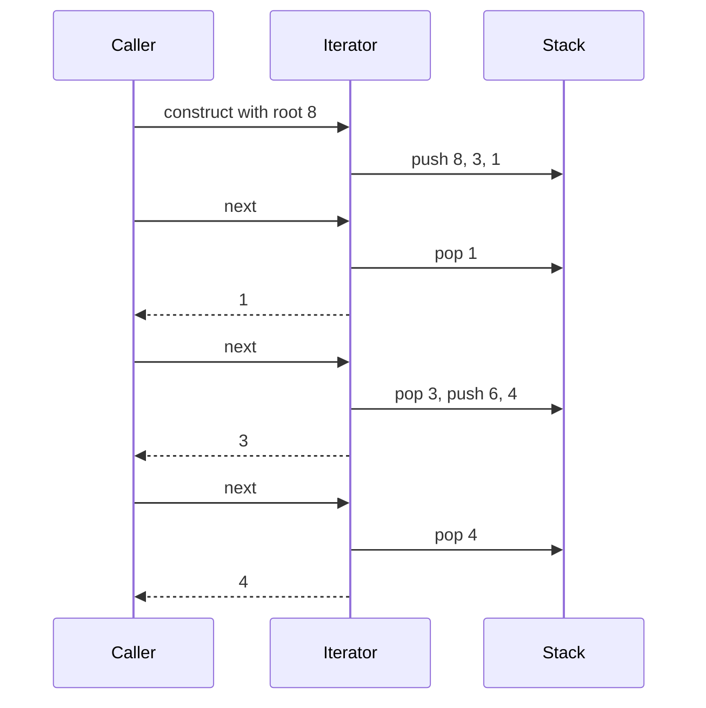

# 156 — Implement iterator for a binary tree (inorder).

> **Tier:** Beginner · **CTCI chapter:** Ch 4 — Trees and Graphs
> **Task spec:** [156-implement-iterator-for-a-binary-tree-inorder.md](../../../tasks/beginner/156-implement-iterator-for-a-binary-tree-inorder.md)
> **Solutions:** [Python](../../../solutions/python/beginner/156-implement-iterator-for-a-binary-tree-inorder/solution.py) ·
> [Java](../../../solutions/java/beginner/156-implement-iterator-for-a-binary-tree-inorder/Solution.java) ·
> [JavaScript](../../../solutions/javascript/beginner/156-implement-iterator-for-a-binary-tree-inorder/solution.js) ·
> [C#](../../../solutions/csharp/beginner/156-implement-iterator-for-a-binary-tree-inorder/Solution.cs)

## 1. Problem restatement

**Input:** the root of a binary tree (possibly null), handed to an iterator class `InOrderIterator`
at construction time.

**Output:** a lazy in-order traversal exposed as two methods — `has_next()` / `hasNext()` and
`next()` — so the caller can pull one value at a time. No recursion is used: the state lives in an
explicit stack, and the documented bounds are `O(1)` amortised per step and `O(h)` extra memory.

The contract is fixed by the assertions:

| Situation | Expected behaviour |
| --- | --- |
| BST `[8, 3, 10, 1, 6, null, 14, null, null, 4, 7, 13]` | the values come out `1, 3, 4, 6, 7, 8, 10, 13, 14` |
| that same sequence | is strictly ascending, i.e. it equals its sorted order |
| after the last value | `has_next()` is `false` and `next()` raises (Python `StopIteration`, Java `NoSuchElementException`, JavaScript `Error` with message `iterator exhausted`, C# `InvalidOperationException`) |
| empty tree | immediately exhausted: `has_next()` is `false`, `next()` raises |
| `[1, 2, 3]` | `2`, `1`, `3` — the left child of the root comes first |
| `has_next()` called twice in a row | idempotent: it peeks and consumes nothing |
| single node `[5]` | `has_next()` is `true`, `next()` returns `5`, then `has_next()` is `false` |

The `[1, 2, 3]` row is the one that pins down the traversal order: the tree is `1` with children
`2` and `3`, and in-order visits the left subtree, then the node, then the right subtree.



In-order visiting that BST yields `1, 3, 4, 6, 7, 8, 10, 13, 14`.

## 2. Intuition

The naive iterator is eager: run a full in-order traversal at construction time, store every value
in an array, and hand out the array elements one by one. It works and each `next()` is `O(1)`, but
it pays `O(n)` time and space up front even when the caller stops after two values — and it cannot
iterate a tree that is still being built.

The key insight is that the recursive in-order traversal only ever needs one path's worth of
context, and that context can be kept in a stack instead of on the call stack. Recursion says:

```text
inorder(node)
    if node = null then return
    inorder(node.left)
    visit node
    inorder(node.right)
```

Unrolling it shows the pattern: the very first node to visit is the leftmost node, reached by
following `left` pointers to the bottom. So:

1. at the start (and whenever the cursor moves right), push the entire **left spine** of the
   current subtree;
2. `next()` pops the top of the stack — that node is the next value in order;
3. the popped node's right subtree still has to be traversed, so push *its* left spine.

That is the whole iterator. The stack always holds exactly the ancestors whose `visit` step is still
pending, which is why its depth never exceeds the tree height `h`.



`has_next()` needs no work at all: it is `stack is not empty`. That is also why it is idempotent —
it reads the stack without modifying it, so calling it twice returns the same answer and leaves the
iterator untouched.

## 3. Algorithm

Construction:

1. Create an empty stack.
2. Push the left spine of the root: walk from the node to the far left, pushing each node.

```text
procedure push_left_spine(node)
    while node != null do
        push stack, node
        node = node.left
    end
end
```

`has_next()`: return whether the stack is non-empty.

`next()`:

1. If the stack is empty, raise an exhaustion error.
2. Pop the top node.
3. Push the left spine of that node's right child.
4. Return the popped node's value.

```text
function next()
    if stack is empty then
        raise error "iterator exhausted"
    node = pop stack
    push_left_spine(node.right)
    return node.val
end
```

The order of steps 2-4 matters: the push of the right child's left spine happens *after* the pop, so
the node itself is consumed before its right subtree is prepared. If the right child is absent the
push does nothing and the next `next()` simply pops the parent — which is exactly the "visit the
ancestor after finishing its left subtree" step of the recursive traversal.



The language-specific shapes are worth noting because they show how little state there is: Python
keeps `self._stack`, Java and C# keep a `Deque` / `Stack` field, and JavaScript keeps a plain array.
No solution stores the tree, a cursor, or a visited set — only the pending spines.

## 4. Worked example

Trace the first few steps on the BST `[8, 3, 10, 1, 6, null, 14, null, null, 4, 7, 13]`.

| Step | Action | Stack after the action (bottom → top) | Returned |
| --- | --- | --- | --- |
| construct | push spine `8 → 3 → 1` | `8, 3, 1` | — |
| `has_next()` | peek | `8, 3, 1` | `true` |
| `next()` | pop `1`, push spine of its right child (none) | `8, 3` | `1` |
| `next()` | pop `3`, push spine `6 → 4` | `8, 6, 4` | `3` |
| `next()` | pop `4`, no right child | `8, 6` | `4` |
| `next()` | pop `6`, push spine `7` | `8, 7` | `6` |
| `next()` | pop `7`, no right child | `8` | `7` |
| `next()` | pop `8`, push spine `10` | `10` | `8` |

The values come out `1, 3, 4, 6, 7, 8, …`, which is ascending — and that is not a coincidence: an
in-order traversal of a BST is sorted, which is exactly why the assertion `values == sorted(values)`
is meaningful rather than decorative.



Note that the stack in the third row is `8, 6, 4`: node `6` was pushed while descending into the
right subtree of `3`, and node `4` on top of it is the next node in order. The stack depth here is
three, which is the height of that part of the tree — never the node count.

## 5. Complexity

Let `n` be the number of nodes and `h` the height of the tree.

| Measure | Bound | Why it holds |
| --- | --- | --- |
| Construction | O(h) | one left-spine walk, one push per level |
| `has_next()` | O(1) | a single emptiness test |
| `next()`, single call | O(h) worst | a call that pushes a long spine does that much work |
| `next()`, amortised | O(1) | each node is pushed once and popped once over the whole traversal |
| Space | O(h) | the stack holds only pending ancestors; `O(n)` for a skewed chain |
| Alternative — eager array | O(n) time and space up front | simple, but pays for values the caller may never read |
| Alternative — Morris traversal | O(1) space, O(n) time | uses temporary right links and mutates the tree during traversal |

The amortised bound is the important one: an individual `next()` can cost `O(h)`, but the total
work over all `n` calls is `O(n)` because every node enters and leaves the stack exactly once. The
`O(h)` memory is the price of not mutating the tree, which is what separates this approach from
Morris traversal.

## 6. Pitfalls and edge cases

- **Empty tree.** The constructor's spine walk does nothing, so `has_next()` is immediately `false`
  and `next()` raises. All four files assert this path.
- **`next()` after exhaustion.** Must raise rather than return a stale or null value; the Python
  and Java files use language-standard exceptions, JavaScript throws an `Error` with the message
  `iterator exhausted`, and C# throws `InvalidOperationException`.
- **`has_next()` must not consume.** Calling it twice in a row and then `next()` must still yield the
  first value; the assertions in all four files check exactly that.
- **Push the *right* child's spine, not the right child.** Pushing only the right child would lose
  the deeper nodes of that subtree; pushing its whole left spine is what makes the next `next()`
  return the correct successor.
- **Push order at construction.** The left spine must be pushed *before* the first `next()`; an
  empty stack at that point would report an exhausted iterator on a non-empty tree.
- **Single node.** `[5]` gives a stack of one entry, one value, then exhaustion — the smallest
  non-trivial case and asserted separately.
- **Skewed trees.** A left chain makes the constructor's walk push all `n` nodes, so construction
  degrades to `O(n)` and the stack to `O(n)`; the bound in the header is `O(h)`, and `h = n` there.
- **Order of children in asserts.** `[1, 2, 3]` yields `2, 1, 3`; a pre-order iterator would give
  `1, 2, 3` and a post-order one `2, 3, 1`, so this is the assertion that identifies in-order.
- **No mutation.** The iterator only reads the tree, so two iterators over the same tree can run
  independently — which the eager-array version also supports, but Morris traversal does not.

## 7. Variants and follow-ups

- **The recursive traversal.** [137-tree-inorder-traversal-recursive.md](../../../tasks/beginner/137-tree-inorder-traversal-recursive.md)
  produces the same sequence eagerly; the iterator is that traversal split into steps.
- **Pre-order and post-order iterators.** [136-tree-preorder-traversal-recursive.md](../../../tasks/beginner/136-tree-preorder-traversal-recursive.md)
  and [138-tree-postorder-traversal-recursive.md](../../../tasks/beginner/138-tree-postorder-traversal-recursive.md)
  need a different stack discipline, since the node is visited before (or after) both children.
- **Why in-order matters for BSTs.** [145-validate-bst-property-inorder.md](../../../tasks/beginner/145-validate-bst-property-inorder.md)
  relies on the same ascending property, and the iterator makes it observable one value at a time.
- **Iterating a list instead of a tree.** [154-implement-a-basic-circular-linked-list.md](../../../tasks/beginner/154-implement-a-basic-circular-linked-list.md)
  keeps its traversal state in a ring and a size counter rather than a stack.
- The chapter walkthrough in [Trees and Graphs](../../ctci/04-trees-and-graphs.md) covers the
  traversal family this iterator belongs to.

## 8. Check yourself

1. Why does the constructor push the entire left spine instead of just the root?

<details><summary>Show answer</summary>

Because the first node in in-order is the leftmost node of the tree, and the only way to reach it
without recursion is to remember the path to it. Pushing the spine at construction time puts the
leftmost node on top of the stack, so the first `next()` is a single pop.

</details>

2. What does `next()` do with the popped node's right subtree, and why?

<details><summary>Show answer</summary>

It pushes the left spine of that right subtree. The popped node is finished, but in-order still has
to traverse its right subtree, and the next node in order is that subtree's leftmost node — which
is exactly the top of the newly pushed spine.

</details>

3. Why is `next()` `O(1)` amortised even though a single call can be `O(h)`?

<details><summary>Show answer</summary>

Because each node is pushed exactly once (either at construction or when its ancestor's right
subtree is prepared) and popped exactly once. The total number of pushes and pops over the whole
traversal is `O(n)`, so the average cost per `next()` across `n` calls is constant, while any one
call that walks a long spine costs `O(h)`.

</details>

4. Where does the `O(h)` memory bound come from?

<details><summary>Show answer</summary>

The stack holds one entry per ancestor whose visit is still pending, so its depth is bounded by the
height of the tree. For a balanced tree that is `O(log n)`, and for a skewed chain it is `O(n)` —
the bound is stated as `O(h)` precisely because it depends on the shape.

</details>

5. What does `has_next()` return after the last value, and what happens if you call `next()` anyway?

<details><summary>Show answer</summary>

`has_next()` is `false` because the stack is empty. Calling `next()` then raises: `StopIteration` in
Python, `NoSuchElementException` in Java, an `Error` with the message `iterator exhausted` in
JavaScript, and `InvalidOperationException` in C#. All four files assert both halves.

</details>
