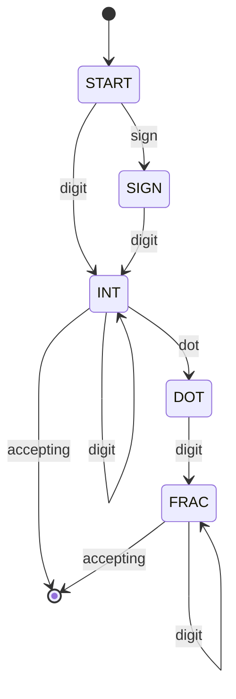
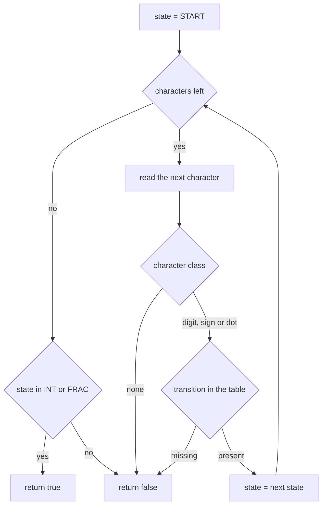
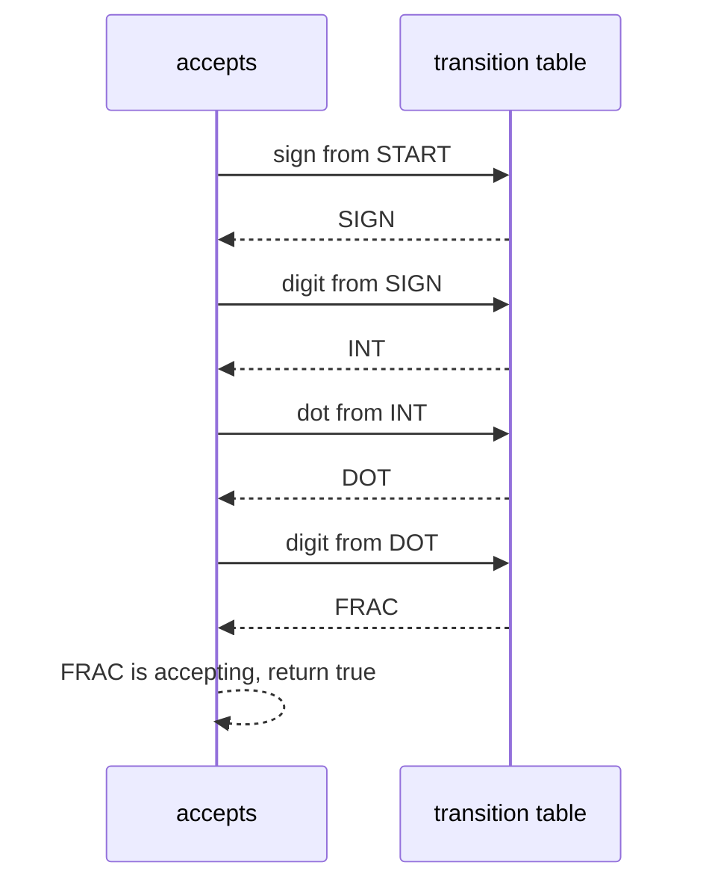

# 157 — Design a simple finite state machine (FSM) for number validation.

> **Tier:** Beginner · **CTCI chapter:** Ch 7 — Object-Oriented Design
> **Task spec:** [157-design-a-simple-finite-state-machine-fsm-for-number-validation.md](../../../tasks/beginner/157-design-a-simple-finite-state-machine-fsm-for-number-validation.md)
> **Solutions:** [Python](../../../solutions/python/beginner/157-design-a-simple-finite-state-machine-fsm-for-number-validation/solution.py) ·
> [Java](../../../solutions/java/beginner/157-design-a-simple-finite-state-machine-fsm-for-number-validation/Solution.java) ·
> [JavaScript](../../../solutions/javascript/beginner/157-design-a-simple-finite-state-machine-fsm-for-number-validation/solution.js) ·
> [C#](../../../solutions/csharp/beginner/157-design-a-simple-finite-state-machine-fsm-for-number-validation/Solution.cs)

## 1. Problem restatement

**Input:** a string `s` of characters.

**Output:** `true` exactly when `s` is a signed decimal literal accepted by a small finite state
machine. The machine is **data-driven**: a transition table maps `(state, character class)` to the
next state, `accepts` walks the table one character at a time, and the verdict is decided by whether
the final state is accepting.

The five states are `START`, `SIGN`, `INT`, `DOT` and `FRAC`. The accepting set is exactly
`{INT, FRAC}`.

| Input | Result | Which state it ends in |
| --- | --- | --- |
| `123` | `true` | `INT` |
| `+1` | `true` | `INT` |
| `-1.5` | `true` | `FRAC` |
| `0` | `true` | `INT` |
| `-0.0` | `true` | `FRAC` |
| `007` | `true` | `INT` (leading zeros are fine) |
| `1.` | `false` | `DOT` is not accepting |
| `.5` | `false` | no transition from `START` on a dot |
| `""` | `false` | stays in `START`, not accepting |
| `+`, `-`, `.` | `false` | `SIGN` and `DOT` are not accepting |
| `1.2.3` | `false` | no transition from `FRAC` on a dot |
| `12a` | `false` | `a` is not a character class |
| ` 12`, `12 ` | `false` | whitespace is rejected everywhere |
| `+-1` | `false` | no transition from `SIGN` on a sign |
| `1e5` | `false` | exponents are intentionally unsupported |

The files also assert the *table itself*, not only the outcomes: `(START, "dot")` must be absent,
`(INT, "dot")` must map to `DOT`, `(DOT, "digit")` must map to `FRAC`, and the accepting set must
be exactly `{INT, FRAC}`. Exponent notation such as `1e5` has no `e` transition, so it is rejected by
design rather than by accident.

## 2. Intuition

The naive implementation is a pile of conditionals: count digits, check for a leading sign, check
whether the dot has a digit on each side, and hope the cases do not interact. It is easy to write
and easy to get subtly wrong — the classic bugs are accepting `1.`, `.5` and `1.2.3`, each of which
requires a different ad-hoc flag.

The key insight is that the character-by-character validity of a number is a *regular language*, and
regular languages are exactly what finite state machines recognise. Once you write down the states —
"nothing yet", "sign only", "integer part", "saw the dot", "fraction part" — every one of those
ad-hoc flags disappears, because each flag was really a state in disguise:

| State | Meaning | Accepting? |
| --- | --- | --- |
| `START` | nothing consumed yet | no |
| `SIGN` | only the sign has been consumed | no |
| `INT` | at least one digit, no dot yet | yes |
| `DOT` | digits, then the dot | no |
| `FRAC` | digits after the dot | yes |

Three design decisions then fall out of the table rather than out of special cases:

- a digit from `START` or `SIGN` moves to `INT`, and from `INT`, `DOT` or `FRAC` stays in the
  digit-consuming state — so `007` is fine;
- a sign is only accepted from `START`, which is why `+-1` has no transition;
- a dot is only accepted from `INT`, which is why `.5` is rejected while `1.5` is not, and why
  `1.2.3` dies in `FRAC`.

`DOT` is not accepting, so `1.` fails; `START` is not accepting, so `""`, `+` and `-` fail. The
acceptance rule is uniformly "did we stop in `INT` or `FRAC`".



Every unlabelled arrow above is simply absent from the table — there is no error state to write,
because a missing entry *is* the failure.

## 3. Algorithm

1. Define the state names and the accepting set `{INT, FRAC}`.
2. Define the transition table with seven entries:
   `(START, digit) → INT`, `(START, sign) → SIGN`, `(SIGN, digit) → INT`, `(INT, digit) → INT`,
   `(INT, dot) → DOT`, `(DOT, digit) → FRAC`, `(FRAC, digit) → FRAC`.
3. Map each character to a class: digits to `digit`, `+`/`-` to `sign`, `.` to `dot`, everything
   else to "no class".
4. Start in `START`. For each character: if it has no class, reject; look up
   `(state, class)` in the table; if the entry is missing, reject; otherwise move to the new state.
5. After the last character, accept iff the current state is in the accepting set.

```text
function accepts(text)
    state = START
    for each ch in text do
        cls = char_class(ch)
        if cls = null then
            return false
        next = transition(state, cls)
        if next = null then
            return false
        state = next
    end
    return state in {INT, FRAC}
end

function char_class(ch)
    if ch is between "0" and "9" then
        return "digit"
    if ch is "+" or ch is "-" then
        return "sign"
    if ch is "." then
        return "dot"
    return null
end
```

The lookups differ per language only in their dictionary shapes: Python uses a dict keyed by
`(state, cls)` tuples and `dict.get`, Java uses a `Map<List<String>, String>`, C# uses a
`Dictionary<(string, string), string>` with `TryGetValue`, and JavaScript uses a nested object
`TRANSITIONS[state][cls]`. All four express the same table and the same two-line loop body.



Note that the check order matters for the *reason* reported, not for the verdict: an unknown
character is rejected by the class lookup, while a known character with no legal transition is
rejected by the table lookup. Both return `false` immediately, which is what makes the machine
single-pass.

## 4. Worked example

Trace `accepts("-1.5")`:

| Step | Character | Class | State before | Transition | State after |
| --- | --- | --- | --- | --- | --- |
| 1 | `-` | `sign` | `START` | `(START, sign) → SIGN` | `SIGN` |
| 2 | `1` | `digit` | `SIGN` | `(SIGN, digit) → INT` | `INT` |
| 3 | `.` | `dot` | `INT` | `(INT, dot) → DOT` | `DOT` |
| 4 | `5` | `digit` | `DOT` | `(DOT, digit) → FRAC` | `FRAC` |
| 5 | end of input | — | `FRAC` | — | accepting → `true` |

The two rejected neighbours of that string show how the table does the work:

| Input | Walk | Verdict |
| --- | --- | --- |
| `1.` | `1` → `INT`, `.` → `DOT`, end | `DOT` is not accepting → `false` |
| `.5` | `.` from `START` has no entry | reject at step 1 → `false` |
| `1.2.3` | `1` → `INT`, `.` → `DOT`, `2` → `FRAC`, `.` from `FRAC` has no entry | reject → `false` |
| `1e5` | `1` → `INT`, `e` has no class | reject → `false` |



The `-0.0` assertion passes by the same path, and `007` ends in `INT` because the `(INT, digit)`
entry is a self-loop — no special "leading zero" rule is needed, which is the design win of turning
validation into a table.

## 5. Complexity

Let `n` be the length of the input string.

| Measure | Bound | Why it holds |
| --- | --- | --- |
| Time, best | O(1) | rejection on the first character, e.g. `.5` |
| Time, average | O(n) | one class lookup and one table lookup per character |
| Time, worst | O(n) | the whole string is consumed once; there is no backtracking |
| Space | O(1) | one state variable plus the fixed table of seven entries |
| Table size | 5 states | constant regardless of input |
| Alternative — regex | O(n) time, larger constant | compiles a pattern; correct but hides the state machine |
| Alternative — nested conditionals | O(n) time | same asymptotics, but the flags duplicate the states |

The `O(1)` space claim is the reason the states exist at all: a validator written with flags needs
one boolean per special case, and every new grammar feature adds another; adding a state or a
transition to the table changes the data, not the code, and the loop stays two lines.

## 6. Pitfalls and edge cases

- **`1.` must fail.** The trailing dot is the most common slip: a machine that treats `DOT` as
  accepting (or that accepts "digits or dot" loosely) gets it wrong. Here `DOT` is deliberately not
  in the accepting set.
- **`.5` must fail.** Requiring a leading digit before the dot is encoded by the *absence* of a
  `(START, dot)` entry; the files assert that absence directly.
- **Empty string.** The loop body never runs, the state stays `START`, and `START` is not
  accepting, so `""` is `false` without a special case.
- **A bare sign.** `+` and `-` end in `SIGN`, which is not accepting; `.` ends in `START` because
  the first transition fails, so it is rejected at step 1.
- **Unknown characters.** Letters and whitespace have no character class and are rejected
  immediately; that is why ` 12` and `12 ` fail even though the digits themselves are valid.
- **Exponent notation is unsupported by design.** `1e5` fails because `e` has no class; the header
  comments in all four files say so explicitly, so this is a documented scope limit rather than a
  bug.
- **Multiple dots and multiple signs.** `1.2.3` dies on the second dot (no `FRAC → DOT` entry) and
  `+-1` dies on the second sign (no `SIGN → SIGN` entry).
- **Leading zeros.** `007` is accepted; the machine validates *shape*, not canonical form, and no
  state distinguishes `7` from `007`.
- **Trailing whitespace.** `12 ` fails at the space character; the machine does not trim.

## 7. Variants and follow-ups

- **The eager alternative.** [158-implement-simple-memoized-prime-checker-cache.md](../../../tasks/beginner/158-implement-simple-memoized-prime-checker-cache.md)
  is the neighbouring design task where the class holds state (a cache) instead of a table.
- **Designing an interface around criteria.** [160-implement-lru-cache-using-linked-list-hashmap.md](../../../tasks/beginner/160-implement-lru-cache-using-linked-list-hashmap.md)
  is the other Ch 7 task in this batch, with a policy (eviction order) instead of a grammar.
- **Parsing numbers by hand.** [030-reverse-digits-of-an-integer.md](../../../tasks/beginner/030-reverse-digits-of-an-integer.md)
  and [127-decode-ways-num-decodings-dp.md](../../../tasks/beginner/127-decode-ways-num-decodings-dp.md)
  are digit-level processing tasks where the digit classification is explicit.
- **Validating instead of transforming.** [002-check-if-a-string-is-a-palindrome.md](../../../tasks/beginner/002-check-if-a-string-is-a-palindrome.md)
  is a small pass/fail string decision of the same shape.
- The chapter walkthrough in [Object-Oriented Design](../../ctci/07-object-oriented-design.md)
  frames the "turn rules into data" approach this task uses.

## 8. Check yourself

1. Why is `1.` rejected when `1.0` is accepted?

<details><summary>Show answer</summary>

Because the dot moves the machine into `DOT`, which is not an accepting state: a number ending right
after the dot has no fraction digits, so it is not a decimal literal. In `1.0` the following `0`
moves the machine from `DOT` to `FRAC`, which *is* accepting.

</details>

2. What makes `.5` invalid, and where is that rule encoded?

<details><summary>Show answer</summary>

The rule is encoded by the absence of a `(START, dot)` transition. A dot is only legal from `INT`,
so an input starting with a dot has no legal first move and is rejected immediately. The assertion
`(START, "dot") not in _TRANSITIONS` locks this in.

</details>

3. Why does the machine reject `1e5`?

<details><summary>Show answer</summary>

Because exponent notation is deliberately out of scope: there is no `e` character class, so the
character has no class and `accepts` returns `false`. All four headers state that exponents are
intentionally unsupported rather than supported.

</details>

4. What are the time and space bounds, and why does the machine need no backtracking?

<details><summary>Show answer</summary>

`O(n)` time for one pass and `O(1)` space for the current state plus a fixed seven-entry table. Each
character either has a legal transition or kills the input, so the machine never has to go back and
try an alternative parse — a regular language is decided by a single left-to-right scan.

</details>

5. How would you extend the machine to accept exponent notation?

<details><summary>Show answer</summary>

Add a class for `e`/`E`, a state such as `EXP` reachable from `INT` or `FRAC`, a `sign` transition
from `EXP` to `EXP_SIGN`, and digit transitions from `EXP`/`EXP_SIGN` to a new accepting state. The
`accepts` loop is unchanged — only table entries and state names are added, which is the point of
keeping the machine data-driven.

</details>
