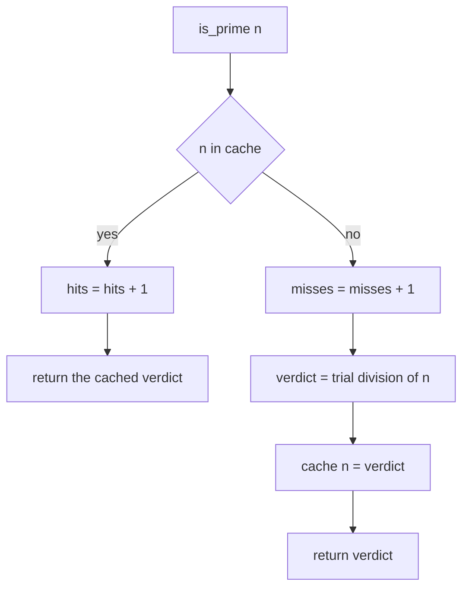
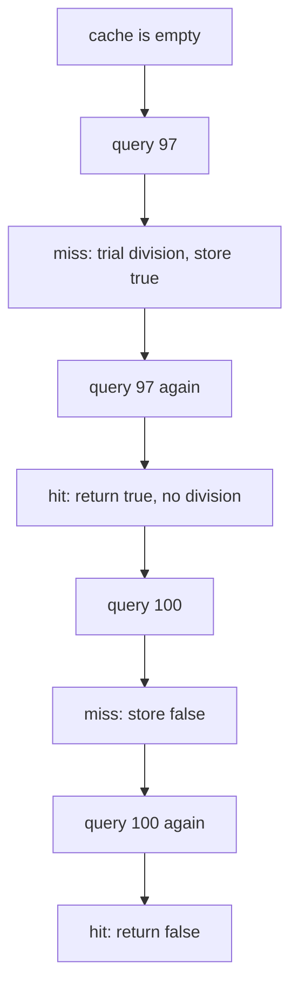
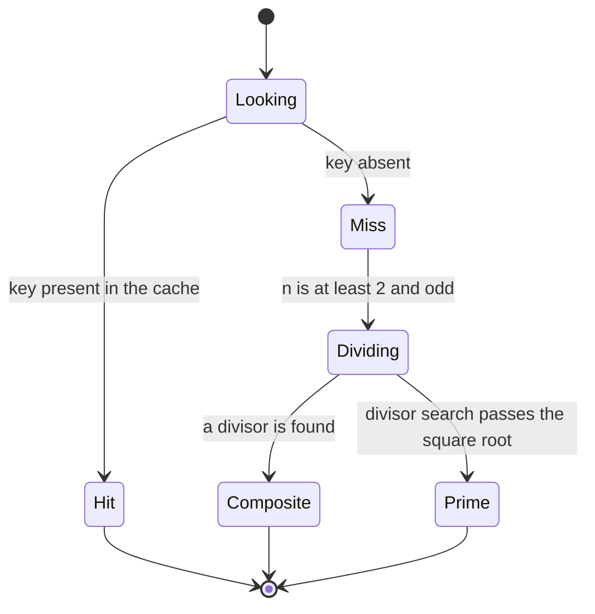
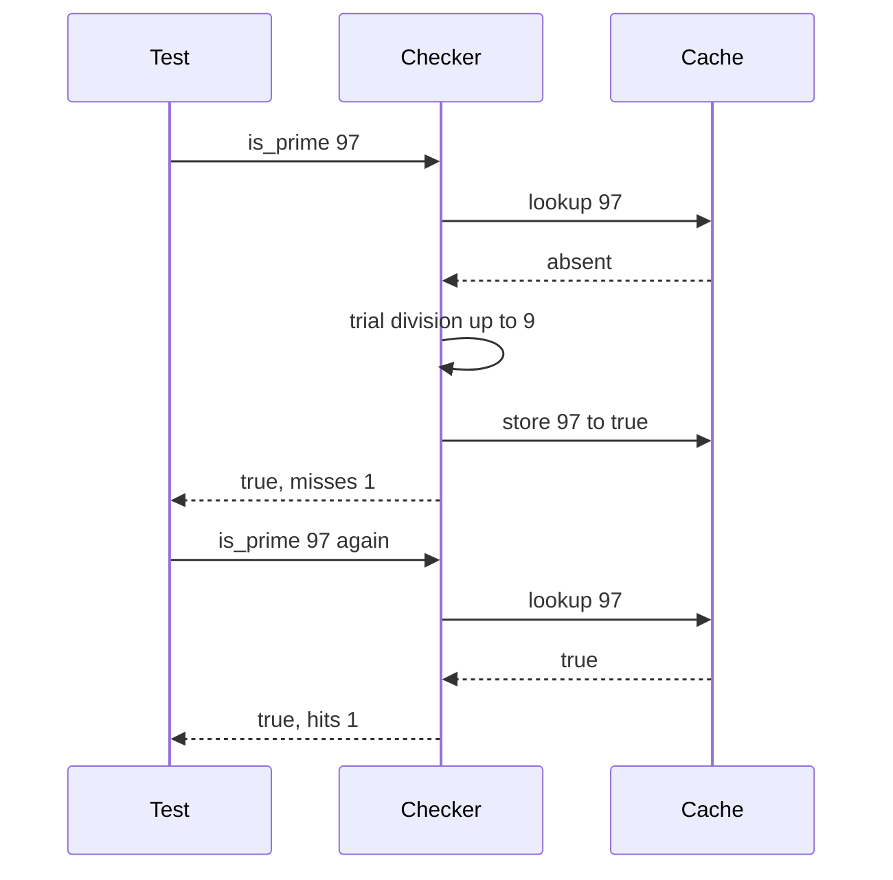

# 158 — Implement simple memoized prime checker cache.

> **Tier:** Beginner · **CTCI chapter:** Ch 6 — Math and Logic Puzzles
> **Task spec:** [158-implement-simple-memoized-prime-checker-cache.md](../../../tasks/beginner/158-implement-simple-memoized-prime-checker-cache.md)
> **Solutions:** [Python](../../../solutions/python/beginner/158-implement-simple-memoized-prime-checker-cache/solution.py) ·
> [Java](../../../solutions/java/beginner/158-implement-simple-memoized-prime-checker-cache/Solution.java) ·
> [JavaScript](../../../solutions/javascript/beginner/158-implement-simple-memoized-prime-checker-cache/solution.js) ·
> [C#](../../../solutions/csharp/beginner/158-implement-simple-memoized-prime-checker-cache/Solution.cs)

## 1. Problem restatement

**Input:** a `PrimeChecker` object and calls of `is_prime(n)` / `isPrime(n)` with integer `n`.

**Output:** `true` iff `n` is prime, with every verdict stored in a cache so a repeated query is
answered without recomputation. The class also exposes `hits`, `misses` and `size`, which the tests
use to prove that the cache is actually serving the repeats.

The verdict rule is `n < 2` is never prime, and the test is trial division up to `sqrt(n)`.

| Query | Result | Counters afterwards |
| --- | --- | --- |
| `is_prime(97)` | `true` | `(hits, misses, size) == (0, 1, 1)` |
| `is_prime(97)` twice more | `true`, `true` | `(2, 1, 1)` — both served from the cache |
| `0, 1, 2, 100, 7919, 7917` | `false, false, true, false, true, false` | `(2, 7, 7)` |
| the whole set again (including `97`) | same verdicts | `(9, 7, 7)` — seven more hits, no new misses |

The counter trajectory is the contract: after the first sweep there are seven distinct keys and
therefore seven misses; the second sweep adds seven hits and zero misses, which is only possible if
every value was cached. `7919` is the 1000th prime and `7917` is divisible by `3`, so the pair
exercises both a large prime and a large composite.



The cache stores `false` verdicts too, which is what keeps the miss count at seven rather than
growing on every composite query.

## 2. Intuition

The naive primality test is trial division: try the candidates `2, 3, 4, …` up to `sqrt(n)` and
report composite as soon as one divides `n`. That is `O(sqrt n)` per call, which is fine for one
query and wasteful for a workload that asks about the same numbers repeatedly — for example
validating many small numbers, or a table build that revisits values while crawling.

The key insight is that primality is a **pure function of one integer argument**. Two queries with
the same `n` must produce the same answer, so the first answer can be kept and reused. That makes
the cache not an optimisation to be tuned but a pure consequence of the function's signature: the
key *is* the argument, and the value *is* the result.

```text
is_prime(n):
    if n is in the cache: return cache[n]        (a hit)
    verdict = expensive_test(n)                  (a miss)
    cache[n] = verdict
    return verdict
```

Two design choices make this a useful component rather than a toy:

- **the cache stores negatives as well as positives.** A cache that only stores primes would
  recompute every composite query, which is exactly the workload that repeats most often;
- **hits and misses are observable.** Without counters you cannot tell a working cache from one
  that is silently broken; the tests assert the exact trajectory, so a cache that never hits fails
  the suite rather than merely underperforming.



Because 97 is odd, trial division never tests an even candidate other than 2: the loop starts at
`d = 3` and steps by two, halving the work compared with testing every integer.

## 3. Algorithm

`is_prime(n)`:

1. If `n` is a key in the cache, increment `hits` and return the stored verdict.
2. Otherwise increment `misses`.
3. Compute the verdict with trial division.
4. Store it under `n`, so the verdict — prime or composite — is never recomputed.
5. Return the verdict.

Trial division (`_check`):

1. If `n < 2`, return `false` — `0` and `1` are not prime.
2. If `n` is even, return `n == 2` — `2` is the only even prime.
3. Set `d = 3` and loop while `d * d <= n`: if `d` divides `n`, return `false`; otherwise `d += 2`.
4. If no divisor was found, return `true`.

```text
function is_prime(n)
    if n is a key in cache then
        hits = hits + 1
        return cache[n]
    misses = misses + 1
    verdict = check(n)
    cache[n] = verdict
    return verdict
end

function check(n)
    if n < 2 then
        return false
    if n is divisible by 2 then
        return n = 2
    d = 3
    while d * d <= n do
        if n is divisible by d then
            return false
        d = d + 2
    end
    return true
end
```

The loop condition `d * d <= n` avoids calling a square-root function, so no floating-point
rounding can make the bound one step too small — the comparison stays in integer arithmetic. In
Java and C# the product is widened to `long` (`(long) d * d <= n`) so the multiplication cannot
overflow for large `n`.



The `size` accessor is just the number of distinct keys asked about, which is why the tests can
assert `size == 7` after the first sweep and `size == 7` again after the second — the second sweep
introduces no new key.

## 4. Worked example

Trace the tests' own sequence, starting from an empty `PrimeChecker`:

| Step | Call | Cache before | Outcome | `hits` | `misses` | `size` |
| --- | --- | --- | --- | --- | --- | --- |
| 1 | `is_prime(97)` | `{}` | miss → `true` | 0 | 1 | 1 |
| 2 | `is_prime(97)` | `{97: true}` | hit → `true` | 1 | 1 | 1 |
| 3 | `is_prime(97)` | `{97: true}` | hit → `true` | 2 | 1 | 1 |
| 4 | `is_prime(0)` | `{97}` | miss → `false` | 2 | 2 | 2 |
| 5 | `is_prime(1)` | `{97, 0}` | miss → `false` | 2 | 3 | 3 |
| 6 | `is_prime(2)` | `{97, 0, 1}` | miss → `true` | 2 | 4 | 4 |
| 7 | `is_prime(100)` | `{…, 2}` | miss → `false` | 2 | 5 | 5 |
| 8 | `is_prime(7919)` | `{…, 100}` | miss → `true` | 2 | 6 | 6 |
| 9 | `is_prime(7917)` | `{…, 7919}` | miss → `false` | 2 | 7 | 7 |
| 10-16 | the set again, including `97` | all seven keys present | 7 hits | 9 | 7 | 7 |

Row 3 is the smallest proof that the cache works: `97` is answered twice without any division. Row
9 shows a composite stored as `false`, and rows 10-16 show the second sweep adding nothing but
hits.



## 5. Complexity

Let `n` be the queried value and `k` the number of distinct values queried so far.

| Measure | Bound | Why it holds |
| --- | --- | --- |
| Time, cache miss | O(sqrt n) | the loop tests odd candidates up to `sqrt(n)` |
| Time, cache hit | O(1) | one dictionary lookup and a counter increment |
| Time, first sweep of `k` values | O(Σ sqrt nᵢ) | every distinct value pays its own division cost once |
| Space, cache | O(k) | one entry per distinct value, prime or composite |
| Space, per call | O(1) | trial division needs two integer variables |
| Alternative — no cache | O(sqrt n) per call | repeats pay the full cost again |
| Alternative — sieve | O(N log log N) for all values below `N` | better for dense queries, worse for a few large ones |

The cache turns a repeated workload from `O(m · sqrt n)` into `O(sqrt n + m)` for `m` queries of the
same value — the entire point of memoisation. The space cost is `O(k)` hash entries, and the
shipped `size` accessor exists so the tests can observe it growing from `1` to `7` and then staying
put.

## 6. Pitfalls and edge cases

- **`n < 2`.** `0` and `1` are not prime, and the cache stores those `false` verdicts just like any
  other. A missing guard here would report `1` as prime (the loop would find no divisor).
- **`2` is the only even prime.** The shortcut `n % 2 == 0 → n == 2` handles it; without it, `2`
  would be reported composite by the even-number shortcut.
- **Odd candidates only.** Starting at `d = 3` and stepping by two skips every even divisor, which
  is safe because `2` was already handled.
- **`d * d <= n`, not `d <= sqrt(n)`.** Integer arithmetic avoids any rounding boundary at perfect
  squares, and widening to `long` in Java and C# prevents overflow when `d` is large.
- **Composite verdicts are cached.** Storing only primes would make repeated composite queries miss
  every time; the assertion `(2, 7, 7)` after six composite-and-prime queries counts on `false`
  entries being present.
- **A hit must not touch `misses`.** The counters are updated on disjoint branches; incrementing
  both, or forgetting to increment on the hit path, breaks the exact trajectories the tests assert.
- **Counters are per instance.** The `size` property and the counters belong to the object, so two
  `PrimeChecker` instances keep independent statistics — the structure is a class, not globals.
- **Large primes.** `7919` requires about 44 odd trial divisions (up to `sqrt(7919) ≈ 89`); the test
  uses it both as a big prime and as a value whose second query must be a hit.

## 7. Variants and follow-ups

- **Memoising an arbitrary function.** [159-implement-function-memoizer-decorator-or-equivalent.md](../../../tasks/beginner/159-implement-function-memoizer-decorator-or-equivalent.md)
  generalises this class into a wrapper for any single-argument pure function, and adds a capacity
  with FIFO eviction.
- **The simple wrapper.** [128-implement-basic-memoization-wrapper.md](../../../tasks/beginner/128-implement-basic-memoization-wrapper.md)
  is the minimal memoisation pattern without the counters.
- **Bounded caches.** [160-implement-lru-cache-using-linked-list-hashmap.md](../../../tasks/beginner/160-implement-lru-cache-using-linked-list-hashmap.md)
  shows what happens when the cache cannot grow without bound.
- **Number theory neighbours.** [166-boyer-moore-majority-vote-algorithm-find-element-n-2.md](../../../tasks/beginner/166-boyer-moore-majority-vote-algorithm-find-element-n-2.md)
  and [168-implement-basic-checksum-sum-bytes.md](../../../tasks/beginner/168-implement-basic-checksum-sum-bytes.md)
  are the other integer-arithmetic tasks in this tier.
- The chapter walkthrough in [Math and Logic](../../ctci/06-math-and-logic.md) covers primality
  testing.

## 8. Check yourself

1. Why must composite verdicts be cached as well as prime ones?

<details><summary>Show answer</summary>

Because repeated queries are not biased towards primes. A cache that only stores primes recomputes
`100`, `7917` and every other composite on each query, so the miss count keeps growing. The test
trajectory `(2, 7, 7)` — seven keys, seven misses, and then nine hits — only works if `false` is a
cached value like any other.

</details>

2. Why does the trial-division loop start at `3` and step by two?

<details><summary>Show answer</summary>

Because `2` has already been handled by the even-number shortcut, so all remaining candidate
divisors are odd: `3, 5, 7, 9, …`. Testing even candidates again would double the work without
finding anything new.

</details>

3. What is the cost of the first query for a new value, and of the second query for the same value?

<details><summary>Show answer</summary>

The first is `O(sqrt n)` — trial division up to the square root — plus an `O(1)` store. The second
is `O(1)`: one cache lookup, one counter increment, and no division at all. That contrast is what
the `hits`/`misses` counters make visible.

</details>

4. Why is `d * d <= n` preferred over `d <= sqrt(n)`?

<details><summary>Show answer</summary>

It keeps the bound in integer arithmetic, so no floating-point rounding can make the loop stop one
step early or late at a perfect square. In Java and C# the product is widened to `long` for the same
reason — to rule out overflow on the multiplication rather than precision on a square root.

</details>

5. What do the counters look like after the two sweeps the tests perform?

<details><summary>Show answer</summary>

`(hits, misses, size) == (2, 1, 1)` after three queries of `97`; `(2, 7, 7)` after the six further
new values; and `(9, 7, 7)` after repeating the whole seven-value set — seven more hits, no new
misses, and a cache size that stops growing because every key was already present.

</details>
