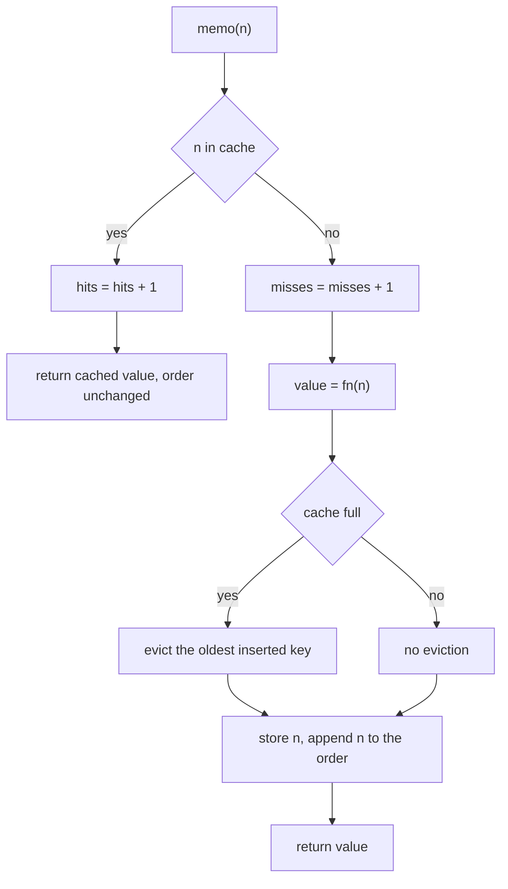
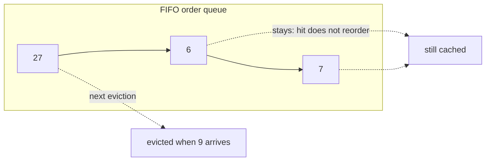
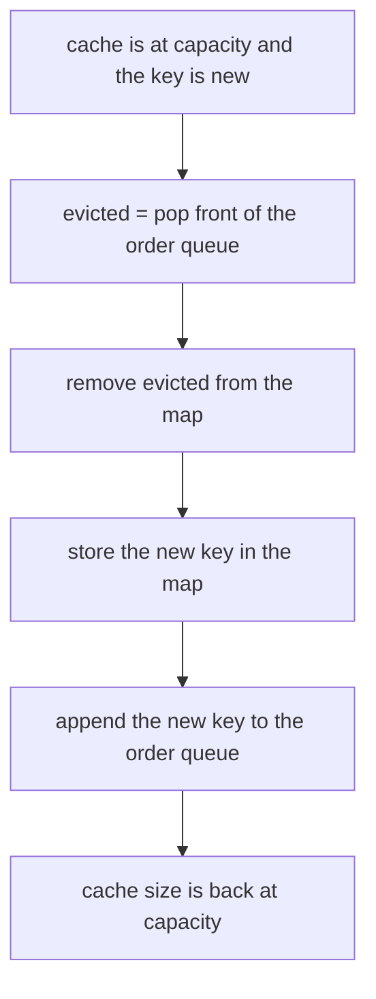
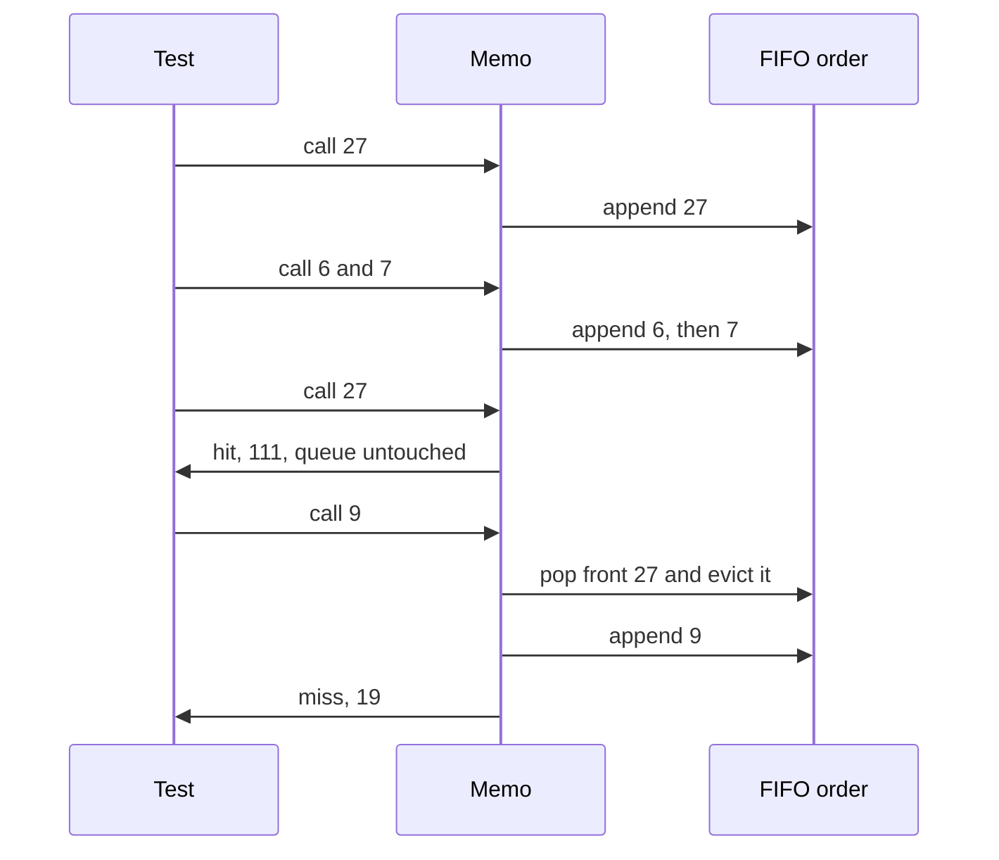

# 159 — Implement function memoizer decorator (or equivalent).

> **Tier:** Beginner · **CTCI chapter:** Ch 8 — Recursion and Dynamic Programming
> **Task spec:** [159-implement-function-memoizer-decorator-or-equivalent.md](../../../tasks/beginner/159-implement-function-memoizer-decorator-or-equivalent.md)
> **Solutions:** [Python](../../../solutions/python/beginner/159-implement-function-memoizer-decorator-or-equivalent/solution.py) ·
> [Java](../../../solutions/java/beginner/159-implement-function-memoizer-decorator-or-equivalent/Solution.java) ·
> [JavaScript](../../../solutions/javascript/beginner/159-implement-function-memoizer-decorator-or-equivalent/solution.js) ·
> [C#](../../../solutions/csharp/beginner/159-implement-function-memoizer-decorator-or-equivalent/Solution.cs)

## 1. Problem restatement

**Input:** a single-argument pure function `fn` plus an optional `capacity`; then calls of the
wrapped function.

**Output:** a `Memoizer` object that behaves like `fn` — same arguments, same results — but answers
repeated arguments from a cache, records `hits` and `misses`, exposes `size`, and optionally evicts
entries when a capacity is set. The documented differences from the minimal wrapper in task 128 are
the counters, the `size` accessor and FIFO eviction.

The eviction policy is deliberately **FIFO, not LRU**: when the cache is full, the *oldest inserted*
key leaves first, and a **hit never changes insertion order**. The solution headers say so
explicitly and point at task 160 for an LRU cache.

| Scenario | Behaviour |
| --- | --- |
| no capacity | every key stays cached forever |
| `Memoizer(fn, capacity=3)`, insert `27, 6, 7` | `size == 3`, `(hits, misses) == (0, 3)` |
| then call `27` | hit; FIFO order unchanged, `27` still cached |
| then call `9` (new key) | miss; the **oldest insertion** `27` is evicted |
| then call `6` | hit — `6` survived because it was inserted later than `27` |
| `capacity=1` | behaves like a single slot: the newest key wins |
| `capacity <= 0` | raises (Python `ValueError`, Java `IllegalArgumentException`, JavaScript `RangeError`, C# `ArgumentException`) |
| two instances | counters are per instance, never shared |

The tests drive the memoizer with Collatz step counts — a pure but slow-ish function — with the
documented values `collatz_steps(27) == 111`, `collatz_steps(6) == 8`, `collatz_steps(7) == 16` and
`collatz_steps(9) == 19`.



## 2. Intuition

A cache on a pure function needs three decisions, and the interesting one is what to do when it
fills up.

1. **What is the key?** For a single-argument function the argument itself is the key — that is what
   "pure" buys: the same input always yields the same output, so no other context matters.
2. **What is the value?** The computed result, stored on the miss path so the next call is a hit.
3. **What happens when the cache is full?** Something must go. The simplest policy that keeps the
   bookkeeping `O(1)` without any reordering is FIFO: remember the insertion order in a queue and
   drop the front when a new key needs room.

FIFO is a deliberate simplification, and the contrast with LRU is instructive. In an LRU cache a
*hit* is a mutation of the ordering — the hit key jumps to the front — which is why task 160 needs a
doubly linked list. Here a hit is a pure read: the queue is untouched, so a hot key does not
protect itself from eviction. The tests assert exactly that: after inserting `27, 6, 7` and hitting
`27`, inserting `9` evicts `27` — the oldest insertion — even though `27` was the most recently
*used*.



The second insight is that a bounded memoizer must keep the map and the order in step. Every
insertion appends to the queue, and every eviction removes from *both* the queue and the map —
otherwise the queue would hand out keys that no longer exist or, worse, the cache would grow past
its capacity.



There is no update path to reconcile: a repeated key is detected as a hit and returns before the
insertion logic, so the order queue never receives a duplicate key.

## 3. Algorithm

Construction:

1. Reject a non-positive capacity.
2. Store the function, the capacity (or "unbounded"), an empty map, an empty FIFO queue, and zeroed
   counters.

Calling `memo(n)`:

1. If `n` is in the map: increment `hits`, return the stored value. Insertion order is untouched.
2. Otherwise increment `misses` and compute `value = fn(n)`.
3. If a capacity is set and the map is already at capacity, take the front key of the order queue and
   delete it from the map.
4. Store `value` under `n` and append `n` to the order queue.
5. Return `value`.

```text
procedure call(n)
    if n is a key in cache then
        hits = hits + 1
        return cache[n]
    misses = misses + 1
    value = fn(n)
    if capacity is set and number of keys >= capacity then
        evicted = remove front of order
        delete cache[evicted]
    end
    cache[n] = value
    append order, n
    return value
end
```

The order queue is the only place eviction order is decided, and the map is the only place values
live, so the two structures answer two different questions: "what is the answer for `n`?" and "which
key is oldest?". That separation is what keeps both operations `O(1)`.

## 4. Worked example

Trace the capacity-3 phase of the tests, which is where eviction becomes visible.

| Step | Call | Cache keys before | Order queue before | Outcome | `hits` | `misses` |
| --- | --- | --- | --- | --- | --- | --- |
| 1 | `27` | `{}` | `[]` | miss, store `111` | 0 | 1 |
| 2 | `6` | `{27}` | `[27]` | miss, store `8` | 0 | 2 |
| 3 | `7` | `{27, 6}` | `[27, 6]` | miss, store `16` | 0 | 3 |
| 4 | `27` | `{27, 6, 7}` | `[27, 6, 7]` | **hit**, order unchanged | 1 | 3 |
| 5 | `9` | `{27, 6, 7}` | `[27, 6, 7]` | miss; evict `27`, store `19` | 1 | 4 |
| 6 | `6` | `{6, 7, 9}` | `[6, 7, 9]` | **hit**, `6` survived | 2 | 4 |

Step 4 is the crux: `27` is the most recently *used* key, yet step 5 evicts it because it is the
oldest *inserted* key. With an LRU policy step 5 would have evicted `6` instead — a difference the
assertions make explicit with `not small.cached(27)` and `small.cached(9)`.

The capacity-1 phase shows the same machinery with a single slot: `tiny(3)` stores `9`; `tiny(4)`
misses, evicts `3` and stores `16`; the following `tiny(4)` is a hit, giving `(hits, misses) == (1, 2)`.



## 5. Complexity

Let `m` be the number of calls and `c` the capacity.

| Measure | Bound | Why it holds |
| --- | --- | --- |
| Time, hit | O(1) | one map lookup, one counter increment, no reordering |
| Time, miss | O(1) + cost of `fn` | one map insert and one queue append; eviction is a pop and a delete |
| Time, eviction | O(1) | the order queue's front is the oldest key |
| Space | O(c) | the map and the queue each hold at most `c` keys (unbounded when no capacity is given) |
| Alternative — LRU | same asymptotics, more work | a hit must unlink and re-link a list node (task 160) |
| Alternative — unbounded | O(k) for `k` distinct keys | no eviction logic at all, but unbounded growth |

The important detail is that a *hit* costs strictly less here than in an LRU cache: no list surgery,
no pointer updates, only a dictionary read. That is the trade FIFO makes — cheaper hits in exchange
for a policy that can evict a hot key.

## 6. Pitfalls and edge cases

- **FIFO is not LRU.** A hit must not touch the order queue. Moving the key to the back on a hit
  turns this into an LRU cache and would break the assertion that `27` — the key that was just
  hit — is the one evicted next.
- **Evict before inserting, and from both structures.** The oldest key has to be removed from the
  map *and* from the queue. Removing from only one leaves either a stale queue entry (which will
  later cause a spurious eviction of a live key) or an oversized cache.
- **No duplicate queue entries.** A repeated key is always a hit and returns early, so the insertion
  path runs at most once per key. If a future variant allowed updating a value, it would have to be
  careful not to enqueue the key twice.
- **Capacity validation.** `capacity <= 0` raises in all four languages; only `None` / `null` /
  absent means unbounded, which is different from capacity zero.
- **Capacity 1.** `Memoizer(fn, 1)` is legal and behaves as a one-slot cache: the newest key always
  wins, as `tiny(3)` then `tiny(4)` demonstrates.
- **Counters are per instance.** A new `Memoizer` starts at `(0, 0)`, and touching it must not
  change another instance's counters; the Python test asserts exactly that.
- **The wrapped function must be pure.** If `fn` returns different values for the same argument, the
  cache will return a stale value. Nothing in the memoizer can detect that; it is a precondition of
  the pattern.
- **Unbounded mode is the default.** Omitting the capacity means the cache only ever grows, which is
  correct for a fixed workload and a leak for an open-ended one.

## 7. Variants and follow-ups

- **Least-recently-used instead of first-in-first-out.** [160-implement-lru-cache-using-linked-list-hashmap.md](../../../tasks/beginner/160-implement-lru-cache-using-linked-list-hashmap.md)
  keeps the same map-plus-order idea but refreshes order on every hit, using a doubly linked list.
- **The minimal wrapper.** [128-implement-basic-memoization-wrapper.md](../../../tasks/beginner/128-implement-basic-memoization-wrapper.md)
  is memoisation without counters, `size` or eviction.
- **A concrete memoized function.** [158-implement-simple-memoized-prime-checker-cache.md](../../../tasks/beginner/158-implement-simple-memoized-prime-checker-cache.md)
  is the same pattern specialised to a primality test, with the same hit/miss accounting.
- **Where memoisation is not optional.** [126-house-robber-problem-1d-dp.md](../../../tasks/beginner/126-house-robber-problem-1d-dp.md)
  and [127-decode-ways-num-decodings-dp.md](../../../tasks/beginner/127-decode-ways-num-decodings-dp.md)
  are the DP tasks where a cache turns exponential recursion into linear work.
- The chapter walkthrough in [Recursion and Dynamic Programming](../../ctci/08-recursion-and-dp.md)
  introduces memoisation as the bridge from recursion to DP.

## 8. Check yourself

1. Why is the *argument* the cache key rather than something derived from the context?

<details><summary>Show answer</summary>

Because the wrapped function is required to be pure: its result depends on nothing but its argument.
Any other key would risk returning a value computed under different circumstances, and the wrapper
has no way to detect such a state. Purity is what makes the shortcut sound.

</details>

2. In the capacity-3 trace, why is key `27` evicted after it was the most recently used?

<details><summary>Show answer</summary>

Because the policy is FIFO, not LRU. The order queue records *insertion* order (`27, 6, 7`), and a
hit does not reorder it, so when `9` needs a slot the front of the queue — `27` — leaves. The
assertion `not small.cached(27)` together with `small.cached(6)` states this precisely.

</details>

3. What must be updated when an eviction happens, and what breaks if only half of it is done?

<details><summary>Show answer</summary>

Both the map and the order queue must lose the evicted key. If it stays in the queue, it will be
"evicted" again later, deleting a live key from the map; if it stays in the map without being
queued, the cache exceeds its capacity and the key can never be evicted.

</details>

4. Why does a hit cost less here than in an LRU cache?

<details><summary>Show answer</summary>

A hit is a bare map lookup plus a counter increment, because FIFO order is not affected by reads. An
LRU hit has to move the key to the most-recent position, which means unlinking and re-linking list
nodes (task 160). Same asymptotics, different constant and different policy behaviour.

</details>

5. What happens with `capacity = 1`, and what does the test show?

<details><summary>Show answer</summary>

The cache holds exactly one entry: every miss evicts the current key and stores the new one. The test
calls `tiny(3)` then `tiny(4)` on an `n → n²` function, checks `size == 1`, `not cached(3)` and
`cached(4)`, and then confirms that a second `tiny(4)` is a hit, giving `(hits, misses) == (1, 2)`.

</details>
