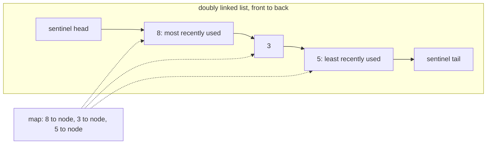
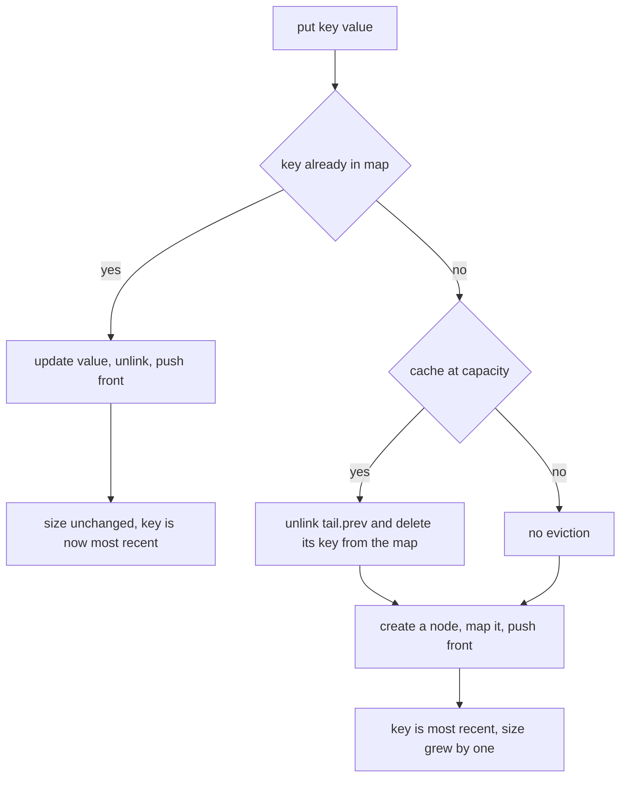
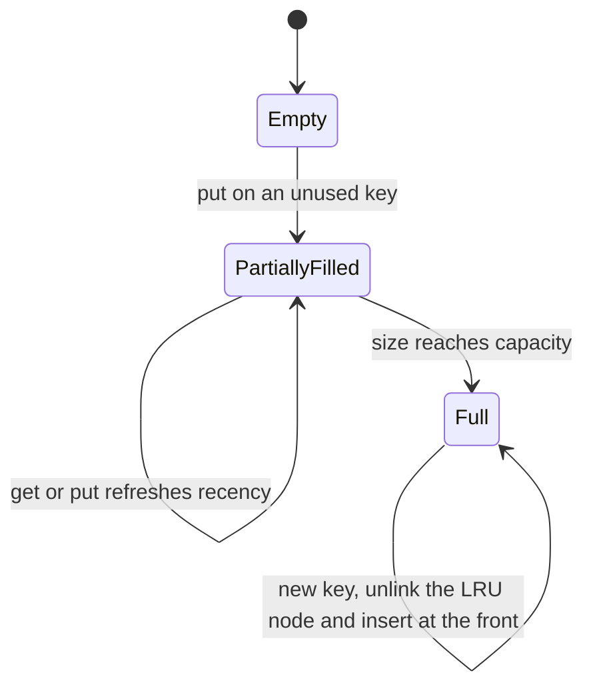
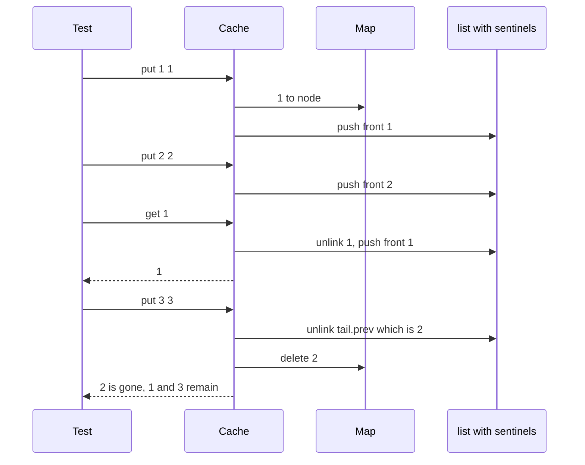

# 160 — Implement LRU cache using linked list + hashmap.

> **Tier:** Beginner · **CTCI chapter:** Ch 7 — Object-Oriented Design
> **Task spec:** [160-implement-lru-cache-using-linked-list-hashmap.md](../../../tasks/beginner/160-implement-lru-cache-using-linked-list-hashmap.md)
> **Solutions:** [Python](../../../solutions/python/beginner/160-implement-lru-cache-using-linked-list-hashmap/solution.py) ·
> [Java](../../../solutions/java/beginner/160-implement-lru-cache-using-linked-list-hashmap/Solution.java) ·
> [JavaScript](../../../solutions/javascript/beginner/160-implement-lru-cache-using-linked-list-hashmap/solution.js) ·
> [C#](../../../solutions/csharp/beginner/160-implement-lru-cache-using-linked-list-hashmap/Solution.cs)

## 1. Problem restatement

**Input:** a positive capacity, then interleaved `put(key, value)` and `get(key)` calls.

**Output:** a cache with `O(1)` `get` and `put` that keeps at most `capacity` entries and evicts the
**least recently used** one when a new key needs room. `get` returns the stored value, or `-1` when
the key is absent. The task is explicit that the two pieces are a hash map from key to node and a
**hand-rolled doubly linked list** — no built-in ordered map (`OrderedDict`, `LinkedHashMap`) — and
that sentinel head/tail nodes remove the empty-list edge cases.

| Behaviour | Asserted effect |
| --- | --- |
| `put(1, 1)`, `put(2, 2)`, `get(1)` on capacity 2 | `1` — the hit makes key `1` most recent |
| then `put(3, 3)` | evicts key `2` (now LRU); `get(2) == -1` |
| then `put(4, 4)` | evicts key `1`; `get(1) == -1`, `get(3) == 3`, `get(4) == 4` |
| `put(1, 1)`, `put(2, 2)`, `put(1, 10)` | size stays 2 and key `1` becomes most recent |
| then `put(3, 3)` | evicts key `2`, **not** key `1`; `get(1) == 10` |
| capacity 1 | only the newest key survives |
| `get(99)` on a full cache | returns `-1` and does **not** change the recency order |
| `LRUCache(0)` | raises (Python `ValueError`, Java `IllegalArgumentException`, JavaScript `RangeError`, C# `ArgumentException`) |

The `put`-on-an-existing-key row is the one that catches the classic bug: an update must refresh
recency without growing the cache and without inserting a second node.



## 2. Intuition

A cache needs a fast lookup and a fast answer to "which entry is oldest?". A hash map gives the
first in `O(1)` but knows nothing about order; an array gives order but `O(n)` removal. The insight
is to use **both**: the map stores the key-to-node mapping, and a doubly linked list stores the
recency order — so each operation needs only `O(1)` surgery at the ends.

Two invariants make the list pleasant to work with:

- the node right after the head sentinel is the **most recently used** entry;
- the node right before the tail sentinel is the **least recently used** entry, i.e. the eviction
  candidate.

Every operation becomes one of three primitives:

1. **unlink(node)** — splice a node out of the list: `node.prev.next = node.next` and
   `node.next.prev = node.prev`. No null checks, because the sentinels guarantee every node has
   neighbours.
2. **push_front(node)** — insert right after the head sentinel.
3. **evict** — `unlink(tail.prev)` and remove that node's key from the map.

`get(key)` is then: look up the node; if absent return `-1`; otherwise `unlink` it, `push_front` it,
and return its value. `put(key, value)` is: if the key exists, update its value and refresh recency;
otherwise, if the cache is full, evict `tail.prev`, then create a node and `push_front` it.



The sentinels are what make the empty-cache case disappear: a fresh cache has `head.next = tail` and
`tail.prev = head`, so `push_front` always has a real next node to fix up and `unlink` always has
real neighbours to splice — no special case for "the list is empty" or "this is the first node".



## 3. Algorithm

Construction:

1. Reject a capacity below 1.
2. Create an empty map and the two sentinel nodes; wire `head.next = tail` and `tail.prev = head`.

`get(key)`:

1. Look up `key` in the map; if there is no node, return `-1` and touch nothing else.
2. Unlink the node from its current position.
3. Push it to the front — a hit is a use, so it becomes most recent.
4. Return the node's value.

`put(key, value)`:

1. Look up `key`. If a node exists: overwrite its value, unlink it, push it to the front, and stop —
   the size does not change.
2. Otherwise, if the map size has reached the capacity, take `tail.prev` (the LRU node), unlink it,
   and delete its key from the map.
3. Create a node for `key`, register it in the map, and push it to the front.

```text
procedure get(key)
    node = map[key]
    if node = null then
        return -1
    unlink(node)
    push_front(node)
    return node.value
end

procedure put(key, value)
    node = map[key]
    if node != null then
        node.value = value
        unlink(node)
        push_front(node)
        return
    if number of keys in map >= capacity then
        lru = tail.prev
        unlink(lru)
        delete map[lru.key]
    end
    node = new node(key, value)
    map[key] = node
    push_front(node)
end

procedure unlink(node)
    node.prev.next = node.next
    node.next.prev = node.prev
end

procedure push_front(node)
    node.prev = head
    node.next = head.next
    head.next.prev = node
    head.next = node
end
```

Note that the evicted node's own `prev`/`next` pointers are left dangling after `unlink`; that is
harmless because the node is unreachable from the map as soon as its key is deleted, and the tests
never inspect an evicted node.



## 4. Worked example

Trace the first test block, a capacity-2 cache.

| Step | Operation | Most recent → LRU | Map keys | Result |
| --- | --- | --- | --- | --- |
| 1 | `put(1, 1)` | `1` | `{1}` | — |
| 2 | `put(2, 2)` | `2, 1` | `{1, 2}` | — |
| 3 | `get(1)` | `1, 2` | `{1, 2}` | `1` — the hit reordered the list |
| 4 | `put(3, 3)` | `3, 1` | `{1, 3}` | evicted `2`, the LRU entry |
| 5 | `get(2)` | `3, 1` | `{1, 3}` | `-1` — the miss changed nothing |
| 6 | `put(4, 4)` | `4, 3` | `{3, 4}` | evicted `1` |
| 7 | `get(1)` | `4, 3` | `{3, 4}` | `-1` |
| 8 | `get(3)` | `3, 4` | `{3, 4}` | `3` — hit, so `3` becomes most recent |
| 9 | `get(4)` | `4, 3` | `{3, 4}` | `4` |

Step 3 is what makes step 4 evict `2` rather than `1`: without the reorder, the LRU entry would
still be `1` and the assertion `get(2) == -1` would fail.

The update block shows the other subtle path:

| Step | Operation | Most recent → LRU | Map keys | Result |
| --- | --- | --- | --- | --- |
| 1 | `put(1, 1)` | `1` | `{1}` | — |
| 2 | `put(2, 2)` | `2, 1` | `{1, 2}` | — |
| 3 | `put(1, 10)` | `1, 2` | `{1, 2}` | size stays 2, value becomes 10 |
| 4 | `put(3, 3)` | `3, 1` | `{1, 3}` | evicts `2` — not `1` |
| 5 | `get(2)` | `3, 1` | `{1, 3}` | `-1` |
| 6 | `get(1)` | `1, 3` | `{1, 3}` | `10` — the updated value survived |

## 5. Complexity

Let `c` be the capacity.

| Measure | Bound | Why it holds |
| --- | --- | --- |
| `get`, hit | O(1) | one map lookup plus two pointer splices at the front |
| `get`, miss | O(1) | one map lookup that returns `-1` without touching the list |
| `put`, new key | O(1) | optional O(1) eviction plus one insert and one map write |
| `put`, existing key | O(1) | value overwrite plus unlink/push-front, no size change |
| Space | O(c) | the map and the list each hold at most `c` entries |
| Alternative — list scan | O(c) per operation | finding the LRU entry by scanning removes the `O(1)` guarantee |
| Alternative — timestamps | O(c) space and O(c) eviction | you must scan for the oldest timestamp |
| Alternative — built-in ordered map | O(1) amortised | forbidden here by the task, which asks for the list to be hand-rolled |

The `O(1)` claim rests on the sentinel list: eviction reads `tail.prev` directly instead of
searching, and recency refresh splices known neighbours instead of shifting an array.

## 6. Pitfalls and edge cases

- **Refresh on `get`, not just on `put`.** A read is a use. If `get` returned the value without
  reordering, step 4 of the trace would evict `1` and the assertion would fail.
- **A `put` update must not insert a second node.** Overwriting the value and refreshing recency
  keeps `size` at 2 after `put(1, 10)`; inserting a new node would grow the cache and break the
  later eviction expectations.
- **Eviction must delete from the map too.** Unlinking the node from the list but leaving its key in
  the map would leave a dangling entry that `get` could still find while the list no longer tracks
  it.
- **A miss must not reorder.** `get(99) == -1` and the following `put(3, 3)` still evicts key `1`,
  which proves the miss left the recency order alone.
- **Sentinels remove empty-list cases.** With `head.next = tail` and `tail.prev = head` from the
  start, `push_front` and `unlink` never dereference a null neighbour. Dropping the sentinels means
  special-casing the first insert and the last removal.
- **Capacity 1.** Every new key evicts the single existing one; the test asserts
  `get(1) == -1 && get(2) == 2` for a capacity-1 cache after `put(1, 1)` and `put(2, 2)`.
- **Capacity validation.** Zero is rejected; only positive capacities are legal.
- **Argument type.** Keys and values are integers, and a miss is signalled by `-1` — so the sentinel
  value is distinguishable from a stored value only because the tests never store `-1` as a value.
- **No built-in ordered map.** The task states the list must be implemented from scratch, which is
  why recency is maintained explicitly rather than delegated to `OrderedDict` or `LinkedHashMap`.

## 7. Variants and follow-ups

- **Cache without recency.** [159-implement-function-memoizer-decorator-or-equivalent.md](../../../tasks/beginner/159-implement-function-memoizer-decorator-or-equivalent.md)
  is the FIFO counterpart: a hit does not reorder anything, so no list is needed — only an insertion
  queue.
- **Frequency instead of recency.** [161-implement-lfu-cache-basic-variant.md](../../../tasks/beginner/161-implement-lfu-cache-basic-variant.md)
  evicts the least *frequently* used entry, which needs per-key counters and a different structure.
- **Admission control instead of eviction.** [162-implement-rate-limiter-token-bucket-simple.md](../../../tasks/beginner/162-implement-rate-limiter-token-bucket-simple.md)
  uses a token bucket to decide what enters rather than what leaves.
- **A concrete memoized function.** [158-implement-simple-memoized-prime-checker-cache.md](../../../tasks/beginner/158-implement-simple-memoized-prime-checker-cache.md)
  is an unbounded cache for a pure function, showing the case where eviction is unnecessary.
- The chapter walkthrough in [Object-Oriented Design](../../ctci/07-object-oriented-design.md)
  covers the map-plus-list composition this cache is built from.

## 8. Check yourself

1. Why does one structure suffice for neither requirement?

<details><summary>Show answer</summary>

A hash map answers "what is the value for this key?" in `O(1)` but has no notion of recency, so
finding the least recently used entry would need a scan. A list keeps recency order but finding a
key requires walking it. Keeping the map from key to node *and* a doubly linked list of nodes gives
`O(1)` for both, at the cost of keeping the two in step.

</details>

2. What do the sentinel head and tail nodes buy?

<details><summary>Show answer</summary>

They remove every empty-list and boundary special case: `push_front` always has a real node after
the head to fix up, and `unlink` always has real neighbours on both sides, even when the cache holds
zero or one entry. Without them, the first insert, the last removal and eviction of the only node
would each need their own guard.

</details>

3. In the trace, why is key `2` evicted at step 4 rather than key `1`?

<details><summary>Show answer</summary>

Because step 3's `get(1)` was a hit, which unlinked `1` and pushed it to the front. The recency order
became `1, 2`, so the LRU entry — `tail.prev` — is `2`. Without the hit refresh the order would still
be `2, 1` and `1` would be the one evicted.

</details>

4. What are the time and space bounds of `get` and `put`?

<details><summary>Show answer</summary>

Both are `O(1)`: `get` is a map lookup plus at most two pointer splices, and `put` is a map lookup,
possibly an `O(1)` eviction (`tail.prev`, unlink, map delete), plus an insert. Space is `O(c)` —
the map and the list each hold at most `capacity` entries, plus the two sentinels.

</details>

5. Why is `get(99) == -1` followed by an eviction of key `1` a meaningful assertion?

<details><summary>Show answer</summary>

Because it proves a *miss* leaves the recency order untouched. If `get` reordered on a miss — say by
touching or re-inserting the missing key — the LRU entry could change, and the test pins down that
the cache with `1` inserted first and `2` second still evicts `1`. A miss is a read of absence, not
a use.

</details>
