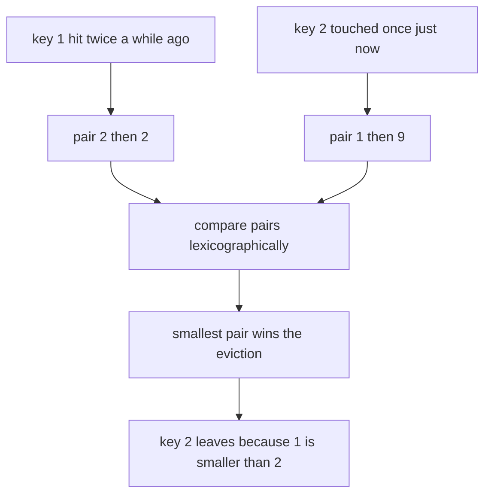
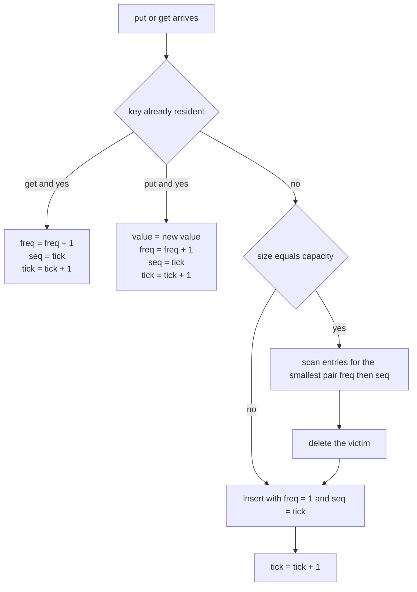
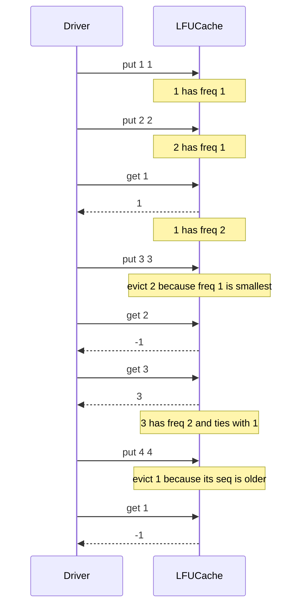
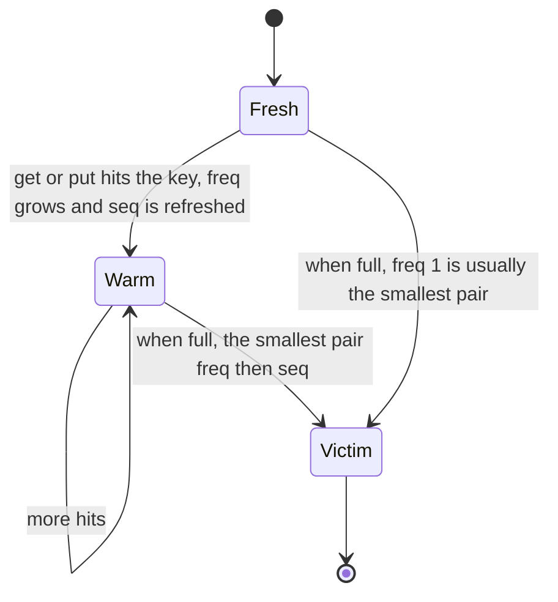

# 161 — Implement LFU cache (basic variant).

> **Tier:** Beginner · **CTCI chapter:** Ch 7 — Object-Oriented Design
> **Task spec:** [161-implement-lfu-cache-basic-variant.md](../../../tasks/beginner/161-implement-lfu-cache-basic-variant.md)
> **Solutions:** [Python](../../../solutions/python/beginner/161-implement-lfu-cache-basic-variant/solution.py) ·
> [Java](../../../solutions/java/beginner/161-implement-lfu-cache-basic-variant/Solution.java) ·
> [JavaScript](../../../solutions/javascript/beginner/161-implement-lfu-cache-basic-variant/solution.js) ·
> [C#](../../../solutions/csharp/beginner/161-implement-lfu-cache-basic-variant/Solution.cs)

## 1. Problem restatement

**Input:** a positive integer `capacity`, followed by a stream of `put(key, value)` and
`get(key)` operations.

**Output:**

- `get(key)` returns the stored value, or `-1` if the key is not resident.
- `put(key, value)` inserts a new key, or overwrites the value of a resident key.
- When an insert would exceed `capacity`, the **least frequently used** key is evicted. Ties on
  frequency are broken by **least recently used**.

Constraints that the four solution files agree on:

- `capacity <= 0` is rejected up front: Python raises `ValueError`, Java
  `IllegalArgumentException`, C# `ArgumentException`, JavaScript `Error`. There is no "cache of
  size zero" mode.
- Keys and values are integers; every resident key carries a frequency counter and a
  monotonically increasing timestamp (`tick`).
- Both a successful `get` and a successful `put` are **accesses**: they increment the frequency
  of the key they touch. A miss costs nothing and does not advance the clock.

The spec itself is one line, so the contract is fixed by the assertions the solution files ship:

| # | Sequence (`capacity` first) | Observed | Why |
| --- | --- | --- | --- |
| 1 | `LFUCache(2)`, `put(1,1)`, `put(2,2)`, `get(1)` | `1` | the hit lifts key 1 to frequency 2 |
| 2 | `put(3,3)`, `get(2)`, `get(3)` | `-1`, then `3` | key 2 has frequency 1, the smallest; key 3 enters at 1 and its read lifts it to 2 |
| 3 | `put(4,4)`, `get(1)`, `get(3)`, `get(4)` | `-1`, `3`, `4` | keys 1 and 3 are tied at frequency 2, so the older timestamp loses |
| 4 | `LFUCache(1)`, `put(9,1)`, `put(9,2)`, `get(9)`, `put(8,8)`, `get(9)`, `get(8)` | `2`, `-1`, `8` | overwriting counts as an access; the single slot then trades 9 for 8 |

Rows 1–3 are asserted by all four files. Row 4 is asserted by the Python file (the other three
stop after row 3).

## 2. Intuition

The naive idea is to reuse the well-known LRU rule: keep keys in insertion/access order and
throw away the oldest one. That is easy — but it is the wrong policy. A key that was hit a
hundred times five minutes ago is valuable, yet pure recency discards it ahead of a key that was
inserted once a second ago and never used again.

The first fix people reach for is "evict the key with the smallest counter", and it fails on a
different case: many keys end up with counter 1, and the rule then has no opinion about which of
them dies. Ties are the common case, not the rare case, so the policy must be a *total order*.

The key insight is to store **two** numbers per resident key — a frequency and a timestamp — and
evict the entry with the lexicographically smallest pair `(freq, seq)`. Frequency answers "how
often", timestamp answers "how recently", and lexicographic order makes frequency the primary
criterion and recency the tie-breaker. Because `seq` is unique (the clock advances on every
mutation), the pair is unique, so there is exactly one victim and the choice never depends on
hash iteration order.



Two consequences follow from that picture and both show up in the assertions:

- **Any access is a use.** Updating a value is a use too, so `put` on a resident key increments
  its frequency exactly like `get` does.
- **A new key always starts at the bottom.** It enters with frequency 1 and the newest
  timestamp, which makes it the most likely victim the moment the cache is full again.

## 3. Algorithm

The variant the repository implements — often called the *basic* variant — keeps one hash map
and a clock, and pays for eviction with a scan:

1. Reject `capacity <= 0` at construction. Store `capacity`, an empty map, and `tick = 0`.
2. `get(key)`: if the key is absent, return `-1` and return immediately. Otherwise take its
   record, increment `freq`, set `seq = tick`, increment `tick`, and return the value.
3. `put(key, value)`: if the key is resident, overwrite the value, increment `freq`, set
   `seq = tick`, increment `tick`, and stop.
4. Otherwise, if `size(map) == capacity`, **scan every entry** and pick the one whose `(freq, seq)`
   pair is smallest; delete it. The scan is `O(n)` in the number of resident entries.
5. Insert the new key with `value`, `freq = 1`, `seq = tick`, then increment `tick`.

```text
procedure make_cache(capacity)
    if capacity <= 0 then
        raise error "capacity must be positive"
    end
    entries ← empty map from key to record of value, freq, seq
    tick ← 0
    return a cache holding entries, capacity and tick
end

function get(cache, key)
    if key is not a key of cache.entries then
        return -1
    end
    entry ← cache.entries[key]
    entry.freq ← entry.freq + 1
    entry.seq ← cache.tick
    cache.tick ← cache.tick + 1
    return entry.value
end

procedure put(cache, key, value)
    if key is a key of cache.entries then
        entry ← cache.entries[key]
        entry.value ← value
        entry.freq ← entry.freq + 1
        entry.seq ← cache.tick
        cache.tick ← cache.tick + 1
        return
    end
    if size(cache.entries) equals cache.capacity then
        victim ← key whose pair freq, seq is smallest among cache.entries
        remove victim from cache.entries
    end
    cache.entries[key] ← record of value, freq 1, seq cache.tick
    cache.tick ← cache.tick + 1
end
```

The control flow, with the eviction scan as the only expensive branch:



In Python the scan is the one-liner `min(entries.items(), key=lambda kv: (kv[1][1], kv[1][2]))`;
Java, JavaScript and C# spell out the same comparison as
`freq < bestFreq || (freq == bestFreq && seq < bestSeq)`. Both forms compute the same minimum
because the tuples are unique — `min` cannot be swayed by iteration order here.

## 4. Worked example

Trace rows 1–3 of the table above, i.e. `capacity = 2` with the access sequence
`put(1,1)`, `put(2,2)`, `get(1)`, `put(3,3)`, `get(2)`, `get(3)`, `put(4,4)`, `get(1)`,
`get(3)`, `get(4)`. The clock starts at 0; the table shows the cache **after** each call as
`key => value, freq, seq`.

| Step | Call | Decision | Cache after the call | Returned |
| --- | --- | --- | --- | --- |
| 1 | `put(1,1)` | room available | `1 => 1, 1, 0` | — |
| 2 | `put(2,2)` | room available | `1 => 1, 1, 0`, `2 => 2, 1, 1` | — |
| 3 | `get(1)` | hit, bump | `1 => 1, 2, 2`, `2 => 2, 1, 1` | `1` |
| 4 | `put(3,3)` | victim `2` has the smallest pair `(1, 1)` | `1 => 1, 2, 2`, `3 => 3, 1, 3` | — |
| 5 | `get(2)` | miss, clock untouched | unchanged | `-1` |
| 6 | `get(3)` | hit, bump | `1 => 1, 2, 2`, `3 => 3, 2, 4` | `3` |
| 7 | `put(4,4)` | tie at freq 2; key 1 has the older `seq` | `3 => 3, 2, 4`, `4 => 4, 1, 5` | — |
| 8 | `get(1)` | miss | unchanged | `-1` |
| 9 | `get(3)` | hit, bump | `3 => 3, 3, 6`, `4 => 4, 1, 5` | `3` |
| 10 | `get(4)` | hit, bump | `3 => 3, 3, 6`, `4 => 4, 2, 7` | `4` |

Step 4 and step 7 are the interesting ones. At step 4 the pair comparison reads `(1, 1)` for
key 2 against `(2, 2)` for key 1: frequency decides, recency never gets a vote. At step 7 both
survivors have frequency 2, so the comparison falls through to `seq` and key 1 (timestamp 2)
loses to key 3 (timestamp 4). Step 5 shows that a miss is free: had the miss advanced the clock,
the later tie would have been decided differently.

The same run as a message trace, with the cache shortened to its contents:



The lifecycle of one entry, which is the whole policy in three states:



## 5. Complexity

Let `n` be the number of resident entries, so `n <= capacity`.

| Measure | Bound | Why it holds |
| --- | --- | --- |
| `get`, all cases | O(1) average | one hash lookup plus constant-time counter updates; `-1` misses exit immediately |
| `put`, key resident | O(1) average | the record is already located; only the value, counter and timestamp change |
| `put`, key absent, cache not full | O(1) average | one hash insert |
| `put`, key absent, cache full | O(n) worst case | the basic variant scans every entry for the smallest `(freq, seq)` |
| Space | O(n) | one map entry per resident key, three integers (value, freq, seq) per entry |
| Alternative (frequency buckets) | O(1) worst case per operation | a per-frequency doubly linked list plus a `minFreq` pointer removes the scan, at the cost of much more bookkeeping |

The Python file states the trade-off in its header comment: **"eviction scans for min (freq, seq)
— O(n) eviction, O(1) get/put amortized"**. Amortized is the right word for real workloads:
an eviction only happens on an insert into a full cache, so the expensive `put` is always
followed by a cheap `get` or a cheap resident `put`. Space is bounded by `capacity` because the
scan and the insert keep the map at exactly `capacity` entries once it is warm.

## 6. Pitfalls and edge cases

- **Capacity zero or negative.** All four files refuse at construction time instead of silently
  evicting everything. A cache that accepts `capacity = 0` and then throws on the first `put`
  would fail the constructor contract.
- **`-1` is the miss sentinel.** A cache holding the value `-1` is indistinguishable from a miss.
  None of the assertions store `-1`, and `get` never signals absence any other way.
- **Ties must be broken, not ignored.** A pure frequency rule picks an arbitrary victim when two
  keys are tied; the `seq` comparison is what makes step 7 of the trace deterministic. Iteration
  order is irrelevant precisely because the pairs are unique.
- **`put` on a resident key is an access.** Skipping the frequency bump breaks row 4 of the
  contract table: with `capacity = 1` the overwrite of key 9 would leave it at frequency 1, which
  happens to survive that particular assertion — but the second half of the Python test
  (`put(8,8)` then `get(9) == -1`) still holds. The bump matters for larger capacities, where a
  forgotten update makes a hot key look cold.
- **A miss must not advance the clock.** Recency is only meaningful relative to other keys;
  burning ticks on misses would not change the current ordering, but it would shift every later
  tie-break for no reason.
- **Frequency restarts on re-insertion.** An evicted key that comes back enters at frequency 1,
  no matter how hot it used to be. This is the standard LFU behaviour and it is what the
  `put(8,8)` assertion exercises.
- **Python's negated-value trick is absent here.** Unlike the two-heap median in task 164, this
  structure never orders values, so the record is stored as a plain mutable list/tuple and
  `long[]`/`{ value, freq, seq }` in Java, C# and JavaScript.
- **Clock growth.** `tick` is a 64-bit counter in Java and C#, so it would take 2^63 accesses to
  wrap; Python's integers are unbounded. Nothing in the solutions guards the wrap because no
  realistic trace reaches it.
- **Not thread safe.** No file takes a lock, so concurrent `put`s can double-insert and push the
  map past `capacity`. The solution is explicitly single-threaded, like the assertions.

## 7. Variants and follow-ups

- **LRU instead of LFU.** Drop the frequency and keep only the timestamp — or, at equal cost, a
  doubly linked list plus a hash map to get O(1) eviction. See
  [160-implement-lru-cache-using-linked-list-hashmap.md](../../../tasks/beginner/160-implement-lru-cache-using-linked-list-hashmap.md).
- **O(1) LFU.** Replace the scan with one doubly linked list per frequency plus a `minFreq`
  pointer; the same `(freq, seq)` ordering is preserved but eviction becomes constant time. The
  advanced task compares LFU against LRU and ARC side by side:
  [485-implement-cache-eviction-policies-lru-lfu-arc-simulate.md](../../../tasks/advanced/485-implement-cache-eviction-policies-lru-lfu-arc-simulate.md).
- **Other O(1) queries over a structure.** The same "pay a little extra per operation so the
  query is constant time" trade shows up in
  [172-implement-stack-that-supports-getmin-in-o-1.md](../../../tasks/beginner/172-implement-stack-that-supports-getmin-in-o-1.md)
  and its queue counterpart
  [173-implement-queue-that-supports-getmin-in-o-1.md](../../../tasks/beginner/173-implement-queue-that-supports-getmin-in-o-1.md).

## 8. Check yourself

**Q1.** After `put(1,1)`, `put(2,2)`, `get(1)`, `get(2)`, both keys are at frequency 2. Which one
does the next insert evict?

<details><summary>Show answer</summary>

Key 1. Both pairs are `(2, seq)`, so the comparison falls through to `seq`; key 2 was refreshed
more recently (its `get` ran later), so key 1 has the smaller timestamp and is the victim. This
is exactly the "tie on freq -> LRU key 1 evicted" check in the Java and C# files.

</details>

**Q2.** Why does the basic variant scan the map instead of keeping a sorted structure?

<details><summary>Show answer</summary>

Because the scan is the cheapest thing that is *correct*: it is O(n) only on the evicting insert,
and it needs no extra index to stay consistent. Maintaining order incrementally (buckets per
frequency, or a balanced tree) is the O(1)/O(log n) upgrade, but every mutation then has to repair
the index. The repository chose the scan and documented the O(n) eviction in the header comment.

</details>

**Q3.** What happens to `tick` when `get` is called on a missing key?

<details><summary>Show answer</summary>

Nothing. The miss returns `-1` before any record is touched, so `tick` does not advance. Only a
successful `get` or a successful `put` consumes a timestamp.

</details>

**Q4.** Is `put(key, value)` on a resident key an eviction candidate event?

<details><summary>Show answer</summary>

It is not an eviction, and the key is not removed, but it *is* an access: value, frequency and
timestamp all change. The Python row-4 trace relies on this — after `put(9,1)` and `put(9,2)` the
key must be resident at frequency 2 for `get(9)` to return `2`.

</details>

**Q5.** Could two entries ever have the same `(freq, seq)` pair?

<details><summary>Show answer</summary>

No. `seq` is written from `tick` and `tick` is incremented on every write, so no two entries can
hold the same timestamp; `tick` is never reused. That uniqueness is what makes the eviction
choice deterministic even though the solutions differ in how they express the minimum.

</details>
