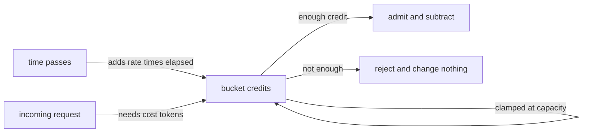
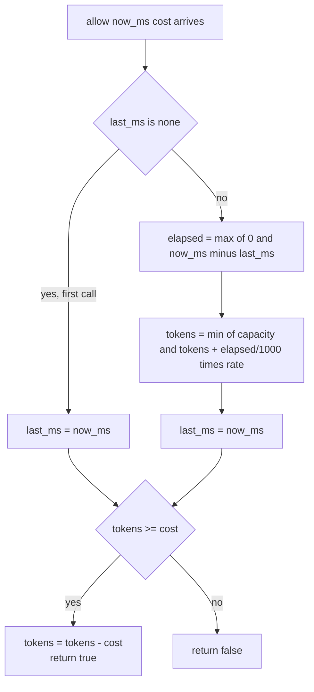
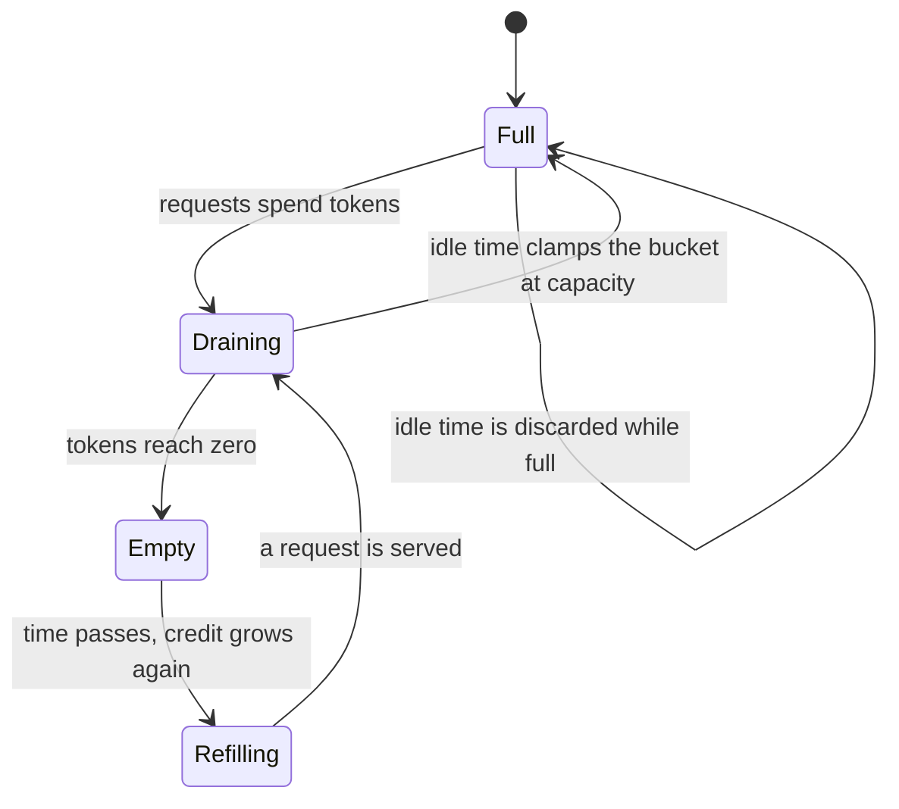
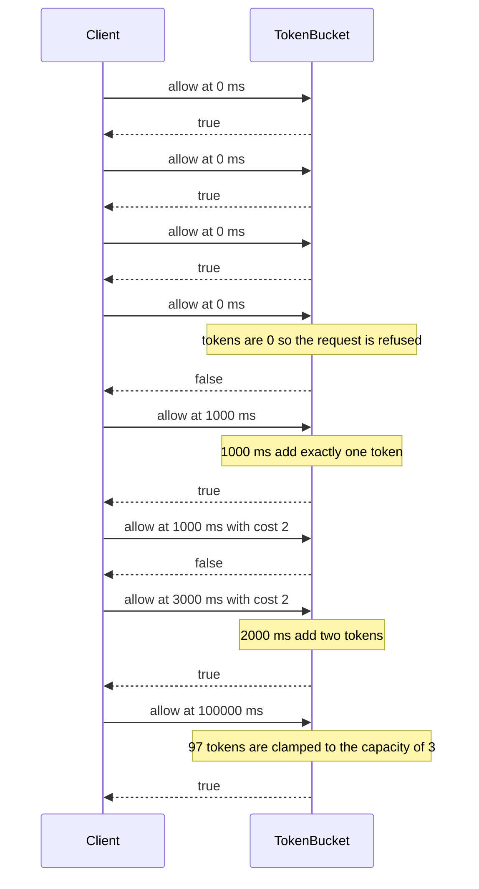

# 162 — Implement rate limiter (token bucket simple).

> **Tier:** Beginner · **CTCI chapter:** Ch 7 — Object-Oriented Design
> **Task spec:** [162-implement-rate-limiter-token-bucket-simple.md](../../../tasks/beginner/162-implement-rate-limiter-token-bucket-simple.md)
> **Solutions:** [Python](../../../solutions/python/beginner/162-implement-rate-limiter-token-bucket-simple/solution.py) ·
> [Java](../../../solutions/java/beginner/162-implement-rate-limiter-token-bucket-simple/Solution.java) ·
> [JavaScript](../../../solutions/javascript/beginner/162-implement-rate-limiter-token-bucket-simple/solution.js) ·
> [C#](../../../solutions/csharp/beginner/162-implement-rate-limiter-token-bucket-simple/Solution.cs)

## 1. Problem restatement

**Input:** a bucket with `capacity` tokens and a `refill_per_second` rate, plus a stream of
`allow(now_ms, cost)` questions. Time is supplied by the caller as milliseconds, so the object is
deterministic and testable without sleeping.

**Output:** `allow` returns `true` when the request can be served and consumes `cost` tokens;
it returns `false` and leaves the bucket untouched when there are not enough tokens.

Constraints the four files share:

- `capacity <= 0` or `refill_per_second <= 0` is refused at construction: `ValueError` in Python,
  `IllegalArgumentException` in Java, `ArgumentException` in C#, `Error` in JavaScript.
- The bucket starts **full** (`tokens = capacity`) and has no recorded timestamp (`last_ms` is
  null) until the first `allow` call.
- Refill is **lazy**: it is computed inside `allow` from the elapsed milliseconds since the last
  call. Nothing runs in the background.
- Python and JavaScript default `cost` to `1`; Java and C# make the caller pass it explicitly
  (`allow(nowMs, cost)`).

Contract table, taken from the assertions (`capacity = 3`, `refill_per_second = 1.0`):

| # | Call | Result | State afterwards | Why |
| --- | --- | --- | --- | --- |
| 1 | `allow(0)` three times | `true`, `true`, `true` | 0 tokens, clock 0 | the bucket starts full; each request spends one |
| 2 | `allow(0)` again | `false` | 0 tokens | a drained bucket refuses without any refill time |
| 3 | `allow(1000)` | `true` | 0 tokens | 1000 ms at 1 token/s grows exactly one token, which is then spent |
| 4 | `allow(1000, cost = 2)` | `false` | 0 tokens | no elapsed time, and 0 tokens is below a cost of 2 |
| 5 | `allow(3000, cost = 2)` | `true` | 0 tokens | 2000 ms more grow exactly two tokens |
| 6 | `allow(100000)` | `true` | 2 tokens | 97 seconds would grow 97 tokens, but the bucket clamps at capacity 3 |
| 7 | `allow(100000, cost = 4)` | `false` | 2 tokens | 2 tokens is below 4, and 4 exceeds the capacity anyway |

All four files assert rows 1–7, in that order.

## 2. Intuition

The obvious limiter is a **fixed window counter**: keep a counter per second and reject once the
counter passes the limit. It is trivial to write and it has a well-known flaw — the window
boundary is a cliff. A client can spend the whole allowance at 0.99 s and the next whole
allowance at 1.01 s, so 2× the intended rate passes in 20 ms. Widening or sliding the window
fixes the cliff but needs history, which costs memory proportional to the window.

The token bucket inverts the bookkeeping: instead of remembering requests, remember **credit**.
A bucket holds up to `capacity` tokens and gains `refill_per_second` tokens per second. Every
request must buy its cost from the bucket. Two things fall out of that single idea:

- The **sustained** rate is bounded by `refill_per_second` — you cannot spend faster than credit
  accrues over any long interval.
- A **burst** is allowed, but only up to `capacity` — the saved credit from an idle period.

The second insight is what makes the implementation small: credit can be computed *on demand*
from the elapsed time instead of by a ticker. That is exactly what the solutions do, and the
header comment of the Python file makes the point explicit — **"Time is injected (now_ms) so
behaviour is deterministic and testable."**



Clamping is not a detail — it is the third rule of the model. Without it, a bucket idle for a day
would bank a day of credit and admit one enormous burst instead of at most `capacity` requests.

## 3. Algorithm

1. At construction, validate that `capacity > 0` and `refill_per_second > 0`, set
   `tokens = capacity`, and set `last_ms = null`.
2. `refill(now)`:
   - If `last_ms` is null, this is the first call: set `last_ms = now` and return without adding
     anything (the bucket is already full).
   - Otherwise compute `elapsed = max(0, now - last_ms)` — the clamp keeps a non-monotonic clock
     from *removing* credit.
   - `tokens = min(capacity, tokens + elapsed / 1000 * rate)`, then set `last_ms = now`.
3. `allow(now, cost)`: call `refill(now)`. If `tokens >= cost`, subtract `cost` and return `true`;
   otherwise return `false` and change nothing else.

```text
procedure make_bucket(capacity, refill_per_second)
    if capacity <= 0 or refill_per_second <= 0 then
        raise error "capacity and refill rate must be positive"
    end
    return a bucket holding capacity, refill_per_second, tokens = capacity, last_ms = none
end

procedure refill(bucket, now_ms)
    if bucket.last_ms is none then
        bucket.last_ms ← now_ms
        return
    end
    elapsed ← maximum of 0 and now_ms - bucket.last_ms
    gained ← elapsed / 1000 * bucket.refill_per_second
    bucket.tokens ← smaller of bucket.capacity and bucket.tokens + gained
    bucket.last_ms ← now_ms
end

function allow(bucket, now_ms, cost)
    refill(bucket, now_ms)
    if bucket.tokens >= cost then
        bucket.tokens ← bucket.tokens - cost
        return true
    end
    return false
end
```

Note that `refill` always updates `last_ms`, even when the bucket was already full and the gain
was clamped away. The credit is not "owed" later; time that arrives while the bucket is full is
simply lost, which is what caps the burst.



The state machine of the bucket itself, which is the same object seen over time:



## 4. Worked example

Trace the assertion sequence with `capacity = 3` and `refill_per_second = 1.0`. Every row shows
the state **before** the call as `(tokens, last_ms)`, the elapsed time the refill sees, and the
state after.

| Step | Call | State before | Elapsed seen | Gain | Tokens after refill | Decision | State after |
| --- | --- | --- | --- | --- | --- | --- | --- |
| 1 | `allow(0)` | `(3, none)` | first call | — | 3 | 3 ≥ 1, spend 1 | `(2, 0)` |
| 2 | `allow(0)` | `(2, 0)` | 0 ms | 0 | 2 | spend 1 | `(1, 0)` |
| 3 | `allow(0)` | `(1, 0)` | 0 ms | 0 | 1 | spend 1 | `(0, 0)` |
| 4 | `allow(0)` | `(0, 0)` | 0 ms | 0 | 0 | 0 < 1, reject | `(0, 0)` |
| 5 | `allow(1000)` | `(0, 0)` | 1000 ms | 1.0 | 1 | spend 1 | `(0, 1000)` |
| 6 | `allow(1000, 2)` | `(0, 1000)` | 1000 ms | 0 | 0 | 0 < 2, reject | `(0, 1000)` |
| 7 | `allow(3000, 2)` | `(0, 1000)` | 2000 ms | 2.0 | 2 | spend 2 | `(0, 3000)` |
| 8 | `allow(100000)` | `(0, 3000)` | 97000 ms | 97.0 | clamped to 3 | spend 1 | `(2, 100000)` |
| 9 | `allow(100000, 4)` | `(2, 100000)` | 0 ms | 0 | 2 | 2 < 4, reject | `(2, 100000)` |

Step 4 is the plain rejection: no time passed, so no credit appeared, and the request is refused
without disturbing the bucket. Step 6 is the same rejection with a larger cost — note that `cost`
can legitimately exceed nothing at all, and a cost above `capacity` (row 7 of the contract table)
can *never* be admitted because `tokens` is clamped at `capacity`. Step 8 shows the clamp doing
the real work: 97 tokens of theoretical credit are cut down to the 3-token burst ceiling, and the
succeeding call leaves 2 behind.

The same trace with `last_ms` as the only mutable clock:



## 5. Complexity

| Measure | Bound | Why it holds |
| --- | --- | --- |
| `allow`, best | O(1) | the miss path is one refill computation and one comparison |
| `allow`, average | O(1) | constant arithmetic: a subtraction, a multiply, a divide, a min, a compare |
| `allow`, worst | O(1) | there is no loop anywhere; the cost of a request does not depend on `cost` |
| Space | O(1) | four scalars: `capacity`, `rate`, `tokens`, `last_ms` |
| Alternative (fixed window counter) | O(1) per request, O(windows) space per client | a counter per window plus the window index |
| Alternative (sliding log) | O(1) amortized per request, O(limit) space | keeps the timestamp of every request inside the window |

The interesting comparison is not time but **accuracy**. The fixed window can pass up to 2× the
limit across a boundary; the token bucket bounds any interval of length `t` by
`capacity + t · rate`, so a 1-second interval with the test parameters admits at most 4 requests —
3 from the burst plus 1 from the refill.

## 6. Pitfalls and edge cases

- **Non-positive parameters.** A rate of zero would make the bucket a one-shot quota; a negative
  rate would *drain* credit as time passes. Both are rejected at construction.
- **First call must not refill.** With `last_ms = null` the code records the timestamp and adds
  nothing. Computing `now - 0` on the first call would hand out a huge free burst.
- **Clock going backwards.** `elapsed = max(0, now - last_ms)` treats a regressed clock as no
  elapsed time. Removing the clamp would let a single bad timestamp subtract credit from the
  bucket.
- **Refill is lazy, but batches safely.** Because `tokens = min(capacity, tokens + elapsed · rate)`
  only depends on the *total* elapsed time, calling `allow` once after 97 seconds gives the same
  state as 97 calls one second apart. Nothing is lost by not having a timer thread.
- **Time spent while full is discarded.** `last_ms` is advanced even when the gain was clamped, so
  banked credit never exceeds `capacity`. That is the entire difference between a burst ceiling
  and an unlimited one.
- **A cost above capacity is permanently impossible.** Row 7 of the contract table shows it: with
  `capacity = 3`, `cost = 4` is refused even after a long idle because the bucket cannot hold four
  tokens.
- **Fractional tokens.** Tokens are floats/doubles, and the refill divides by `1000.0` before
  multiplying by the rate. With a rate like 0.5 the bucket carries a fractional part between
  calls; the comparison is `tokens >= cost`, so a partial token never admits a request.
- **No sleeping, no threads.** Every solution is single-threaded and returns immediately. Two
  threads calling `allow` concurrently could both pass the check and spend the same token; the
  files do not claim otherwise.
- **`allow` with a negative `cost`.** Nothing validates it, and a negative cost would *add* tokens,
  because the subtraction of a negative is an addition. The assertions never do it.

## 7. Variants and follow-ups

- **Leaky bucket / rate-limited queue.** Instead of dropping refused work, queue it and drain the
  queue at a fixed rate; the queue replaces the token count as the state.
  See [506-implement-rate-limited-queue-with-leaky-bucket-test-harness.md](../../../tasks/advanced/506-implement-rate-limited-queue-with-leaky-bucket-test-harness.md).
- **Per-client limits.** The object is O(1) in space, so a registry `client -> bucket` scales to
  many clients; evicting idle clients reuses the policy machinery of
  [160-implement-lru-cache-using-linked-list-hashmap.md](../../../tasks/beginner/160-implement-lru-cache-using-linked-list-hashmap.md).
- **Same shape, different resource.** Any "budget that regenerates" fits this pattern: connection
  pools, retry budgets, or the O(1) frontier bookkeeping of
  [173-implement-queue-that-supports-getmin-in-o-1.md](../../../tasks/beginner/173-implement-queue-that-supports-getmin-in-o-1.md).

## 8. Check yourself

**Q1.** Why does the bucket start full, and what would break if it started empty?

<details><summary>Show answer</summary>

`tokens = capacity` at construction models a fresh client that has been idle forever, so the first
burst is allowed up to `capacity`. Starting empty would make the very first `allow(0)` return
`false`, contradicting rows 1–3 of the contract table.

</details>

**Q2.** A request arrives with `cost = 2` but only 1 token is available. Does the bucket keep the
1 token for later?

<details><summary>Show answer</summary>

Yes. The failure path returns `false` without touching `tokens` (and the refill already ran), so the
partial credit stays in the bucket. Step 6 of the trace shows the token count unchanged at 0/0
because no time passed there; with fractional tokens the same logic keeps the fraction.

</details>

**Q3.** Where exactly is the burst bounded, and by which line of code?

<details><summary>Show answer</summary>

By the `min(capacity, ...)` clamp inside `refill`. It caps `tokens` at `capacity` on every call, so
no amount of idle time can widen a burst beyond the capacity, as step 8 of the trace shows
(97 tokens of theoretical credit cut down to 3).

</details>

**Q4.** Why is `last_ms` updated even when the bucket is full?

<details><summary>Show answer</summary>

So that credit is consumed by time, not banked. If `last_ms` were only advanced when the gain was
actually applied, the elapsed time would be counted again on the next call and a long idle period
could be amplified into repeated bursts.

</details>

**Q5.** The tests never sleep. What makes that possible, and what does it forbid?

<details><summary>Show answer</summary>

`now_ms` is a parameter of `allow`, so the tests can jump the clock forward (0, 1000, 3000,
100000) without real time passing. It forbids reading the wall clock inside the bucket — the
object must never call a timer itself, which is why the clock is only ever `last_ms`.

</details>
