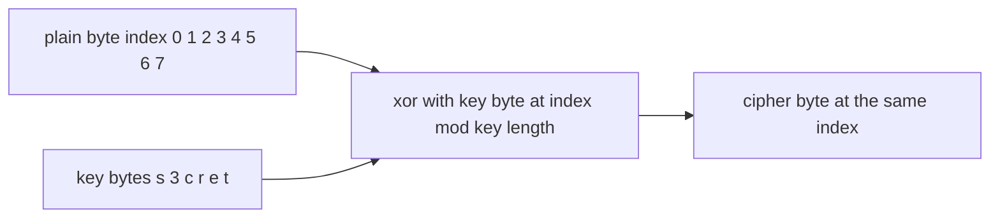
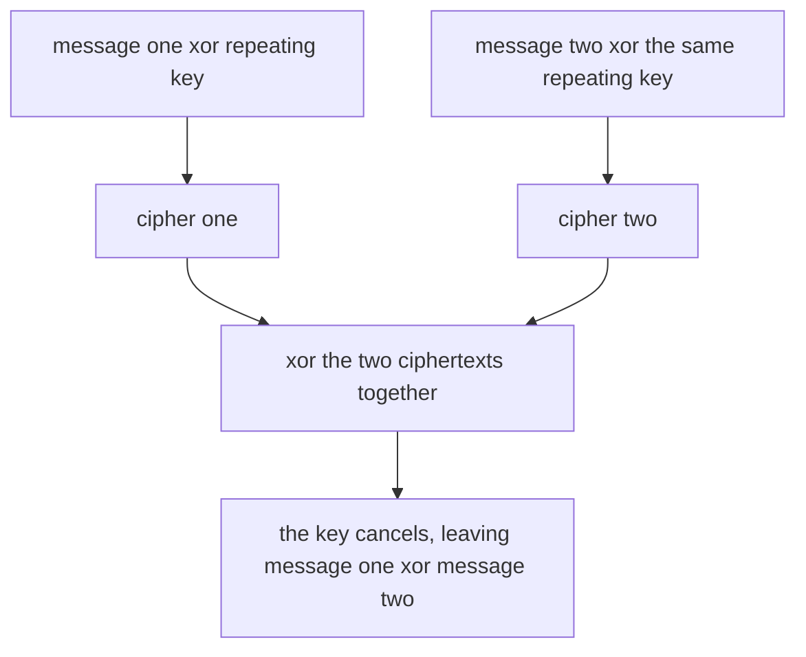
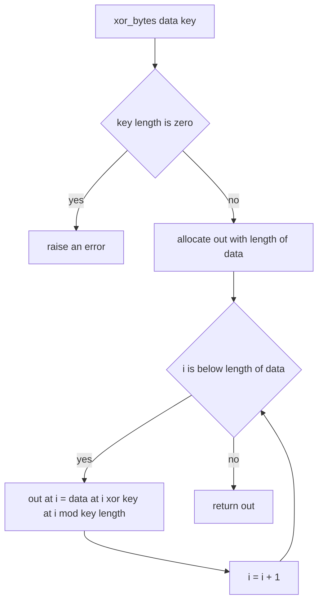
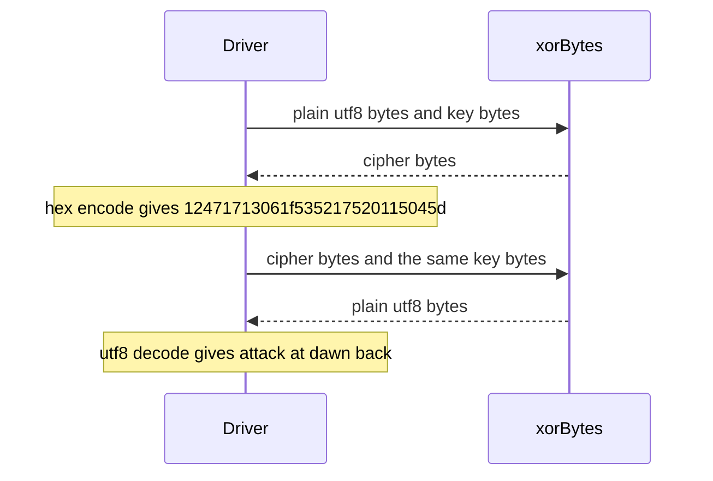

# 163 — Implement basic encryption/decryption with XOR.

> **Tier:** Beginner · **CTCI chapter:** Ch 5 — Bit Manipulation
> **Task spec:** [163-implement-basic-encryption-decryption-with-xor.md](../../../tasks/beginner/163-implement-basic-encryption-decryption-with-xor.md)
> **Solutions:** [Python](../../../solutions/python/beginner/163-implement-basic-encryption-decryption-with-xor/solution.py) ·
> [Java](../../../solutions/java/beginner/163-implement-basic-encryption-decryption-with-xor/Solution.java) ·
> [JavaScript](../../../solutions/javascript/beginner/163-implement-basic-encryption-decryption-with-xor/solution.js) ·
> [C#](../../../solutions/csharp/beginner/163-implement-basic-encryption-decryption-with-xor/Solution.cs)

## 1. Problem restatement

**Input:** a byte buffer (or a text string, which is encoded to bytes first) and a non-empty key.
The key is a byte sequence that is *repeated* to cover the data, byte `i` being XOR-ed with
`key[i mod key_length]`.

**Output:**

- `xor_bytes(data, key)` returns a new buffer of the same length as `data`; `data` is not modified.
- `xor_text(text, key)` encodes `text` as UTF-8, XORs it, and returns the ciphertext as a
  **lowercase hex string**.
- `decrypt_text(hex_cipher, key)` parses the hex back to bytes, XORs them with the same key, and
  decodes the result as UTF-8.

Constraints the four files share:

- An empty key is refused: `ValueError` in Python, `IllegalArgumentException` in Java,
  `ArgumentException` in C#, `Error` in JavaScript. Without a key byte there is nothing to XOR.
- The ciphertext has exactly the same length in **bytes** as the plaintext; the hex form is
  therefore twice as long.
- All four files print the educational warning in the header comment — the Python one says it
  outright: *"EDUCATIONAL ONLY - repeating-key XOR offers no real security."*

Contract table, from the assertions:

| Call | Result | Why |
| --- | --- | --- |
| `xor_text("attack at dawn", "s3cret")` | `12471713061f535217520115045d` | 14 plain bytes, 28 lowercase hex characters |
| `decrypt_text("12471713061f535217520115045d", "s3cret")` | `"attack at dawn"` | the same XOR run in the other direction |
| `decrypt_text(cipher, "other")` | `}3` + DEL + `vtp':r nal8` | a wrong key yields printable junk, never the message |
| `xor_text("", key)` | `""` | no bytes to transform — an empty hex string |
| `decrypt_text("", key)` | `""` | round trip of the empty case |
| `xor_bytes(xor_bytes(b"\x00\xff\x7f", b"k"), b"k")` | `b"\x00\xff\x7f"` | XOR is self-inverse on raw bytes as well |
| `xor_text("abc", "x")` twice | `191a1b` both times | the scheme is deterministic: no nonce, no salt |

The C# file compares the double application of `XorBytes` through
`Convert.ToBase64String` so that byte-array equality is easy to check; Java uses
`Arrays.equals`, Python compares bytes values directly, and JavaScript works on `Buffer`s.

## 2. Intuition

The naive idea is a Caesar-style shift: add a constant to every byte. It is easy to write and
just as easy to break — an attacker tries the 256 possible offsets. Using a *different* constant
per position is the fix, and the cheapest way to derive that per-position constant is to take it
from the key: byte `i` uses `key[i mod key_length]`, so the key wraps around the whole message.

That already looks like encryption, but the reason it works so well as a *toy* is a bit
property of XOR: `x ^ k ^ k = x` for every byte. Encryption and decryption are therefore the
**same** operation with the same key. There is no inverse table, no separate decrypt routine,
and no state — which is why all four files can implement `decrypt_text` as "parse hex, call
`xor_bytes` again, decode UTF-8".

Two further properties explain the shape of the code:

- `x ^ 0 = x`, so a zero byte in the keystream leaves the plaintext byte visible. This is the
  whole ballgame for breaking the cipher.
- The keystream repeats with period `key_length`. When the key is short, the same key byte
  protects every `key_length`-th message byte, and two messages sent under one key cancel each
  other out when their ciphertexts are XOR-ed.



The cancellation that makes the scheme unsafe, drawn out:



That last diagram is the classic *two-time pad* failure, and it is why the files insist the
technique is educational only.

## 3. Algorithm

1. Reject an empty key (length 0) before doing any work.
2. Convert the inputs to bytes: UTF-8 for the text, UTF-8 for the key. In JavaScript the buffers
   come from `Buffer.from`, in C# from `Encoding.UTF8.GetBytes`, in Java from
   `getBytes(StandardCharsets.UTF_8)`, and in Python from `str.encode`.
3. Allocate an output buffer of exactly `len(data)` bytes.
4. For each index `i`, write `data[i] ^ key[i mod len(key)]` into the output buffer.
5. For encryption, hex-encode the buffer (two lowercase characters per byte) and return the
   string. For decryption, hex-decode first and UTF-8-decode the XOR result instead.

```text
procedure xor_bytes(data, key)
    if length(key) equals 0 then
        raise error "key must not be empty"
    end
    out ← new byte buffer of the same length as data
    for i ← 0 to length(data) - 1 do
        out[i] ← data[i] xor key[i mod length(key)]
    end
    return out
end

function encrypt_text(text, key)
    key_bytes ← utf8 bytes of key
    cipher ← xor_bytes(utf8 bytes of text, key_bytes)
    return lowercase hex string of cipher
end

function decrypt_text(hex_cipher, key)
    key_bytes ← utf8 bytes of key
    cipher ← bytes decoded from hex_cipher
    plain ← xor_bytes(cipher, key_bytes)
    return text decoded from plain as utf8
end
```

The step-4 loop is the only loop in the program; everything else is a conversion:



`decrypt_text` inverts each conversion in reverse order, and the XOR itself is identical:



## 4. Worked example

Encrypt `"attack at dawn"` under the key `"s3cret"`. Both are ASCII, so one character is one byte
and the keystream restarts every six positions.

| `i` | plain | plain hex | key byte | key hex | `i mod 6` | cipher hex |
| --- | --- | --- | --- | --- | --- | --- |
| 0 | `a` | `61` | `s` | `73` | 0 | `12` |
| 1 | `t` | `74` | `3` | `33` | 1 | `47` |
| 2 | `t` | `74` | `c` | `63` | 2 | `17` |
| 3 | `a` | `61` | `r` | `72` | 3 | `13` |
| 4 | `c` | `63` | `e` | `65` | 4 | `06` |
| 5 | `k` | `6b` | `t` | `74` | 5 | `1f` |
| 6 | ` ` | `20` | `s` | `73` | 0 | `53` |
| 7 | `a` | `61` | `3` | `33` | 1 | `52` |
| 8 | `t` | `74` | `c` | `63` | 2 | `17` |
| 9 | ` ` | `20` | `r` | `72` | 3 | `52` |
| 10 | `d` | `64` | `e` | `65` | 4 | `01` |
| 11 | `a` | `61` | `t` | `74` | 5 | `15` |
| 12 | `w` | `77` | `s` | `73` | 0 | `04` |
| 13 | `n` | `6e` | `3` | `33` | 1 | `5d` |

Concatenating the last column gives `12471713061f535217520115045d`, the value the assertions
expect. Rows 0 and 6 are the interesting ones: both use key byte `73`, so both encrypt with the
same keystream byte, which is visible as the recurring `5x`/`1x` pattern — and is exactly the
weakness that makes crib-dragging possible.

Decrypting is the same table read backwards: `12 ^ 73 = 61` (`a`), `47 ^ 33 = 74` (`t`), and so
on, which is why the round trip is asserted rather than re-implemented.

Apply the wrong key `"other"` (five bytes) to the same ciphertext and the key no longer lines up:

| `i` | cipher hex | key byte | key hex | plain hex | character |
| --- | --- | --- | --- | --- | --- |
| 0 | `12` | `o` | `6f` | `7d` | `}` |
| 1 | `47` | `t` | `74` | `33` | `3` |
| 2 | `17` | `h` | `68` | `7f` | DEL |
| 3 | `13` | `e` | `65` | `76` | `v` |
| 4 | `06` | `r` | `72` | `74` | `t` |
| 5 | `1f` | `o` | `6f` | `70` | `p` |

The result `}3` + DEL + `vtp':r nal8` is printable garbage — not the message, which is all the
assertion `decrypt_text(cipher, "other") != message` claims. Because every byte here happens to
stay in the ASCII range, the UTF-8 decode succeeds; a different wrong key can produce byte
sequences that are not valid UTF-8 at all.

## 5. Complexity

Let `n` be the number of bytes of the input (the UTF-8 length of the text) and `m` the key length.

| Measure | Bound | Why it holds |
| --- | --- | --- |
| Time, best/average/worst | O(n) | one XOR, one modulo and one store per byte; nothing depends on the data values |
| Space, extra | O(n) | the solutions allocate a fresh output buffer instead of mutating the input |
| Space, keystream | O(1) | the keystream is never materialised — it is recomputed as `key[i mod m]` |
| Space, hex output | O(n) | two characters per byte, so the encoded string is `2n` characters |
| Key-length sensitivity | none for time | `m` changes only the modulo operand, not the number of steps |
| Alternative: one-time pad with a fresh key per message | O(n) time, O(n) key storage | unbreakable *only* if the key is as long as the message, uniformly random, and never reused |

The asymptotic cost is not the point of this task — the interesting line in the complexity table
is the alternative. This implementation is `O(n)` in the same way a real stream cipher is; what it
lacks is a keystream that does not repeat.

## 6. Pitfalls and edge cases

- **Empty key.** Every file checks `key_length == 0` before the loop. Without the check,
  `i mod 0` is a division by zero in Java, C# and JavaScript, and a `ZeroDivisionError` in
  Python — and even if it were somehow skipped, the ciphertext would equal the plaintext.
- **Bytes, not characters.** The key is encoded to UTF-8 too, so a key such as `"é"` contributes
  **two** bytes to the keystream. The period that matters for the repeating-key weakness is the
  number of key *bytes*, not the number of key characters.
- **Ciphertext length is measured in bytes.** `"aé"` is three bytes in UTF-8, so its ciphertext is
  three bytes and six hex characters, not four.
- **Reuse is fatal.** Two messages under one key leak `message_one xor message_two`; if one of them
  is guessable, the other follows. The Python assertions encode the related fact that the scheme
  is deterministic: a fixed key and text always give the same hex.
- **XOR is malleable.** Flipping bit `b` of a ciphertext byte flips bit `b` of the plaintext byte,
  so an attacker can edit the message without knowing the key. Nothing here authenticates.
- **Invalid or odd-length hex.** `bytes.fromhex` in Python, `Integer.parseInt(..., 16)` on
  two-character slices in Java, `Convert.ToByte(..., 16)` in C# and `Buffer.from(hex, "hex")` in
  JavaScript all reject malformed input differently — Python raises `ValueError`, the Java and C#
  helpers throw on a non-hex character, and JavaScript silently stops at the first invalid pair.
  None of the solutions adds its own validation.
- **Decoding the wrong key.** With a wrong key the plaintext bytes are noise, and noise is often
  not valid UTF-8. Python's `decode("utf-8")` raises `UnicodeDecodeError`; JavaScript's
  `Buffer.toString("utf8")` substitutes U+FFFD, and Java/C# substitute the replacement character.
  The tested wrong key `"other"` happens to stay in ASCII, so no assertion trips on this.
- **Case of the hex output.** Python emits lowercase, Java and C# use the `%02x`/`x2` format
  specifiers (lowercase), and JavaScript's `toString("hex")` is lowercase. The assertions in
  Python check the alphabet explicitly, and the Java file matches `[0-9a-f]+`.
- **No key stretching, no IV, no nonce.** Any two runs with the same key and text produce the same
  ciphertext, so an observer learns whether the same message was sent twice.

## 7. Variants and follow-ups

- **One-time pad.** Keep the same XOR core but draw the keystream from a random source that is at
  least as long as the message and never reused; sampling that stream well is the subject of
  [165-reservoir-sampling-for-k-items-from-stream.md](../../../tasks/beginner/165-reservoir-sampling-for-k-items-from-stream.md).
- **XOR as a swap primitive.** The same self-inverse property lets you swap two variables without
  a temporary: [014-swap-two-variables-without-a-temporary-variable.md](../../../tasks/beginner/014-swap-two-variables-without-a-temporary-variable.md).
- **Other byte-level transforms.** The checksum in
  [168-implement-basic-checksum-sum-bytes.md](../../../tasks/beginner/168-implement-basic-checksum-sum-bytes.md)
  walks the same bytes with `+` instead of `^`, and the expert task
  [758-implement-secure-multiparty-computation-basic-xor-sharing-demo.md](../../../tasks/expert/758-implement-secure-multiparty-computation-basic-xor-sharing-demo.md)
  uses XOR for secret sharing rather than secrecy.

## 8. Check yourself

**Q1.** Why can a single function serve as both `encrypt` and `decrypt`?

<details><summary>Show answer</summary>

Because `x ^ k ^ k = x`: applying the same keystream twice returns the original byte. The
direction of the operation only matters for the conversions around it — hex-encode on the way out,
hex-decode on the way in. The Java file's `decryptText` is literally hex-decode, `xorBytes`,
UTF-8-decode.

</details>

**Q2.** The key is `"s3cret"` (six bytes). Which plaintext positions share a key byte?

<details><summary>Show answer</summary>

Positions `i` and `i + 6`, because the keystream index is `i mod 6`. In the worked trace, positions
0 and 6 both use `73`, and positions 1 and 7 both use `33`. The same alignment is what lets an
attacker XOR two ciphertexts and cancel the key.

</details>

**Q3.** What is the ciphertext length in hex for a 14-byte plaintext, and why?

<details><summary>Show answer</summary>

28 characters: hex uses two characters per byte and XOR never changes the length. The assertions
check for `12471713061f535217520115045d`, which is exactly 28 characters.

</details>

**Q4.** Does a wrong key always raise an error during decryption?

<details><summary>Show answer</summary>

No. The XOR always succeeds; what can fail is the *decode* step, because the recovered bytes may
not be valid UTF-8. In the tested case (`"other"` against the `"s3cret"` ciphertext) the junk
`}3` + DEL + `vtp':r nal8` stays inside ASCII, so Python decodes it happily and the assertion is
simply `!= message`.

</details>

**Q5.** Name two reasons this scheme would be rejected in a security review.

<details><summary>Show answer</summary>

The keystream repeats with the key length, so key reuse leaks `message_one xor message_two` and a
short key invites frequency analysis; and XOR provides no integrity, so anybody can flip chosen
plaintext bits by flipping the matching ciphertext bits. The header comment of every solution says
the same thing in one line: educational only.

</details>
