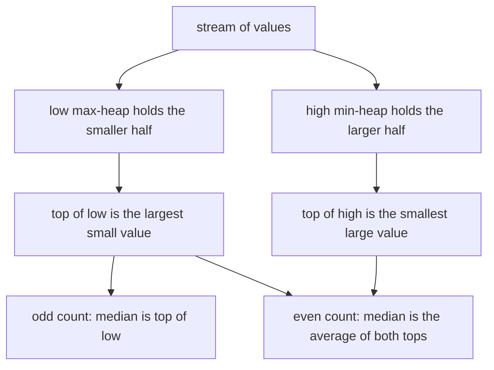
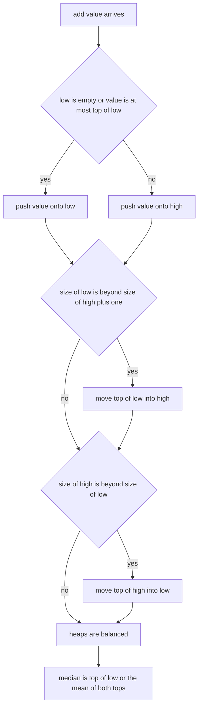
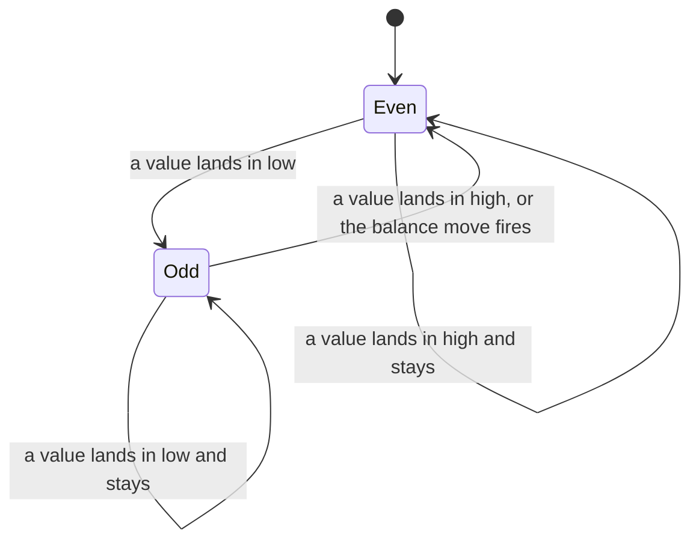
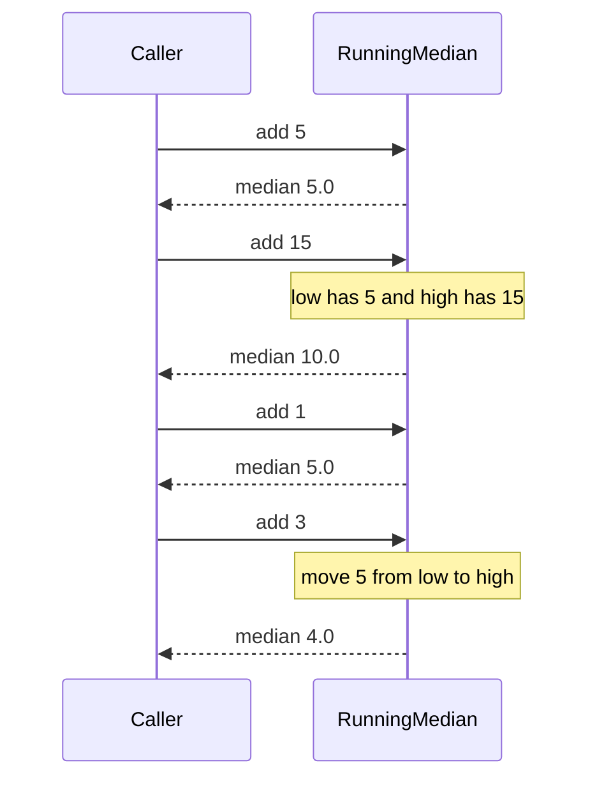

# 164 — Compute running median using two heaps.

> **Tier:** Beginner · **CTCI chapter:** Ch 4 — Trees and Graphs
> **Task spec:** [164-compute-running-median-using-two-heaps.md](../../../tasks/beginner/164-compute-running-median-using-two-heaps.md)
> **Solutions:** [Python](../../../solutions/python/beginner/164-compute-running-median-using-two-heaps/solution.py) ·
> [Java](../../../solutions/java/beginner/164-compute-running-median-using-two-heaps/Solution.java) ·
> [JavaScript](../../../solutions/javascript/beginner/164-compute-running-median-using-two-heaps/solution.js) ·
> [C#](../../../solutions/csharp/beginner/164-compute-running-median-using-two-heaps/Solution.cs)

## 1. Problem restatement

**Input:** a stream of numbers, delivered one at a time. After each arrival, report the median of
everything seen so far.

**Output:** a sequence of medians, one per input element. For an odd count the median is the single
middle value; for an even count it is the average of the two middle values, so it can be a
half-integer.

Constraints the four files share:

- Two heaps are used. `low` is a **max-heap** holding the smaller half, `high` a **min-heap**
  holding the larger half.
- The invariants are declared in the Python header comment: `len(low) == len(high)` or
  `len(low) == len(high) + 1`, and `max(low) <= min(high)`. The same comment states the cost:
  *"Each add is O(log n); median is O(1)."*
- A value that equals the current top of `low` goes into `low` (the comparison is `<=`), so ties
  never fall through to `high` by accident.
- `median()` on an empty structure is an error: `ValueError` in Python, `IllegalStateException` in
  Java, `InvalidOperationException` in C#, `Error` in JavaScript. No assertion covers that path —
  an empty stream simply produces no output.

Contract table, from the assertions:

| Stream | Running medians | Why |
| --- | --- | --- |
| `[1, 2, 3]` | `[1.0, 1.5, 2.0]` | 1 alone, then the even pair `(1, 2)`, then the middle `2` |
| `[5, 15, 1, 3]` | `[5.0, 10.0, 5.0, 4.0]` | the balancing move at the last element reorders the halves |
| `[-1, -2, -3]` | `[-1.0, -1.5, -2.0]` | negative values must sort the same way |
| `[7]` | `[7.0]` | a single element is its own median (asserted by the Python file) |
| `[2, 2, 2]` | `[2.0, 2.0, 2.0]` | duplicates do not break the invariant |

Python asserts all five rows; Java, JavaScript and C# assert rows 1–3 and the duplicate row. C#
compares with a tolerance of `1e-9` (`Math.Abs(got[i] - expected[i]) < 1e-9`), the other three use
exact equality.

## 2. Intuition

The naive approach keeps every value in one array, appends the new one, sorts, and reads the
middle. The sort is `O(n log n)` per element, so a stream of `n` values costs `O(n² log n)`. A
sorted array with binary search for the insertion point shaves the search to `O(log n)` but the
insertion itself still shifts `O(n)` elements.

The key insight is that a median never needs the full order — only the **middle one or two**
values. Split the data into "the smaller half" and "the larger half" and the median is one of two
tops. The only requirement is that the halves stay balanced in size and separated in value.

That is exactly what a heap gives for free:

- A **max-heap** `low` hands you the largest of the small values in `O(1)`.
- A **min-heap** `high` hands you the smallest of the large values in `O(1)`.
- Pushing and popping is `O(log n)`, which is the only place work happens.

So each new value is placed on one side in `O(log n)`, at most one element is moved across to
restore balance, and the median is a comparison of two tops.



Two details make this work in practice, and both appear in the code:

- **The sizes are the tie-breaker.** `low` may hold at most one element more than `high`, so the
  median always sits at the top of `low` when the count is odd.
- **The separation is one-sided.** The code only ever checks the candidate against `low`; a value
  that fails that test goes to `high`, and the rebalancing then guarantees `max(low) <= min(high)`.

## 3. Algorithm

1. Create two empty heaps: `low` as a max-heap, `high` as a min-heap.
2. `add(value)`:
   - If `low` is empty or `value <= top(low)`, push `value` onto `low`; otherwise push it onto `high`.
   - If `low` holds more than one element than `high`, move `top(low)` across to `high`.
   - Otherwise, if `high` is bigger than `low`, move `top(high)` across to `low`.
3. `median()`:
   - Error out if `low` is empty.
   - If the heaps are the same size, return `(top(low) + top(high)) / 2`.
   - Otherwise return `top(low)`, which is the middle element of the odd count.
4. `running_medians(stream)` calls `add` then `median` once per element and collects the results.

```text
procedure make_median_tracker()
    low ← empty max-heap
    high ← empty min-heap
    return a tracker holding low and high
end

procedure add(tracker, value)
    if tracker.low is empty or value <= top(tracker.low) then
        push value onto tracker.low
    else
        push value onto tracker.high
    end
    if size(tracker.low) > size(tracker.high) + 1 then
        push top(tracker.low) onto tracker.high
    else if size(tracker.high) > size(tracker.low) then
        push top(tracker.high) onto tracker.low
    end
end

function median(tracker)
    if tracker.low is empty then
        raise error "no values yet"
    end
    if size(tracker.low) equals size(tracker.high) then
        return (top(tracker.low) + top(tracker.high)) / 2
    end
    return top(tracker.low)
end

function running_medians(stream)
    tracker ← make_median_tracker()
    out ← empty list
    for each value in stream do
        add(tracker, value)
        append median(tracker) to out
    end
    return out
end
```

The two heaps are the only state; the flow below is the whole update path:



The three shapes the tracker can be in after a rebalance:



## 4. Worked example

Trace `[5, 15, 1, 3]`. The table shows the two heaps as `{contents}` with their top marked, the
rebalancing move if any, and the median reported after the insertion.

| Step | `value` | Test against `top(low)` | Placement | Rebalance | `low` | `high` | Median |
| --- | --- | --- | --- | --- | --- | --- | --- |
| 1 | `5` | `low` is empty | push `low` | none | `{5}` | `{}` | `5.0` |
| 2 | `15` | `15 > 5` | push `high` | none | `{5}` | `{15}` | `10.0` |
| 3 | `1` | `1 <= 5` | push `low` | none | `{5, 1}` | `{15}` | `5.0` |
| 4 | `3` | `3 <= 5` | push `low` | `low` got too big, move `5` to `high` | `{3, 1}` | `{5, 15}` | `4.0` |

Step 3 leaves `low` with two elements against `high`'s one — allowed, because `low` may lead by
one and the odd count makes its top the median. Step 4 pushes `low` to three and `high` to one,
which trips the first rebalance branch: the largest small value `5` moves to `high`, leaving
`{3, 1}` and `{5, 15}`. The count is now even, so the median is `(3 + 5) / 2 = 4.0`.

The second assertion, `[1, 2, 3]`, exercises the other branch:

| Step | `value` | Placement | Rebalance | `low` | `high` | Median |
| --- | --- | --- | --- | --- | --- | --- |
| 1 | `1` | push `low` | none | `{1}` | `{}` | `1.0` |
| 2 | `2` | `2 > 1`, push `high` | none | `{1}` | `{2}` | `1.5` |
| 3 | `3` | `3 > 1`, push `high` | `high` is bigger, move `2` to `low` | `{1, 2}` | `{3}` | `2.0` |

Here `low` never leads; the second branch (`size(high) > size(low)`) is what keeps the invariant,
and the median flips back to a single value. The duplicates stream `[2, 2, 2]` shows the `<=`
comparison at work: each incoming `2` equals `top(low)`, so all three go to `low` and the
balancing move pumps elements through `high` while every median stays `2.0`.

The same trace for `[5, 15, 1, 3]` as a message exchange between the tracker and its caller:



## 5. Complexity

Let `n` be the number of values added so far.

| Measure | Bound | Why it holds |
| --- | --- | --- |
| `add`, best | O(1) | a single sift-up to the root when the value belongs at that path's top |
| `add`, average | O(log n) | a push and at most one cross-heap move, each `O(log n)` |
| `add`, worst | O(log n) | heap height is `log n`; the number of moves is bounded by one, not by `n` |
| `median`, all cases | O(1) | reads one or two heap tops, no traversal |
| Space | O(n) | every value is stored exactly once, `low` and `high` together hold the stream |
| Alternative: sort on every arrival | O(n log n) per element, O(n² log n) total | re-sorting throws away the work done for the previous median |
| Alternative: keep a sorted array | O(n) per insertion | binary search finds the position in `O(log n)`, but the insert shifts the tail |
| Alternative: balanced BST with subtree sizes | O(log n) per add, O(log n) per order-statistic query | more code for the same asymptotic result as two heaps |

The two heaps win because the *only* query is "the middle one or two values", and a heap answers
that in `O(1)` after each `O(log n)` insert. A structure that can answer arbitrary order statistics
(such as
[432-implement-data-structure-for-dynamic-median-order-statistics-tre.md](../../../tasks/advanced/432-implement-data-structure-for-dynamic-median-order-statistics-tre.md))
pays more per operation for a much richer query.

## 6. Pitfalls and edge cases

- **Empty tracker.** `median()` before any `add` raises rather than returning a sentinel. The
  drivers never do it: they call `add` first, once per stream element.
- **Odd versus even counts.** The size comparison decides between one top and the average of two.
  Returning `top(low)` unconditionally would give `5.0` instead of `4.0` at the end of the
  `[5, 15, 1, 3]` trace.
- **Which heap gets the ties.** The test is `value <= top(low)`, so equal values prefer `low`. With
  `[2, 2, 2]` this keeps every median at `2.0`; using a strict `<` would push ties into `high` and
  still be correct here, but the `<=` form is what the four files implement.
- **One rebalance, not a loop.** The `if`/`else if` moves at most one element per `add`. It is
  enough because the previous state was already balanced and a single insertion can unbalance a
  heap by at most one.
- **Half-integers are exact.** The average is computed in floating point (`/ 2.0`), which is exact
  for the sums in these traces; C#'s `1e-9` tolerance exists because floating-point comparisons in
  general should not be equality tests.
- **Duplicates and negatives.** Neither breaks the invariant; both are asserted
  (`[2, 2, 2]` and `[-1, -2, -3]`), and the negative case confirms that the comparison logic is
  sign-agnostic.
- **Max-heap plumbing differs per language.** Python pushes `-value` onto `heapq` and negates the
  top again; Java uses `PriorityQueue<>(Comparator.reverseOrder())`; C# enqueues with a negated
  *priority* on `PriorityQueue<int, int>`; JavaScript has no heap in its standard library, so the
  solution ships its own `Heap` class with a comparator. All four must negate the same places.
- **`inf`/`NaN` inputs.** Nothing filters them. A `NaN` would poison the comparisons because every
  comparison against `NaN` is false, so it would land in `high` and then break the ordering
  invariant silently. The assertions keep inputs finite.

## 7. Variants and follow-ups

- **Class instead of function.** Task
  [179-implement-simple-heap-based-median-of-stream-class.md](../../../tasks/beginner/179-implement-simple-heap-based-median-of-stream-class.md)
  packages the same tracker as an object, which is the shape a streaming service needs.
- **Deleting from the middle.** With an extra multiset (or lazy deletion) the structure can also
  answer "median after removing an old value", the subject of
  [334-implement-rolling-median-with-delete-operation-multiset-or-two-h.md](../../../tasks/intermediate/334-implement-rolling-median-with-delete-operation-multiset-or-two-h.md).
- **Two sorted arrays instead of a stream.** If both inputs are already sorted and you must find
  the median in `O(log(min(m, n)))`, the merge-based thinking of
  [261-median-of-two-sorted-arrays-log-min-n-m-algorithm.md](../../../tasks/intermediate/261-median-of-two-sorted-arrays-log-min-n-m-algorithm.md)
  applies.
- **Heaps on their own.** If the `PriorityQueue`/`heapq` plumbing feels like magic, build it by
  hand first: [066-implement-min-heap-push-pop.md](../../../tasks/beginner/066-implement-min-heap-push-pop.md)
  and [067-implement-max-heap-push-pop.md](../../../tasks/beginner/067-implement-max-heap-push-pop.md).

## 8. Check yourself

**Q1.** Why must `low` be a max-heap and `high` a min-heap, not the other way round?

<details><summary>Show answer</summary>

Because the two middle values are the *largest* of the smaller half and the *smallest* of the larger
half. A max-heap exposes its maximum at the root, which is precisely `max(low)`; a min-heap exposes
`min(high)`. Reversing the orders would force a scan of the whole heap for the same value.

</details>

**Q2.** What is the largest possible difference in size between the two heaps, and when?

<details><summary>Show answer</summary>

One element, with `low` holding the extra one, and only when the total count is odd. The rebalance
step forces `size(low) <= size(high) + 1`, and the second branch forces `size(high) <= size(low)`.

</details>

**Q3.** In the `[5, 15, 1, 3]` trace, why does the median drop from `5.0` to `4.0` on the last
element?

<details><summary>Show answer</summary>

`3` is pushed onto `low`, making it three elements against `high`'s one, so `5` is moved across.
The even count then makes the median the average of `top(low) = 3` and `top(high) = 5`, i.e. `4.0`.
Without the cross-heap move the invariant would be broken and the tops would no longer be the two
middle values.

</details>

**Q4.** How many heap operations does one `add` perform in the worst case?

<details><summary>Show answer</summary>

Two: one push and at most one move (a pop from one heap plus a push into the other). Each of those
is `O(log n)`, which is why the total is `O(log n)` — the rebalance is an `if`/`else if`, never a
loop.

</details>

**Q5.** Would the algorithm still be correct if `add` pushed the value into `high` whenever
`low` was non-empty?

<details><summary>Show answer</summary>

The balance moves alone would keep the sizes legal, but the *ordering* invariant
(`max(low) <= min(high)`) could break: a value smaller than `max(low)` would sit in `high` and the
two tops would no longer bracket the middle. The comparison against `top(low)` is what keeps the
halves separated.

</details>
