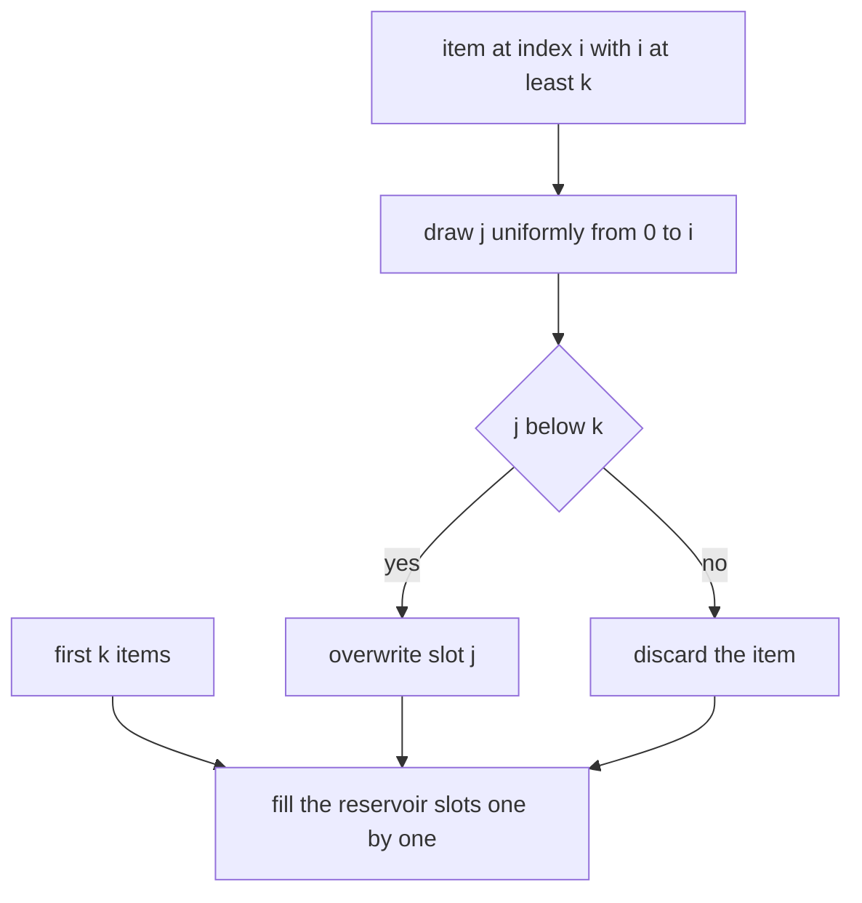
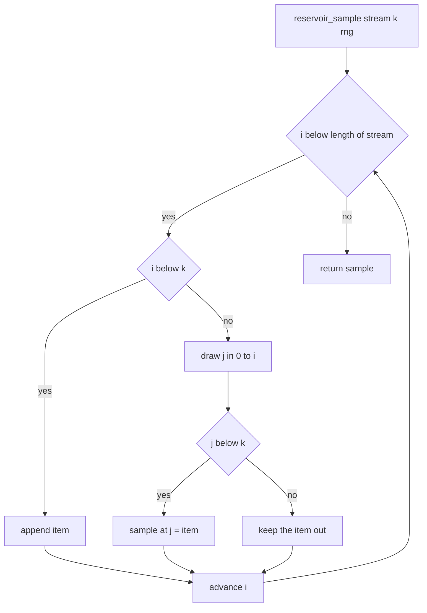
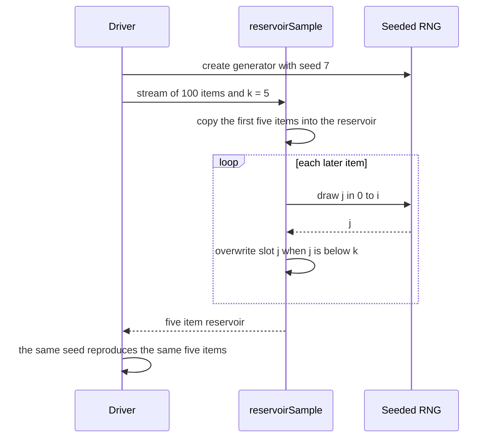

# 165 — Reservoir sampling for k items from stream.

> **Tier:** Beginner · **CTCI chapter:** Ch 6 — Math and Logic Puzzles
> **Task spec:** [165-reservoir-sampling-for-k-items-from-stream.md](../../../tasks/beginner/165-reservoir-sampling-for-k-items-from-stream.md)
> **Solutions:** [Python](../../../solutions/python/beginner/165-reservoir-sampling-for-k-items-from-stream/solution.py) ·
> [Java](../../../solutions/java/beginner/165-reservoir-sampling-for-k-items-from-stream/Solution.java) ·
> [JavaScript](../../../solutions/javascript/beginner/165-reservoir-sampling-for-k-items-from-stream/solution.js) ·
> [C#](../../../solutions/csharp/beginner/165-reservoir-sampling-for-k-items-from-stream/Solution.cs)

## 1. Problem restatement

**Input:** a stream of `n` items that can be read **once** and whose length may be unknown when the
first item arrives, plus an integer `k`.

**Output:** a uniformly random subset of `k` items, using `O(k)` memory. "Uniform" means every item
of the stream ends up in the sample with probability `k / n`, whatever `n` turns out to be.

The four files all implement **Algorithm R** and state the rule in their header comment:

> *"Algorithm R: keep the first k items; for the i-th item (i >= k), replace a random slot with
> probability k/i. Every item ends up included with probability k/n. A seeded RNG is injected so
> runs are reproducible and testable."*

Constraints and conventions shared by the four implementations:

- The random source is a **parameter**, not a global: `random.Random` in Python, `Random` in Java
  and C#, and a hand-written `mulberry32` seedable generator in JavaScript, because the JavaScript
  standard library has no seedable RNG.
- For the `i`-th item with 0-based index `i < k` the item is appended; for `i >= k` a slot index
  `j` is drawn uniformly from the `i + 1` values `0..i` and the item overwrites `sample[j]` only
  when `j < k`.
- The reservoir is exactly `k` long once the stream has more than `k` items; the output order is
  **slot order**, not stream order.

Contract table, from the assertions (stream `0..99`, `k = 5` unless noted):

| Call | Result | Why |
| --- | --- | --- |
| `reservoir_sample(range(100), 5, seed 7)` | `[14, 25, 35, 59, 57]` | five slots, five distinct picks, all inside `0..99` |
| the same call again with seed 7 | the same list | the injected RNG makes the run reproducible |
| the same call with seed 8 | `[30, 91, 59, 44, 96]` | a different seed gives a (almost surely) different sample |
| `reservoir_sample([1, 2, 3], 5, seed 1)` | `[1, 2, 3]` | when `k >= n` nothing is ever replaced |
| `reservoir_sample([], 3, seed 1)` | `[]` | an empty stream has nothing to draw |
| `reservoir_sample([9], 1, seed 1)` | `[9]` | one item, one slot (asserted by the Python file) |
| 4000 trials over `range(100)` with `k = 5` and seed 123 | `198` hits for item `0`, ratio `0.0495` | the expected inclusion rate is `k / n = 0.05`; the assertion accepts `0.03 < ratio < 0.08` |

## 2. Intuition

If the length `n` were known in advance, a uniform sample is one line: draw `k` distinct indices.
The difficulty is precisely that `n` is not known — the stream might be a log file that is still
being written, a network socket of unknown size, or a database scan. Materialising the stream to
count it first costs `O(n)` memory, which defeats the purpose.

The naive "keep `k` items and replace one whenever the stream is longer" idea fails in a subtle way:
if you replace a slot on *every* later item, early items are always kicked out, and the sample is
biased towards the tail. Choosing a replacement with a *fixed* probability is no better — the bias
just moves.

The key insight is to make the replacement probability depend on how many items have been seen:
the `i`-th item (0-based) draws a slot index from the whole range `0..i`, i.e. it draws one of
`i + 1` values, and it only lands in the reservoir when that draw happens to be **below `k`** —
probability `k / (i + 1)`. Early in the stream, where `k` is a large fraction of `i + 1`, items are
often accepted; late in the stream almost everything is rejected, which is exactly what keeps the
old survivors' chances equal to the newcomers'.



Why the surviving probabilities stay equal: an item accepted at position `i` must also survive every
later step, and step `t` rejects it with probability `k/(t + 1)`. Multiplying the survival chain
from `i + 1` to `n` telescopes to `k / n` — which is why the assertion measures roughly `5/100` for
item `0` over 4000 trials rather than some drifting value.

## 3. Algorithm

1. Create an empty reservoir list.
2. Walk the stream with a 0-based index `i`.
3. If `i < k`, append the item — the reservoir is not full yet, so nothing can be displaced.
4. Otherwise draw `j` uniformly from `0` to `i` inclusive (`i + 1` possible values).
5. If `j < k`, write the item into `sample[j]`; else drop the item.
6. Return the reservoir. Once `i >= k` has been reached its length is exactly `k`.

```text
function reservoir_sample(stream, k, rng)
    sample ← empty list
    for i ← 0 to length(stream) - 1 do
        item ← stream[i]
        if i < k then
            append item to sample
        else
            j ← rng.randrange(i + 1)
            if j < k then
                sample[j] ← item
            end
        end
    end
    return sample
end
```

The whole algorithm is one pass and one branch, and the only state besides the reservoir is the
index `i`:



The language details are all about the RNG: Python uses `rng.randrange(i + 1)`, Java
`rng.nextInt(i + 1)`, C# `rng.Next(i + 1)`, and JavaScript needs the extra step because the
standard library cannot be seeded:



## 4. Worked example

First a small hand trace that shows the mechanics: `stream = [1, 2, 3, 4, 5]`, `k = 2`, and suppose
the injected generator hands back the draws `j = 1`, `j = 3`, `j = 0` for the three items past the
fill phase.

| Step | `i` | Item | Draw `j` | Range of `j` | Decision | Reservoir after |
| --- | --- | --- | --- | --- | --- | --- |
| 1 | 0 | `1` | — | — | `i < k`: append | `[1]` |
| 2 | 1 | `2` | — | — | `i < k`: append | `[1, 2]` |
| 3 | 2 | `3` | `1` | `0..2` | `1 < 2`: overwrite slot 1 | `[1, 3]` |
| 4 | 3 | `4` | `3` | `0..3` | `3` is not below 2: discard | `[1, 3]` |
| 5 | 4 | `5` | `0` | `0..4` | `0 < 2`: overwrite slot 0 | `[5, 3]` |

The final reservoir is `[5, 3]` — note the order: slots, not stream order, and therefore not the
sorted `[3, 5]`. Step 4 is the discard case that makes the algorithm work; step 5 shows that the
last item can still displace the very first survivor.

The real seeded run quoted in the contract table, `stream = 0..99`, `k = 5`, seed 7, produces
`[14, 25, 35, 59, 57]`, and the uniformity assertion over 4000 trials with seed 123 counts item `0`
198 times, a ratio of `0.0495` — close to the theoretical `k / n = 0.05`. Those are the concrete
numbers the Python file asserts; the other three files assert the same structural properties with
their own RNG objects.

## 5. Complexity

Let `n` be the stream length.

| Measure | Bound | Why it holds |
| --- | --- | --- |
| Time, best/average/worst | O(n) | exactly one iteration per item, one draw and at most one write |
| Space, extra | O(k) | the reservoir; nothing else in the stream is retained |
| Space, if the stream is materialised first | O(n) | the naive "count first, then draw indices" approach |
| Draws | one per item with `i >= k` | `n - k` draws total, or none when `k >= n` |
| Streaming requirement | one pass, `n` unknown | the decision for item `i` uses only `i`, `k` and the draw |
| Alternative: shuffle then take `k` | O(n) time, O(n) space | requires the whole input, and therefore an unknown `n` is fatal |
| Alternative: hash-based sampling | O(n) time, O(k) space | derive a uniform key per item and keep the `k` smallest; same guarantees, different RNG usage |
| Alternative: counting sort of the stream | O(n log n) time | sorting is unnecessary work for a `k`-sized answer |

The point of the `O(k)` bound is what it excludes: keeping the stream is `O(n)` space, which for a
log stream can be unbounded. Reservoir sampling is the standard answer because the space depends on
the *answer* size, not the input size.

## 6. Pitfalls and edge cases

- **`k >= n`.** The `i < k` branch copies everything and the random path is never taken, so
  `[1, 2, 3]` with `k = 5` returns `[1, 2, 3]` in stream order. A "sample of `k`" that pads with
  duplicates would be wrong.
- **Empty stream.** No iterations, empty reservoir, asserted as `[]` by Python and Java.
- **`k = 0`.** Legal in the code but never asserted: the fill branch never fires and `j < 0` is
  never true, so the result is `[]`. Nothing validates `k`, so a negative `k` behaves the same way.
- **The draw range must include `i` itself.** `randrange(i + 1)` gives `i + 1` equally likely
  values, so the replacement probability is exactly `k / (i + 1)`. Writing `randrange(i)` instead
  both shifts the probability and makes index 0 unreachable for `i = 0` — a division-by-zero-style
  bug in Java, C# and JavaScript.
- **Slot, not value.** The item replaces `sample[j]`; a Stream of `k` distinct items is not
  required. The "five distinct picks" assertion passes only because the test stream `0..99` has
  distinct values — with a stream of equal values the reservoir would hold duplicates.
- **Output order is unspecified.** `[14, 25, 35, 59, 57]` is not sorted and the algorithm makes no
  promise that it is; the assertions therefore compare lists only for reproducibility, on the same
  seed, and never sort.
- **Reproducibility needs an injected RNG.** JavaScript has no seedable standard generator, so the
  solution ships `mulberry32`; Python, Java and C# accept a `Random`/`Random(seed)` argument.
  Using an ambient global RNG would make the "same seed, same sample" assertion untestable.
- **The uniformity check is statistical.** It runs a fixed 4000 trials with seed 123 and asserts
  `0.03 < ratio < 0.08` around the expected `0.05`; the observed value is `0.0495` (198 hits). A
  different seed could in principle fall outside the window, and a *bug* that biases slightly would
  probably still pass — the tight assertions are the structural ones.
- **One pass only.** Rewinding the stream to count it first breaks the premise of the task; the
  implementation never touches `stream[i]` twice.

## 7. Variants and follow-ups

- **Where does the RNG come from?** The deterministic generators in
  [039-simple-linear-congruential-pseudorandom-generator.md](../../../tasks/beginner/039-simple-linear-congruential-pseudorandom-generator.md)
  are the same idea as the injected `mulberry32`.
- **Randomised selection instead of sampling.** If the whole array is known and you want one
  element, Quickselect is `O(n)` expected and needs no reservoir:
  [260-quickselect-randomized-implementation.md](../../../tasks/intermediate/260-quickselect-randomized-implementation.md).
- **Random element from a mutable set.** The same "uniform at the moment of the query" requirement
  appears in [345-design-a-randomized-set-with-insert-delete-getrandom.md](../../../tasks/intermediate/345-design-a-randomized-set-with-insert-delete-getrandom.md),
  where the trick is to swap the victim into one array slot before popping it.

## 8. Check yourself

**Q1.** Why can a reservoir sampler not simply record every item and then pick `k` at random?

<details><summary>Show answer</summary>

Because that keeps `O(n)` memory and the task assumes `n` may be unknown and large. The point of the
reservoir is that its size is `k` regardless of how long the stream is, so it works on an unbounded
source.

</details>

**Q2.** An item arrives at 0-based index `i = 9` with `k = 3`. What is the probability it enters the
reservoir, and what happens to the slot it lands in?

<details><summary>Show answer</summary>

`j` is drawn uniformly from `0..9`, ten values; it enters when `j < 3`, i.e. with probability
`3/10 = k/(i + 1)`. If it enters, the value previously in `sample[j]` is overwritten and leaves the
sample immediately.

</details>

**Q3.** What exactly does the assertion "five distinct picks" prove, and what does it not prove?

<details><summary>Show answer</summary>

It proves the function never returns the same *stream position* twice — with distinct input values
that means distinct results. It says nothing about uniformity, and nothing about streams with
duplicate values, where the reservoir may legitimately hold equal items.

</details>

**Q4.** The 4000-trial check measures `0.0495` for `k = 5`, `n = 100`. What value does the theory
predict, and which bound in the acceptance window is tighter?

<details><summary>Show answer</summary>

The theory predicts `k / n = 5 / 100 = 0.05`. The assertion accepts `0.03 < ratio < 0.08`, so the
lower bound is the tighter one — the sample of 4000 trials has to be within 0.02 of the mean on both
sides.

</details>

**Q5.** Why is the reservoir's order not the stream order, and does the algorithm promise anything
about it?

<details><summary>Show answer</summary>

Items are appended positionally while filling, but later items are written into arbitrary slots, so
the order is an artefact of which slots happened to be replaced — `[5, 3]` in the trace, not
`[3, 5]`. No solution sorts the result or claims an order; the assertions only compare against a
re-run with the same seed.

</details>
