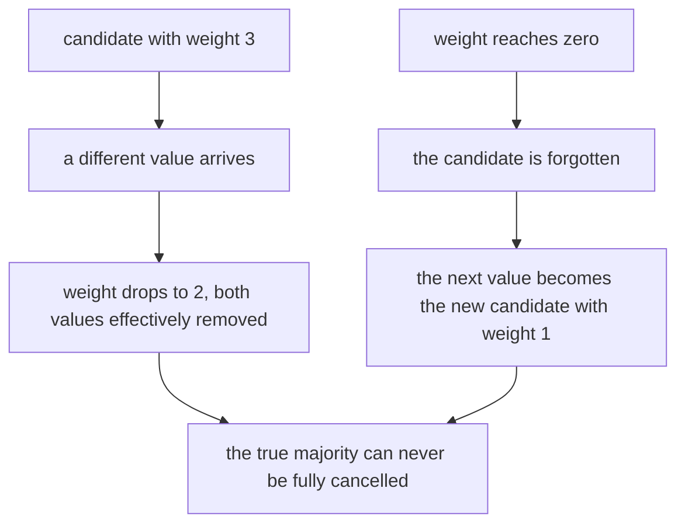
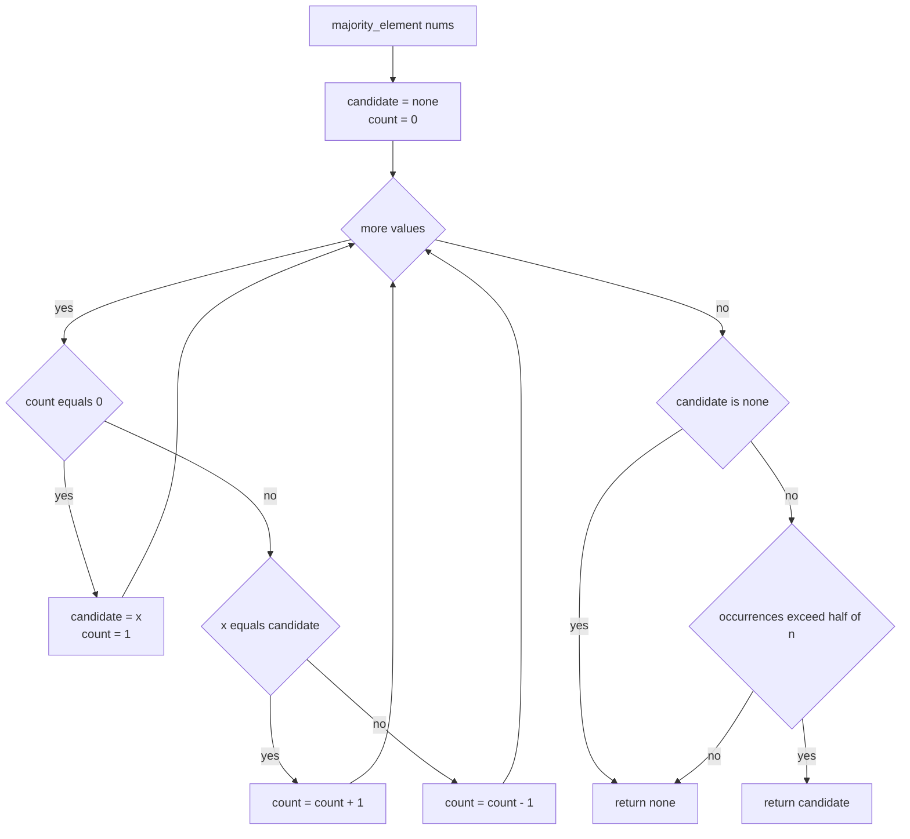
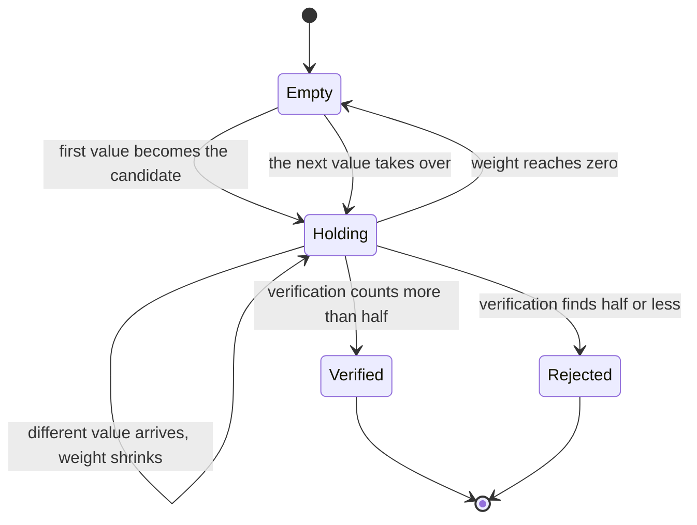
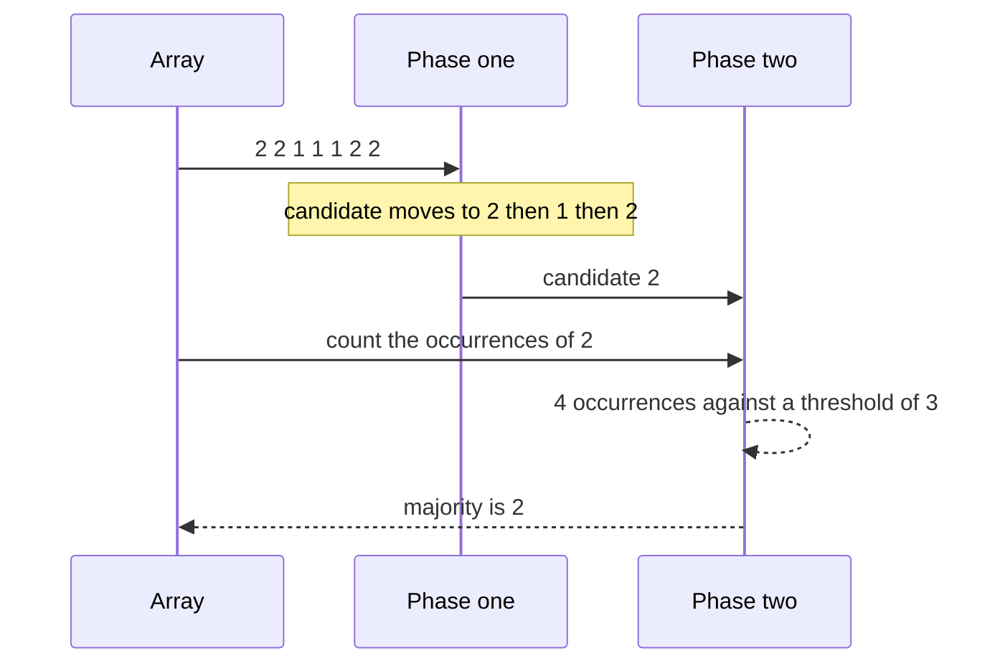

# 166 — Boyer-Moore majority vote algorithm (find element > n/2).

> **Tier:** Beginner · **CTCI chapter:** Ch 6 — Math and Logic Puzzles
> **Task spec:** [166-boyer-moore-majority-vote-algorithm-find-element-n-2.md](../../../tasks/beginner/166-boyer-moore-majority-vote-algorithm-find-element-n-2.md)
> **Solutions:** [Python](../../../solutions/python/beginner/166-boyer-moore-majority-vote-algorithm-find-element-n-2/solution.py) ·
> [Java](../../../solutions/java/beginner/166-boyer-moore-majority-vote-algorithm-find-element-n-2/Solution.java) ·
> [JavaScript](../../../solutions/javascript/beginner/166-boyer-moore-majority-vote-algorithm-find-element-n-2/solution.js) ·
> [C#](../../../solutions/csharp/beginner/166-boyer-moore-majority-vote-algorithm-find-element-n-2/Solution.cs)

## 1. Problem restatement

**Input:** an array `nums` of `n` integers, possibly empty, possibly with duplicates.

**Output:** the value that occurs **strictly more than `n / 2`** times, or a null result
(`None` in Python, `null` in Java, JavaScript and C#) when no such value exists. The return type is
nullable in every language: Python returns either an int or `None`, Java and C# use
`Integer`/`int?`, JavaScript uses `null`.

Cost requirement: `O(n)` time and `O(1)` extra space, which rules out a counting hash map.

The Python header comment states the two phases precisely:

> *"Phase 1 cancels pairs of different values; the survivor is the only possible majority. Phase 2
> verifies it (the algorithm alone only finds a candidate)."*

Contract table, from the assertions:

| Input | Result | Why |
| --- | --- | --- |
| `[3, 2, 3]` | `3` | 2 votes out of 3 is more than `3 / 2` |
| `[2, 2, 1, 1, 1, 2, 2]` | `2` | 4 votes out of 7; the count even returns to 1 in the middle |
| `[1]` | `1` | a single element is more than half of itself |
| `[]` | none | nothing was ever proposed as a candidate |
| `[1, 2, 3]` | none | phase 1 proposes `3`, which only occurs once, so verification rejects it |
| `[1, 1, 2, 2]` | none | exactly half is **not** more than half |
| `[5, 5, 5, 5, 1, 2]` | `5` | asserted by the Python file only; 4 of 6 |

## 2. Intuition

The immediate solution is a frequency map: count every value, then look for a count above `n / 2`.
It is correct and runs in `O(n)` time, but it costs `O(n)` space, and for the specific question
"which value is in the majority?" the whole histogram is overkill.

The key insight is a **cancellation** argument. Imagine pairing up a majority element with a
different element and deleting both. The majority element has more copies than everything else
combined, so it cannot be completely cancelled: after removing pairs of *distinct* values one at a
time, the majority value is what remains. The algorithm performs that cancellation implicitly,
without ever storing the pairs.

Concretely, maintain a `candidate` and a `count` that plays the role of "how much unmatched weight
does the candidate carry right now?":

- A value equal to the candidate increases the weight.
- A different value cancels one unit of the candidate's weight.
- When the weight drops to zero, the candidate is discarded and the next value becomes the new
  candidate with weight 1.



The second half of the insight is a warning: **a survivor is not yet an answer.** When no majority
exists, phase 1 still returns *some* value — for `[1, 2, 3]` it returns `3` — so the candidate must
be verified with a real count. That verification second pass is `O(n)` time and `O(1)` space, so
the complexity class does not change.

## 3. Algorithm

Phase 1 — find a candidate in one pass:

1. Start with `candidate = none` and `count = 0`.
2. For each `x`: if `count == 0`, set `candidate = x` and `count = 1`; else if `x == candidate`,
   `count += 1`; else `count -= 1`.

Phase 2 — verify:

3. If no candidate was ever set (empty input), return none.
4. Count the occurrences of the candidate in a second pass.
5. Return the candidate if that count is **strictly greater** than `n / 2` (integer division
   `n // 2` in Python, `nums.length / 2` in Java), otherwise return none.

```text
function majority_element(nums)
    candidate ← none
    count ← 0
    for each x in nums do
        if count equals 0 then
            candidate ← x
            count ← 1
        else if x equals candidate then
            count ← count + 1
        else
            count ← count - 1
        end
    end
    if candidate is none then
        return none
    end
    occurrences ← 0
    for each x in nums do
        if x equals candidate then
            occurrences ← occurrences + 1
        end
    end
    if occurrences > length(nums) / 2 then
        return candidate
    end
    return none
end
```

The two phases, including the early exit that protects the empty array from being counted:



Seen as a state machine, phase 1 only cares about the candidate's weight:



## 4. Worked example

Trace `[2, 2, 1, 1, 1, 2, 2]`, `n = 7`, so the majority threshold is `7 / 2 = 3` occurrences to beat.

| Step | `x` | Branch taken | `candidate` | `count` |
| --- | --- | --- | --- | --- |
| start | — | — | none | 0 |
| 1 | `2` | count is 0, take over | `2` | 1 |
| 2 | `2` | same as candidate | `2` | 2 |
| 3 | `1` | different, cancel one | `2` | 1 |
| 4 | `1` | different, cancel one | `2` | 0 |
| 5 | `1` | count is 0, take over | `1` | 1 |
| 6 | `2` | different, cancel one | `1` | 0 |
| 7 | `2` | count is 0, take over | `2` | 1 |

Phase 1 ends with `candidate = 2` but `count = 1`. That small weight is *not* the answer — the count
only ever expressed unmatched weight. Phase 2 counts `2` four times in the array, and `4 > 3`, so
the function returns `2`. The middle of the trace is the interesting part: at steps 5 and 6 the
candidate changes twice, yet the true majority still survives, exactly as the cancellation argument
promises.

The counter-example `[1, 2, 3]` shows why phase 2 is mandatory:

| Step | `x` | Branch taken | `candidate` | `count` |
| --- | --- | --- | --- | --- |
| start | — | — | none | 0 |
| 1 | `1` | count is 0, take over | `1` | 1 |
| 2 | `2` | different, cancel one | `1` | 0 |
| 3 | `3` | count is 0, take over | `3` | 1 |

The candidate is `3` with occurrence count 1, and `1 > 1` is false, so the result is none. Without
verification the algorithm would confidently answer `3` for an array where every value appears once.
The same rejection happens for `[1, 1, 2, 2]`, where `4 // 2 = 2` occurrences is exactly half and
therefore not *more* than half.



## 5. Complexity

Let `n` be the array length.

| Measure | Bound | Why it holds |
| --- | --- | --- |
| Time, best | O(n) | phase 2 always rescan the array; only `n = 0` exits early |
| Time, average | O(n) | two linear passes, each a constant amount of work per element |
| Time, worst | O(n) | at most `2n` comparisons and `n` increments in total |
| Space | O(1) | two integers and one nullable candidate — the space does not grow with `n` |
| Alternative: hash map of counts | O(n) time, O(n) space | simpler to read, but the histogram can hold up to `n` distinct values |
| Alternative: sort then inspect the middle | O(n log n) time, O(1) extra space in place | the element at index `n / 2` is a valid *candidate*, still needing a count |
| Alternative: sort and compare the two halves | O(n log n) time, O(1) extra space in place | if the middle elements are not equal, there is no majority |

The `O(1)` space bound is what singles this algorithm out: it is the only one of the three that
neither sorts nor stores counts, and both of those alternatives spend more than the problem
requires.

## 6. Pitfalls and edge cases

- **The candidate is not the answer.** Phase 1 is a *filter*: with no majority it still names a
  value whose occurrence count is arbitrary. `[1, 2, 3]` returns `3` from phase 1 and none from the
  function, and the Python comment says exactly that in the assertion list.
- **"More than half" is strict.** For `[1, 1, 2, 2]` the count of `1` is `2` and the threshold is
  `4 / 2 = 2`, so `2 > 2` fails and the answer is none. The instruction is `> n/2`, not `>= n/2`.
- **Empty input.** `candidate` is never assigned, so the code returns none before touching
  `nums.count`, which in Python would otherwise be `None`. Java, JavaScript and C# also short
  circuit on the null candidate.
- **Single element.** `[1]` gives candidate `1` with count 1, verification finds 1 occurrence and
  the threshold `1 / 2 = 0` is beaten, so the result is `1`. This is the only case where a count of
  1 is a majority.
- **A stale candidate when the weight hits zero.** `[1, 1, 2, 2]` ends phase 1 with `count = 0` while
  `candidate` still holds `1`. Nothing resets the candidate to none at that moment; the code relies
  on phase 2 to reject it, so a "return the candidate if count > 0" shortcut would be wrong.
- **Null versus a legitimate value.** `null`/`None` is the only "no majority" signal, and every
  language keeps it outside the value domain (`Integer`, `int?`, `null`, `None`). Zero as a
  sentinel would fail on arrays containing `0`.
- **Negative numbers and duplicates.** The comparisons are equality and counting only, so the
  algorithm is sign-agnostic; `[3, 2, 3]` in the tests uses small positives purely for readability.
- **Integer arithmetic in the threshold.** Java and C# use `nums.length / 2` and `occurrences >
  nums.length / 2`, an integer division that floors; Python uses `nums.count(candidate) >
  len(nums) // 2`. All three agree with the mathematical statement `count > n/2` for even `n`, where
  `n/2` is exact, and for odd `n`, where `floor(n/2)` is the largest integer below `n/2`.

## 7. Variants and follow-ups

- **Two values can exceed `n/3`.** The generalization to a fraction `1/3` needs two candidates and
  is the natural next step:
  [167-find-all-elements-appearing-n-3-generalized.md](../../../tasks/beginner/167-find-all-elements-appearing-n-3-generalized.md).
- **General `n/k`.** Keeping `k - 1` candidates and verifying each one generalizes the same pairing
  argument; an explicit count map is the readable version of that generalization in
  [337-design-majority-vote-generalized-n-k-using-count-map.md](../../../tasks/intermediate/337-design-majority-vote-generalized-n-k-using-count-map.md).
- **Streaming statistics with fixed state.** The two-heap tracker of
  [164-compute-running-median-using-two-heaps.md](../../../tasks/beginner/164-compute-running-median-using-two-heaps.md)
  is the other "answer a stream question with bounded state" pattern in this tier — different data
  structure, same `O(1)`-state ambition.

## 8. Check yourself

**Q1.** Why can the survivor of phase 1 fail to be a majority?

<details><summary>Show answer</summary>

Because phase 1 only cancels pairs of different values. If no value dominates, the cancellations
still leave *some* value unmatched — for `[1, 2, 3]` the last one, `3`. The guarantee is one
directional: a true majority always survives, but a survivor is not necessarily a majority, so it
must be counted.

</details>

**Q2.** `[1, 1, 2, 2]` has two values at exactly half each. What does the function return, and which
comparison decides that?

<details><summary>Show answer</summary>

It returns none. Phase 1 leaves `candidate = 1` with `count = 0`; phase 2 counts two occurrences,
and `2 > 4 / 2` is false. The strict `>` is what separates "more than half" from "at least half".

</details>

**Q3.** How many times is the array scanned, and does that change the asymptotic bound?

<details><summary>Show answer</summary>

Twice — once for the candidate, once for the verification count. `O(2n)` is still `O(n)`, and the
extra pass keeps the space at `O(1)`, which is the reason to prefer this over a hash map.

</details>

**Q4.** In the `[2, 2, 1, 1, 1, 2, 2]` trace, the candidate changes at step 5 (to `1`) and step 7
(back to `2`). Why is that not a bug?

<details><summary>Show answer</summary>

Because the candidate variable is just "the currently unmatched value". Each change happens when the
weight reached zero, meaning all earlier pairings were resolved. The majority value is never fully
cancelled, so it is either still the candidate at the end or has been replaced by another value
that is then verified — here the verification confirms `2` with four occurrences.

</details>

**Q5.** Why do the files return a nullable type instead of `-1` or `0` for "no majority"?

<details><summary>Show answer</summary>

Because any integer could be a legitimate array element, so a numeric sentinel would make a valid
answer indistinguishable from "not found". `null`/`None`/`Integer`/`int?` keeps the empty result
outside the value domain — the same reasoning behind the `-1` caveat in the LFU cache of task 161.

</details>
