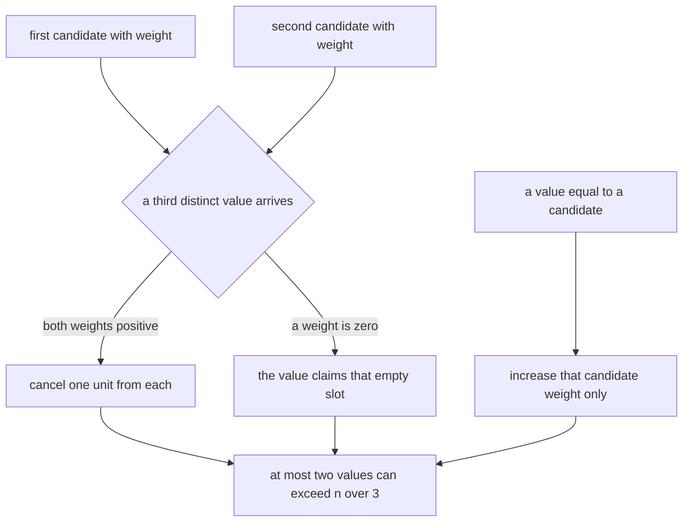
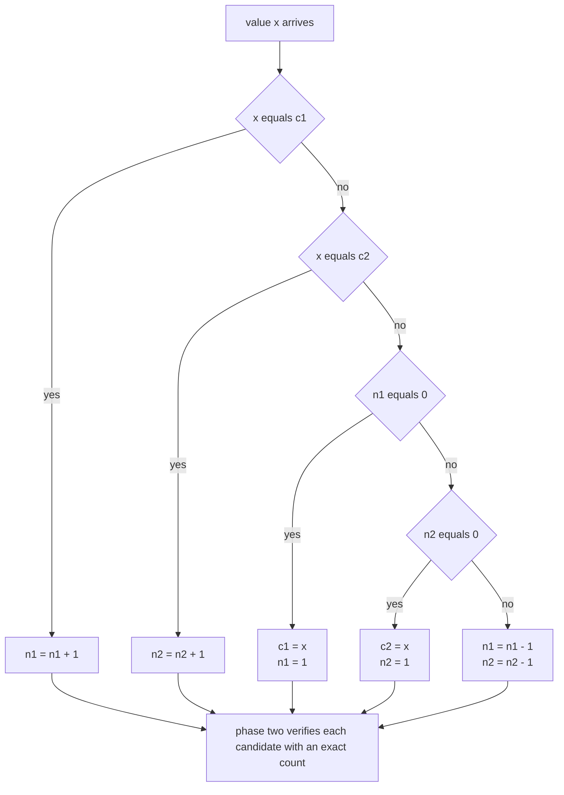
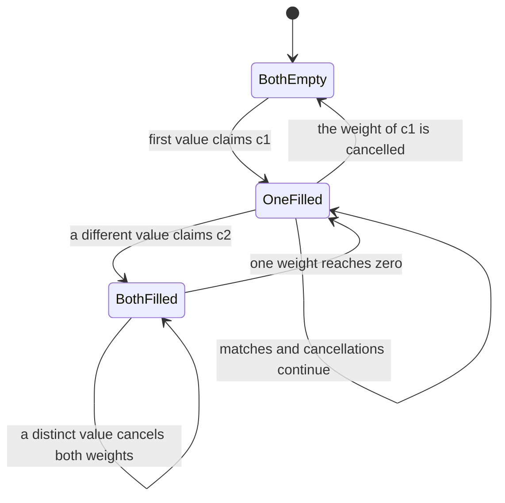
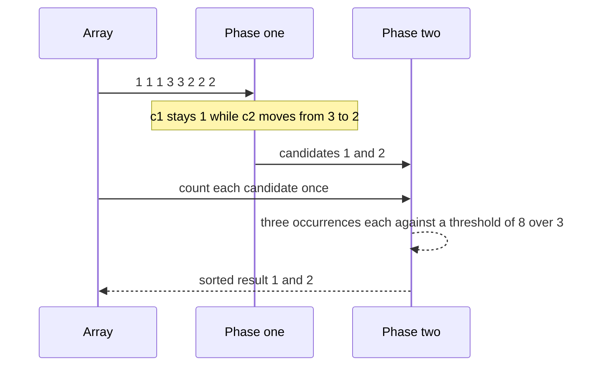

# 167 — Find all elements appearing > n/3 (generalized).

> **Tier:** Beginner · **CTCI chapter:** Ch 6 — Math and Logic Puzzles
> **Task spec:** [167-find-all-elements-appearing-n-3-generalized.md](../../../tasks/beginner/167-find-all-elements-appearing-n-3-generalized.md)
> **Solutions:** [Python](../../../solutions/python/beginner/167-find-all-elements-appearing-n-3-generalized/solution.py) ·
> [Java](../../../solutions/java/beginner/167-find-all-elements-appearing-n-3-generalized/Solution.java) ·
> [JavaScript](../../../solutions/javascript/beginner/167-find-all-elements-appearing-n-3-generalized/solution.js) ·
> [C#](../../../solutions/csharp/beginner/167-find-all-elements-appearing-n-3-generalized/Solution.cs)

## 1. Problem restatement

**Input:** an array `nums` of `n` integers, possibly empty.

**Output:** a **sorted list** of every value that occurs strictly more than `n / 3` times. The list
is empty when no value qualifies, and it can hold at most two values.

Constraint: `O(n)` time and `O(1)` extra space — the same requirement as the `n / 2` case, but now
with a list output instead of a single nullable value.

The Python header comment names the generalization:

> *"Generalized Boyer-Moore with TWO candidates: at most two values can exceed n/3. Phase 1 finds
> candidates, phase 2 verifies with exact counts."*

Contract table, from the assertions:

| Input | Result | Why |
| --- | --- | --- |
| `[3, 2, 3]` | `[3]` | `2 / 3` is more than `1 / 3` |
| `[1, 1, 1, 3, 3, 2, 2, 2]` | `[1, 2]` | `3 / 8` beats `8 / 3`; both candidates survive and sort |
| `[1, 2, 3]` | `[]` | three values at `1 / 3` each are not *more* than a third |
| `[]` | `[]` | no candidates, nothing to verify |
| `[4]` | `[4]` | `1 / 1` is above the threshold |
| `[1, 1, 2, 2, 3]` | `[1, 2]` | `2 / 5 = 0.4 > 1 / 3`, and the test comment records that ratio |
| `[1, 1, 2, 2]` | `[1, 2]` | asserted by the Python file only; `2 / 4 = 0.5 > 1 / 3` |

## 2. Intuition

The `n / 2` algorithm of task 166 keeps one candidate and cancels a different value against it. Why
does that stop working here? Because with a `1 / 3` threshold there can be **two** winners: two
values with `n / 3 + 1` occurrences each fit inside `n` comfortably. A single candidate would be
cancelled by the second winner's votes and could be pushed out of the running.

The fix is to run the same cancellation with **two** independent candidates and give each of them
its own weight. A different value cancels one unit from *both* candidates at once. If both weights
reach zero, the next value claims a slot.

Why two candidates are provably enough: suppose three values each occurred more than `n / 3` times.
Their total would exceed `n`, which is impossible. So the answer list can never have more than two
entries, and two slots are exactly the right amount of state.



The second insight is unchanged from the `n / 2` case, and it matters even more here: a candidate is
only a *hypothesis*. `[1, 2, 3]` ends phase 1 with two candidates (`1` and `2`) and neither is above
the threshold, so the verification pass empties the answer.

## 3. Algorithm

Phase 1 — maintain two candidate/slot pairs `(c1, n1)` and `(c2, n2)`:

1. Start with `c1 = c2 = none`, `n1 = n2 = 0`.
2. For each `x`, in this exact order:
   - if `c1` is set and `x == c1`, then `n1 += 1`;
   - else if `c2` is set and `x == c2`, then `n2 += 1`;
   - else if `n1 == 0`, then `c1 = x`, `n1 = 1`;
   - else if `n2 == 0`, then `c2 = x`, `n2 = 1`;
   - else `n1 -= 1` and `n2 -= 1`.

Phase 2 — verify each candidate:

3. Threshold: `n / 3`. Python compares the exact count against `len(nums) / 3`; Java, JavaScript
   and C# avoid floating point entirely with `occurrences * 3 > n`.
4. Collect the candidates that pass, then sort the result and return it.

```text
function majority_elements_n3(nums)
    c1 ← none
    c2 ← none
    n1 ← 0
    n2 ← 0
    for each x in nums do
        if c1 is not none and x equals c1 then
            n1 ← n1 + 1
        else if c2 is not none and x equals c2 then
            n2 ← n2 + 1
        else if n1 equals 0 then
            c1 ← x
            n1 ← 1
        else if n2 equals 0 then
            c2 ← x
            n2 ← 1
        else
            n1 ← n1 - 1
            n2 ← n2 - 1
        end
    end
    result ← empty list
    for each candidate in the set of c1 and c2 that are not none do
        occurrences ← 0
        for each x in nums do
            if x equals candidate then
                occurrences ← occurrences + 1
            end
        end
        if occurrences * 3 > length(nums) then
            append candidate to result
        end
    end
    sort result
    return result
end
```

The branch order inside the loop is part of the specification, not a style choice: matches are
checked before empty slots, and slot one is checked before slot two, which is what keeps the two
candidates distinct.



The two slots as a state machine, showing that a slot is never empty while its weight is positive:



## 4. Worked example

Trace `[1, 1, 1, 3, 3, 2, 2, 2]`, `n = 8`, so the threshold is `8 / 3 ≈ 2.67` and three occurrences
qualify.

| Step | `x` | Branch taken | `c1` | `n1` | `c2` | `n2` |
| --- | --- | --- | --- | --- | --- | --- |
| start | — | — | none | 0 | none | 0 |
| 1 | `1` | slot one is empty | `1` | 1 | none | 0 |
| 2 | `1` | matches `c1` | `1` | 2 | none | 0 |
| 3 | `1` | matches `c1` | `1` | 3 | none | 0 |
| 4 | `3` | slot two is empty | `1` | 3 | `3` | 1 |
| 5 | `3` | matches `c2` | `1` | 3 | `3` | 2 |
| 6 | `2` | distinct, both weights fall | `1` | 2 | `3` | 1 |
| 7 | `2` | distinct, both weights fall | `1` | 1 | `3` | 0 |
| 8 | `2` | slot two is empty | `1` | 1 | `2` | 1 |

Phase 1 leaves candidates `{1, 2}` — note that `3`, which had accumulated weight 2, was the value
that got evicted, and the eviction happened exactly when its weight hit zero. Phase 2 counts `1`
three times and `2` three times; `3 * 8 = 24 > 8` in the integer form (`3 > 2.67` in the Python
form) for both, so the sorted answer is `[1, 2]`.

The rejection case `[1, 2, 3]` shows phase 2 earning its keep:

| Step | `x` | Branch taken | `c1` | `n1` | `c2` | `n2` |
| --- | --- | --- | --- | --- | --- | --- |
| start | — | — | none | 0 | none | 0 |
| 1 | `1` | slot one is empty | `1` | 1 | none | 0 |
| 2 | `2` | slot two is empty | `1` | 1 | `2` | 1 |
| 3 | `3` | distinct, both weights fall | `1` | 0 | `2` | 0 |

The candidates `{1, 2}` each occur once, and `1 * 3 > 3` is false, so the result is `[]` — the same
"a candidate is only a hypothesis" rule as in the `n / 2` task, applied twice.



## 5. Complexity

Let `n` be the array length and `c` the number of candidates, which is at most 2.

| Measure | Bound | Why it holds |
| --- | --- | --- |
| Time, best | O(n) | phase 2 always rescans; even `n = 0` is trivial rather than early-exiting |
| Time, average | O(n) | one pass of constant work per element, then at most two counting passes |
| Time, worst | O(n + c·n) = O(n) | `c <= 2` is a constant, so the second phase is at most `2n` comparisons |
| Space | O(1) | four scalars plus the output list, whose length is at most 2 |
| Alternative: count map | O(n) time, O(n) space | one pass, but the histogram can hold `n` distinct values |
| Alternative: sort then scan runs | O(n log n) time, O(1) extra space in place | the runs of a sorted array make the threshold check easy, at the price of sorting |
| Alternative: count map plus a heap of top-2 counts | O(n log n) time, O(n) space | more machinery for the same two-entry answer |

The constant `c = 2` is the whole reason the generalization stays `O(n)`: reverting to a count map
would be simpler to write but loses the `O(1)` space bound, which is the property the task is about.

## 6. Pitfalls and edge cases

- **At most two answers.** Three values above `n / 3` would sum to more than `n`, so one candidate
  slot pair is provably sufficient. A third value appearing in the output would mean the branch
  order was wrong.
- **Matches before empty slots.** A value equal to `c1` must increment `n1` rather than claim an
  empty `c2` slot; checking the empty slots first would let the same value occupy both candidates.
- **`c1 != null` guards.** The comparison is written as `c1 != null && x == c1` rather than
  `x == c1`, so the empty-slot state is explicit. Using `0` as a sentinel instead of `null` would
  break on input that contains a legitimate `0`, and in JavaScript `null === 0` is false while
  `0 == "0"` style coercion traps exist for other sentinels.
- **The candidates are always distinct.** `c2` is assigned only from a value that already failed the
  `c1` match, so `c1` and `c2` never hold the same element. Python's set and the Java/C# `Set`/
  `HashSet` deduplication are therefore defensive rather than load-bearing.
- **Strictly more than a third.** `[1, 1, 1, 2, 2, 2, 3, 3, 3]` has three values at exactly `n / 3`;
  `occurrences * 3 > n` becomes `9 > 9`, false, so the answer would be `[]`. The assertion `[1, 2, 3]`
  → `[]` is the same rule on a smaller scale.
- **Empty input.** Both candidates stay null, the verification loop never runs, and the result is
  `[]`. There is no division by `n` anywhere, so `n = 0` cannot raise.
- **Single element.** `[4]` passes with `1 > 1 / 3`; the threshold is fractional, which is why the
  integer form multiplies by 3 instead of dividing by 3.
- **Float versus integer threshold.** Python computes `len(nums) / 3` as a float and compares a
  count against it; Java, JavaScript and C# scale the count with `occurrences * 3 > nums.length`.
  The integer form is exact and avoids the classic float-comparison trap for large arrays.
- **Sorted output.** `[1, 2]` must come back in ascending order, so all four files sort before
  returning — Python with `sorted`, Java with `Collections.sort`, JavaScript with `sort((a, b) =>
  a - b)` (the bare `sort()` would compare strings) and C# with `List.Sort()`.
- **Duplicates elsewhere are harmless.** Values that never accumulate weight simply push the
  candidates' weights down in pairs; `[1, 1, 2, 2]` still returns `[1, 2]` even though the
  cancellations remove most units.

## 7. Variants and follow-ups

- **Back to the `n / 2` case.** One candidate, one weight, a single nullable return value:
  [166-boyer-moore-majority-vote-algorithm-find-element-n-2.md](../../../tasks/beginner/166-boyer-moore-majority-vote-algorithm-find-element-n-2.md).
- **Arbitrary `n / k`.** Keeping `k - 1` candidates generalizes the same cancellation argument; the
  count-map version of the generalization is worked out in
  [337-design-majority-vote-generalized-n-k-using-count-map.md](../../../tasks/intermediate/337-design-majority-vote-generalized-n-k-using-count-map.md).
- **Other stream questions with fixed state.** Reservoir sampling answers "which `k` items?" with
  `O(k)` state in [165-reservoir-sampling-for-k-items-from-stream.md](../../../tasks/beginner/165-reservoir-sampling-for-k-items-from-stream.md),
  the same spirit as holding two candidates here.

## 8. Check yourself

**Q1.** Why are two candidates enough, and could a third ever be needed?

<details><summary>Show answer</summary>

If three distinct values each occurred more than `n / 3` times, their combined count would exceed
`n` — impossible. So at most two values can qualify, and two slots suffice. A third slot would never
be filled by a value that passes verification.

</details>

**Q2.** Why does a distinct value decrement **both** weights, rather than one of them?

<details><summary>Show answer</summary>

Because it cancels one unit of unmatched weight from each candidate. The pairing argument is applied
in parallel to both hypotheses: a value that matches neither candidate is evidence against both, so
it consumes one unit from each. Decrementing only one would let the other grow unboundedly.

</details>

**Q3.** In the `[1, 1, 1, 3, 3, 2, 2, 2]` trace, value `3` was a candidate with weight 2 and ends up
out of the answer. What removed it?

<details><summary>Show answer</summary>

Step 6 (`2`) and step 7 (`2`) each cancelled one unit of `n2`, dropping it from 2 to 0. With the
weight at zero, slot two was free at step 8 and the third `2` claimed it. `3` was never verified
because it is no longer a candidate.

</details>

**Q4.** The Python file compares against `len(nums) / 3` while the other three use
`occurrences * 3 > nums.length`. Are they equivalent?

<details><summary>Show answer</summary>

Yes for all non-negative counts: `count > n / 3` is the same statement as `3 * count > n`, and the
integer form avoids any floating-point rounding. With the integer form there is no division at all,
so `n = 0` cannot raise.

</details>

**Q5.** What breaks if the code checks `n1 == 0` before checking whether `x == c1`?

<details><summary>Show answer</summary>

A value could claim a free slot while it is already the *other* candidate. In the trace, step 4 would
be able to set `c2 = 1` if `n2` were zero and the match tests did not come first — the same element
would then occupy both slots, and the cancellation arithmetic would double-count it.

</details>
