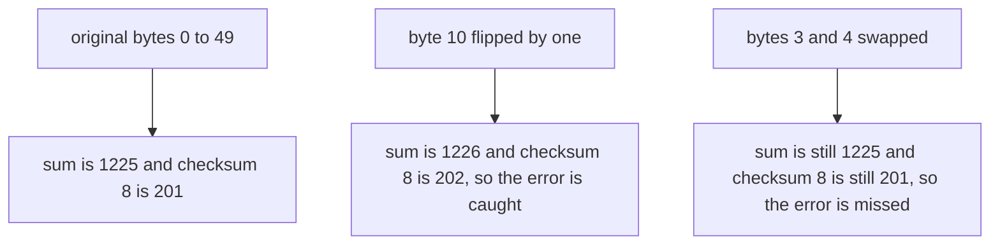
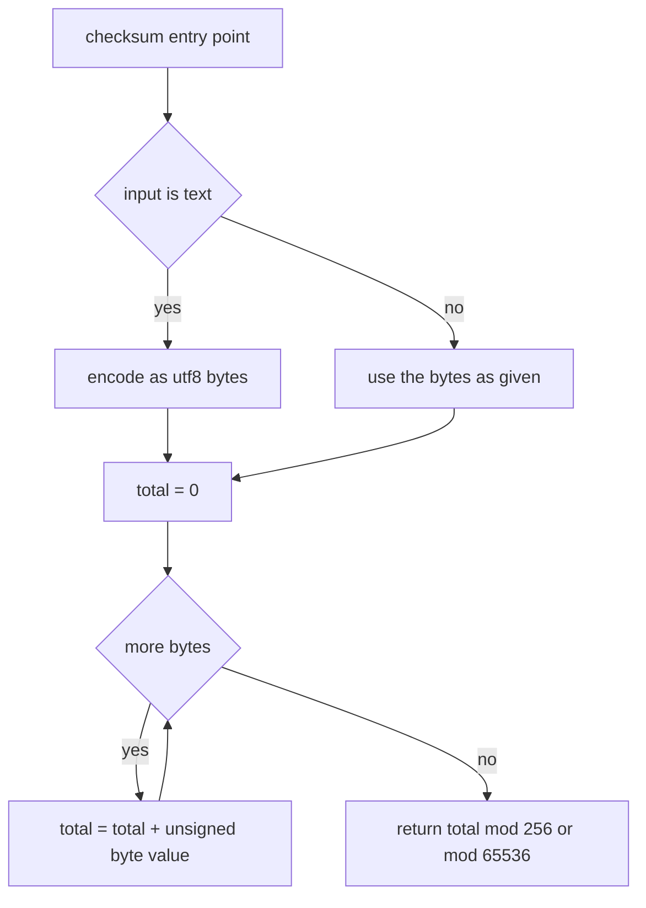
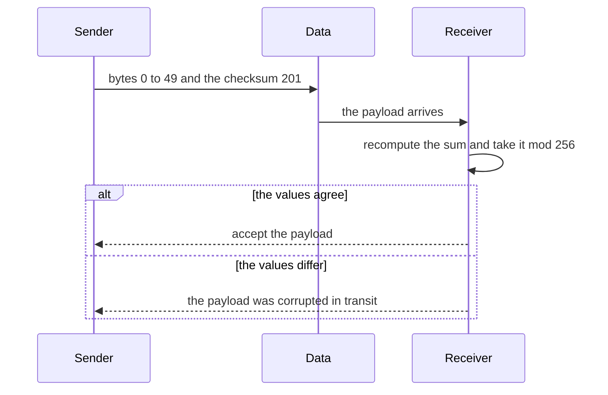

# 168 — Implement basic checksum (sum bytes).

> **Tier:** Beginner · **CTCI chapter:** Ch 5 — Bit Manipulation
> **Task spec:** [168-implement-basic-checksum-sum-bytes.md](../../../tasks/beginner/168-implement-basic-checksum-sum-bytes.md)
> **Solutions:** [Python](../../../solutions/python/beginner/168-implement-basic-checksum-sum-bytes/solution.py) ·
> [Java](../../../solutions/java/beginner/168-implement-basic-checksum-sum-bytes/Solution.java) ·
> [JavaScript](../../../solutions/javascript/beginner/168-implement-basic-checksum-sum-bytes/solution.js) ·
> [C#](../../../solutions/csharp/beginner/168-implement-basic-checksum-sum-bytes/Solution.cs)

## 1. Problem restatement

**Input:** a byte buffer, or a text string that is first encoded as UTF-8.

**Output:** a small integer fingerprint of the data:

- `checksum8` returns the sum of all byte values taken **mod 256**, so the result is in `0..255`.
- `checksum16` returns the same sum taken **mod 65536**, so the result is in `0..65535`.

Both are *error-detecting*, not cryptographic. The Python header comment says so directly:

> *"Two simple checksums: 8-bit sum (mod 256) and 16-bit sum (mod 65536). These DETECT accidental
> corruption; they are not cryptographic digests."*

Constraints and conventions:

- A string argument is encoded as UTF-8 before summing; Python checks `isinstance(data, str)`, Java
  and C# provide a `String` overload, and JavaScript's `toBuffer` helper converts anything that is
  not already a `Buffer`.
- The checksum is computed in a single forward pass, and the modulo is applied only at the end (the
  accumulation is a plain integer sum).
- The sum is **order-insensitive** by construction, and the test suites assert that property on
  purpose.

Contract table, from the assertions:

| Call | Result | Why |
| --- | --- | --- |
| `checksum8(b"")` | `0` | an empty sum is zero |
| `checksum8("abc")` | `38` | `97 + 98 + 99 = 294`, and `294 mod 256 = 38` |
| `checksum16("abc")` | `294` | the same sum, below the 16-bit modulus so it is unchanged |
| `checksum8(b"\xff\x01")` | `0` | `255 + 1 = 256`, and `256 mod 256 = 0` — the sum wrapped |
| `checksum16(b"\xff\xff")` | `510` | two large bytes stay well under 65536 |
| `checksum8(bytes(0..49))` | `201` | `0 + 1 + ... + 49 = 1225`, and `1225 mod 256 = 201` |
| the same bytes with byte 10 flipped by `^ 0x01` | differs (`202`) | the sum rises from 1225 to 1226, so the 8-bit value moves from 201 to 202 |
| the same bytes with bytes 3 and 4 swapped | unchanged (`201`) | the sum does not care about position |

Java, Python and C# assert all eight rows; the JavaScript file asserts the five single-value rows and
the flip, but not the swap (its comment in the other files calls the order-insensitivity
"by design").

## 2. Intuition

The naive approach to "did the bytes arrive intact?" is to compare the data itself — which means
storing or re-sending all of it. A checksum replaces that with a single small number: send the data
plus its fingerprint, recompute on arrival, compare. The naive *checksum* is a plain sum, which is
one addition per byte.

The critical thing to understand is what a sum can and cannot see:

- A single byte that changes by any amount always changes the total sum, and the change is at most
  `255` in magnitude, which is smaller than the 8-bit modulus — so the 8-bit sum never wraps around
  and the two values differ. **Single-byte corruption is always detected.**
- But the sum has no idea where a byte came from. `[0x01, 0x02]` and `[0x02, 0x01]` have the same
  sum, and so do `[0x01, 0x04]` and `[0x02, 0x03]`. **Transpositions and compensating changes are
  invisible.**

That asymmetry is the whole lesson of the task, and the assertions are written to make the point
visible: the tests deliberately flip a bit (detected) and deliberately swap two bytes (not
detected).



The mod at the end is what squeezes an arbitrarily large sum into a fixed number of bits — and it is
also what makes collisions inevitable: 256 possible 8-bit values and 65536 possible 16-bit values
are tiny compared to the space of all byte strings. A checksum is a bet that *accidental* corruption
is unlikely to land on a colliding value; it is not a defence against anyone who wants to forge one.

## 3. Algorithm

1. Normalise the input to bytes: leave a byte buffer alone, encode a string as UTF-8.
2. Start an accumulator at 0.
3. For each byte `b`, add its unsigned value (`data[i]`, or `b & 0xFF` in Java, where `byte` is
   signed) to the accumulator.
4. Return `accumulator mod 256` for `checksum8`, or `accumulator mod 65536` for `checksum16`.

```text
function checksum8(data)
    bytes ← data as bytes, encoding text as utf8 when needed
    total ← 0
    for i ← 0 to length(bytes) - 1 do
        total ← total + unsigned value of bytes[i]
    end
    return total mod 256
end

function checksum16(data)
    bytes ← data as bytes, encoding text as utf8 when needed
    total ← 0
    for i ← 0 to length(bytes) - 1 do
        total ← total + unsigned value of bytes[i]
    end
    return total mod 65536
end
```

The two functions differ in exactly one constant, which is why every solution implements one loop
and one normalisation helper and then writes both entry points on top of them.



The unsigned-value detail is the one place where the languages genuinely differ: Java's `byte` is
signed, so `b` alone would add a negative number for any byte above `0x7F` and the checksum would
be wrong, which is why the Java loop is written `sum += (b & 0xFF)`.



## 4. Worked example

Take `data = bytes(range(0, 50))`, the 50 bytes `0, 1, 2, ... 49`, which is the array both the flip
and the swap assertions are built from.

| Step | Bytes | Accumulator | `checksum8` | `checksum16` |
| --- | --- | --- | --- | --- |
| start | `[]` | 0 | `0` | `0` |
| after `0..9` | `0` to `9` | 45 | `45` | `45` |
| after `0..19` | `0` to `19` | 190 | `190` | `190` |
| after `0..29` | `0` to `29` | 435 | `179` | `435` |
| after `0..39` | `0` to `39` | 780 | `12` | `780` |
| after `0..49` | the whole array | 1225 | `201` | `1225` |

The 8-bit column drops whenever the running total passes a multiple of 256 — `435 mod 256 = 179`,
and `780 mod 256 = 12` — while the 16-bit column stays exact because 1225 is far below 65536. The
final `1225 mod 256 = 201` is the value the assertions compare against. (Had the file been long
enough to push the sum past 65536, the 16-bit column would wrap the same way.)

Now the two error scenarios, both applied to that array:

| Scenario | Affected bytes | New sum | `checksum8` | Detected? |
| --- | --- | --- | --- | --- |
| no error | — | 1225 | `201` | — |
| byte 10 flipped with `^ 0x01` | `10` becomes `11` | 1226 | `202` | yes, `201 != 202` |
| bytes 3 and 4 swapped | `3` and `4` change places | 1225 | `201` | no, the checksum is unchanged |
| two changes of `+1` and `-1` | any two bytes | 1225 | `201` | no, the totals cancel |

The third row is the assertion labelled *"sum is order-insensitive by design"* in the Java and C#
files, and the fourth row is the general form of the same blind spot: a checksum of a sum can only
see the *total*, never the arrangement.

## 5. Complexity

Let `n` be the number of bytes.

| Measure | Bound | Why it holds |
| --- | --- | --- |
| Time, best/average/worst | O(n) | one addition per byte, with no early exit possible — every byte affects the total |
| Time, empty input | O(1) | no iterations, the result is `0` |
| Space, extra | O(1) | a single accumulator |
| Space, if a string must be encoded | O(n) | UTF-8 encoding materialises a byte array (`str.encode`, `getBytes`, `Buffer.from`, `Encoding.UTF8.GetBytes`) |
| Alternative: cryptographic digest | O(n) time, O(1) space, much larger constant | resists deliberate collisions; the task deliberately does not go there |
| Alternative: position-weighted checksum (Adler, Fletcher, CRC) | O(n) time, O(1) space | catches transpositions and many compensating errors, which a plain sum cannot |
| Alternative: compare the data itself | O(n) time, O(n) extra space in transit | correct but pays the cost the checksum exists to avoid |

The interesting line is the third alternative: switching from an unweighted sum to a weighted one
costs the same `O(n)` and closes the transposition blind spot, which is why real protocols use CRC
or Adler rather than a bare sum.

## 6. Pitfalls and edge cases

- **Signed bytes in Java.** A Java `byte` above `0x7F` is negative, so the accumulation must mask it
  with `b & 0xFF`. Without the mask, `checksum8(new byte[]{(byte) 0xFF, 0x01})` would be
  `(-1 + 1) mod 256 = 0` by accident but `checksum8(new byte[]{(byte) 0xFF})` would be `255` in one
  implementation and `-1 mod 256 = 255` in the other only after a fix-up — the mask is what keeps
  every language consistent.
- **String inputs are byte inputs.** `checksum8("abc")` sums the UTF-8 bytes `97, 98, 99`, not the
  characters; a non-ASCII string such as `"é"` contributes two bytes. Python's `isinstance` check,
  Java's and C#'s `String` overloads and JavaScript's `toBuffer` all normalise before summing.
- **Empty input is a valid input.** The checksum of nothing is `0`, and `0` is also produced by
  real data such as the single byte `0x00` — the empty case is asserted so the normalisation path
  cannot crash.
- **Order-insensitivity is a feature of the algorithm and a bug in the design.** A payload with two
  bytes swapped passes verification; the assertion documents this rather than fighting it.
- **Compensating changes cancel.** Any pair of changes whose deltas sum to a multiple of the
  modulus — most simply `+1` on one byte and `-1` on another — is invisible.
- **Deliberate collisions are trivial.** Anyone can append bytes that restore the sum, because the
  algorithm is public and invertible. A checksum answers "did a random bit flip happen?", not "was
  this forged?".
- **The accumulator's own width.** Java and C# accumulate in a 32-bit `int`, so a sum beyond
  `Integer.MAX_VALUE` (about 8.4 million bytes at 255 per byte) wraps silently before the modulo is
  ever applied; JavaScript's numbers stay exact far longer, and Python's integers never overflow.
  The tests use 50 bytes, where none of this matters.
- **Modulus size.** 8-bit gives 256 possible values and 16-bit gives 65536, so a 16-bit checksum is
  no more expensive to compute but discriminates better on longer payloads. Neither changes the
  collision-blindness story above.
- **No length or position is included.** Two payloads with the same multiset of bytes but different
  lengths cannot have the same sum unless padded with zero bytes — which is itself undetectable,
  because a zero byte adds nothing.

## 7. Variants and follow-ups

- **Byte transforms next door.** The XOR cipher of
  [163-implement-basic-encryption-decryption-with-xor.md](../../../tasks/beginner/163-implement-basic-encryption-decryption-with-xor.md)
  walks the same bytes, but its transform is invertible and position-sensitive, which is exactly
  what a sum is not.
- **Fighting collisions with position.** Weighting each byte by its position (or hashing with two
  independent moduli) is what
  [315-rolling-hash-double-hash-to-reduce-collisions.md](../../../tasks/intermediate/315-rolling-hash-double-hash-to-reduce-collisions.md)
  is about; the double modulus is the same idea as moving from 8-bit to 16-bit taken one step
  further.
- **Bit-level tricks for the same data.** If the exercise is bit manipulation rather than
  integrity, [014-swap-two-variables-without-a-temporary-variable.md](../../../tasks/beginner/014-swap-two-variables-without-a-temporary-variable.md)
  shows the other classic use of XOR on raw values.

## 8. Check yourself

**Q1.** Why is `checksum8("abc")` equal to `38` and not `294`?

<details><summary>Show answer</summary>

Because the 8-bit variant reduces the total modulo 256: `97 + 98 + 99 = 294`, and
`294 - 256 = 38`. The 16-bit variant returns the unreduced `294` for the same input, which the
assertions also check.

</details>

**Q2.** The tests flip a bit in byte 10 and the checksum changes from 201 to 202. Would a flip that
changes a byte by 256 ever be missed?

<details><summary>Show answer</summary>

No such flip exists: a byte holds `0..255`, so any single-byte change shifts the sum by at most 255
in magnitude — always less than the 256 modulus. A single-byte change is therefore always detected
by both variants. What is *not* detected is a set of changes whose deltas sum to a multiple of the
modulus.

</details>

**Q3.** Swapping bytes 3 and 4 leaves the checksum at 201. What does that tell you about using this
as an integrity check for a protocol?

<details><summary>Show answer</summary>

That it cannot see reordering at all. If byte order matters — as it does for essentially every wire
format — a bare sum is insufficient; a position-weighted checksum (CRC, Adler, Fletcher) is needed.
The assertion exists to document this limitation, not to celebrate it.

</details>

**Q4.** Why does the Java implementation write `sum += (b & 0xFF)` instead of `sum += b`?

<details><summary>Show answer</summary>

Because Java's `byte` is signed: `0xFF` is `-1`, not `255`. Masking with `0xFF` converts the byte to
its unsigned value, so all four languages compute the same sum. Python, C# and JavaScript use
unsigned byte values naturally (`b` in a Python `bytes` iterates as `0..255`, C# `byte` is unsigned,
and `Buffer` iteration yields `0..255`).

</details>

**Q5.** Give two changes to a payload that an 8-bit sum can never detect.

<details><summary>Show answer</summary>

Transposing two different bytes (the sum is unchanged), and applying compensating deltas such as
`+1` to one byte and `-1` to another. Appending or removing zero bytes is a third: they contribute
nothing to the sum.

</details>
