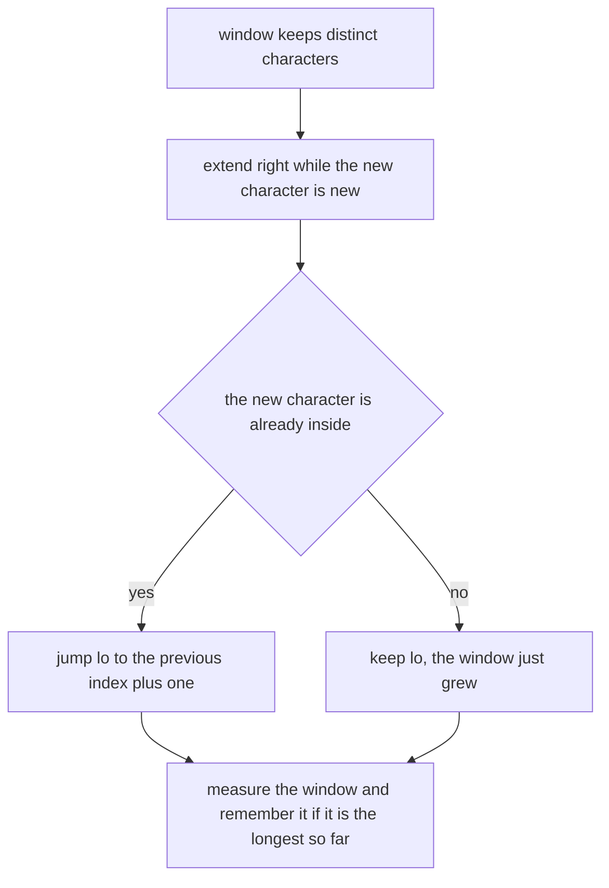
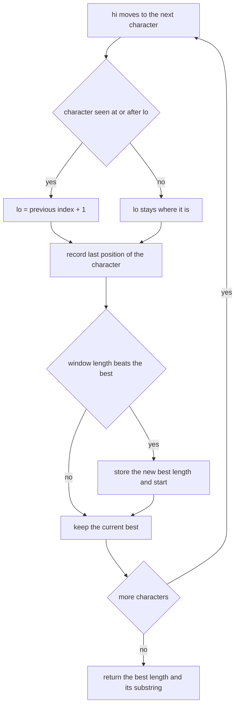
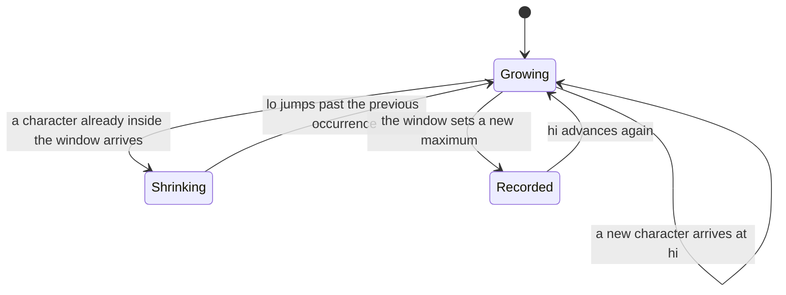
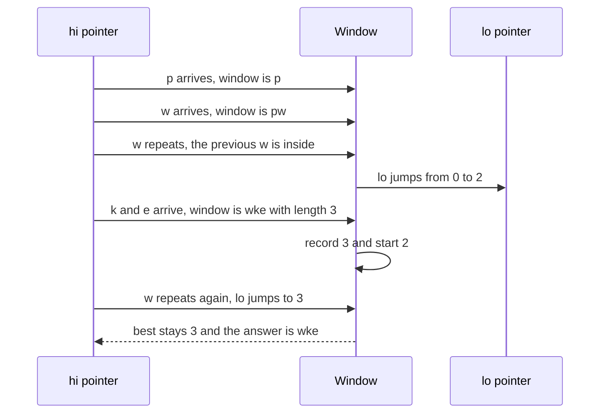

# 169 — Implement sliding window for unique characters (longest unique substring).

> **Tier:** Beginner · **CTCI chapter:** Ch 1 — Arrays and Strings
> **Task spec:** [169-implement-sliding-window-for-unique-characters-longest-unique-su.md](../../../tasks/beginner/169-implement-sliding-window-for-unique-characters-longest-unique-su.md)
> **Solutions:** [Python](../../../solutions/python/beginner/169-implement-sliding-window-for-unique-characters-longest-unique-su/solution.py) ·
> [Java](../../../solutions/java/beginner/169-implement-sliding-window-for-unique-characters-longest-unique-su/Solution.java) ·
> [JavaScript](../../../solutions/javascript/beginner/169-implement-sliding-window-for-unique-characters-longest-unique-su/solution.js) ·
> [C#](../../../solutions/csharp/beginner/169-implement-sliding-window-for-unique-characters-longest-unique-su/Solution.cs)

## 1. Problem restatement

**Input:** a string `s` of `n` characters, possibly empty.

**Output:** a pair — the **length** of the longest substring whose characters are all distinct, and
the **substring** itself. When several windows tie for the maximum length, the earliest one wins.

The Python header comment names the technique and its cost:

> *"Two pointers with a last-seen index map: O(n) time, O(min(n, alphabet)) space."*

The four implementations agree on:

- One left pointer `lo`, one right pointer `hi` walking the string once from left to right.
- A map from character to the **last index at which it was seen** (`dict`/`HashMap`/`Map`/`Dictionary`).
- On a repeat, `lo` jumps to `last[ch] + 1` — but only when `last[ch] >= lo`, so `lo` never moves
  backwards.
- The candidate length is `hi - lo + 1`, and the best window is replaced only on a **strictly**
  greater length.

Contract table, from the assertions:

| Input | Result | Why |
| --- | --- | --- |
| `"abcabcbb"` | `(3, "abc")` | the first three characters; later windows recycle the same length |
| `"bbbbb"` | `(1, "b")` | every window is a single `b` |
| `"pwwkew"` | `(3, "wke")` | the repeat at `w` forces `lo` to 2, and `"wke"` beats the earlier `"pw"` |
| `""` | `(0, "")` | no characters, no window |
| `"x"` | `(1, "x")` | one character is trivially unique (asserted by the Python file) |
| `"dvdf"` | `(3, "vdf")` | the repeat of `d` moves `lo` to 1, and `"vdf"` is longer than `"dv"` |
| `"abba"` | `(2, "ab")` | the stale `a` at index 0 must **not** drag `lo` back (asserted by Python) |

Python asserts all seven rows; Java, JavaScript and C# assert every row except the single-character
and `"abba"` cases.

## 2. Intuition

The brute-force idea is three nested loops: for every start, grow the end while the characters stay
distinct, and remember the longest. Checking distinctness with a set per start makes it `O(n²)`, and
re-checking from scratch for every start is `O(n³)` in the naive version.

The insight is that consecutive starts share almost all of their work. If the window `[lo, hi]` has
all-distinct characters, then so does every sub-window of it. So a single window can slide:

- **Extend** `hi` to the right while the new character is not already inside the window.
- **Shrink** from the left by moving `lo` past the previous occurrence of the offending character.

The second rule needs the *position* of the previous occurrence, not just the fact that it exists —
which is why the map stores **last-seen indices** instead of a membership set. That one change is
what makes the algorithm a single pass instead of a restart.



The subtle part is the condition that guards the jump. The map remembers indices from windows that
have already been abandoned, so a repeat can be **stale**: in `"abba"`, the `a` at index 0 is behind
`lo = 2` by the time index 3 arrives. Jumping to `last['a'] + 1 = 1` would drag the window's left
edge backwards and invent a window that contains a duplicate. The guard `last[ch] >= lo` means "only
react to repeats that are still inside the current window".

## 3. Algorithm

1. Keep `lo = 0`, `best_len = 0`, `best_start = 0`, and an empty map `last`.
2. For each `hi` from `0` to `n - 1` with character `ch`:
   - If `ch` is in `last` **and** `last[ch] >= lo`, set `lo = last[ch] + 1`.
   - Record `last[ch] = hi` (this must happen even when `lo` moved, so the map always describes the
     newest occurrence).
   - Compute `hi - lo + 1`; if it is greater than `best_len`, record the new best length and
     `best_start = lo`.
3. Return `best_len` and the slice `s[best_start .. best_start + best_len - 1]`.

```text
function longest_unique_substring(s)
    last ← empty map from character to index
    best_len ← 0
    best_start ← 0
    lo ← 0
    for hi ← 0 to length(s) - 1 do
        ch ← s[hi]
        if ch is a key of last and last[ch] >= lo then
            lo ← last[ch] + 1
        end
        last[ch] ← hi
        if hi - lo + 1 > best_len then
            best_len ← hi - lo + 1
            best_start ← lo
        end
    end
    return best_len and the substring of s from best_start of length best_len
end
```

`lo` only ever moves forward, so the two pointers together touch each index at most twice — once when
`hi` passes it and once when `lo` passes it — and the loop body does constant work.



The window itself has only two meaningful states:



## 4. Worked example

Trace `"pwwkew"`, `n = 6`. The window is `[lo, hi]`; the table shows the map entry touched at each
step.

| Step | `hi` | `ch` | `last[ch]` before | Guard `last[ch] >= lo` | `lo` after | Window | Length | Best |
| --- | --- | --- | --- | --- | --- | --- | --- | --- |
| 1 | 0 | `p` | absent | — | 0 | `[0, 0]` = `p` | 1 | `(1, 0)` |
| 2 | 1 | `w` | absent | — | 0 | `[0, 1]` = `pw` | 2 | `(2, 0)` |
| 3 | 2 | `w` | `1` | yes, `1 >= 0` | 2 | `[2, 2]` = `w` | 1 | `(2, 0)` |
| 4 | 3 | `k` | absent | — | 2 | `[2, 3]` = `wk` | 2 | `(2, 0)` |
| 5 | 4 | `e` | absent | — | 2 | `[2, 4]` = `wke` | 3 | `(3, 2)` |
| 6 | 5 | `w` | `2` | yes, `2 >= 2` | 3 | `[3, 5]` = `kew` | 3 | `(3, 2)` |

The answer is `(3, "wke")` — the frame captured at step 5, because step 6 only ties the record and
the comparison is strictly greater. Steps 3 and 6 show the jump: the offending character is inside
the window, so `lo` moves to just past its old position, immediately repairing the invariant without
re-checking any other character.

Now the same algorithm on `"abba"`, which is the case that requires the guard:

| Step | `hi` | `ch` | `last[ch]` before | `last[ch] >= lo`? | `lo` after | Window | Length | Best |
| --- | --- | --- | --- | --- | --- | --- | --- | --- |
| 1 | 0 | `a` | absent | — | 0 | `a` | 1 | `(1, 0)` |
| 2 | 1 | `b` | absent | — | 0 | `ab` | 2 | `(2, 0)` |
| 3 | 2 | `b` | `1` | yes, `1 >= 0` | 2 | `b` | 1 | `(2, 0)` |
| 4 | 3 | `a` | `0` | **no**, `0 < 2` | 2 | `ba` | 2 | `(2, 0)` |

Step 4 is the trap. The stored `a` at index 0 is stale — it belongs to a window that was abandoned
at step 3 — so the guard refuses the jump and `lo` stays at 2. Without the guard, `lo` would become
`0 + 1 = 1`, the window would look like `bba` with length 3, and the function would claim a longest
unique substring of length 3 that does not exist.

The two-pointer interaction, drawn as a sequence:



## 5. Complexity

Let `n` be the string length and `σ` the size of the character alphabet.

| Measure | Bound | Why it holds |
| --- | --- | --- |
| Time, best | O(n) | `hi` advances exactly `n` times and every step does constant work |
| Time, average | O(n) | `lo` also advances at most `n` times in total, so the pointers cost `2n` moves |
| Time, worst | O(n) | hash lookups are amortised `O(1)`; no nested loop over the window |
| Space | O(min(n, σ)) | one map entry per distinct character currently remembered, at most `n` |
| Alternative: restart the window at every start | O(n²) | for each `lo`, grow `hi` again from scratch |
| Alternative: check distinctness of every pair of bounds | O(n³) | the natural triple loop, re-scanning the window for each candidate |
| Alternative: fixed-size window of size `k` | O(n) time, O(σ) space | a *different* question — see the variants section |

Everything hinges on "each index is visited by `hi` once and left behind by `lo` at most once". That
amortisation is the reason the guard `last[ch] >= lo` also matters for performance: a jump that
moved `lo` *backwards* would break the two-pass accounting, not just the answer.

## 6. Pitfalls and edge cases

- **The stale-repeat guard.** `last[ch] >= lo` is not optional; without it `"abba"` returns
  `(3, "bba")` instead of `(2, "ab")`. Every solution has the same guard, and the Python file
  asserts the case exactly.
- **Updating the map when `lo` jumps.** `last[ch] = hi` must run unconditionally, otherwise the map
  would keep an index that has already been left behind and later steps would jump `lo` too far.
- **Strict comparison for the best.** The code uses `hi - lo + 1 > best_len`, so ties keep the
  earliest window. Switching to `>=` would return `"kew"` for `"pwwkew"` — a different valid answer,
  which the assertions would reject because they pin the substring as well as the length.
- **Empty string.** The loop never runs and the function returns `(0, "")`; the slice expression
  `s[0:0]` is empty in every language, and the Java/C# `substring(bestStart, bestStart + bestLen)`
  call is safe only because `bestLen` is 0 there.
- **Single character.** `(1, "x")`; the initial `best_len = 0` makes any single-character window an
  improvement.
- **All characters equal.** `"bbbbb"` returns `(1, "b")`: each step finds the previous `b` inside the
  window, `lo` follows `hi` exactly, and the length never exceeds 1.
- **UTF-16 versus code points.** Python iterates code points, so an emoji counts as one character;
  Java's `charAt`, C#'s indexer and JavaScript's `s[hi]` index UTF-16 **code units**, so an astral
  character appears as two distinct units and can extend a unique window to 2. The tests are ASCII,
  so the difference never shows up.
- **Memory is bounded by the alphabet, not the string, in practice.** Stale entries are never
  removed, so a pathological input with many distinct characters keeps one map entry per distinct
  character seen — `O(σ)`, which for UTF-16 is at most 65536 entries.
- **Return value differs per language.** Python returns a tuple, JavaScript an object
  `{ length, substring }`, and Java an `Object[]` (the Java driver wraps the result in a `checkPair`
  helper because a heterogeneous pair has no natural type). C# uses a `(int Length, string Substring)`
  tuple.

## 7. Variants and follow-ups

- **Fixed-size windows.** If the window length is given rather than discovered, the same slide turns
  into a running sum: [090-implement-sliding-window-sum-of-size-k.md](../../../tasks/beginner/090-implement-sliding-window-sum-of-size-k.md).
- **Add a monotonic deque.** The sliding-window maximum needs the deque variant because the window's
  *contents* are queried, not its length:
  [092-max-over-sliding-window-using-deque.md](../../../tasks/beginner/092-max-over-sliding-window-using-deque.md).
- **Track a requirement instead of uniqueness.** The minimum-window-substring problem keeps a
  frequency map of what is still missing inside the window, which is the same two-pointer skeleton
  with a richer invariant:
  [232-minimum-window-substring-covering-all-chars-of-pattern.md](../../../tasks/intermediate/232-minimum-window-substring-covering-all-chars-of-pattern.md).
- **Different predicate, same window.** `"dvdf"` and `"abba"` are the reason the guard exists; the
  palindrome check of [002-check-if-a-string-is-a-palindrome.md](../../../tasks/beginner/002-check-if-a-string-is-a-palindrome.md)
  shows the other two-pointer pattern where both ends move inward instead.

## 8. Check yourself

**Q1.** Why does the map store indices instead of just "seen or not seen"?

<details><summary>Show answer</summary>

Because a repeat forces `lo` to jump *to a specific place* — one past the previous occurrence. A set
would only say "already present", leaving no way to know how far to move the left edge, and the
algorithm would degrade into restarting the scan.

</details>

**Q2.** What exactly goes wrong in `"abba"` without the `last[ch] >= lo` guard?

<details><summary>Show answer</summary>

At `hi = 3` the map still holds `last['a'] = 0`, from a window abandoned at step 3 when `lo` moved to
2. Without the guard, `lo` would be set to `0 + 1 = 1`, moving the left edge backwards, and the
window `[1, 3]` = `"bba"` would be reported with length 3. The guard rejects the stale entry.

</details>

**Q3.** How many times does each index get touched by the two pointers?

<details><summary>Show answer</summary>

At most twice: once when `hi` steps onto it, and once when `lo` jumps past it. Both pointers only ever
move forward, which is what makes the total work `O(n)` despite the inner-looking jump.

</details>

**Q4.** `"pwwkew"` contains two windows of length 3: `"wke"` and `"kew"`. Which one is returned, and
why?

<details><summary>Show answer</summary>

`"wke"`, the earlier one, because the best window is replaced only on a strictly greater length
(`hi - lo + 1 > best_len`). Both are valid answers to "the longest unique substring"; the assertion
pins the earliest, which is the convention all four files share.

</details>

**Q5.** Would the returned values change for a string containing an emoji?

<details><summary>Show answer</summary>

Potentially yes, and differently per language. Python's iteration yields code points, so the emoji is
one character; Java, C# and JavaScript index UTF-16 code units, so a character outside the BMP is
two units and can make a window look longer. None of the solutions normalises this — the task's
assertions are all ASCII.

</details>
