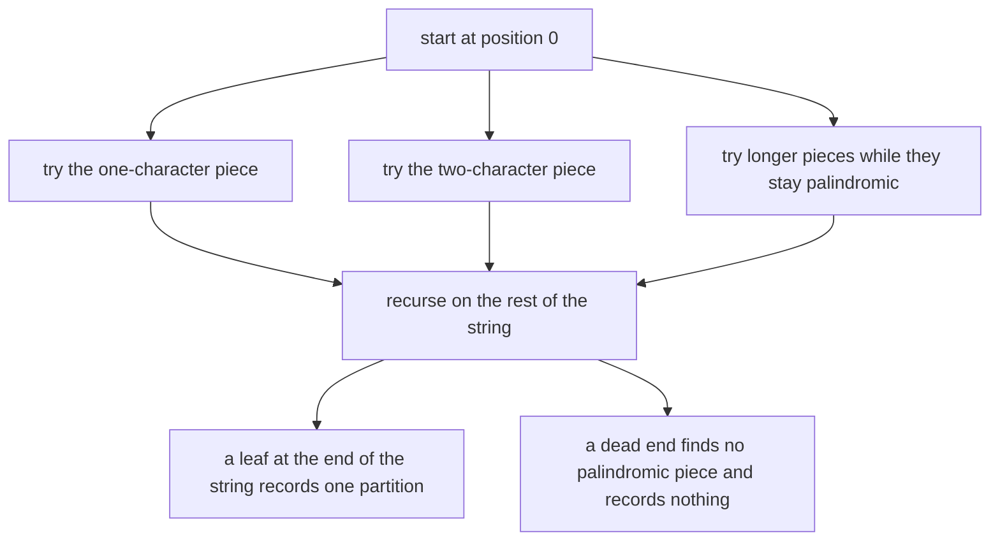
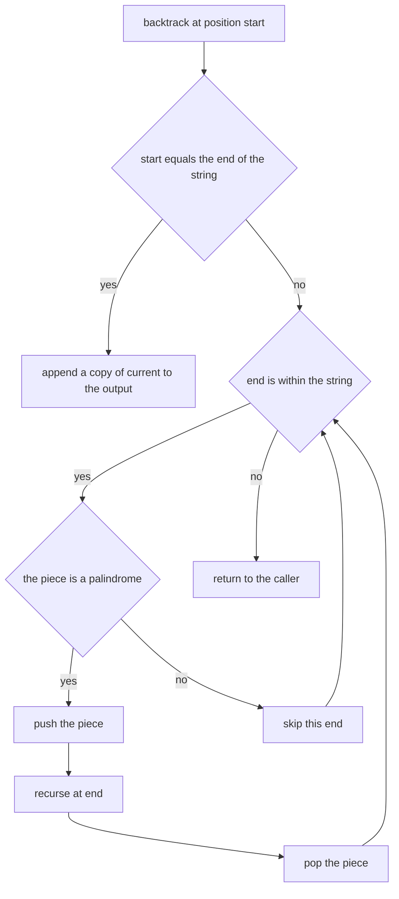
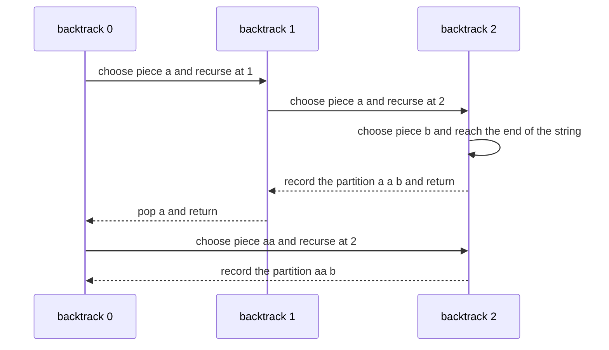
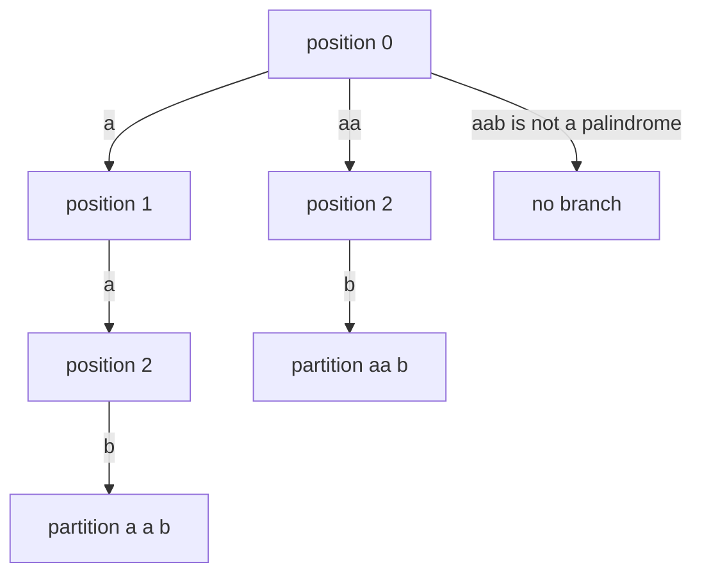

# 170 — Simple palindrome partitioning backtracking (list partitions).

> **Tier:** Beginner · **CTCI chapter:** Ch 8 — Recursion and Dynamic Programming
> **Task spec:** [170-simple-palindrome-partitioning-backtracking-list-partitions.md](../../../tasks/beginner/170-simple-palindrome-partitioning-backtracking-list-partitions.md)
> **Solutions:** [Python](../../../solutions/python/beginner/170-simple-palindrome-partitioning-backtracking-list-partitions/solution.py) ·
> [Java](../../../solutions/java/beginner/170-simple-palindrome-partitioning-backtracking-list-partitions/Solution.java) ·
> [JavaScript](../../../solutions/javascript/beginner/170-simple-palindrome-partitioning-backtracking-list-partitions/solution.js) ·
> [C#](../../../solutions/csharp/beginner/170-simple-palindrome-partitioning-backtracking-list-partitions/Solution.cs)

## 1. Problem restatement

**Input:** a string `s`, possibly empty.

**Output:** **every** way to cut `s` into pieces such that each piece is a palindrome. The answer is
a list of partitions, each partition a list of the pieces in order.

The Python header comment states the approach and the documented simplification:

> *"Enumerate every way to cut the string into palindromic pieces. Palindromes are checked with two
> pointers; memoizing the check is a later optimization."*

Conventions the four files share:

- A palindrome test with two pointers that walk inward from both ends and stop on the first
  mismatch.
- A recursive `backtrack(start)` that tries every piece `s[start..end-1]` in **increasing length**,
  recurses on the remainder, and then undoes the choice (push / recurse / pop).
- The recursion terminates when `start == len(s)`, at which point a **copy** of the current path is
  appended to the output.
- The empty string is considered to have exactly **one** partition: the empty one, written `[[]]`.

Contract table, from the assertions:

| Input | Result | Why |
| --- | --- | --- |
| `"aab"` | `[["a", "a", "b"], ["aa", "b"]]` | two ways: three single characters, or `aa` plus `b` |
| `"a"` | `[["a"]]` | the only piece is the single character |
| `""` | `[[]]` | the empty input has one partition, the empty partition |
| `"aaa"` | 4 partitions | `a,a,a` · `a,aa` · `aa,a` · `aaa` |
| `"ab"` | `[["a", "b"]]` | `ab` is not a palindrome, so the only cut is between the characters |
| `"aabb"` (every returned partition) | concatenates back to `"aabb"` and every piece is a palindrome | the round-trip invariant Python asserts |

The Java and C# files assert the first five rows through `toString()`/`Count` checks; Python and
JavaScript additionally validate the `"aabb"` round trip (Python checks both the concatenation and
that each piece is a palindrome; Java checks only the concatenation).

## 2. Intuition

Every partition of a string is a choice of cut positions, and there are `n - 1` gaps, so the naive
idea is to enumerate all `2^(n-1)` subsets of gaps and filter out the partitions that contain a
non-palindromic piece. That is correct but wasteful: it tests whole partitions only after building
them.

The better idea is to decide one piece at a time, from the left, and never commit to a piece that is
not a palindrome in the first place. At position `start`, the only choices are the substrings
`s[start..start]`, `s[start..start+1]`, ... — and each one that passes the palindrome test spawns a
sub-problem on the suffix that follows it.

That structure is a **backtracking tree**: each node is a prefix position, each edge is a chosen
palindromic piece, and each leaf that reaches `len(s)` is one complete partition. Because the tree
only contains palindromic edges, every leaf is automatically a valid answer, and the algorithm never
has to filter anything.



The third piece of the design is the **undo**. `current` is a single mutable list shared by every
branch; the recursive call pushes a piece, and the statement after it pops the piece again. Without
that pop, the pieces of an abandoned branch would leak into its siblings.

## 3. Algorithm

1. `is_palindrome(piece)`: compare `piece[i]` with `piece[len - 1 - i]` while the pointers have not
   crossed; return false on the first mismatch.
2. `backtrack(start, current)`:
   - If `start == len(s)`, the path is a complete partition: append a **copy** of `current` to the
     output and return.
   - Otherwise, for `end` from `start + 1` to `len(s)` (inclusive): take the piece `s[start..end-1]`;
     if it is a palindrome, push it onto `current`, recurse at `end`, then pop it.
3. Start the process with `backtrack(0, [])` and return the collected output.

```text
function is_palindrome(piece)
    i ← 0
    j ← length(piece) - 1
    while i < j do
        if piece[i] is not equal to piece[j] then
            return false
        end
        i ← i + 1
        j ← j - 1
    end
    return true
end

procedure backtrack(s, start, current, out)
    if start equals length(s) then
        append a copy of current to out
        return
    end
    for end ← start + 1 to length(s) do
        piece ← substring of s from start of length end - start
        if is_palindrome(piece) then
            append piece to current
            backtrack(s, end, current, out)
            remove the last element of current
        end
    end
end

function palindrome_partitions(s)
    out ← empty list
    backtrack(s, 0, empty list, out)
    return out
end
```

The control flow of one recursive call, with the three phases of a choice (try, descend, undo):



Java and C# avoid materialising a substring for the test by passing `start` and `end - 1` into
`isPalindrome`, and only build the string once the test passes; Python and JavaScript slice first
and test the slice. Both are the same algorithm, with a constant-factor difference.



## 4. Worked example

Trace `palindrome_partitions("aab")`. The table lists each node of the recursion tree in the order
it is visited, the pieces tried at that node, and the effect.

| Visit | `start` | `current` before | Pieces tried | Palindromic? | Action |
| --- | --- | --- | --- | --- | --- |
| 1 | 0 | `[]` | `a` (`0..1`) | yes | push and recurse at 1 |
| 2 | 1 | `[a]` | `a` (`1..2`) | yes | push and recurse at 2 |
| 3 | 2 | `[a, a]` | `b` (`2..3`) | yes | push and recurse at 3 |
| 4 | 3 | `[a, a, b]` | — | — | `start == len`: record `["a", "a", "b"]` |
| 5 | 2 | `[a, a]` | `ab` (`2..3`+1) | no | loop ends after the pop of `b` |
| 6 | 1 | `[a]` | `ab` (`1..3`) | no | pop `a`, loop ends |
| 7 | 0 | `[]` | `aa` (`0..2`) | yes | push and recurse at 2 |
| 8 | 2 | `[aa]` | `b` (`2..3`) | yes | push and recurse at 3 |
| 9 | 3 | `[aa, b]` | — | — | record `["aa", "b"]` |
| 10 | 0 | `[]` | `aab` (`0..3`) | no | loop ends, return |

The output is `[["a", "a", "b"], ["aa", "b"]]`, matching the assertion. Note the ordering rule that
emerges from iterating `end` upwards: the partition built from the *shortest possible first piece*
comes first, which is why `["a", "a", "b"]` precedes `["aa", "b"]` and why `"aaa"` is enumerated as
`a,a,a` · `a,aa` · `aa,a` · `aaa`.

The same run drawn as a tree, with the two successful paths highlighted:



Two invariants are worth stating because the assertions test them: every returned partition
concatenates back to the original string (each step consumed a contiguous piece), and every piece
in every returned partition is a palindrome (only palindromic edges exist in the tree). The Python
file re-checks both properties for `"aabb"`.

## 5. Complexity

Let `n` be the length of `s`.

| Measure | Bound | Why it holds |
| --- | --- | --- |
| Time, best | O(n) | a string with no palindromic piece longer than one character, such as `"ab"`, has a single path of length `n` |
| Time, average | exponential in `n` | the output itself is the answer: a run of `n` equal characters admits `2^(n-1)` partitions |
| Time, worst | O(n · 2^(n-1)) | at each of up to `2^(n-1)` leaves, up to `n` characters were copied into `current` |
| Time per palindrome test | O(len) | the two-pointer check walks half of each candidate piece |
| Space, recursion | O(n) | the depth is bounded by the position, which advances by at least one per level |
| Space, output | exponential | every partition is stored, so the output dominates whenever the input is repetitive |
| Space, `current` path | O(n) | one piece per level, at most `n` pieces of total length `n` |
| Alternative: enumerate gap subsets and filter | O(2^(n-1) · n) time | same answer, but every candidate is built before being rejected |
| Alternative: precompute an `is_pal` table | O(n²) time and space, then O(1) per test | removes the repeated two-pointer work; the minimum-cuts DP in task 171 does exactly this |

The exponential bound is inherent, not an implementation flaw: `"aaa...a"` really does have
`2^(n-1)` different partitions, and the function must return them all. What the algorithm *can*
avoid is paying `O(len)` for the same palindrome test over and over, which is the optimization the
header comment defers.

## 6. Pitfalls and edge cases

- **The empty string.** `backtrack(0)` sees `start == len(s) == 0` immediately and records the empty
  partition, so the result is `[[]]` — a list containing one empty list, not an empty list. All four
  files assert exactly that, in slightly different ways.
- **Copying the path.** Appending `current` itself instead of a copy would store a reference that
  later pushes and pops mutate, and every recorded partition would end up identical (usually empty).
  Python uses `current[:]`, Java `new ArrayList<>(current)`, JavaScript `[...current]`, C#
  `new List<string>(current)`.
- **Undoing the choice.** The pop must execute on every path out of the recursive call. Skipping it
  pollutes sibling branches with pieces from abandoned ones.
- **Not every prefix is a palindrome.** The loop tries all lengths and rejects the failures; the
  rejection is what keeps the leaves valid. For `"aab"`, the piece `"aab"` itself fails and ends the
  search at position 0.
- **Ordering is observable.** The output order follows increasing first-piece length and then a
  depth-first descent, which is why the assertions compare whole lists. Reversing the loop, or
  using a `while` with a different increment order, would produce the same partitions in a different
  order and fail the equality checks (the Java and C# files even compare the `toString()` rendering).
- **Single character.** `[["a"]]`: one piece, one partition, no choices to make.
- **Complexity cliff.** `"aaa"` has 4 partitions but `"aaaaaaaaaa"` has 512; the function is fine for
  short inputs and explosive for long repetitive ones. Nothing in the solutions prunes the search,
  because the task asks for the full list.
- **The palindrome test is repeated.** The same substring can be tested at several tree nodes; the
  header comments call memoizing it a later optimization, not part of this task.
- **Substring indexing.** Python and JavaScript slice as `s[start:end]` / `s.slice(start, end)` with
  an exclusive `end`, while Java and C# pass `start` and `end - 1` as inclusive bounds to the
  palindrome helper. Mixing the two conventions is the classic off-by-one here.
- **Unicode.** All four implementations compare code units (Java, C#, JavaScript) or code points
  (Python), so astral characters behave differently across languages for the same input; the
  assertions are ASCII.

## 7. Variants and follow-ups

- **Minimum cuts instead of all partitions.** If the question is "how few cuts?", the answer fits in
  `O(n²)` time and a DP replaces the search entirely:
  [171-minimum-cuts-for-palindrome-partitioning-dp.md](../../../tasks/beginner/171-minimum-cuts-for-palindrome-partitioning-dp.md).
- **The same enumeration with memoized palindrome tests.** The intermediate task returns the same
  answers while precomputing the palindrome table:
  [290-palindrome-partitioning-all-partitions-backtracking.md](../../../tasks/intermediate/290-palindrome-partitioning-all-partitions-backtracking.md).
- **Counting palindromic substrings.** A DP over all `(start, end)` pairs counts rather than
  partitions, and is the natural warm-up for the `is_pal` table:
  [303-count-palindromic-substrings-dp.md](../../../tasks/intermediate/303-count-palindromic-substrings-dp.md).
- **The palindrome test itself.** The two-pointer walk is the same one used by
  [002-check-if-a-string-is-a-palindrome.md](../../../tasks/beginner/002-check-if-a-string-is-a-palindrome.md).

## 8. Check yourself

**Q1.** Why does the empty string produce `[[]]` rather than `[]`?

<details><summary>Show answer</summary>

Because "partition into palindromic pieces" has one trivial solution for the empty input: use no
pieces. The recursion discovers it immediately, since `start == 0 == len(s)` on the very first call,
so it records the empty path. Returning `[]` would claim there is no way to partition it.

</details>

**Q2.** What would break if the code appended `current` without copying it?

<details><summary>Show answer</summary>

Every recorded partition would alias the same list, which continues to be mutated as the search
returns. By the time the caller inspects the output, all entries would look identical (typically
empty). The copy is what freezes a path at the moment it becomes complete.

</details>

**Q3.** In the `"aab"` trace, why is `["a", "a", "b"]` recorded before `["aa", "b"]`?

<details><summary>Show answer</summary>

Because the loop at position 0 tries `end = start + 1` first, so the one-character piece `a` is
explored before the two-character piece `aa`, and the search is depth-first. The ordering rule is
"shortest first piece first", and the assertions depend on it.

</details>

**Q4.** How many partitions does a string of ten identical characters have, and what does that say
about the algorithm's cost?

<details><summary>Show answer</summary>

Every subset of the nine gaps is a valid partition, so there are `2^9 = 512`. The algorithm's work
grows with the output, which is why it is exponential in the worst case and why the task returns the
list rather than promising a bound like `O(n²)`.

</details>

**Q5.** The pieces are tested with a two-pointer palindrome check every time they are tried. Where
does that repeated work show up, and what removes it?

<details><summary>Show answer</summary>

The same substring, such as the `a` at position 1 of `"aaa"`, is tested at several nodes of the tree,
each time in `O(len)`. Precomputing `is_pal[start][end]` in `O(n²)` makes every later test `O(1)` —
which is precisely the table the minimum-cuts DP builds. The header comment marks memoization as a
later optimization rather than part of this task.

</details>
