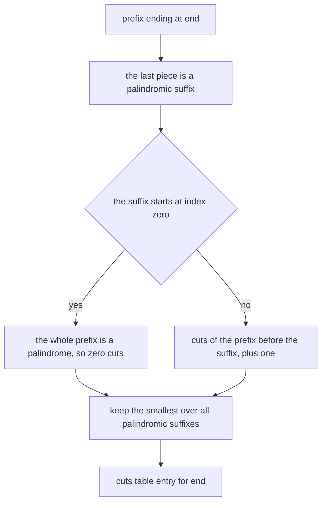
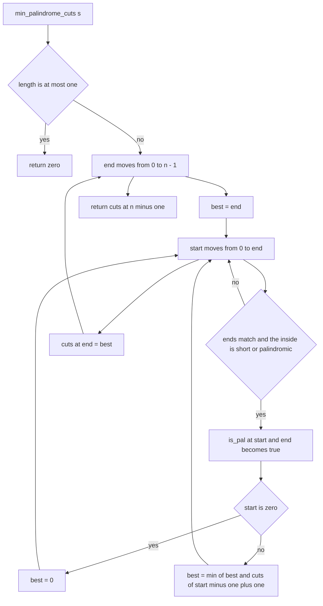
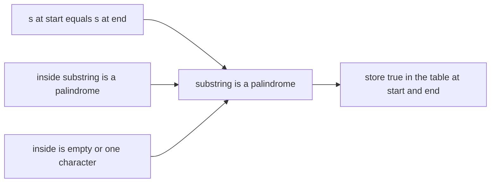
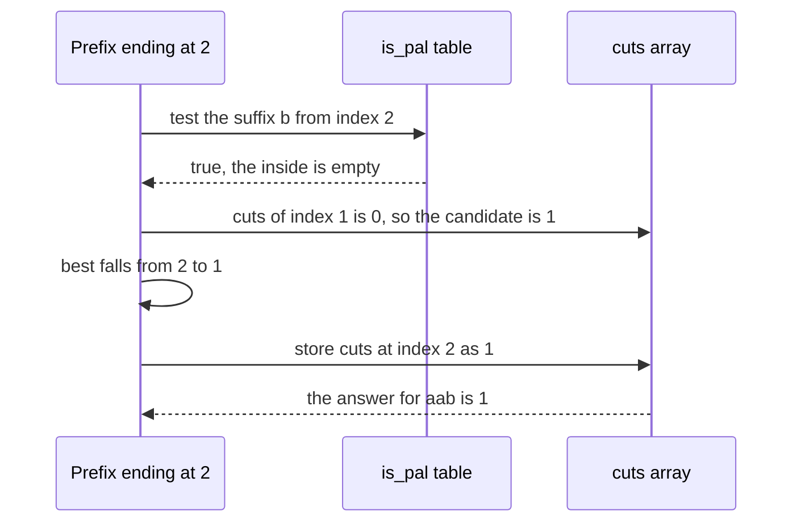

# 171 — Minimum cuts for palindrome partitioning (DP).

> **Tier:** Beginner · **CTCI chapter:** Ch 8 — Recursion and Dynamic Programming
> **Task spec:** [171-minimum-cuts-for-palindrome-partitioning-dp.md](../../../tasks/beginner/171-minimum-cuts-for-palindrome-partitioning-dp.md)
> **Solutions:** [Python](../../../solutions/python/beginner/171-minimum-cuts-for-palindrome-partitioning-dp/solution.py) ·
> [Java](../../../solutions/java/beginner/171-minimum-cuts-for-palindrome-partitioning-dp/Solution.java) ·
> [JavaScript](../../../solutions/javascript/beginner/171-minimum-cuts-for-palindrome-partitioning-dp/solution.js) ·
> [C#](../../../solutions/csharp/beginner/171-minimum-cuts-for-palindrome-partitioning-dp/Solution.cs)

## 1. Problem restatement

**Input:** a string `s`, possibly empty.

**Output:** the **minimum number of cuts** needed to split `s` into pieces that are all palindromes.
A string that is already a palindrome needs `0` cuts; a string of `n` single characters needs `n - 1`.

The Python header comment defines the two tables and their cost:

> *"is_pal[i][j] table + cuts[i] = min cuts for the prefix ending at i. O(n^2) time and space."*

Conventions the four files share:

- `is_pal[start][end]` is a boolean table: is `s[start..end]` a palindrome?
- `cuts[end]` is the minimum number of cuts for the **prefix** `s[0..end]`.
- The table is filled by increasing `end`, and for each `end` by increasing `start`.
- `n <= 1` is answered immediately with `0`, without building any table.
- `best` starts at `end` — the pessimistic value "cut between every pair of characters" — and is
  lowered whenever a palindromic suffix is found.

Contract table, from the assertions:

| Input | Result | Partition that achieves it | Why |
| --- | --- | --- | --- |
| `"aab"` | `1` | `aa | b` | `ab` at the front costs 2 cuts, `aa | b` costs 1 |
| `"a"` | `0` | `a` | nothing to cut |
| `""` | `0` | (empty) | the shortcut `n <= 1` returns 0 |
| `"ab"` | `1` | `a | b` | neither `ab` nor a longer piece is a palindrome |
| `"aabb"` | `1` | `aa | bb` | two pieces, one cut |
| `"abcba"` | `0` | `abcba` | the whole string is already a palindrome |
| `"abcd"` | `3` | `a | b | c | d` | no palindrome beyond single characters; Python and Java assert this row |

Python and Java assert all seven rows; JavaScript and C# assert every row except `"abcd"`.

## 2. Intuition

The natural first attempt is to reuse the enumeration of
[170-simple-palindrome-partitioning-backtracking-list-partitions.md](../../../tasks/beginner/170-simple-palindrome-partitioning-backtracking-list-partitions.md)
and keep the shortest result. That is exponential: for ten identical characters there are 512
partitions and only one is minimal, so almost all the work is thrown away.

The insight that makes this cheap is that the minimum-cuts answer has **optimal substructure**.
Consider the prefix ending at index `end`. Its last piece must be a palindromic suffix `s[start..end]`,
and everything before that suffix needs `cuts[start - 1]` cuts, plus one more cut to separate the
suffix. So

```
cuts[end] = min over palindromic suffixes s[start..end] of (0 if start == 0 else cuts[start - 1] + 1)
```

The `start == 0` case is the one where the whole prefix is a palindrome, which needs no cut at all.
That recurrence is exactly what the code computes:

```text
best = 0 if start == 0 else min(best, cuts[start - 1] + 1)
```

The second insight is about the palindrome test itself. Testing `s[start..end]` from scratch for every
pair is `O(n³)` overall. But a substring is a palindrome if its two ends match **and its inside is a
palindrome**, so `is_pal[start][end]` can be read from `is_pal[start + 1][end - 1]`, a strictly
shorter substring. One table removes the inner loop.



The fill order is what makes the table lookup legal, and it is worth being precise about it: the
outer loop runs over `end`, so when the code reads `is_pal[start + 1][end - 1]` every cell with a
smaller right endpoint has already been computed in an earlier outer iteration. Reading a *row* that
is filled later would be wrong — it is the smaller `end`, not the smaller `start`, that guarantees
dependence order.

## 3. Algorithm

1. If `n <= 1`, return `0`.
2. Allocate `is_pal` as an `n × n` boolean table (all false) and `cuts` as an `n`-element array.
3. For each `end` from `0` to `n - 1`:
   - Initialise `best = end`, the worst case (a cut before every character).
   - For each `start` from `0` to `end`:
     - The substring is a palindrome when the two end characters match and the inside is short
       (`end - start <= 1`) or already known to be a palindrome (`is_pal[start + 1][end - 1]`).
     - When it is: mark `is_pal[start][end] = true`; then `best` becomes `0` if `start == 0`,
       otherwise `min(best, cuts[start - 1] + 1)`.
   - Store `cuts[end] = best`.
4. Return `cuts[n - 1]`.

```text
function min_palindrome_cuts(s)
    n ← length(s)
    if n <= 1 then
        return 0
    end
    is_pal ← table of n by n booleans, all false
    cuts ← array of n integers
    for end ← 0 to n - 1 do
        best ← end
        for start ← 0 to end do
            inside_is_palindrome ← end - start <= 1 or is_pal[start + 1][end - 1]
            if s[start] equals s[end] and inside_is_palindrome then
                is_pal[start][end] ← true
                if start equals 0 then
                    best ← 0
                else
                    best ← smaller of best and cuts[start - 1] + 1
                end
            end
        end
        cuts[end] ← best
    end
    return cuts[n - 1]
end
```

The nested loops and the two outputs of the inner test — a table cell and a candidate for `best`:



The palindrome recurrence itself, which is the reason a single table suffices:



## 4. Worked example

Trace `min_palindrome_cuts("aab")`, `n = 3`. The `is_pal` cells are written as `(start, end)`.

| `end` | `start` | `s[start]` vs `s[end]` | Inside condition | Palindrome? | `best` after | `cuts[end]` |
| --- | --- | --- | --- | --- | --- | --- |
| 0 | 0 | `a` vs `a` | `0 <= 1` | yes, `(0, 0)` | `0` (start is 0) | — |
| — | — | — | — | — | — | `cuts[0] = 0` |
| 1 | 0 | `a` vs `a` | `1 <= 1` | yes, `(0, 1)` | `0` (start is 0) | — |
| 1 | 1 | `a` vs `a` | `0 <= 1` | yes, `(1, 1)` | `min(0, cuts[0] + 1 = 1)` = `0` | — |
| — | — | — | — | — | — | `cuts[1] = 0` |
| 2 | 0 | `a` vs `b` | — | no | `2` | — |
| 2 | 1 | `a` vs `b` | — | no | `2` | — |
| 2 | 2 | `b` vs `b` | `0 <= 1` | yes, `(2, 2)` | `min(2, cuts[1] + 1 = 1)` = `1` | — |
| — | — | — | — | — | — | `cuts[2] = 1` |

The final answer is `cuts[2] = 1`, and the winning candidate at the last row is the suffix `"b"` with
`cuts[1] + 1 = 1` — that is, `"aa"` needs no cuts and the suffix costs one cut. Note how the `end = 1`
block is what makes the answer cheap: `cuts[1] = 0` records that `"aa"` is already a palindrome,
which is exactly the information the last block reuses.

For contrast, `"abcd"` has no palindromic piece longer than one character, so every row only finds
its single-character suffix:

| Input | `cuts[0]` | `cuts[1]` | `cuts[2]` | `cuts[3]` | Answer |
| --- | --- | --- | --- | --- | --- |
| `"abcd"` | `0` | `min(1, cuts[0] + 1) = 1` | `min(2, cuts[1] + 1) = 2` | `min(3, cuts[2] + 1) = 3` | `3` |
| `"abcba"` | `0` | `1` | `2` | `1` | `0` |

The `"abcba"` row ends at `0` because the whole string is a palindrome: at `end = 4`, `s[0] == s[4]`
and `is_pal[1][3]` was already true (it is the palindrome `"bcb"`), so `start == 0` applies and `best`
drops to `0`.



## 5. Complexity

Let `n` be the length of `s`.

| Measure | Bound | Why it holds |
| --- | --- | --- |
| Time, best | O(1) | `n <= 1` returns without touching the tables |
| Time, average | O(n²) | the double loop visits `n(n + 1) / 2` `(start, end)` pairs, each doing constant work |
| Time, worst | O(n²) | no pair is visited twice and no inner loop depends on the string content |
| Space | O(n²) | the `is_pal` table has `n²` booleans; `cuts` adds `O(n)` |
| Space, if the table is dropped | O(n) | cuts alone is `O(n)`; the palindrome test then costs `O(n)` per pair |
| Alternative: enumerate all partitions and take the smallest | exponential | the backtracking of task 170 produces up to `2^(n-1)` partitions and discards all but one |
| Alternative: expand around every centre | O(n²) time, O(n) space | finds all palindromic substrings by centre expansion instead of by building a table |
| Alternative: Manacher plus cuts | O(n) time for the palindromes, then `O(n²)` for the cuts | the fastest palindrome detection available, but the cuts DP still dominates |

The `O(n²)` space is the weak point: for `n = 100000` the boolean table is `10^10` entries, which no
machine will hold. Since each `(start, end)` test only depends on `end - start`, the cuts could be
computed with an `O(n)` expansion-around-centre scan instead — the space/time trade the table makes
is deliberate and documented in the header comment.

## 6. Pitfalls and edge cases

- **`n <= 1` shortcut.** `""` and `"a"` must return `0` without allocating a table; otherwise the
  code would index `cuts[n - 1]` with `n - 1 = -1` in Python (a silent wrap to the last element of an
  empty list raises) and fail in the typed languages.
- **`best` starts pessimistic.** Initialising `best = end` gives the "cut everywhere" value, which
  is always achievable because every single character is a palindrome. Starting from a large sentinel
  would work too, but `end` is the tight, provable bound.
- **The `start == 0` branch.** A palindromic suffix that starts at 0 means the whole prefix is a
  palindrome, so no cut is needed at all; `cuts[start - 1]` would index `-1`.
- **Dependence order.** `is_pal[start + 1][end - 1]` is only meaningful because the outer loop runs
  over increasing `end`. A row-major fill over `start` would read uncomputed cells for the
  `"abcba"` case and return a wrong answer.
- **The short-inside guard.** `end - start <= 1` covers both the single character and the empty
  inside; without it, the code would read `is_pal[start + 1][end - 1]` for adjacent indices and, in
  Java or C#, index out of bounds when `start == end`.
- **Character equality is necessary but not sufficient.** `s[start] == s[end]` alone would mark
  `"aab"`'s suffix `"ab"` as a palindrome; the inside test is what rejects it.
- **Empty string.** Both the shortcut and the tables avoid a `n - 1` underflow; the assertions list
  the empty case explicitly.
- **Already-palindromic input.** `"abcba"` returns `0`, and the assertion exists to make sure the
  `start == 0` path is actually exercised rather than merely written.
- **No reconstruction.** The function returns the count, not the partition — `cuts` records numbers,
  not choices. Recovering the pieces needs a parent pointer per entry.
- **Cost of the table.** `O(n²)` booleans is the dominant memory term; the header comment states the
  bound so the trade-off is visible rather than accidental.
- **Character semantics.** All four files compare single characters (UTF-16 code units in Java, C#,
  JavaScript; code points in Python), so astral characters can behave differently across languages.

## 7. Variants and follow-ups

- **All partitions instead of the minimum.** The backtracking version returns every valid cut set,
  at exponential cost:
  [170-simple-palindrome-partitioning-backtracking-list-partitions.md](../../../tasks/beginner/170-simple-palindrome-partitioning-backtracking-list-partitions.md).
- **Count instead of minimise.** Counting palindromic substrings is the same `(start, end)` DP
  without the cuts array:
  [303-count-palindromic-substrings-dp.md](../../../tasks/intermediate/303-count-palindromic-substrings-dp.md).
- **Palindrome detection as its own problem.** If the palindromes are the goal rather than an input
  to the cuts DP, expand-around-centre is `O(n²)` with `O(1)` extra space
  ([230-longest-palindrome-substring-expand-center.md](../../../tasks/intermediate/230-longest-palindrome-substring-expand-center.md))
  and Manacher is linear
  ([231-manacher-s-algorithm-for-longest-palindromic-substring.md](../../../tasks/intermediate/231-manacher-s-algorithm-for-longest-palindromic-substring.md)).
- **The single-string check.** [002-check-if-a-string-is-a-palindrome.md](../../../tasks/beginner/002-check-if-a-string-is-a-palindrome.md)
  is the two-pointer routine that this DP replaces with a table.

## 8. Check yourself

**Q1.** Why does the code need the `end - start <= 1` condition before reading the table?

<details><summary>Show answer</summary>

Because palindromes are built from inside out: a substring of length 1 or 2 has no meaningful
inside, so it is a palindrome as soon as its ends match. Without the guard the code would read
`is_pal[start + 1][end - 1]` with `end - 1 < start + 1`, which is a backwards range — and out of
bounds when `start == end`.

</details>

**Q2.** What exactly does `cuts[end]` mean, and why is `cuts[n - 1]` the answer?

<details><summary>Show answer</summary>

`cuts[end]` is the minimum number of cuts for the **prefix** `s[0..end]`. The full string is the
prefix ending at `n - 1`, so the final cell holds the answer. For `"aab"` the array is `[0, 0, 1]`:
`"a"` and `"aa"` need no cuts, and `"aab"` needs one.

</details>

**Q3.** Why is `best` initialised to `end` rather than to a large number?

<details><summary>Show answer</summary>

Because `end` is always achievable: cutting between every pair of characters leaves `end` single
characters, each of which is a palindrome. Using `end` keeps the value semantically tight and
removes the need for an infinity sentinel — though the loop only ever lowers it, so both work.

</details>

**Q4.** Could the loops be swapped, with `start` outer and `end` inner?

<details><summary>Show answer</summary>

Not as written. `is_pal[start][end]` depends on `is_pal[start + 1][end - 1]`, which has a larger
`start`, so a `start`-outer fill would read uncomputed cells — the `"abcba"` trace relies on
`is_pal[1][3]` being ready before `is_pal[0][4]` is evaluated, and only the `end`-outer order
guarantees that.

</details>

**Q5.** The table costs `O(n²)` memory. How would you keep the `O(n²)` time but return to `O(n)`
space?

<details><summary>Show answer</summary>

Drop the table and test palindromes by expanding around each centre: for every centre (a character or
a gap), walk outwards while the characters match, and each `(start, end)` pair discovered is a
palindrome candidate for the cuts update. The time is still `O(n²)` — every pair is examined once —
but the memory drops to `O(n)` for `cuts` alone.

</details>
