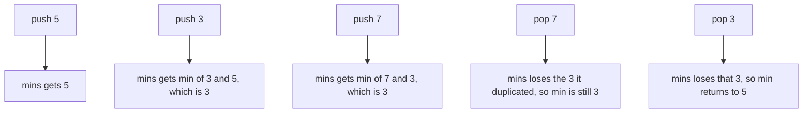
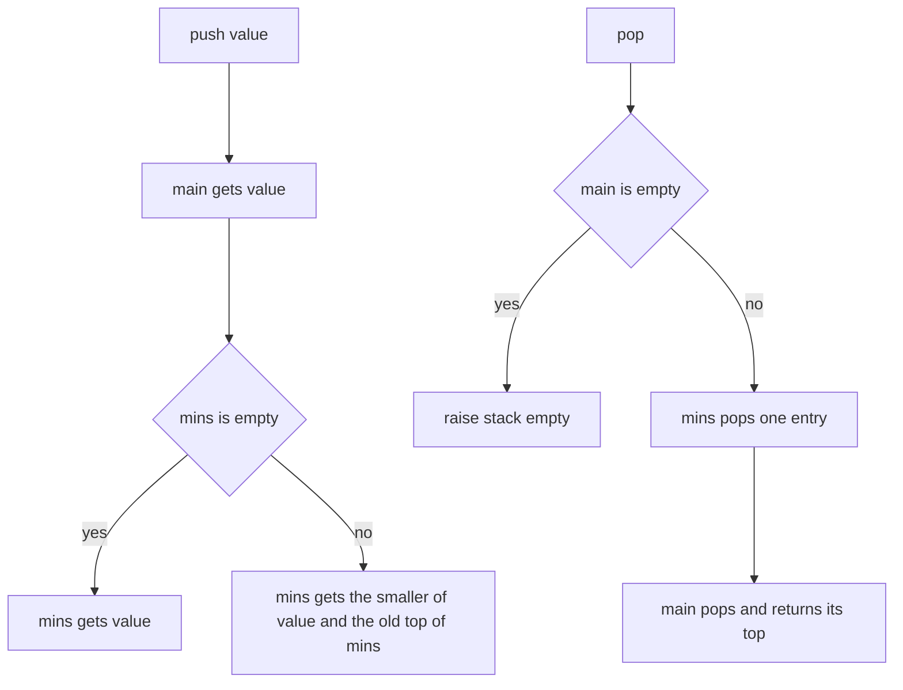
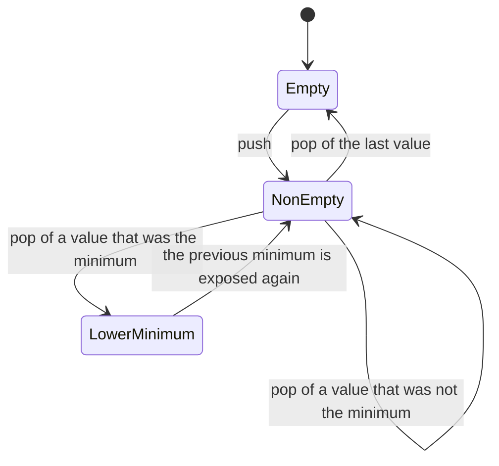
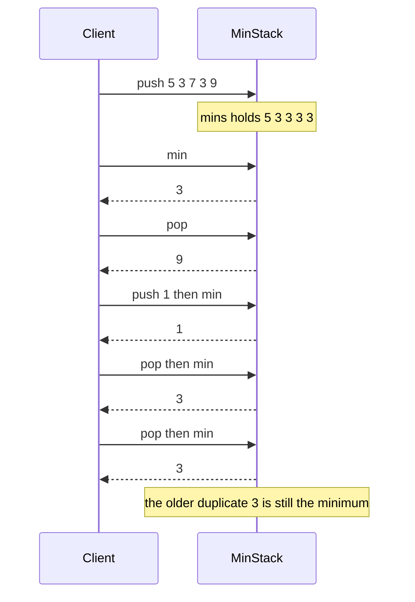

# 172 — Implement stack that supports getMin in O(1).

> **Tier:** Beginner · **CTCI chapter:** Ch 3 — Stacks and Queues
> **Task spec:** [172-implement-stack-that-supports-getmin-in-o-1.md](../../../tasks/beginner/172-implement-stack-that-supports-getmin-in-o-1.md)
> **Solutions:** [Python](../../../solutions/python/beginner/172-implement-stack-that-supports-getmin-in-o-1/solution.py) ·
> [Java](../../../solutions/java/beginner/172-implement-stack-that-supports-getmin-in-o-1/Solution.java) ·
> [JavaScript](../../../solutions/javascript/beginner/172-implement-stack-that-supports-getmin-in-o-1/solution.js) ·
> [C#](../../../solutions/csharp/beginner/172-implement-stack-that-supports-getmin-in-o-1/Solution.cs)

## 1. Problem restatement

**Input:** a sequence of stack operations — `push(value)`, `pop()`, `peek()`, `min()`, plus the
`is_empty`/`size` predicates.

**Output:** `pop` returns the most recently pushed value, `peek` returns it without removing it, and
`min` returns the smallest value **currently** on the stack. Every operation must be `O(1)`; `min`
must not walk the stack.

The Python header comment states the design and the cost:

> *"A parallel 'running minimum' stack: mins.push(min(value, mins.peek())). push/pop/min are all
> O(1); O(n) extra space."*

Conventions the four files share:

- An inner stack for the values (`_main`) and a second stack of the **same length** holding the
  running minimum (`_mins`).
- `push` appends the value and then appends `value` if `_mins` is empty, else
  `min(value, top_of_mins)`.
- `pop` removes one entry from each stack, so the two stacks never drift apart.
- `pop`, `peek` and `min` on an empty stack are errors: `IndexError` in Python,
  `NoSuchElementException` in Java, `Error` in JavaScript, `InvalidOperationException` in C#.

Contract table, from the assertions (the push sequence is `5, 3, 7, 3, 9`):

| Step | Operation | Result | `main` after | `mins` after |
| --- | --- | --- | --- | --- |
| 1–5 | five pushes | — | `5, 3, 7, 3, 9` | `5, 3, 3, 3, 3` |
| 6 | `min()` | `3` | — | — |
| 7 | `peek()` | `9` | — | — |
| 8 | `size()` | `5` | — | — |
| 9 | `pop()` | `9`, then `min()` | `5, 3, 7, 3` | `5, 3, 3, 3` → min `3` |
| 10 | `push(1)`, `min()` | `1` | `5, 3, 7, 3, 1` | `5, 3, 3, 3, 1` |
| 11 | `pop()`, `min()` | `1`, then `3` | `5, 3, 7, 3` | `5, 3, 3, 3` |
| 12 | `pop()`, `min()` | `3`, then `3` | `5, 3, 7` | `5, 3, 3` — the duplicate minimum is still tracked |
| 13 | `pop()`, `min()` | `7`, then `3` | `5, 3` | `5, 3` |
| 14 | `pop()`, `min()` | `3`, then `5` | `5` | `5` |
| 15 | `pop()`, `is_empty()` | `5`, then empty | `[]` | `[]` |

## 2. Intuition

A plain stack cannot answer `min` in `O(1)`: the minimum is a property of the *set* of stored values,
and removing the top element can change it. Scanning on every `min()` call costs `O(n)`.

The obvious repair is to keep one extra variable, `current_min`, updated on every push. It works
until the first pop of that minimum: once the smallest value leaves, the variable holds a value that
is no longer on the stack, and there is no way to recover the previous minimum without rescanning.
That failure is not a corner case — it is the common case for any stack that only ever grows and
shrinks at the top.

The key insight is that the sequence of minima is itself **stack-shaped**. Think of the minimum after
each push: it can only decrease when a new value arrives, and it must return to a previous value when
the value that caused the decrease is popped. So store one minimum entry per pushed value, and the
`k`-th entry of `mins` is "the minimum of the bottom `k` elements". Popping discards both the value
and its minimum entry, restoring the previous minimum automatically.



The cost is exactly one extra integer per element, which the header comment records as `O(n)` extra
space. In exchange, all three queries (`peek`, `pop`, `min`) read a single top element and are
therefore constant time.

## 3. Algorithm

1. Constructor: create two empty stacks, `main` and `mins`.
2. `push(value)`: push onto `main`; then push `value` onto `mins` if `mins` is empty, else
   `min(value, top(mins))`.
3. `pop()`: raise if `main` is empty; otherwise pop from `mins`, then return the value popped from
   `main`.
4. `peek()`: raise if empty, else return `top(main)`.
5. `min()`: raise if `mins` is empty, else return `top(mins)`.
6. `is_empty()` is `main` being empty, and `size()` is the length of `main`.

```text
function make_min_stack()
    return an object holding main ← empty stack and mins ← empty stack
end

procedure push(stack, value)
    push value onto stack.main
    if stack.mins is empty then
        push value onto stack.mins
    else
        push the smaller of value and top(stack.mins) onto stack.mins
    end
end

function pop(stack)
    if stack.main is empty then
        raise error "stack empty"
    end
    pop from stack.mins
    return pop from stack.main
end

function peek(stack)
    if stack.main is empty then
        raise error "stack empty"
    end
    return top(stack.main)
end

function min(stack)
    if stack.mins is empty then
        raise error "stack empty"
    end
    return top(stack.mins)
end
```

The two stacks are maintained in lockstep: any operation that adds or removes an element touches both,
so `length(mins) == length(main)` is an invariant of every state the object can reach.



The object as a state machine, showing that only the top can change:



## 4. Worked example

Trace the assertion sequence. Each row shows the pair of stacks immediately after the operation, with
the top on the right.

| # | Operation | `main` | `mins` | `min()` | Returned |
| --- | --- | --- | --- | --- | --- |
| 1 | `push(5)` | `5` | `5` | `5` | — |
| 2 | `push(3)` | `5, 3` | `5, 3` | `3` | — |
| 3 | `push(7)` | `5, 3, 7` | `5, 3, 3` | `3` | — |
| 4 | `push(3)` | `5, 3, 7, 3` | `5, 3, 3, 3` | `3` | — |
| 5 | `push(9)` | `5, 3, 7, 3, 9` | `5, 3, 3, 3, 3` | `3` | — |
| 6 | `peek()` | unchanged | unchanged | `3` | `9` |
| 7 | `pop()` | `5, 3, 7, 3` | `5, 3, 3, 3` | `3` | `9` |
| 8 | `push(1)` | `5, 3, 7, 3, 1` | `5, 3, 3, 3, 1` | `1` | — |
| 9 | `pop()` | `5, 3, 7, 3` | `5, 3, 3, 3` | `3` | `1` |
| 10 | `pop()` | `5, 3, 7` | `5, 3, 3` | `3` | `3` |
| 11 | `pop()` | `5, 3` | `5, 3` | `3` | `7` |
| 12 | `pop()` | `5` | `5` | `5` | `3` |
| 13 | `pop()` | empty | empty | error | `5` |

Rows 9 and 10 are the duplicate-minimum case: two `3`s were pushed (rows 2 and 4), so `mins` holds
three `3` entries after row 5. Popping the `3` from row 4 in row 10 does not disturb the minimum,
because the `3` from row 2 is still underneath — the assertion labels this *"duplicate minimum still
tracked"*. Row 11 is where the minimum actually changes, and it changes to `3` because that older `3`
is now the top of `mins`. Only row 12, popping the last `3`, exposes `5` again.

The same sequence as a message trace:



## 5. Complexity

Let `n` be the number of values currently on the stack.

| Measure | Bound | Why it holds |
| --- | --- | --- |
| `push` | O(1) | two appends and one comparison |
| `pop` | O(1) | two pops from the ends of two stacks |
| `peek` | O(1) | one read of the top of `main` |
| `min` | O(1) | one read of the top of `mins` |
| `is_empty` / `size` | O(1) | a length query or count of an underlying container |
| Space | O(n) extra | `mins` mirrors `main` entry for entry, so the total is `2n` values |
| Alternative: single `current_min` variable | O(n) per `min` after a pop of the minimum | the previous minimum is unrecoverable without a rescan |
| Alternative: encode values as differences from the minimum | O(1) extra space, O(1) per operation | clever but fragile: values are stored as differences, so arithmetic overflow and type width become real concerns |

The `O(1)` guarantee is unconditional — no operation ever scans — which is the property the task is
about. The price is the second stack, and the alternative column shows both how to avoid paying the
`O(n)` space and why the straightforward version is usually preferred.

## 6. Pitfalls and edge cases

- **Popping the minimum.** A single `current_min` variable breaks here: after the smallest value
  leaves, the variable is stale. The parallel stack re-exposes the previous minimum for free.
- **Duplicate minima.** Two equal minima must each get their own entry in `mins`; keeping only
  "strictly smaller" entries, or deduplicating, would drop the minimum too early. Rows 9 and 10 of
  the trace are exactly this case.
- **Keeping the stacks in lockstep.** Every push and pop must touch both stacks. A `pop` that
  forgot `mins` would leave the two lengths unequal and report a minimum from a value that is no
  longer present.
- **Order of the pops in `pop`.** The code pops `mins` first and only then `main` — the order does
  not matter for correctness here, but in the queue of task 173 the same shape is built on top of
  these primitives, so it is worth noticing that both pops belong to the same logical step.
- **Empty stack.** `pop`, `peek` and `min` all raise; none of them returns a sentinel. The assertions
  drain the stack completely and check `is_empty()`, so an implementation that returned `null` or a
  huge value would be caught.
- **`min()` on an empty stack versus `min` of an empty stack.** Since `mins` mirrors `main`, checking
  either one is sufficient; the files check `mins` in `min()` and `main` in `pop`/`peek`, which are
  equivalent given the invariant.
- **Values are not clamped or copied.** Any comparable type works: Python and JavaScript compare
  dynamically, Java and C# use `int` with `Math.min`, and negative values are handled by the same
  comparison. Nothing assumes non-negative inputs.
- **Memory doubling is real.** The structure stores each value twice — once as data and once as a
  running minimum — so an `n`-element stack costs `2n` slots. The header comment states the `O(n)`
  extra space rather than hiding it.
- **Sentinel-free type choice.** Python returns `None` only by raising, Java throws
  `NoSuchElementException` from an explicit check, and C# uses `InvalidOperationException`; none of
  them relies on the underlying container's own exception type, so the contract is the same in all
  four languages.
- **Not thread safe.** No locking is used, so a concurrent push and pop can interleave between the
  two stacks and break the lockstep invariant. The solutions are single-threaded by design.

## 7. Variants and follow-ups

- **The queue counterpart.** A queue cannot use a parallel minimum stack directly, because the front
  may leave while the minimum is in the middle; the two-stack construction is the fix:
  [173-implement-queue-that-supports-getmin-in-o-1.md](../../../tasks/beginner/173-implement-queue-that-supports-getmin-in-o-1.md).
- **A plain stack first.** If the push/pop mechanics themselves need building,
  [049-implement-stack-with-array-push-pop.md](../../../tasks/beginner/049-implement-stack-with-array-push-pop.md)
  is the prerequisite.
- **Monotone bookkeeping instead of a mirror.** Keeping only the *winners* rather than one entry per
  element is the deque pattern used for sliding-window maxima:
  [092-max-over-sliding-window-using-deque.md](../../../tasks/beginner/092-max-over-sliding-window-using-deque.md).
- **The same idea, different statistic.** The two-heap tracker of
  [164-compute-running-median-using-two-heaps.md](../../../tasks/beginner/164-compute-running-median-using-two-heaps.md)
  keeps a running statistic in `O(1)` query time at the cost of extra structure, exactly like this
  task.

## 8. Check yourself

**Q1.** Why does a single `current_min` variable fail, and on which operation?

<details><summary>Show answer</summary>

On `pop` of the minimum. The variable holds the smallest value that *was* on the stack; once that
value leaves, the true minimum might be any of the remaining elements, and there is no record of it.
The parallel stack is precisely a record of the minimum at every depth.

</details>

**Q2.** `mins` holds `5, 3, 3, 3` after pushing `5, 3, 7, 9`. What do the repeated `3`s mean?

<details><summary>Show answer</summary>

Each entry is "the minimum of the stack up to this depth". Pushing `7` and then `9` never lowers the
minimum, so both entries repeat `3`. The repetitions are what let a pop restore the previous minimum
by simply dropping one entry.

</details>

**Q3.** What happens to `mins` when a value that is *not* the current minimum is popped?

<details><summary>Show answer</summary>

One entry is removed from the top of `mins` and nothing else changes. Because that entry was a copy of
the current minimum, the new top is still the minimum — this is the case in rows 7 and 11 of the
trace.

</details>

**Q4.** Both `pop` and `min` can be called on an empty stack. What do the solutions do?

<details><summary>Show answer</summary>

They raise: `IndexError` in Python, `NoSuchElementException` in Java, `Error` in JavaScript,
`InvalidOperationException` in C#. Returning a sentinel would make "minimum of an empty stack"
indistinguishable from a genuine value, the same reasoning that keeps `-1` out of the general
contract.

</details>

**Q5.** The structure stores every value twice. Is there a way to keep all operations `O(1)` with
`O(1)` extra space?

<details><summary>Show answer</summary>

Yes, in principle: store each element as the difference between the value and the running minimum
(when the value is the new minimum, store the previous minimum instead and update a single variable).
That needs only one stack plus one variable, but it makes every stored value an arithmetic difference,
so overflow, type width and the choice of comparison become part of the contract. The repository
takes the readable `O(n)`-space version and documents the cost in the header comment.

</details>
