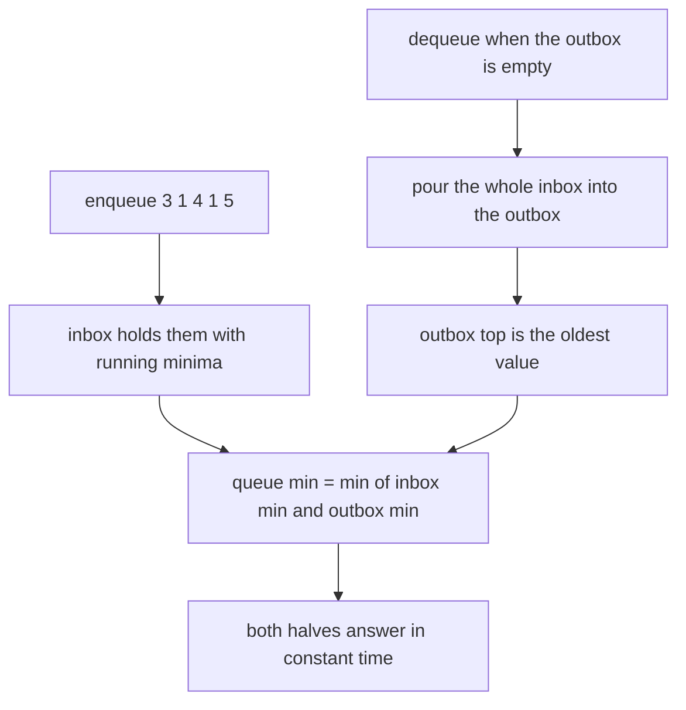
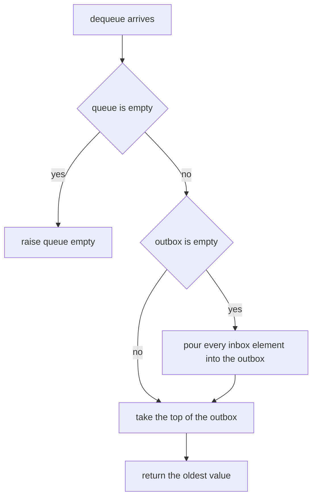
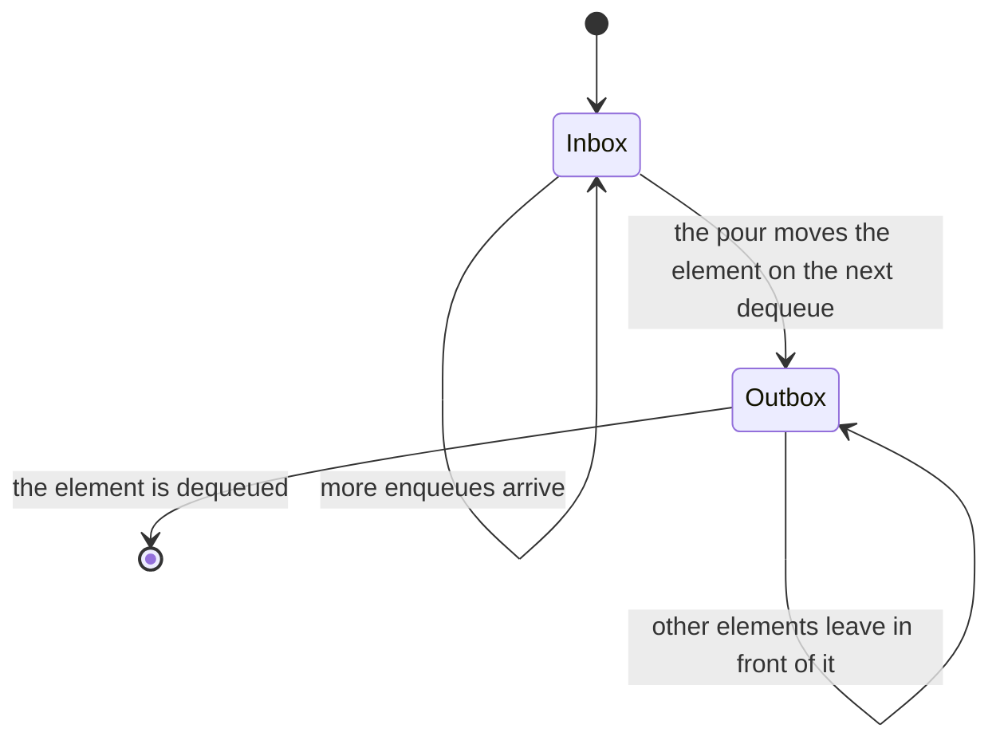
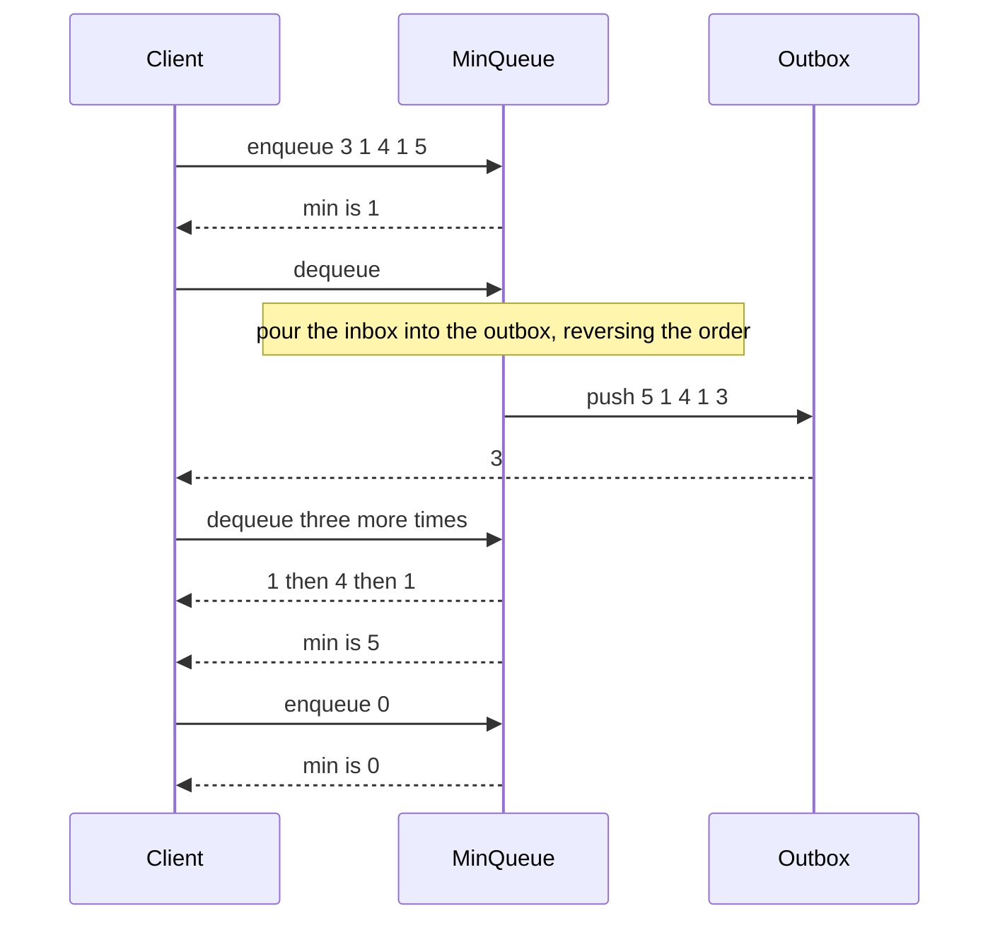

# 173 — Implement queue that supports getMin in O(1).

> **Tier:** Beginner · **CTCI chapter:** Ch 3 — Stacks and Queues
> **Task spec:** [173-implement-queue-that-supports-getmin-in-o-1.md](../../../tasks/beginner/173-implement-queue-that-supports-getmin-in-o-1.md)
> **Solutions:** [Python](../../../solutions/python/beginner/173-implement-queue-that-supports-getmin-in-o-1/solution.py) ·
> [Java](../../../solutions/java/beginner/173-implement-queue-that-supports-getmin-in-o-1/Solution.java) ·
> [JavaScript](../../../solutions/javascript/beginner/173-implement-queue-that-supports-getmin-in-o-1/solution.js) ·
> [C#](../../../solutions/csharp/beginner/173-implement-queue-that-supports-getmin-in-o-1/Solution.cs)

## 1. Problem restatement

**Input:** a sequence of queue operations — `enqueue(value)`, `dequeue()`, `min()`, plus `is_empty`.

**Output:** `dequeue` removes and returns the **oldest** value (FIFO), and `min` returns the smallest
value currently in the queue. Every operation must be `O(1)` amortised, so `min` may not scan.

The Python header comment describes the construction and the cost:

> *"Two min-stacks: `inbox` for enqueue, `outbox` for dequeue. Each stack pair keeps a running
> minimum, so min = min(inbox.min, outbox.min). All operations amortized O(1)."*

Conventions the four files share:

- Each half is the minimum-tracking stack of
  [172-implement-stack-that-supports-getmin-in-o-1.md](../../../tasks/beginner/172-implement-stack-that-supports-getmin-in-o-1.md):
  a data stack plus a parallel stack of running minima.
- `enqueue` pushes onto the inbox.
- `dequeue` moves **everything** from the inbox to the outbox when the outbox is empty, then pops the
  outbox once. That transfer reverses the order, which is what turns a stack into a FIFO.
- `min` combines the two halves: whichever half is empty contributes nothing, otherwise the answer is
  `min(inbox.min, outbox.min)`.
- `dequeue` and `min` on an empty queue raise: `IndexError` in Python, `NoSuchElementException` in
  Java, `Error` in JavaScript, `InvalidOperationException` in C#.

Contract table, from the assertions (the enqueue sequence is `3, 1, 4, 1, 5`):

| # | Operation | Result | Why |
| --- | --- | --- | --- |
| 1 | five enqueues, then `min()` | `1` | the smallest of `3, 1, 4, 1, 5` |
| 2 | `dequeue()`, `min()` | `3`, then `1` | the oldest value leaves; the minimum is still present |
| 3 | `dequeue()`, `min()` | `1`, then `1` | a duplicate `1` is still in the queue |
| 4 | `dequeue()`, `min()` | `4`, then `1` | the remaining minimum is untouched |
| 5 | `dequeue()`, `min()` | `1`, then `5` | the last `1` leaves, so the minimum becomes `5` |
| 6 | `enqueue(0)`, `min()` | `0` | a new value can lower the minimum while the other half is busy |
| 7 | `dequeue()`, `dequeue()`, `is_empty()` | `5`, then `0`, then empty | the queue drains in FIFO order |

## 2. Intuition

A queue cannot copy the stack solution directly. The minimum stack works because the only removable
element is the top, and the top is also the last element whose minimum entry was recorded. A queue
removes the **oldest** element, which may be anywhere in the middle of the value order — including the
minimum itself. Removing the minimum from the front must not destroy the record of the minimum of
everything behind it.

The classic two-stack queue already solves the *ordering* problem: push onto `inbox`, and when the
`outbox` runs dry, pour the whole inbox into it by popping and pushing. The reversal performed by the
pour means the outbox's top is the oldest value, so FIFO order emerges from two LIFO structures.

The key insight here is that the same pour also solves the *minimum* problem — provided both stacks
track their own running minimum. The queue's contents are exactly the union of the two stacks'
contents, so:

```
min(queue) = min(inbox.min, outbox.min)
```

Each half answers its own minimum in `O(1)`, and combining two numbers is `O(1)`, so the queue's
minimum is `O(1)` as well. No element is ever stored twice within one half, and the pour moves each
element between halves exactly once per phase.



Because the pour reverses order, the outbox's running-minimum stack is a running minimum over the
queue's oldest elements first — which is exactly what is needed when those elements leave one at a
time from the front.

## 3. Algorithm

1. Create two minimum-tracking stacks: `inbox` and `outbox`.
2. `enqueue(value)`: push onto `inbox`.
3. `dequeue()`: raise if both halves are empty. If `outbox` is empty, pour: while `inbox` is not
   empty, pop from `inbox` and push onto `outbox`. Then pop from `outbox` and return the value.
4. `min()`: raise if both halves are empty. If one half is empty, return the other half's minimum;
   otherwise return `min(inbox.min, outbox.min)`.
5. `is_empty()`: both halves are empty.

```text
function make_min_queue()
    return an object holding inbox ← make_min_stack() and outbox ← make_min_stack()
end

procedure enqueue(queue, value)
    push value onto queue.inbox
end

function dequeue(queue)
    if queue is empty then
        raise error "queue empty"
    end
    if size(queue.outbox) equals 0 then
        while size(queue.inbox) > 0 do
            push the value popped from queue.inbox onto queue.outbox
        end
    end
    return the value popped from queue.outbox
end

function min(queue)
    if queue is empty then
        raise error "queue empty"
    end
    if size(queue.inbox) equals 0 then
        return minimum of queue.outbox
    end
    if size(queue.outbox) equals 0 then
        return minimum of queue.inbox
    end
    return smaller of minimum of queue.inbox and minimum of queue.outbox
end
```

The inner minimum stack is the one built in task 172: a data stack plus a parallel stack whose `k`-th
entry is the minimum of the bottom `k` values.



The two halves over the lifetime of one queue, showing that an element visits at most two stacks:



## 4. Worked example

Trace the assertion sequence. The inbox is written bottom-to-top, so the top is the rightmost entry,
and the outbox likewise.

| # | Operation | `inbox` (data) | `inbox.mins` | `outbox` (data) | `outbox.mins` | `min()` | Returned |
| --- | --- | --- | --- | --- | --- | --- | --- |
| 1 | enqueue `3, 1, 4, 1, 5` | `3, 1, 4, 1, 5` | `3, 1, 1, 1, 1` | — | — | `1` | — |
| 2 | `dequeue()` | (poured) | — | `5, 1, 4, 1, 3` | `5, 1, 1, 1, 1` | `1` | `3` |
| 3 | `dequeue()` | empty | — | `5, 1, 4, 1` | `5, 1, 1, 1` | `1` | `1` |
| 4 | `dequeue()` | empty | — | `5, 1, 4` | `5, 1, 1` | `1` | `4` |
| 5 | `dequeue()` | empty | — | `5, 1` | `5, 1` | `1` | `1` |
| 6 | `min()` | empty | — | `5` | `5` | `5` | — |
| 7 | `enqueue(0)` | `0` | `0` | `5` | `5` | `0` | — |
| 8 | `dequeue()` | `0` | `0` | empty | — | `0` | `5` |
| 9 | `dequeue()` | empty | — | `0` | `0` | `0` | `0` |
| 10 | `is_empty()` | empty | — | empty | — | error | `true` |

Step 2 is the only place work beyond `O(1)` happens: the pour reverses `3, 1, 4, 1, 5` into
`5, 1, 4, 1, 3` and the top of the outbox becomes `3`, the oldest element. Step 3 shows why the
duplicate matters — the `1` that leaves is the one at queue position 2, and the other `1` (queue
position 4) keeps the minimum at `1`. Step 5 removes the *last* `1`, and only then does step 6 report
`5`. Step 7 shows that a fresh enqueue can lower the minimum even while the outbox still holds older
elements, since `min()` consults both halves.

Reading the same trace as a message exchange:



## 5. Complexity

Let `n` be the number of elements currently queued.

| Measure | Bound | Why it holds |
| --- | --- | --- |
| `enqueue` | O(1) | one push onto the inbox (and one onto its minimum stack) |
| `dequeue`, outbox non-empty | O(1) | one pop from the outbox |
| `dequeue`, outbox empty | O(k) for that call, then O(1) | the pour moves `k` elements once, and each is moved at most once per fill |
| `dequeue`, amortised | O(1) | an element is poured once when the outbox is filled and leaves once |
| `min` | O(1) | two top reads and one comparison; the empty-half cases are even cheaper |
| `is_empty` | O(1) | two length queries |
| Space | O(n) | each element lives in exactly one half's data stack, plus its entry in that half's minimum stack |
| Alternative: single deque with a monotone minimum deque | O(1) amortised, O(n) space | also works, but each element then holds up to two indices and the bookkeeping is easier to get wrong |
| Alternative: scan for the minimum | O(n) per `min()` | the naive version the task forbids |
| Alternative: keep one running minimum | incorrect | a dequeue can remove the minimum, and the next smallest value is unknown |

The amortised argument is the classic one: each element is pushed onto the inbox, poured onto the
outbox at most once, and popped from the outbox at most once. Three constant-cost touches per element
over its lifetime means an average of `O(1)` per operation, no matter how the enqueues and dequeues
are interleaved.

## 6. Pitfalls and edge cases

- **Pour only when the outbox is empty.** Pouring while the outbox still holds values would put
  newer elements on top of older ones and break FIFO order. The condition
  `if size(outbox) == 0` is what preserves the invariant "the outbox, read from the top down, is the
  oldest part of the queue".
- **The pour reverses order, and that is the point.** Popping the inbox pushes the newest element
  first and the oldest last, so the outbox's top is the oldest. Any "helpful" sorting or re-pushing
  would destroy the property.
- **`min` must consider both halves.** Looking only at the outbox misses freshly enqueued values;
  looking only at the inbox misses everything already poured. The three-way branch (inbox empty /
  outbox empty / both) is required, because calling `min` on an empty half is an error in the
  underlying structure.
- **Duplicate minima.** As in the stack case, two equal minima each keep their own entry in a half's
  minimum stack, so removing one does not prematurely change the queue minimum. Steps 3–5 of the
  trace are exactly that case.
- **Empty queue.** `dequeue` and `min` raise rather than returning a sentinel; the caller is expected
  to check `is_empty`. The queue checks emptiness *before* the pour, so it never pops from an empty
  inbox.
- **The inner stack does not check emptiness.** Its `pop` and `min` trust the caller — the queue
  performs the emptiness checks, and the pour loop condition `size(inbox) > 0` guarantees the inner
  pops are safe. Reusing that inner stack directly elsewhere would remove that guarantee.
- **Amortised, not worst case.** A single `dequeue` that triggers a pour costs `O(k)` for `k` queued
  elements. The header comment says *amortized O(1)*, and the assertions never time an individual
  operation, so this is by design rather than an oversight.
- **A single running minimum over the queue is wrong.** Unlike the stack, the queue's minimum cannot
  be maintained by one variable, because the element that leaves is the front, which may be the
  minimum with no information about the next smallest — the two-half construction is what recovers
  it.
- **Space is `O(n)` in the worst case but can be less.** Elements split between the halves, and each
  half keeps a parallel minimum stack, so an `n`-element queue can hold at most `2n` values in total
  — the same order as the stack of task 172, no worse.
- **JavaScript accessors.** The JavaScript implementation exposes `size` and `isEmpty` as getters,
  while the other languages call them as methods (`size()`, `Size`, `size`). The behaviour is
  identical; only the call syntax differs.

## 7. Variants and follow-ups

- **The stack primitive this builds on.** Push, pop and the parallel minimum stack are all in
  [172-implement-stack-that-supports-getmin-in-o-1.md](../../../tasks/beginner/172-implement-stack-that-supports-getmin-in-o-1.md).
- **The plain two-stack queue.** Without the minimum bookkeeping, the pour is the standard O(1)
  amortised queue: [050-implement-queue-with-array-enqueue-dequeue.md](../../../tasks/beginner/050-implement-queue-with-array-enqueue-dequeue.md).
- **Ring buffers.** When a fixed capacity is known, a circular array replaces the two stacks and the
  amortised pour becomes a wrap-around index calculation:
  [064-implement-circular-queue-ring-buffer.md](../../../tasks/beginner/064-implement-circular-queue-ring-buffer.md).
- **Monotone deques.** The alternative design keeps only the "useful" candidates for the minimum,
  which is the same pruning idea as the sliding-window maximum in
  [092-max-over-sliding-window-using-deque.md](../../../tasks/beginner/092-max-over-sliding-window-using-deque.md).

## 8. Check yourself

**Q1.** Why can the queue not use the stack's trick of a single parallel minimum array?

<details><summary>Show answer</summary>

Because a queue removes the *oldest* element, not the newest. The parallel array is indexed by depth,
and its top describes the minimum of everything up to the newest element; when the front leaves, the
remaining set is not a suffix or prefix of that history, so the array's top no longer answers the
question. Splitting the queue into two stacks makes "the remaining set" a union of two stack-shaped
sets, each of which the trick does handle.

</details>

**Q2.** After `enqueue(3, 1, 4, 1, 5)`, what does the pour produce, and why is the outbox top `3`?

<details><summary>Show answer</summary>

The pour pops `5, 1, 4, 1, 3` from the inbox and pushes them in that order, so the outbox (bottom to
top) is `5, 1, 4, 1, 3` and its top is `3` — the oldest element, which is now first in line to be
dequeued. That reversal is exactly what makes the FIFO order come out right.

</details>

**Q3.** `min()` consults both halves. What would go wrong if it returned only `outbox.min()`?

<details><summary>Show answer</summary>

Values enqueued after the last pour live only in the inbox, so their minimums would be ignored. In
step 7 of the trace, `enqueue(0)` lowers the queue minimum to `0`, but the outbox still holds `5` —
an outbox-only implementation would report `5`.

</details>

**Q4.** Is the `O(1)` bound per operation true in the worst case?

<details><summary>Show answer</summary>

No — a `dequeue` that triggers a pour is `O(k)` for the `k` elements currently in the inbox. The bound
is amortised: each element is poured at most once per fill, so the cost averages out to `O(1)`.
The header comment uses the word *amortized* deliberately.

</details>

**Q5.** Why does the queue check `is_empty` before pouring instead of relying on the inner stack?

<details><summary>Show answer</summary>

The inner minimum stack's `pop` and `min` do not check for emptiness — they trust the caller. The
queue performs the check once, up front, so both the pour and the final pop are safe. Without it, a
`dequeue` on an empty queue would raise an exception from the wrong place (or, in Python, an
`IndexError` from a list pop rather than the documented `IndexError` from the queue).

</details>
