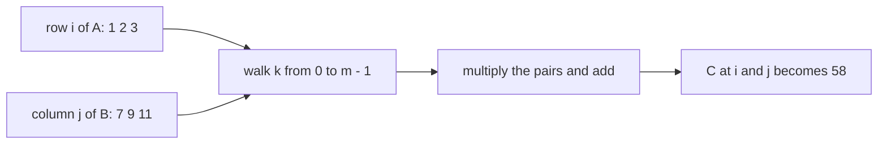
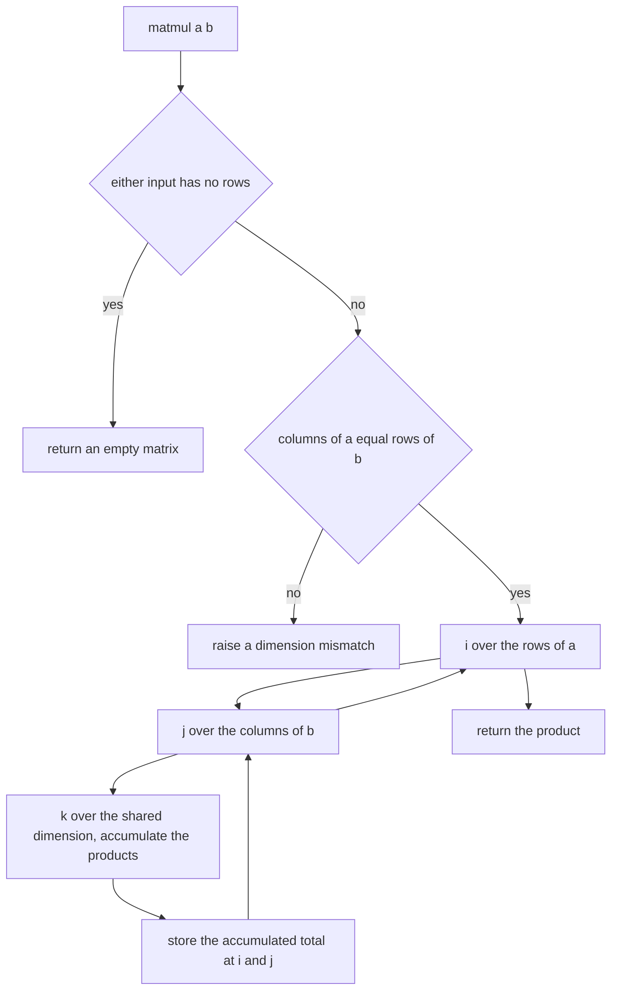
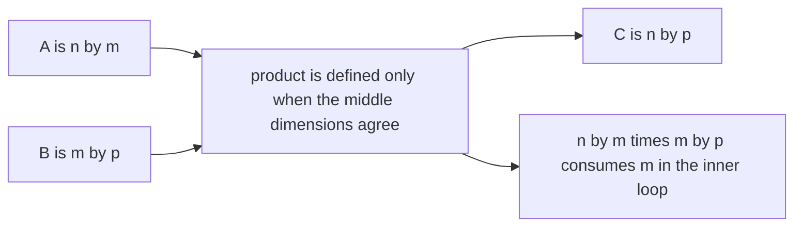
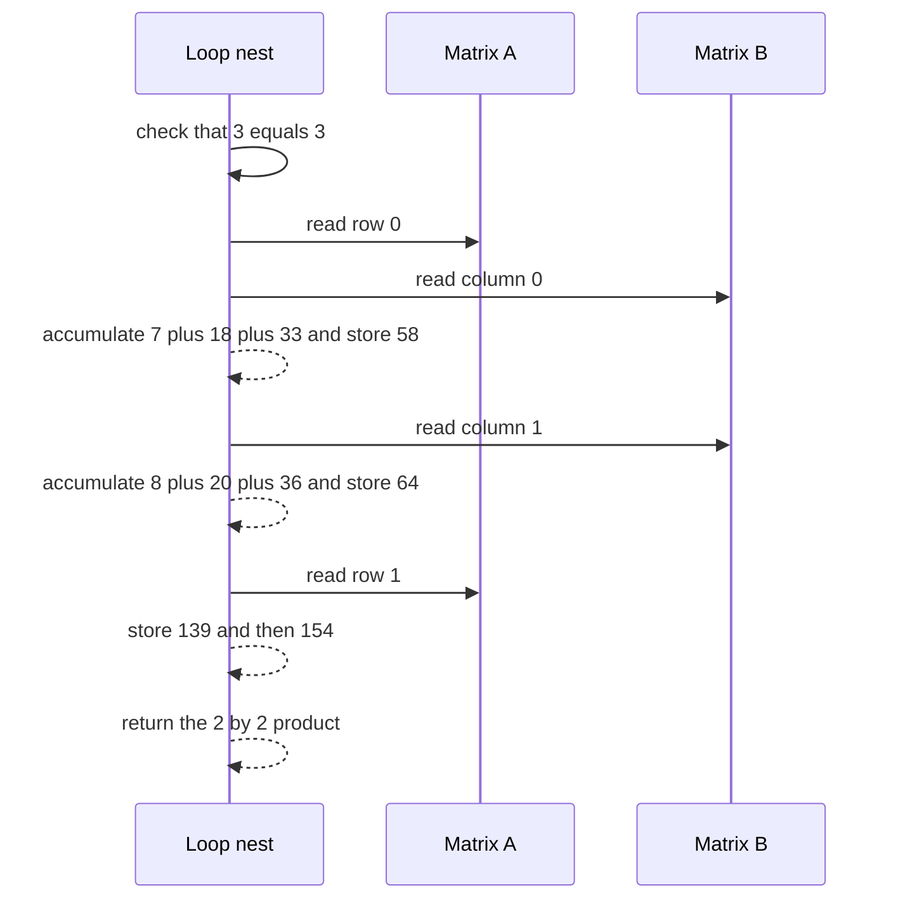

# 174 — Implement basic matrix multiplication (naive).

> **Tier:** Beginner · **CTCI chapter:** Ch 6 — Math and Logic Puzzles
> **Task spec:** [174-implement-basic-matrix-multiplication-naive.md](../../../tasks/beginner/174-implement-basic-matrix-multiplication-naive.md)
> **Solutions:** [Python](../../../solutions/python/beginner/174-implement-basic-matrix-multiplication-naive/solution.py) ·
> [Java](../../../solutions/java/beginner/174-implement-basic-matrix-multiplication-naive/Solution.java) ·
> [JavaScript](../../../solutions/javascript/beginner/174-implement-basic-matrix-multiplication-naive/solution.js) ·
> [C#](../../../solutions/csharp/beginner/174-implement-basic-matrix-multiplication-naive/Solution.cs)

## 1. Problem restatement

**Input:** two matrices of integers, `A` of shape `n × m` and `B` of shape `m × p`, given as arrays
of rows.

**Output:** the product `C = A × B` of shape `n × p`, where
`C[i][j] = sum over k of A[i][k] * B[k][j]`.

The Python header comment states the shape rule and the cost:

> *"C = A x B with the triple loop, O(n^3) for square n x n. Dimensions must match: A is (n x m) and
> B is (m x p) -> C is (n x p)."*

Conventions the four files share:

- Both inputs are checked for being empty first, and an empty input yields an empty matrix (`[]` /
  `new int[0][]`) rather than an error.
- The shapes are read as `n = rows(A)`, `m = columns(A)`, `m2 = rows(B)`, `p = columns(B)`, where the
  column counts come from the **first row** of each matrix.
- `m != m2` raises: `ValueError` in Python, `IllegalArgumentException` in Java, `ArgumentException` in
  C#, `Error` in JavaScript.
- The accumulator for each output cell is a plain integer sum, and the inner loop is the only place
  multiplication happens.

Contract table, from the assertions:

| `A` | `B` | Result | Why |
| --- | --- | --- | --- |
| `[[1, 2, 3], [4, 5, 6]]` | `[[7, 8], [9, 10], [11, 12]]` | `[[58, 64], [139, 154]]` | `2×3` times `3×2` gives `2×2` |
| `[[5, 6], [7, 8]]` | `[[1, 0], [0, 1]]` | `[[5, 6], [7, 8]]` | multiplying by the identity on the right changes nothing |
| `[[1, 0], [0, 1]]` | `[[5, 6], [7, 8]]` | `[[5, 6], [7, 8]]` | and multiplying by the identity on the left changes nothing either |
| `[[1, 2]]` | `[[3], [4]]` | `[[11]]` | `1×2` times `2×1` gives the scalar `1*3 + 2*4` |
| `[]` and `[]` | — | `[]` | asserted by the Python file: empty inputs short circuit before the shape check |
| `[[1, 2]]` | `[[1, 2]]` | raises | `1×2` cannot multiply `1×2`; the mismatch is rejected in all four languages |

The Python file asserts all six rows, the other three assert the shapes, the identity property and
the mismatch.

## 2. Intuition

The definition of matrix multiplication is a formula, and the naive implementation is that formula
translated literally: three nested loops. There is nothing to simplify — the interesting content of
the task is what the loops mean and what the shapes forbid.

The key insight for reading the loops is that `C[i][j]` is a **dot product**: take row `i` of `A` and
column `j` of `B`, walk both at the same speed, multiply the pairs and add them. The `k` index is the
shared walk position: `A[i][k]` moves across a row while `B[k][j]` moves down a column.



The second insight is the shape rule, and it is a rule about *counting*, not about values. The inner
loop walks `k` over `m` values on both sides: `A[i][k]` needs `m` to be the number of columns of `A`,
and `B[k][j]` needs the same `m` to be the number of rows of `B`. If those two counts disagree there
is no pairing to make, so the multiplication is undefined and the code refuses it instead of reading
out of bounds.

A detail worth noticing early: the output shape is determined entirely by `n` and `p`, and the inner
loop length `m` affects only the cost — not the shape of the answer.

## 3. Algorithm

1. If either input matrix has no rows, return an empty matrix.
2. Read `n` and `m` from `A`, `m2` and `p` from `B`, using the first row for the column counts.
3. If `m != m2`, raise a dimension-mismatch error.
4. Allocate `C` as `n` rows of `p` zeros.
5. For each `i` in `0..n-1`, for each `j` in `0..p-1`: accumulate
   `total = sum over k of A[i][k] * B[k][j]`, then store `total` in `C[i][j]`.
6. Return `C`.

```text
function matmul(a, b)
    if a has no rows or b has no rows then
        return an empty matrix
    end
    n ← number of rows of a
    m ← number of columns of a
    m2 ← number of rows of b
    p ← number of columns of b
    if m is not equal to m2 then
        raise error "dimension mismatch"
    end
    c ← matrix of n rows and p columns, all zeros
    for i ← 0 to n - 1 do
        for j ← 0 to p - 1 do
            total ← 0
            for k ← 0 to m - 1 do
                total ← total + a[i][k] * b[k][j]
            end
            c[i][j] ← total
        end
    end
    return c
end
```

The control flow is the shape check followed by the triple loop; note that the accumulation is
per-cell, so the loops can be reordered without changing the result (only the memory access pattern
changes).



The shape algebra that the check enforces:



## 4. Worked example

Multiply `A = [[1, 2, 3], [4, 5, 6]]` (`2×3`) by `B = [[7, 8], [9, 10], [11, 12]]` (`3×2`). The shape
check passes because both middle dimensions are `3`, and the output is `2×2`.

| Output cell | Row of `A` | Column of `B` | `k = 0` | `k = 1` | `k = 2` | Total |
| --- | --- | --- | --- | --- | --- | --- |
| `C[0][0]` | `1, 2, 3` | `7, 9, 11` | `1 * 7 = 7` | `2 * 9 = 18` | `3 * 11 = 33` | `58` |
| `C[0][1]` | `1, 2, 3` | `8, 10, 12` | `1 * 8 = 8` | `2 * 10 = 20` | `3 * 12 = 36` | `64` |
| `C[1][0]` | `4, 5, 6` | `7, 9, 11` | `4 * 7 = 28` | `5 * 9 = 45` | `6 * 11 = 66` | `139` |
| `C[1][1]` | `4, 5, 6` | `8, 10, 12` | `4 * 8 = 32` | `5 * 10 = 50` | `6 * 12 = 72` | `154` |

So `C = [[58, 64], [139, 154]]`, exactly the first assertion. Each output cell consumes one full row
of `A` and one full column of `B`, which is `m = 3` multiplications and `m` additions, for
`n · p · m = 2 · 2 · 3 = 12` multiplications in total.

The identity case is worth reading as a special instance of the same table: with
`B = [[1, 0], [0, 1]]`, each column of `B` has exactly one `1`, so every output cell keeps a single
term of the row — `[[5, 6], [7, 8]]` comes back unchanged from both sides.

The same computation as a message exchange, showing that the loop nest is just a schedule:



## 5. Complexity

Let `A` be `n × m` and `B` be `m × p`.

| Measure | Bound | Why it holds |
| --- | --- | --- |
| Time, best/average/worst | O(n · m · p) | the triple loop performs exactly `n · m · p` multiplications and additions, independent of the values |
| Time, square case | O(n³) | with `n = m = p` the bound becomes `n³`, as the header comment says |
| Time, empty input | O(1) | the emptiness check returns before any loop |
| Space, output | O(n · p) | the result matrix, which must be materialised |
| Space, extra | O(1) | `total` and the loop indices; the accumulation is per-cell and nothing else is allocated |
| Alternative: Strassen's algorithm | O(n^2.807) | trades a much larger constant and numerical stability for a better exponent at large `n` |
| Alternative: row-times-matrix with a transposed `B` | O(n · m · p) time, O(m · p) extra space | the same operations, reordered so the inner loop reads both operands contiguously — a locality win, not an asymptotic one |
| Alternative: sparse multiplication | O(nonzero products) | when most entries are zero, skip the zeros instead of multiplying them — see task 177 |

The naive bound is optimal for the straightforward formulation: every product `A[i][k] * B[k][j]`
contributes to some output cell, so no algorithm of this shape can skip work. Faster algorithms
(Strassen, or blocking for cache behaviour) change the shape of the computation rather than the
number of contributions.

## 6. Pitfalls and edge cases

- **Empty inputs short circuit.** `matmul([], [])` returns `[]` — the emptiness check comes **before**
  the dimension check, so an empty input never triggers the mismatch error, and reading `a[0]` would
  otherwise crash.
- **The mismatch must be detected.** `[[1, 2]] × [[1, 2]]` is `1×2` by `1×2`; the inner loop needs the
  columns of the first operand (2) to equal the rows of the second (1). The code raises instead of
  silently reading out of bounds, and all four files assert the exception.
- **Ragged input is not validated.** The column count comes from row 0 only, so a matrix whose other
  rows are shorter would be read past its end (undefined behaviour in the typed languages,
  `IndexError` in Python). Nothing checks rectangularity.
- **Shape order matters.** `A × B` and `B × A` are different products with different shapes; the
  identity assertions check both orders precisely because the trap is assuming commutativity.
- **Zero-sized dimensions.** A matrix with zero rows is treated as empty, but a matrix with rows of
  length zero, such as `[[]]`, has `m = 0`; the product would then be all zeros of shape `n × p`.
  No assertion covers it, and Python's `[[0] * p for _ in range(n)]` handles it.
- **Integer overflow is real for large values.** The accumulator is a machine integer in Java, C# and
  JavaScript, so products near the 32-bit or 53-bit limits wrap or lose precision silently. Python's
  integers are unbounded, so the Python file is the only one that cannot overflow.
- **The loops can be reordered.** `i`, `j`, `k` may be permuted, and even exchanged (accumulate into
  `C[i][j]` incrementally) with the same result; what cannot change is the set of triples visited.
- **Aliasing.** If the caller passed the same matrix for both inputs, the code still works because it
  never writes into `A` or `B` — the output is freshly allocated.
- **Empty versus one-row matrices.** `[[1]] × [[1]]` is `1×1`, not empty; the emptiness test is on
  the number of rows, not the number of elements.

## 7. Variants and follow-ups

- **Sparse matrices.** When almost every entry is zero, storing coordinates instead of a full grid
  turns the triple loop into a loop over non-zero pairs:
  [177-implement-basic-sparse-matrix-storage-coordinate-list.md](../../../tasks/beginner/177-implement-basic-sparse-matrix-storage-coordinate-list.md).
- **Transpose and rotate.** Printing or reshaping the result usually starts with
  [098-transpose-a-2d-matrix.md](../../../tasks/beginner/098-transpose-a-2d-matrix.md) or
  [099-rotate-matrix-90-degrees-clockwise-in-place-for-square.md](../../../tasks/beginner/099-rotate-matrix-90-degrees-clockwise-in-place-for-square.md).
- **Grid traversal rather than arithmetic.** The connectivity question in
  [176-check-matrix-connectivity-graph-view.md](../../../tasks/beginner/176-check-matrix-connectivity-graph-view.md)
  walks a matrix with the same nested-loop skeleton but no accumulation, which is a good reminder
  that the shape of the loops is independent of what the body does.
- **Doubling and blocking.** Multiplying repeatedly (matrix exponentiation) and the cache-friendly
  blocked loop order both build directly on this routine.

## 8. Check yourself

**Q1.** Why does the inner loop run over the columns of `A` and the rows of `B` at the same time?

<details><summary>Show answer</summary>

Because the two operands must be indexed by the *same* position for the pairs to correspond:
`A[i][k]` walks across a row of `A` while `B[k][j]` walks down a column of `B`. That shared position
only exists when the number of columns of `A` equals the number of rows of `B` — which is exactly the
dimension check.

</details>

**Q2.** How many multiplications does a `2×3` by `3×2` product perform, and how does that generalise?

<details><summary>Show answer</summary>

`n · m · p = 2 · 3 · 2 = 12`, as the four cells of the worked table show (three products each). In
general the triple loop performs exactly `n · m · p` multiplications, which is why the square case is
`O(n³)`.

</details>

**Q3.** `matmul([], [])` returns `[]` rather than raising a mismatch. Why is that the right order of
checks?

<details><summary>Show answer</summary>

Because an empty matrix has no first row, so the column counts cannot even be read. Checking emptiness
first avoids an index error and gives the natural identity-like answer "no rows in, no rows out". The
dimension check is only meaningful once both shapes are known.

</details>

**Q4.** Both identity assertions pass. What would change if matrices multiplied commutatively?

<details><summary>Show answer</summary>

Nothing would change for square matrices, which is why the tests would still pass — the point of
asserting both `A · I` and `I · A` is to pin down that the code multiplies in the order given, not to
detect a bug in the results. Commutativity fails in general (rectangular shapes, and different
results for the same two matrices when both orders are defined).

</details>

**Q5.** The result of a `1000×1000` square multiply is `10⁹` multiplications. What is the practical
bottleneck, and what is the one-line change that helps?

<details><summary>Show answer</summary>

Memory locality: the inner loop reads a column of `B` while walking a row of both matrices, so one of
the two accesses strides through memory. Transposing `B` first (an `O(m · p)` copy) makes the inner
loop read two contiguous rows, which typically improves constant factors substantially without
changing the `O(n³)` bound.

</details>
