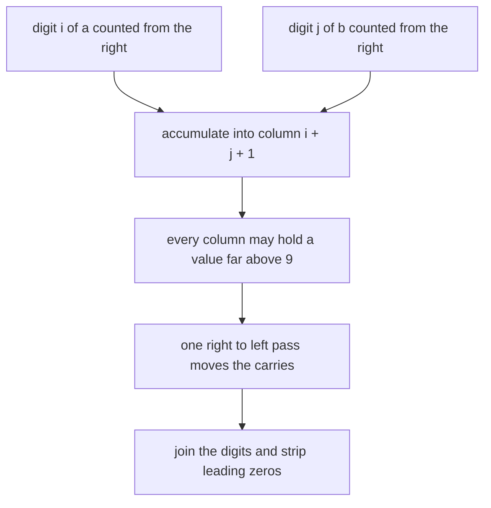
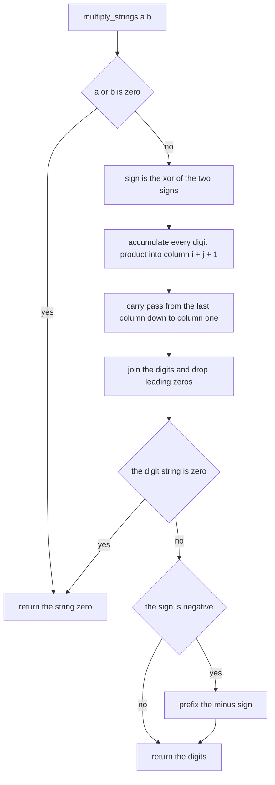
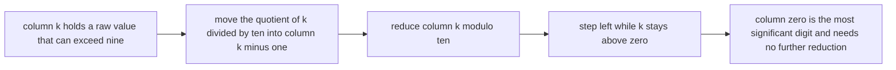
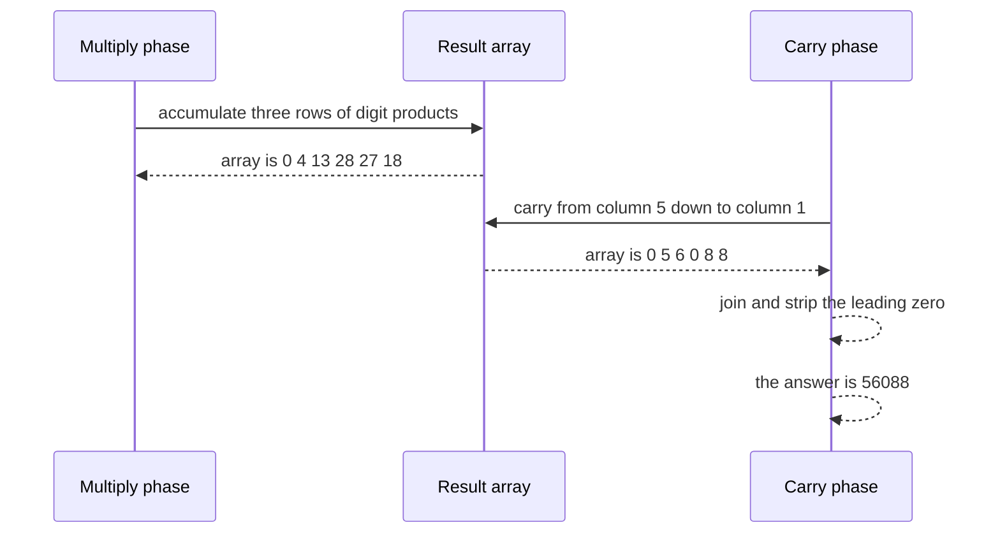

# 175 — Multiply large integers as strings.

> **Tier:** Beginner · **CTCI chapter:** Ch 6 — Math and Logic Puzzles
> **Task spec:** [175-multiply-large-integers-as-strings.md](../../../tasks/beginner/175-multiply-large-integers-as-strings.md)
> **Solutions:** [Python](../../../solutions/python/beginner/175-multiply-large-integers-as-strings/solution.py) ·
> [Java](../../../solutions/java/beginner/175-multiply-large-integers-as-strings/Solution.java) ·
> [JavaScript](../../../solutions/javascript/beginner/175-multiply-large-integers-as-strings/solution.js) ·
> [C#](../../../solutions/csharp/beginner/175-multiply-large-integers-as-strings/Solution.cs)

## 1. Problem restatement

**Input:** two integers given as decimal strings, `a` and `b`. They may carry a leading `-` and may
contain leading zeros; they may be far too long for the language's native integer type.

**Output:** the product, as a decimal string, with no leading zeros and no `-0`.

The Python header comment names the technique and its bound:

> *"Schoolbook multiplication into a digit array: O(n*m) time. Signs and leading zeros are handled;
> the result is verified against Python's own arbitrary-precision ints on large random inputs."*

Conventions the four files share:

- A zero operand short circuits to `"0"` before anything else happens.
- The sign is the XOR of the two input signs, so `-12 × 12` and `12 × -12` are negative while
  `-12 × -12` is positive.
- Both operands are stripped of their sign and converted to digit arrays.
- Products are accumulated into an output array of length `len(a) + len(b)` at index `i + j + 1`.
- A single right-to-left pass normalises the carries, and the digits are then joined and stripped of
  leading zeros.

Contract table, from the assertions:

| Call | Result | Why |
| --- | --- | --- |
| `multiply_strings("123", "456")` | `"56088"` | the schoolbook example traced below |
| `multiply_strings("0", "999")` | `"0"` | a zero operand short circuits |
| `multiply_strings("-12", "12")` | `"-144"` | one sign, so the product is negative |
| `multiply_strings("-12", "-12")` | `"144"` | two signs cancel |
| `multiply_strings("2", "3")` | `"6"` | asserted by the Python file: a single-digit product |
| `multiply_strings("99999", "99999")` | `"9999800001"` | a long carry chain through every position |
| 30 random pairs | equal to the language's own big-int product | Python and JavaScript draw 1–40 digit values, Java draws 1–120 bit values, C# draws 1–120 digit values |
| `"9" * 100` times itself | equal to the built-in product | 200-digit input, checked against `int` / `BigInteger` / `BigInt` |

## 2. Intuition

The naive implementation is `int(a) * int(b)` — and it is exactly what the task forbids, because the
point is to multiply digits that do not fit in a machine word. Python makes it easy to forget this;
JavaScript's `Number` loses precision past 2^53, and Java and C# need `BigInteger` explicitly.

The insight is the algorithm everybody learns in school, expressed as an array of columns. Write the
two numbers one above the other and multiply each pair of digits: digit `i` of `a` (counted from the
right) times digit `j` of `b` contributes to the column at `i + j`. Instead of handling carries during
the multiplication, accumulate **all** the raw products in their columns and normalise afterwards:

```
result[i + j + 1] += a_digits[i] * b_digits[j]
```

The `+ 1` is the detail that makes the array indexing clean: a number with `n` digits occupies
indices `1..n` of a length-`n+m` array, and the final carry has room at index 0.

The second insight is the size of the array. An `n`-digit number times an `m`-digit number has at
most `n + m` digits, so an array of exactly `len(a) + len(b)` slots can never overflow — no growth,
no bounds check, no dynamic resizing.



Accumulating first and carrying later is not just for elegance: it means the inner product loop never
writes to a neighbouring column, so the whole multiply phase is branch-free and trivially
parallelisable.

## 3. Algorithm

1. If `a` or `b` is `"0"`, return `"0"`.
2. `negative = (first character of a is '-') XOR (first character of b is '-')`.
3. Strip the signs and convert both operands to arrays of digit values.
4. Allocate `result` of `len(da) + len(db)` zeros.
5. For `i` from `len(da) - 1` down to `0`, for `j` from `len(db) - 1` down to `0`:
   `result[i + j + 1] += da[i] * db[j]`.
6. Normalise the carries from right to left: for `k` from the end down to `1`,
   `result[k - 1] += result[k] // 10` and `result[k] %= 10`.
7. Join the digits, strip leading zeros (an all-zero string becomes `"0"`), and prefix `-` when
   `negative` is true and the digit string is not `"0"`.

```text
function multiply_strings(a, b)
    if a equals "0" or b equals "0" then
        return "0"
    end
    negative ← (first character of a is "-") is different from (first character of b is "-")
    da ← digit values of a with any leading "-" removed
    db ← digit values of b with any leading "-" removed
    result ← array of length(da) + length(db), all zeros
    for i ← length(da) - 1 down to 0 do
        for j ← length(db) - 1 down to 0 do
            result[i + j + 1] ← result[i + j + 1] + da[i] * db[j]
        end
    end
    for k ← length(result) - 1 down to 1 do
        result[k - 1] ← result[k - 1] + result[k] / 10
        result[k] ← result[k] mod 10
    end
    digits ← the digits of result joined, with leading zeros removed
    if digits is empty then
        digits ← "0"
    end
    if digits equals "0" then
        return "0"
    end
    if negative then
        return "-" concatenated with digits
    end
    return digits
end
```

Three phases — accumulate, carry, format — and only the middle one touches neighbouring slots:



The carry pass in detail, since it is the step where off-by-one errors live:



## 4. Worked example

Multiply `"123"` by `"456"`. `da = [1, 2, 3]`, `db = [4, 5, 6]`, and the result array has
`3 + 3 = 6` slots.

The accumulation phase, one row per outer digit:

| `i` | `da[i]` | `j = 2`, `db[j] = 6` | `j = 1`, `db[j] = 5` | `j = 0`, `db[j] = 4` |
| --- | --- | --- | --- | --- |
| 2 | `3` | `result[5] += 18` | `result[4] += 15` | `result[3] += 12` |
| 1 | `2` | `result[4] += 12` → 27 | `result[3] += 10` → 22 | `result[2] += 8` |
| 0 | `1` | `result[3] += 6` → 28 | `result[2] += 5` → 13 | `result[1] += 4` |

After the multiply phase the array is `[0, 4, 13, 28, 27, 18]` — note that the columns are far above
9 and nothing has been carried yet. The normalisation pass then walks from the right:

| `k` | Value before | Carry into `k - 1` | Array after |
| --- | --- | --- | --- |
| 5 | `18` | `1` | `[0, 4, 13, 28, 28, 8]` |
| 4 | `28` | `2` | `[0, 4, 13, 30, 8, 8]` |
| 3 | `30` | `3` | `[0, 4, 16, 0, 8, 8]` |
| 2 | `16` | `1` | `[0, 5, 6, 0, 8, 8]` |
| 1 | `5` | `0` | `[0, 5, 6, 0, 8, 8]` |

The array is now `[0, 5, 6, 0, 8, 8]`, so joining gives `"056088"`, stripping the leading zero gives
`"56088"`, and the sign is positive — the asserted result. The leftover `0` in column 0 is the reason
the loop stops at `k = 1`: once every column from 1 upwards is a single digit, the leading column can
only hold the final most significant digit, because the total value is the true product and it is
strictly less than `10^(n+m)`.

The two sign cases are independent of all of this: `"-12" × "12"` runs the same digits-only pipeline
on `"12"` and `"12"` (producing `"144"`) and then prepends the sign because exactly one operand was
negative.



## 5. Complexity

Let `n = len(a)` and `m = len(b)` be the digit counts.

| Measure | Bound | Why it holds |
| --- | --- | --- |
| Time, best | O(n + m) | a zero operand returns after one comparison |
| Time, average/worst | O(n · m) | the nested loop performs exactly `n · m` multiplications and additions |
| Time, carry phase | O(n + m) | one pass over the `n + m` slots |
| Time, formatting | O(n + m) | join and strip leading zeros |
| Space, result | O(n + m) | the product has at most `n + m` digits, which is exactly the array length |
| Space, extra | O(n + m) | the two digit arrays plus the result array |
| Alternative: convert and multiply | O(1) with a 64-bit type only for small inputs | fails outright beyond 2^63 (Java/C# `long`) or 2^53 (JavaScript `Number`) |
| Alternative: Karatsuba | O(n^1.585) | splits each operand in half and uses three recursive multiplications; relevant for thousands of digits |
| Alternative: built-in big integers | asymptotically better in most libraries | used here only as the test oracle, never as the implementation |

For the sizes the assertions use — up to 120 digits, and 100 nines squared — the `n · m` bound is
around 10000 digit operations, which is why the schoolbook method is the right level of machinery.

## 6. Pitfalls and edge cases

- **Zero operands.** `"0" × "999"` must return `"0"`, and the early return prevents the carry phase
  from stripping an all-zero array into the empty string. It also keeps the sign logic out of play, so
  no `"-0"` can appear.
- **`-0` input.** `"-0"` does not equal `"0"`, so it takes the general path; its digits are all zero,
  the digit string becomes `"0"`, and the explicit `digits == "0"` check returns `"0"` **without** the
  sign. Skipping that check would print `"-0"`.
- **Sign XOR.** `(a[0] == '-') != (b[0] == '-')` (or `^` in Python and Java) is the whole sign rule:
  equal signs give a positive product, different signs a negative one. C# and Java compare the first
  character, so an input with a leading `+` is not recognised as a sign at all.
- **Index `i + j + 1`, not `i + j`.** The `+ 1` reserves column 0 for the final carry. With the
  off-by-one, `"123" × "456"` would place the product one column to the left and drop the leading
  digit of any result that needs `n + m` digits.
- **Carry everything before formatting.** The result columns can hold values in the hundreds (up to
  `9 · 9 = 81` times `min(n, m)` contributions), so they must be normalised before being joined as
  digits; joining first would print multi-character "digits".
- **The carry loop stops at `k = 1`.** Column 0 receives the last carry and is the most significant
  digit; once every lower column is below 10, the value in column 0 cannot exceed 9. Looping down to
  `k = 0` would index `-1` (Python's wraparound, an out-of-bounds access elsewhere).
- **Leading zeros in the input.** `"007" × "2"` runs on `[0, 0, 7]` and produces `"0014"`, which the
  final strip turns into `"14"`. Removing zeros before the multiply would change the column alignment
  and produce a wrong answer, so the strip must happen only on the output.
- **Leading zeros in the output.** `"99999" × "99999"` = `"9999800001"` is a ten-digit result from
  `5 + 5` slots, and shorter products leave unused slots at the front — hence the strip, and hence the
  fallback to `"0"` when the strip empties the string.
- **Accumulator width.** Each slot holds at most `min(n, m) · 81`, so an `int` is fine until the digit
  counts reach the millions; the intermediate quotient in the carry phase is equally small. Python has
  no width to worry about; JavaScript's numbers stay exact far beyond the test sizes.
- **The oracle is not the implementation.** Every file verifies against its own big-integer type in
  `main`, but the shipped function never calls it — the numbers in the tests exist to check the digit
  algorithm, not to replace it.
- **Unicode digits are not handled.** `charCodeAt(i) - 48` and `da[i] - '0'` assume ASCII. A
  non-ASCII digit would produce a negative or huge value rather than an error.

## 7. Variants and follow-ups

- **Fewer, larger digits.** Packing digits in base 10^4 or 10^9 reduces the number of inner-loop
  iterations by the same factor; the column arithmetic is unchanged.
- **Divide and conquer.** Splitting each number in half gives Karatsuba's `O(n^1.585)`, the natural
  follow-up when the operands grow past a few thousand digits.
- **The other big-integer strings.** Addition and subtraction share the digit-array shape but need no
  nested loop; the conversion pitfalls are the same as in
  [017-convert-string-to-integer-atoi-basic.md](../../../tasks/beginner/017-convert-string-to-integer-atoi-basic.md).
- **Same array arithmetic, different operation.** Matrix multiplication accumulates
  `A[i][k] * B[k][j]` into a cell instead of a column, but the "accumulate raw, normalise later"
  structure is identical:
  [174-implement-basic-matrix-multiplication-naive.md](../../../tasks/beginner/174-implement-basic-matrix-multiplication-naive.md).
- **Cheap digit-level summaries.** The byte-sum checksum of
  [168-implement-basic-checksum-sum-bytes.md](../../../tasks/beginner/168-implement-basic-checksum-sum-bytes.md)
  is the same walk over a digit array with a much smaller purpose.

## 8. Check yourself

**Q1.** Why is the result array exactly `len(a) + len(b)` long?

<details><summary>Show answer</summary>

Because the product of an `n`-digit and an `m`-digit number has at most `n + m` digits: it is bounded
by `(10^n - 1)(10^m - 1) < 10^(n+m)`. The `+ 1` indexing means columns `1..n+m-1` hold the low digits
and column 0 is available for a final carry, so no bounds check or growth is ever needed.

</details>

**Q2.** In the `"123" × "456"` trace, why is column 3 equal to 28 before the carry pass, and what
does it become?

<details><summary>Show answer</summary>

Three products land in column 3: `3 × 4 = 12`, `2 × 5 = 10` and `1 × 6 = 6`, giving 28. The carry
phase takes `28 mod 10 = 8` into the column and pushes `2` left into column 2. That single column is
the clearest illustration of why carrying must happen after all products are accumulated.

</details>

**Q3.** What does `multiply_strings("-12", "12")` return, and which line of the algorithm decides it?

<details><summary>Show answer</summary>

`"-144"`. The sign rule `(a[0] == '-') != (b[0] == '-')` is true for exactly one negative operand, so
the digits-only result `"144"` gets the `-` prefix. With both operands negative the same rule is false
and the product stays positive.

</details>

**Q4.** Why is the final `digits == "0"` check needed when a zero operand already short circuits?

<details><summary>Show answer</summary>

Because a zero *result* can arise without a zero *operand* in string form — for example the input
`"-0"`, whose digits are all zero. Without the check, the sign logic would happily produce `"-0"`.
It is a guard on the output, not a duplicate of the input test.

</details>

**Q5.** The tests verify 30 random pairs against the language's own big integers. Why not use those
types in the implementation?

<details><summary>Show answer</summary>

Because the task is to implement the digit algorithm; calling `BigInteger` or `BigInt` would answer
the question trivially and defeat the purpose. The built-in types are used as a *test oracle* — an
independent implementation to compare against — which is what makes the random assertions meaningful.

</details>
