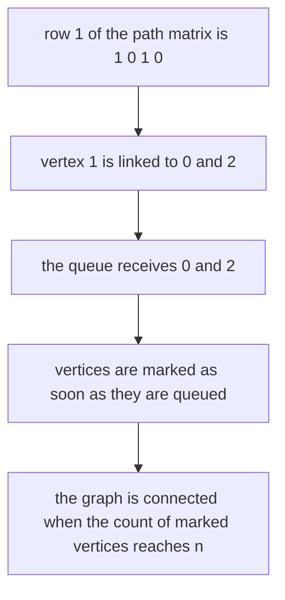
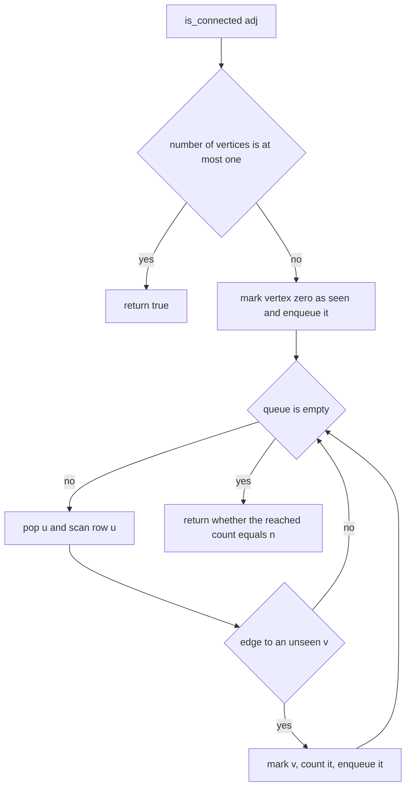
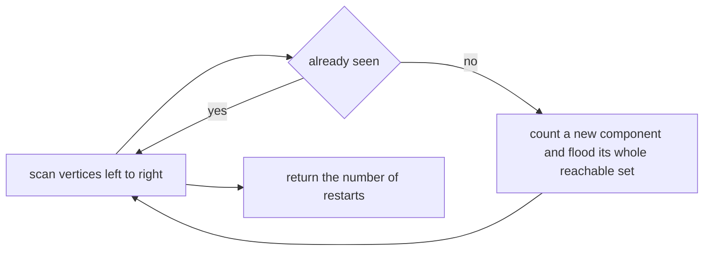
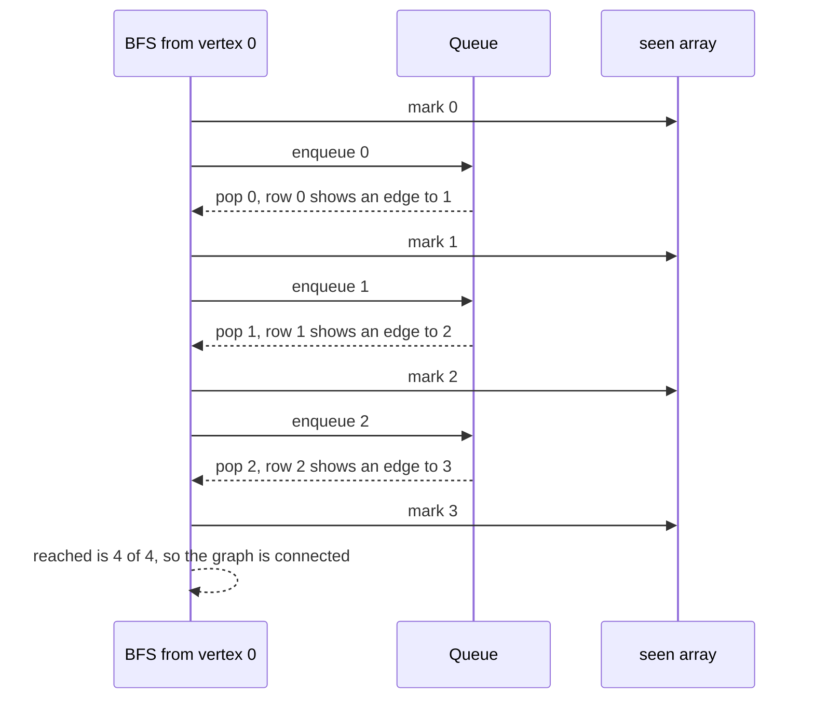

# 176 — Check matrix connectivity (graph view).

> **Tier:** Beginner · **CTCI chapter:** Ch 4 — Trees and Graphs
> **Task spec:** [176-check-matrix-connectivity-graph-view.md](../../../tasks/beginner/176-check-matrix-connectivity-graph-view.md)
> **Solutions:** [Python](../../../solutions/python/beginner/176-check-matrix-connectivity-graph-view/solution.py) ·
> [Java](../../../solutions/java/beginner/176-check-matrix-connectivity-graph-view/Solution.java) ·
> [JavaScript](../../../solutions/javascript/beginner/176-check-matrix-connectivity-graph-view/solution.js) ·
> [C#](../../../solutions/csharp/beginner/176-check-matrix-connectivity-graph-view/Solution.cs)

## 1. Problem restatement

**Input:** a square `n × n` matrix `adj` of 0s and 1s, read as the **adjacency matrix** of an
undirected graph on vertices `0..n-1`. `adj[i][j] == 1` means "there is an edge between `i` and `j`",
and the diagonal is zero in every test case.

**Output:** two related facts about the graph:

- `is_connected(adj)` — `true` when a single traversal from vertex 0 reaches every vertex.
- `connected_components(adj)` — the number of connected components, computed by the second function
  the files ship as a bonus view of the same structure.

The Python header comment states the model and the cost, and also the degenerate case:

> *"An adjacency matrix defines an undirected graph: adjacency[i][j] = 1 means an edge. The graph is
> connected iff BFS/DFS from 0 reaches every vertex. O(n^2)."*

> *"adj is a square 0/1 matrix. Empty/1x1 graphs count as connected."*

Contract table, from the assertions:

| Matrix | Shape of the graph | `is_connected` | `connected_components` |
| --- | --- | --- | --- |
| `[[0,1,0,0],[1,0,1,0],[0,1,0,1],[0,0,1,0]]` | a path `0-1-2-3` | `true` | `1` |
| `[[0,1,0,0],[1,0,0,0],[0,0,0,1],[0,0,1,0]]` | two disjoint edges | `false` | `2` |
| `[[0,1,1,0],[1,0,0,0],[1,0,0,0],[0,0,0,0]]` | a star on `{0,1,2}` plus an isolated vertex `3` | `false` | `2` |
| `[]` | no vertices | `true` | — |
| `[[0]]` | one vertex, no edges | `true` | — |
| `[[0,1],[1,0]]` | one edge | `true` | — (asserted by the Python file) |

The empty and single-vertex cases go through the `n <= 1` shortcut, so no traversal is started.

## 2. Intuition

The naive way to read the question is "does every vertex appear somewhere in the matrix?" — and it
is wrong, because appearing in an edge is not the same as being *reachable* from vertex 0. The three
test graphs make the point: the isolated vertex `3` of the third matrix is present in the matrix (it
has a row and a column) and still misses the traversal, so the answer is `false`.

The key insight is that connectivity is a **reachability** property, not a local one. Two vertices are
in the same component exactly when a path connects them, and the standard way to find all such
vertices is a traversal: start anywhere, follow every edge you can, and see which vertices you touch.
Vertex 0 is a perfectly good start — if the graph is connected, it reaches everything by definition.

The second insight is about the shape of the input. An adjacency **matrix** stores the edges as `n`
rows of `n` flags, so enumerating the neighbours of a vertex `u` is a scan of row `u`. The traversal
therefore costs `O(n)` per visited vertex and `O(n²)` in total — it touches the whole matrix in the
worst case, whether or not most of it is zeros.



Marking on **enqueue**, not on dequeue, is the detail that keeps the traversal linear: it guarantees
each vertex enters the queue at most once, even when many edges lead to it.

## 3. Algorithm

`is_connected`:

1. Let `n` be the number of rows. If `n <= 1`, return `true` — an empty or single-vertex graph is
   connected by definition.
2. Allocate `seen` of `n` flags, mark `seen[0] = true`, and put vertex 0 in a queue with
   `reached = 1`.
3. While the queue is not empty: pop `u`; for every `v` where `adj[u][v] == 1` and `seen[v]` is
   false, mark `v`, increment `reached`, and enqueue `v`.
4. Return `reached == n`.

`connected_components`:

5. Allocate `seen` and a counter.
6. For each `start` from 0 to `n - 1`: if it is already seen, skip it; otherwise increment the
   counter and run the same traversal from `start`, marking everything it reaches.
7. Return the counter.

```text
function is_connected(adj)
    n ← number of rows of adj
    if n <= 1 then
        return true
    end
    seen ← array of n flags, all false
    seen[0] ← true
    queue ← queue containing vertex 0
    reached ← 1
    while queue is not empty do
        u ← remove the front of queue
        for v ← 0 to n - 1 do
            if adj[u][v] equals 1 and seen[v] is false then
                seen[v] ← true
                reached ← reached + 1
                append v to queue
            end
        end
    end
    return reached equals n
end

function connected_components(adj)
    n ← number of rows of adj
    seen ← array of n flags, all false
    components ← 0
    for start ← 0 to n - 1 do
        if seen[start] is false then
            components ← components + 1
            seen[start] ← true
            queue ← queue containing start
            while queue is not empty do
                u ← remove the front of queue
                for v ← 0 to n - 1 do
                    if adj[u][v] equals 1 and seen[v] is false then
                        seen[v] ← true
                        append v to queue
                    end
                end
            end
        end
    end
    return components
end
```

Both functions are the same inner routine; the second one just restarts it on every vertex that the
previous rounds failed to reach.



How the component counter differs: the traversal is restarted once per component, and the number of
restarts is the answer.



## 4. Worked example

Take the path graph `0-1-2-3`, whose matrix is

```text
     0  1  2  3
0 [  0  1  0  0 ]
1 [  1  0  1  0 ]
2 [  0  1  0  1 ]
3 [  0  0  1  0 ]
```

| Step | Queue before | `u` popped | Row `u` | Neighbours found | `reached` | `seen` after |
| --- | --- | --- | --- | --- | --- | --- |
| 1 | `[0]` | `0` | `0, 1, 0, 0` | `1` is new | 2 | `0, 1` |
| 2 | `[1]` | `1` | `1, 0, 1, 0` | `2` is new (`0` is seen) | 3 | `0, 1, 2` |
| 3 | `[2]` | `2` | `0, 1, 0, 1` | `3` is new (`1` is seen) | 4 | `0, 1, 2, 3` |
| 4 | `[3]` | `3` | `0, 0, 1, 0` | none (`2` is seen) | 4 | unchanged |

The queue empties with `reached = 4 = n`, so `is_connected` returns `true` and
`connected_components` returns `1`, as asserted. Step 2 is worth noting: vertex `1` is scanned even
though vertex `0` already pointed back at it, and the `seen` test is what stops the traversal from
ping-ponging between the two.

Now the split graph, which is two disjoint edges:

| Start | Component reached | Components so far |
| --- | --- | --- |
| `0` (unseen) | `{0, 1}` from `0 - 1` | `1` |
| `1` | already seen, skipped | `1` |
| `2` (unseen) | `{2, 3}` from `2 - 3` | `2` |
| `3` | already seen, skipped | `2` |

Two restarts, so `connected_components` returns `2`, and `is_connected` returns `false` because the
traversal from vertex 0 only counted 2 of the 4 vertices.



## 5. Complexity

Let `n` be the number of vertices, so the matrix has `n²` entries.

| Measure | Bound | Why it holds |
| --- | --- | --- |
| Time, best | O(1) | the `n <= 1` shortcut returns immediately |
| Time, average | O(n²) | each popped vertex scans a full row of `n` flags, and at most `n` vertices are popped |
| Time, worst | O(n²) | a complete graph pops every vertex and scans every row: exactly `n²` flag tests |
| Time, `connected_components` | O(n²) | each vertex is scanned once per component it attends, and the outer scan covers all rows |
| Space | O(n) | the `seen` flags plus the queue, which holds at most `n` vertices |
| Alternative: adjacency list plus BFS | O(n + e) time, O(n + e) space | skips the zeros, so it is better whenever the graph is sparse |
| Alternative: union-find | O(n² α(n)) here, or O(e log n) with a sorted edge list | answers connectivity and component counts for edges arriving over time |
| Alternative: DFS instead of BFS | O(n²) time, O(n) space for the explicit stack | same asymptotics; recursion depth is `n`, which can overflow on large graphs |
| Alternative: matrix powers or transitive closure | O(n³) or O(n^2.807) | answers "is there a path of length at most k", which is far more than this task needs |

The `O(n²)` bound is the price of the matrix representation, and it is worth reading the alternative
column carefully: for a sparse graph with `n = 10^5` vertices and `10^5` edges, the matrix would be
`10^10` entries — impossible to store — while the adjacency list version runs in `O(n + e)`.

## 6. Pitfalls and edge cases

- **Presence is not reachability.** A vertex with a full row of zeros is in the matrix but in no
  component with anyone else; the star-plus-isolated-vertex assertion exists exactly to catch a
  "does every vertex appear?" shortcut.
- **Degenerate graphs are connected.** `[]` and `[[0]]` both return `true` — a graph with fewer than
  two vertices has nothing to connect, and the shortcut also avoids reading `seen[0]` from an empty
  array.
- **Mark on enqueue, not on dequeue.** Marking only when a vertex leaves the queue lets the same
  vertex be enqueued many times, which both breaks the `reached` count and can blow the queue up.
- **Self-loops.** A `1` on the diagonal such as `adj[u][u]` is skipped by the `seen[v]` test when
  `v == u`, so self-loops do not affect the traversal. The test matrices have a zero diagonal.
- **The matrix is assumed symmetric.** Only row `u` is scanned, so an asymmetric matrix is traversed
  as a *directed* graph and the answer becomes "reachable from 0 in the directed sense". Nothing
  validates symmetry.
- **Unweighted and 0/1 only.** Any non-zero entry counts as an edge in principle, but the code tests
  `adj[u][v] == 1` (Python's truthiness also accepts any non-zero), so weighted input would need the
  comparison adjusted.
- **`reached == n` versus "queue emptied".** The two are equivalent here, but the count makes the
  intent explicit and gives `O(1)` access to how many vertices were missed — the diagnostic used in
  the split-graph trace.
- **Component counting restarts the traversal.** The outer loop is over starts, not over edges, so
  the count is the number of times a flood had to be launched — not the number of edges or the number
  of isolated pairs.
- **JavaScript's `shift()`.** The JavaScript implementation dequeues with `Array.prototype.shift`,
  which is `O(n)` on a plain array, so the queue operations add an extra factor; the other three use a
  proper deque or queue (`deque.popleft`, `ArrayDeque.poll`, `Queue.Dequeue`). The asymptotics of the
  traversal as a whole are dominated by the `O(n)` row scans anyway.
- **Recursion depth.** A DFS variant that recurses once per vertex would need a stack of depth `n`; the
  shipped solutions are all iterative BFS, which has no depth limit.
- **Disconnected input is not an error.** `is_connected` returns `false` and `connected_components`
  returns a number above 1; neither raises.

## 7. Variants and follow-ups

- **Sparse graphs.** When the edges are few, an adjacency list plus the same BFS is `O(n + e)`:
  [104-implement-bfs-on-adjacency-list-graph.md](../../../tasks/beginner/104-implement-bfs-on-adjacency-list-graph.md).
- **DFS instead of BFS.** The same reachability with a stack instead of a queue:
  [105-implement-dfs-recursive-on-graph.md](../../../tasks/beginner/105-implement-dfs-recursive-on-graph.md).
- **Grid connectivity.** The same flood idea on a matrix where neighbours come from the four
  directions rather than from a row of flags:
  [101-count-islands-in-boolean-grid-dfs.md](../../../tasks/beginner/101-count-islands-in-boolean-grid-dfs.md)
  and [102-flood-fill-algorithm-dfs-bfs.md](../../../tasks/beginner/102-flood-fill-algorithm-dfs-bfs.md).
- **Shortest distances.** BFS reaches vertices in order of distance, so the same code can report the
  path length instead of a boolean:
  [103-shortest-path-in-unweighted-grid-bfs.md](../../../tasks/beginner/103-shortest-path-in-unweighted-grid-bfs.md).
- **Counting components in a directed graph.** Once edges have a direction, "connected" splits into
  weak and strong connectivity and needs the machinery of
  [280-count-connected-components-in-directed-graph-strongly-connected.md](../../../tasks/intermediate/280-count-connected-components-in-directed-graph-strongly-connected.md).

## 8. Check yourself

**Q1.** Why does the third test graph fail `is_connected` even though vertex 3 is in the matrix?

<details><summary>Show answer</summary>

Because vertex 3 has no edges at all — its whole row is zeros. The traversal from vertex 0 reaches
only `{0, 1, 2}`, so `reached` is 3 against `n = 4`. Connectivity is about paths, not about a vertex
existing in the input.

</details>

**Q2.** Why mark a vertex when it is enqueued rather than when it is dequeued?

<details><summary>Show answer</summary>

So that each vertex enters the queue at most once. If marking happened on dequeue, two neighbours of
the same vertex could both enqueue it before either popped it, the `reached` counter would double-count
it, and the queue could grow far beyond `n` entries.

</details>

**Q3.** The graph is undirected; what would change if the matrix were not symmetric?

<details><summary>Show answer</summary>

The traversal only ever follows row `u`, so it would follow the direction `u → v` and answer a
directed reachability question: "which vertices can be reached *from* 0". The code does not check
symmetry, so an input with `adj[0][1] = 1` and `adj[1][0] = 0` would silently be treated as directed.

</details>

**Q4.** How many components does the star-plus-isolated-vertex graph have, and how does the counter
reach that number?

<details><summary>Show answer</summary>

Two: `{0, 1, 2}` and `{3}`. The outer loop starts at 0, floods the star, and moves on; vertices 1 and
2 are already seen and are skipped; when it reaches 3 nothing has marked it, so a second flood is
launched and the counter becomes 2.

</details>

**Q5.** A smaller graph can be traversed with DFS. Why do all four solutions use BFS?

<details><summary>Show answer</summary>

For plain reachability the two are interchangeable, and DFS with an explicit stack keeps the same
`O(n²)` time and `O(n)` space. BFS was chosen for the shipped solutions because its queue cannot
overflow the call stack on large graphs, and because the same traversal extends directly to shortest
paths, where the level order matters.

</details>
