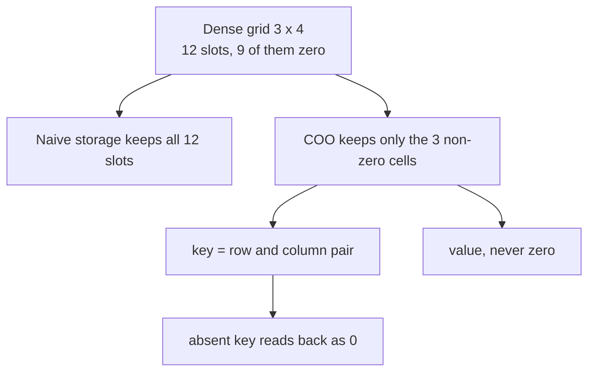
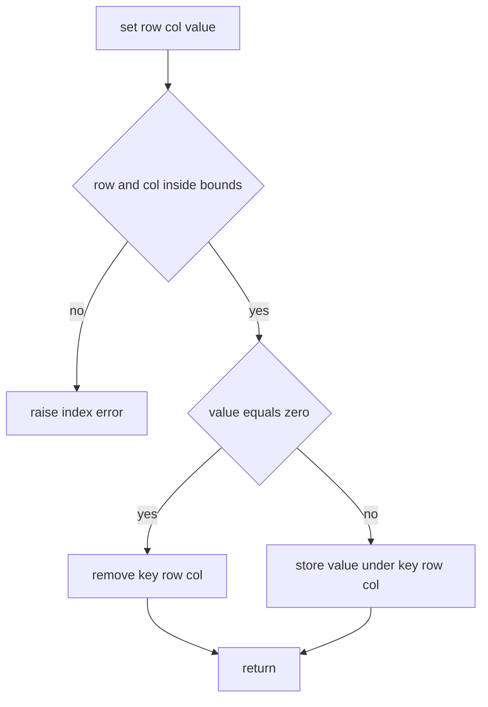
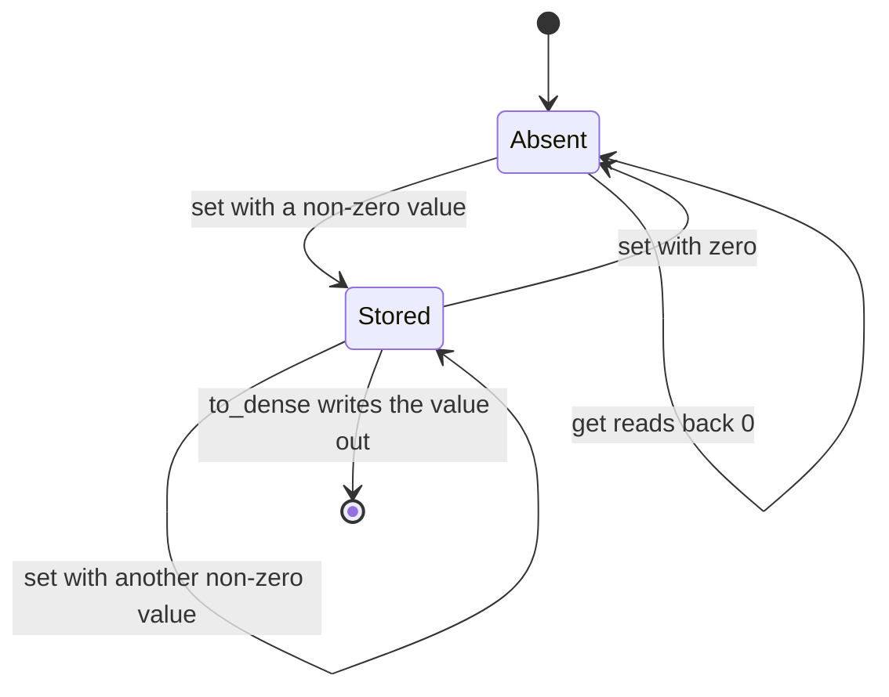
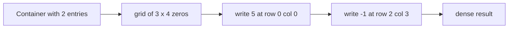

# 177 — Implement basic sparse matrix storage (coordinate list).

> **Tier:** Beginner · **CTCI chapter:** Ch 7 — Object-Oriented Design
> **Task spec:** [177-implement-basic-sparse-matrix-storage-coordinate-list.md](../../../tasks/beginner/177-implement-basic-sparse-matrix-storage-coordinate-list.md)
> **Solutions:** [Python](../../../solutions/python/beginner/177-implement-basic-sparse-matrix-storage-coordinate-list/solution.py) ·
> [Java](../../../solutions/java/beginner/177-implement-basic-sparse-matrix-storage-coordinate-list/Solution.java) ·
> [JavaScript](../../../solutions/javascript/beginner/177-implement-basic-sparse-matrix-storage-coordinate-list/solution.js) ·
> [C#](../../../solutions/csharp/beginner/177-implement-basic-sparse-matrix-storage-coordinate-list/Solution.cs)

## 1. Problem restatement

**Input:** a matrix shape `(rows, cols)`, plus a sequence of `set(row, col, value)` and
`get(row, col)` calls. Values are integers; `rows` and `cols` are non-negative.

**Output:** a `SparseMatrix` object that

- stores only the non-zero cells of the matrix,
- answers `get` with `0` for every cell that was never stored,
- reports its stored-cell count as `nnz()` (Python, Java) or `nnz` (JavaScript, C#),
- converts itself back to a dense grid with `to_dense()` / `toDense()`.

The task spec is one line long, so the exact contract comes from the assertions the four
solution files ship with. All four build the same object and assert the same numbers:

| Call | Result | Why |
| --- | --- | --- |
| `SparseMatrix(3, 4)` then `set(0, 0, 5)`, `set(1, 2, 7)`, `set(2, 3, -1)` | `nnz == 3` | only three cells were written |
| `to_dense()` on that matrix | `[[5, 0, 0, 0], [0, 0, 7, 0], [0, 0, 0, -1]]` | every unstored cell materialises as `0` |
| `set(1, 2, 0)` afterwards | `nnz == 2`, `get(1, 2) == 0` | writing zero *removes* the entry |
| `SparseMatrix(2, 2)` | `nnz == 0`, `to_dense() == [[0, 0], [0, 0]]` | an all-zero matrix stores nothing |
| `get(5, 0)` on the 3×4 matrix | throws | `5` is outside `rows`, so the call is rejected |
| `SparseMatrix(-1, 4)` | throws | negative dimensions are rejected at construction |

Only Python exposes `coordinates()`, which returns the stored `((row, col), value)` pairs in
sorted order, and `row(r)`, which materialises one dense row. JavaScript, Java and C# keep the
same state but expose fewer accessors.

## 2. Intuition

The naive representation is a dense two-dimensional array of `rows * cols` slots. It makes
`set` and `get` trivially `O(1)`, but it pays for the zeros: a 3×4 grid with three non-zero
cells still allocates twelve slots, and a realistic sparse matrix (a graph adjacency matrix, a
recommender-system rating table, a finite-element stiffness matrix) wastes the overwhelming
majority of its memory on zeros.

The key insight is that **zero needs no storage because it is the default**. If a cell is
absent from the container, reading it yields `0`; therefore only cells with a non-zero value
have to exist in the container at all. That flips the data structure from "a grid that happens
to contain many zeros" into "a set of non-zero coordinates", which is the coordinate (COO)
format:

- a container keyed by the coordinate pair `(row, col)`,
- values stored under those keys, and
- the invariant *no stored value is zero*.

The invariant has a second half that falls out of it: assigning `0` to a cell is exactly the
same statement as *deleting* the cell. That is why all four solutions route `value == 0` in
`set` to a removal instead of a write.



The four languages spell the key differently, but the idea is identical:

| Language | Container | Key |
| --- | --- | --- |
| Python | `dict` | the tuple `(row, col)` |
| Java | `HashMap<Long, Integer>` | the packed integer `row * cols + col`, widened to `long` |
| JavaScript | `Map` | the string `` `${row},${col}` `` |
| C# | `Dictionary<(int, int), int>` | the value tuple `(row, col)` |

Java is the one that needs arithmetic: a hash map cannot key on a tuple without an extra
object, so it folds the pair into a single number. Because `col < cols` always holds for a
valid cell, the fold is a bijection, and the `long` cast keeps it a bijection for shapes whose
product overflows a 32-bit integer.

## 3. Algorithm

1. **Construct.** Reject negative `rows` or `cols`. Remember the shape, create an empty
   container.
2. **`set(row, col, value)`.** Reject out-of-range coordinates. If `value` is zero, remove the
   key (no-op when it was absent). Otherwise store the value under the key, overwriting any
   previous value.
3. **`get(row, col)`.** Reject out-of-range coordinates. Return the stored value, or `0` when
   the key is absent.
4. **`nnz()`.** Return the container size. The invariant guarantees this is the number of
   non-zero cells.
5. **`to_dense()`.** Allocate a `rows × cols` grid filled with `0`, then write every stored
   value into its slot.
6. **`coordinates()` (Python only).** Return the key/value pairs sorted, so the caller has a
   deterministic order — hash container iteration order is otherwise unspecified.

```text
procedure set(row, col, value)
    check_bounds(row, col)
    if value = 0 then
        remove key(row, col) from data
    else
        data[key(row, col)] ← value
    end
end

procedure get(row, col)
    check_bounds(row, col)
    if key(row, col) is in data then
        return data[key(row, col)]
    end
    return 0
end

procedure to_dense()
    dense ← new rows x cols grid filled with 0
    for each (key, value) in data do
        (row, col) ← decode(key)
        dense[row][col] ← value
    end
    return dense
end

procedure check_bounds(row, col)
    if row &lt; 0 or row ≥ rows or col &lt; 0 or col ≥ cols then
        raise index error
    end
end
```

The control flow of `set` is the whole data structure in one picture — bounds first, then a
three-way decision (remove / insert / overwrite):



The same structure read as a lifecycle: a cell is either absent or stored, and it moves between
those two states according to what `set` is given.



Note that `get` never changes the state. Reading an absent cell is not a reason to allocate it —
a lazy "touch on read" would turn queries into mutations and break the `nnz` invariant.

## 4. Worked example

Trace the exact assertion sequence from the Python file:

```text
m = SparseMatrix(3, 4)
m.set(0, 0, 5); m.set(1, 2, 7); m.set(2, 3, -1)
m.set(1, 2, 0)
```

| Step | Call | Bounds | Zero? | Container after | `nnz` |
| --- | --- | --- | --- | --- | --- |
| start | `SparseMatrix(3, 4)` | — | — | `{}` | 0 |
| 1 | `set(0, 0, 5)` | ok | no | `{(0,0): 5}` | 1 |
| 2 | `set(1, 2, 7)` | ok | no | `{(0,0): 5, (1,2): 7}` | 2 |
| 3 | `set(2, 3, -1)` | ok | no | `{(0,0): 5, (1,2): 7, (2,3): -1}` | 3 |
| 4 | `get(0, 1)` | ok | — | unchanged, key absent → `0` | 3 |
| 5 | `set(1, 2, 0)` | ok | yes | `{(0,0): 5, (2,3): -1}` | 2 |
| 6 | `get(5, 0)` | out of range | — | unchanged, raises | 2 |

Step 5 is the interesting one: `(1, 2)` was *not* overwritten with a zero, it was dropped. If
the implementation had written `0` instead, `nnz` would still report 3 while the matrix only
had two non-zero cells, and every later operation that trusts `nnz` (a row scan, a filter, a
serializer) would do one unit of useless work per phantom cell.

`to_dense()` then expands the three remaining pairs back into the grid:



The Python assertions also cover the empty matrix: `SparseMatrix(2, 2)` has `nnz() == 0` and
`to_dense() == [[0, 0], [0, 0]]`, because the allocation loop runs `rows * cols` times
regardless of how many entries exist. That is the boundary case where the sparse
representation's advantage disappears — a small all-zero matrix costs nothing to store but
still costs `rows * cols` to materialise.

## 5. Complexity

Let `nnz` be the number of stored (non-zero) cells and let `R`, `C` be the shape.

| Operation | Time | Reason |
| --- | --- | --- |
| `set` | `O(1)` average, `O(nnz)` worst | one hash lookup (or removal); worst case is hash collisions |
| `get` | `O(1)` average, `O(nnz)` worst | same lookup, plus a default when the key is missing |
| `nnz` | `O(1)` | the container tracks its own size |
| `to_dense` | `O(R · C)` | the output itself has `R · C` cells, so it cannot be cheaper |
| `coordinates` | `O(nnz log nnz)` | Python sorts the pairs before returning them |
| `row(r)` | `O(C)` | builds one dense row by probing `C` keys |
| Space | `O(nnz)` | one key/value entry per non-zero cell |

Compared with the dense alternative, the sparse version trades a slower worst case for
memory: the dense array gives `O(1)` *worst-case* `set` and `get` for every cell, at
`O(R · C)` space. The sparse version is `O(nnz)` space and `O(1)`-average access, which is
strictly better whenever `nnz` is much smaller than `R · C` — and strictly worse when the
matrix is dense, because then the container adds per-entry overhead on top of storing the same
values.

The `O(R · C)` cost of `to_dense` is the reason the assertions only compare dense grids for
small shapes: materialising a dense grid is an explicit, opt-in operation, and callers that
live in the sparse world (iterating stored entries, scaling values, adding two sparse
matrices) should never call it.

## 6. Pitfalls and edge cases

- **Zero means "delete", not "store".** Every solution funnels `value == 0` into a removal.
  If you keep the zero, `nnz` stops meaning "non-zero count" and `to_dense` produces a grid
  that happens to look right while every count downstream is wrong.
- **Out-of-range coordinates throw instead of reading as `0`.** `get(5, 0)` on a 3×4 matrix
  raises `IndexError` (Python), `RangeError` (JavaScript), `IndexOutOfBoundsException` (Java)
  or `IndexOutOfRangeException` (C#). For a zero-sized matrix every coordinate is out of range,
  so any read throws — that is deliberate, but it means a "safe probe" helper is on the caller.
- **Negative dimensions are rejected at construction** (`ValueError`, `Error`,
  `IllegalArgumentException`, `ArgumentException` respectively).
- **Packing two indices into one integer needs care.** Java computes
  `(long) row * cols + col`; without the `long` widening, a matrix with more than `2^31` cells
  of shape would collide different coordinates onto the same key. The fold is only a bijection
  because `0 ≤ col < cols` is already enforced.
- **JavaScript keys are strings.** `` `${row},${col}` `` is unambiguous for non-negative
  integers, but a caller that passes `1.5` or a negative zero still produces a key; the bounds
  check is what keeps the key space honest.
- **JavaScript `?? 0` hides stored `null`/`undefined`.** `set(0, 1, undefined)` stores the key
  (`undefined === 0` is false) so `nnz` counts it, while `get` returns `0` and `toDense` writes
  `undefined`. The shipped solution only ever stores numbers, but the mixed signal is a real
  hazard if the class is reused for nullable values.
- **`-0` is zero.** `-0.0 == 0` in Python and `-0 === 0` in JavaScript, so writing `-0` removes
  the entry rather than storing a signed zero.
- **Iteration order is unspecified.** Python advertises order only through `coordinates()`,
  which sorts; Java's `HashMap`, C#'s `Dictionary` and JavaScript's `Map` preserve insertion
  order in no way you should rely on. Never assert on raw container order.
- **No distinction between "cell is zero" and "cell was never set".** That is the whole point of
  COO, but it means you cannot represent a matrix over a domain where zero is a meaningful
  *stored* value — for those you need a presence set or a sentinel.

## 7. Variants and follow-ups

- **Compressed sparse row / column (CSR, CSC).** Instead of a map, keep three parallel arrays
  (`values`, `column indices`, `row offsets`). Same storage count, far better cache behaviour
  and fast row slices, but `set` on an existing cell costs `O(nnz)` in the worst case because
  the arrays have to shift.
- **Matrix operations on the coordinate list.** Adding two sparse matrices means merging two
  key sets; transposing means swapping the pair inside every key. Both stay `O(nnz)` and never
  build a dense grid.
- **Adjacency matrices are sparse matrices.** [178-compute-transitive-closure-floyd-warshall-naive.md](../../../tasks/beginner/178-compute-transitive-closure-floyd-warshall-naive.md)
  works on a dense 0/1 adjacency matrix and toggles `reach[i][j]`. The same code works on a
  `SparseMatrix` as long as `0` keeps meaning "no edge" — which is exactly the invariant here.
- **Dense-to-sparse and back.** [182-implement-segment-tree-for-range-sum-build-query-update.md](../../../tasks/beginner/182-implement-segment-tree-for-range-sum-build-query-update.md)
  shows the opposite trade-off: a tree over an array that pays extra space for faster range
  queries.
- See the chapter walkthrough in [Arrays and Strings](../../ctci/01-arrays-and-strings.md) for
  the earlier index-and-container drills that this class builds on.

## 8. Check yourself

1. Why does `set(1, 2, 0)` leave `nnz` at 2 instead of 3?

<details><summary>Show answer</summary>

Because storing a zero would violate the COO invariant "no stored value is zero". All four
solutions remove the key instead, and `get(1, 2)` still returns `0` because an absent key reads
back as the default.

</details>

2. What is the cost of `to_dense()` on a 3×4 matrix with three entries, and why are the
   assertions for it written on tiny grids?

<details><summary>Show answer</summary>

`O(rows · cols)`, i.e. twelve cells here, because the output grid has to be allocated in full
no matter how few entries exist. Materialising dense data is precisely what the sparse format
avoids, so tests keep it to small shapes where the cost is trivial and the comparison readable.

</details>

3. Java packs the coordinate into `(long) row * cols + col`. What would break without the cast
   to `long`?

<details><summary>Show answer</summary>

For shapes whose `rows * cols` exceeds `2^31 - 1`, the multiplication overflows 32-bit `int`
arithmetic, so distinct coordinates can map to the same key — one cell's value would silently
overwrite another's. The `long` cast keeps the fold injective over the range the bounds check
allows.

</details>

4. A caller asks for the row `1` of the 3×4 matrix. How do the four implementations answer?

<details><summary>Show answer</summary>

Python calls `row(1)`, which probes `(1, c)` for `c` in `0..3` and returns `[0, 0, 7, 0]`.
Java, JavaScript and C# do not expose a per-row accessor at all in these solutions; the caller
either builds a `SparseMatrix(1, cols)` and copies, or calls `toDense()` and indexes into it —
the same probe loop, just written at the call site.

</details>

5. When is the dense array the better choice despite using more memory?

<details><summary>Show answer</summary>

When `nnz` is close to `rows · cols`. The container then stores one entry per cell anyway, adds
hashing and boxing overhead on top, and gives up the dense array's guaranteed `O(1)` worst-case
access. The sparse form only wins while the grid stays mostly empty.

</details>
