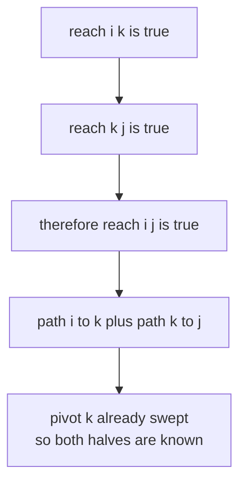
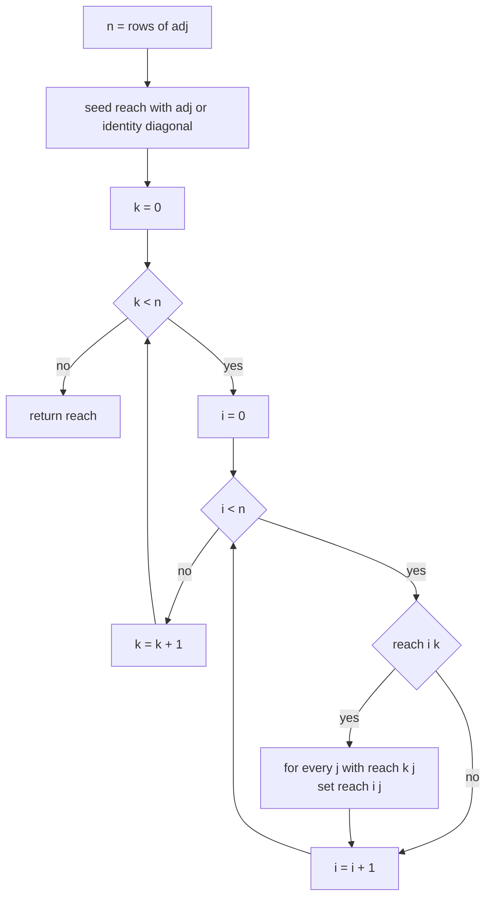
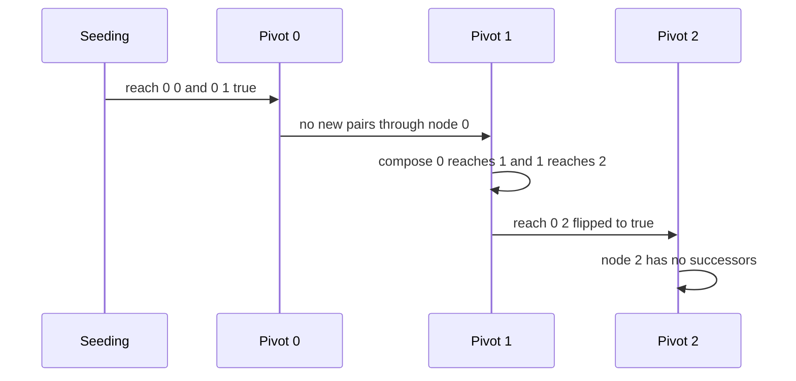

# 178 — Compute transitive closure (Floyd-Warshall naive).

> **Tier:** Beginner · **CTCI chapter:** Ch 4 — Trees and Graphs
> **Task spec:** [178-compute-transitive-closure-floyd-warshall-naive.md](../../../tasks/beginner/178-compute-transitive-closure-floyd-warshall-naive.md)
> **Solutions:** [Python](../../../solutions/python/beginner/178-compute-transitive-closure-floyd-warshall-naive/solution.py) ·
> [Java](../../../solutions/java/beginner/178-compute-transitive-closure-floyd-warshall-naive/Solution.java) ·
> [JavaScript](../../../solutions/javascript/beginner/178-compute-transitive-closure-floyd-warshall-naive/solution.js) ·
> [C#](../../../solutions/csharp/beginner/178-compute-transitive-closure-floyd-warshall-naive/Solution.cs)

## 1. Problem restatement

**Input:** a square adjacency matrix `adj` of size `n × n`. `adj[i][j]` is non-zero exactly when
there is a directed edge `i → j`. The matrix may be empty (`n = 0`). Edge weights are ignored —
only presence matters.

**Output:** a boolean matrix `reach` of the same shape where `reach[i][j]` is `True` iff node `j`
is reachable from node `i` through a path of zero or more edges. Zero-edge paths are included,
so the diagonal `reach[i][i]` is always `True`.

The task spec names the technique ("Floyd-Warshall naive") and the four solution files pin the
contract with the same assertions:

| Input | Result | Why |
| --- | --- | --- |
| chain `[[0,1,0],[0,0,1],[0,0,0]]` | rows `[T,T,T]`, `[F,T,T]`, `[F,F,T]` | `0 → 1 → 2` makes `0` reach everyone; `2` reaches only itself |
| cycle `[[0,1,0],[1,0,0],[0,0,0]]` | `reach[0][1]`, `reach[1][0]` true, `reach[0][2]` false | the 2-cycle closes on itself, node `2` is isolated |
| `[]` | `[]` | no nodes to consider |
| `[[0]]` | `[[True]]` | a single node reaches itself by the identity diagonal |
| 8-node graph with edge probability `0.2` (seed `3`) | agrees with BFS/DFS from every source | the matrix result must equal graph traversal |

Only Python, Java and C# run the randomized cross-check; all four assert the chain, the cycle,
the empty matrix and the single node. The reference traversal in the checks is a stack-based
DFS in Java and C#, and a stack-based walk in Python; all three must agree with `reach`
element by element.

## 2. Intuition

The obvious approach is to run a graph search from every node and write the visited set into
row `i` of the result. That is correct, but it re-derives reachability over and over, and on an
adjacency matrix every search already costs `O(n²)` just to scan neighbour rows, for
`O(n³)` total. If the answer costs `O(n³)` anyway, an algorithm that fills the matrix directly
is simpler than `n` searches plus `n` visited sets.

The key insight is a single composition rule:

> If `i` can reach `k`, and `k` can reach `j`, then `i` can reach `j`.

That is not magic — it is just concatenating two paths. Floyd-Warshall turns it into an
algorithm by making `k` a *pivot* and sweeping every pivot once, outermost:

```text
for each pivot k do
    for each source i do
        for each target j do
            reach[i][j] ← reach[i][j] or (reach[i][k] and reach[k][j])
```

Two details make this exactly right. First, the diagonal is seeded from the identity, because a
path of zero edges is a path. Second, the pivot loop must be the *outermost* one: after the
iteration for pivot `k`, every pair `(i, j)` has been settled for paths whose intermediate nodes
all come from `{0, ..., k}`. Closing over that invariant for `k = n - 1` gives full
reachability — the same induction that makes the in-place shortest-path version correct.



The diagram is the whole justification for the iteration order: when the algorithm is deciding
about the pair `(i, j)` at pivot `k`, both `reach[i][k]` and `reach[k][j]` are values that
earlier pivots (or the initial seeding) have already fixed, so no half-finished information is
used.

## 3. Algorithm

1. Let `n` be the number of rows of `adj`.
2. Allocate `reach`, a boolean `n × n` matrix.
3. Seed it: `reach[i][j]` is `True` when `adj[i][j]` is non-zero **or** `i == j`. The second
   term is the identity diagonal.
4. For each pivot `k` from `0` to `n - 1`:
   1. For each source `i` from `0` to `n - 1`: if `reach[i][k]` is false, skip to the next `i`
      (there is nothing to compose).
   2. For each target `j` from `0` to `n - 1`: if `reach[k][j]` is true, set `reach[i][j]` to
      true.
5. Return `reach`.

```text
function transitive_closure(adj)
    n ← number of rows of adj
    reach ← new n x n matrix of false
    for i ← 0 to n - 1 do
        for j ← 0 to n - 1 do
            reach[i][j] ← adj[i][j] ≠ 0 or i = j
        end
    end
    for k ← 0 to n - 1 do
        for i ← 0 to n - 1 do
            if reach[i][k] then
                for j ← 0 to n - 1 do
                    if reach[k][j] then
                        reach[i][j] ← true
                    end
                end
            end
        end
    end
    return reach
end
```

The two `if` guards are not cosmetic: they turn most of the `n³` inner work into a skipped
branch. On a sparse graph — exactly the case where most pivots have few in- or out-edges — the
loop bodies run far fewer than `n³` times, even though the worst case is unchanged.



Reading the picture as a machine: the only state that matters between pivots is the matrix
itself, and the only way a pivot changes the answer is by composing through itself.

## 4. Worked example

Trace the chain `0 → 1 → 2`, the first assertion in every solution:

```text
adj = [[0, 1, 0],
       [0, 0, 1],
       [0, 0, 0]]
```

After step 3 the seeded matrix is the adjacency plus the diagonal:

| `i` | row after seeding |
| --- | --- |
| 0 | `[T, T, F]` |
| 1 | `[F, T, T]` |
| 2 | `[F, F, T]` |

Now sweep the pivots.

| Pivot `k` | `(i, k)` pairs that pass the guard | Work done | Matrix after the pivot |
| --- | --- | --- | --- |
| 0 | `(0, 0)` | `0` reaches `1`, so `reach[0][1]` stays true | rows `[T,T,F]`, `[F,T,T]`, `[F,F,T]` |
| 1 | `(0, 1)`, `(1, 1)` | `0` reaches `1`'s successors, so `reach[0][2] ← true` | rows `[T,T,T]`, `[F,T,T]`, `[F,F,T]` |
| 2 | `(0, 2)`, `(1, 2)`, `(2, 2)` | `2` has no out-edges, nothing changes | rows `[T,T,T]`, `[F,T,T]`, `[F,F,T]` |

The decisive step is pivot `1`: before it, `reach[0][2]` was false; the composition
`0 → 1 → 2` flipped it. Pivot `2` then runs for completeness and finds no work, which is the
common case — the last pivot frequently has an empty successor set.



The cycle example `0 ↔ 1` behaves the same way: seeding gives `reach[0][1]` and `reach[1][0]`;
pivot `0` composes `1 → 0 → 1` (no news, already true), pivot `1` composes `0 → 1 → 0` (also
already true), and `reach[0][2]` stays false because node `2` has no edges in either direction.
Both the chain and the cycle are closed after a single pass — there is no repeated iteration
until nothing changes, because the pivot sweep already achieves the fixed point.

## 5. Complexity

Let `n` be the number of nodes.

| Measure | Bound | Why it holds |
| --- | --- | --- |
| Time, worst | `O(n³)` | three nested loops over `n`, each iteration constant work |
| Time, best | `O(n³)` in the loop structure, much less in practice | the guards skip the `j` loop whenever `reach[i][k]` is false, so only reachable pairs cost work |
| Time, dense graphs | `~n³` | when most pairs are reachable, both guards pass and every triple does work |
| Space, result | `O(n²)` | the boolean matrix is the output |
| Space, extra | `O(n²)` | `reach` is built separately from `adj`, so the input is never mutated |
| Alternative: DFS or BFS per source | `O(n · (n²)) = O(n³)` on an adjacency matrix, `O(n · (n + m))` with adjacency lists | `n` traversals, each scanning the whole matrix or the edge list |
| Alternative: bitset row composition | `O(n³ / w)` | each `reach[i]` becomes a bit vector and the composition is an OR of shifted rows |

The interesting comparison is with search-based reachability. On the matrix representation the
two approaches land on the same `O(n³)`, but they spend it differently: the traversal version is
output-sensitive in the *edge* count (`m`), while the pivot sweep is output-insensitive and does
the same structured work regardless of shape. For a single-source question the traversal wins
by a factor of `n`; for *all-pairs* reachability on a dense graph they are the same order, and
the pivot sweep needs no visited bookkeeping, no queue, and no per-source allocation.

## 6. Pitfalls and edge cases

- **The diagonal must be seeded.** `reach[i][i]` is not derivable from the edges for an acyclic
  graph — node `2` of the chain has no out-edges and would end up reaching nobody, including
  itself. Every solution ORs in `i == j`. The single-node assertion `transitive_closure([[0]])`
  checks exactly this.
- **A self-loop in the input is harmless.** `adj[i][i] != 0` sets a diagonal entry that the
  identity already made true, so it changes nothing.
- **`k` must be the outermost loop.** Permuting the loops to `i, k, j` yields a *partially*
  closed matrix: pairs discovered late never get re-examined during the same sweep, so the
  result depends on the loop order. The chain example still slips through with `i` outermost on
  some graphs, which is why the randomized cross-check exists instead of one hand-picked case.
- **The comparison is `!= 0`, not `== 1`.** Weights, counts and booleans all encode "edge
  present" the same way. A matrix holding distances with `0` for "no edge" and `1` for
  "edge of length 1" works too, provided `0` really means absent.
- **Empty input.** `n = 0` returns an empty matrix; Java asserts `transitiveClosure(new int[0][]).length == 0`
  and Python asserts `transitive_closure([]) == []`. No dimension check is performed, so a
  non-square input is the caller's bug.
- **Do not fold the result back into `adj`.** All four solutions allocate a fresh boolean
  matrix; writing booleans into the caller's `int[][]` would silently destroy the weights.
- **In-place updates are safe *because* of the pivot order.** Setting `reach[i][j]` while the
  pivot `k` is still running can only add information about paths whose interior nodes are
  `≤ k`, which is precisely what the pivot is allowed to use — but the same trick applied in the
  wrong loop order becomes unsound.
- **Integer versus boolean representation.** Python builds `bool` values, Java and C# build
  `boolean`/`bool` matrices. A caller comparing `reach` to the original `0/1` matrix by value
  gets a mismatch in languages where types are strict — the shapes match, the types do not.

## 7. Variants and follow-ups

- **Search-based reachability.** Running DFS or BFS from each source is the natural alternative
  when the graph is stored as adjacency lists rather than a matrix; see
  [176-check-matrix-connectivity-graph-view.md](../../../tasks/beginner/176-check-matrix-connectivity-graph-view.md)
  for the same graph-as-matrix view applied to one connectivity question.
- **Sparse inputs.** [177-implement-basic-sparse-matrix-storage-coordinate-list.md](../../../tasks/beginner/177-implement-basic-sparse-matrix-storage-coordinate-list.md)
  stores only the non-zero cells, which is the right representation for the large, mostly-edge-free
  adjacency matrices that make the naive `O(n³)` sweep intolerable.
- **Floyd-Warshall with distances.** Replace the boolean OR/AND with `min`/`+` over distances
  and the same pivot sweep computes all-pairs shortest paths, with the same `k`-outermost
  requirement.
- **Reachability by boolean matrix powers.** squaring the adjacency matrix and OR-ing the powers
  also yields the closure, at the cost of `log n` boolean matrix products — the view taken in
  [174-implement-basic-matrix-multiplication-naive.md](../../../tasks/beginner/174-implement-basic-matrix-multiplication-naive.md).
- The chapter walkthrough in [Trees and Graphs](../../ctci/04-trees-and-graphs.md) places this
  sweep next to the traversal-based connectivity checks.

## 8. Check yourself

1. Why does `reach[2][2]` come out `True` for the chain, even though node `2` has no outgoing
   edges?

<details><summary>Show answer</summary>

Because reachability is reflexive in this problem: a path of zero edges is a valid path, so
`reach[i][i]` is seeded `True` by the identity term `i == j`. Without it, every node with no
out-edges would report itself unreachable, and the single-node test `[[0]] → [[True]]` would
fail.

</details>

2. What goes wrong if the pivot loop is moved inside the source loop?

<details><summary>Show answer</summary>

The matrix is no longer closed. The pivot sweep only works because at pivot `k` every pair
`(i, j)` has already been settled for interiors `≤ k - 1`; moving `i` outermost means a pair
discovered while processing a later source never gets composed with the pivots already passed,
so reachability through those intermediate nodes is lost.

</details>

3. The worst case is `O(n³)`. Where does the guard `if reach[i][k]` help, and why does it not
   change the bound?

<details><summary>Show answer</summary>

It skips the entire inner loop for a source `i` that cannot reach pivot `k`, which on sparse
graphs eliminates most triples. It cannot improve the bound because a dense graph passes the
guard for nearly every pair, leaving the full `n³` iterations.

</details>

4. How would you check the result without writing a second implementation?

<details><summary>Show answer</summary>

Run a DFS or BFS from each source over `adj`, recording visited nodes, and compare with the
corresponding row of `reach`. That is exactly the randomized cross-check in the Python, Java and
C# files: an 8-node graph with edge probability `0.2` built from seed `3`, then one traversal
per source.

</details>

5. Does the algorithm need a separate output matrix?

<details><summary>Show answer</summary>

It needs a matrix that is *not* the weighted input, because the output is boolean and the input
may hold weights. A separate `reach` matrix is what all four solutions allocate. A boolean
in-place rewrite of the caller's array would work only if the caller promised the input is 0/1
and may be destroyed, which is a contract change the solutions deliberately avoid.

</details>
